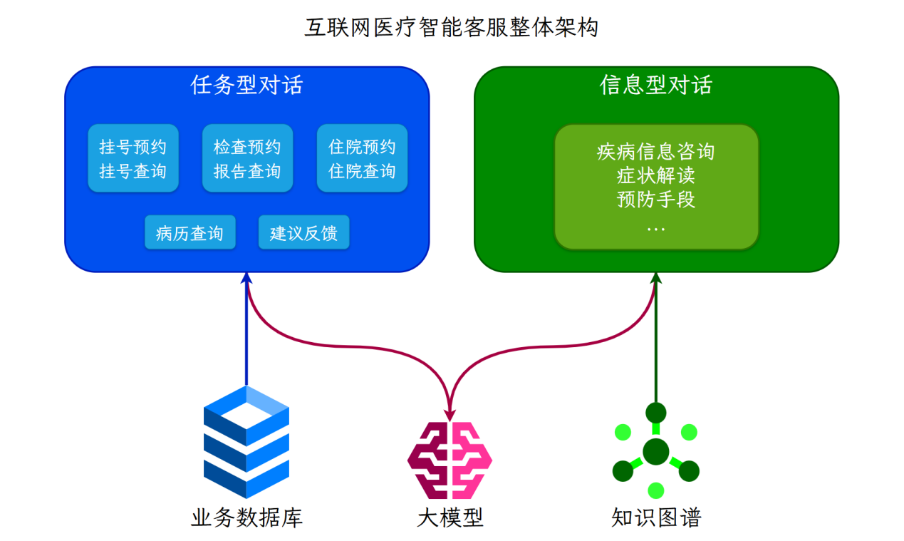
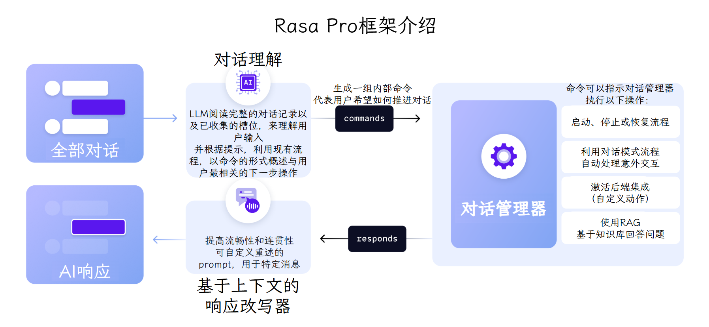
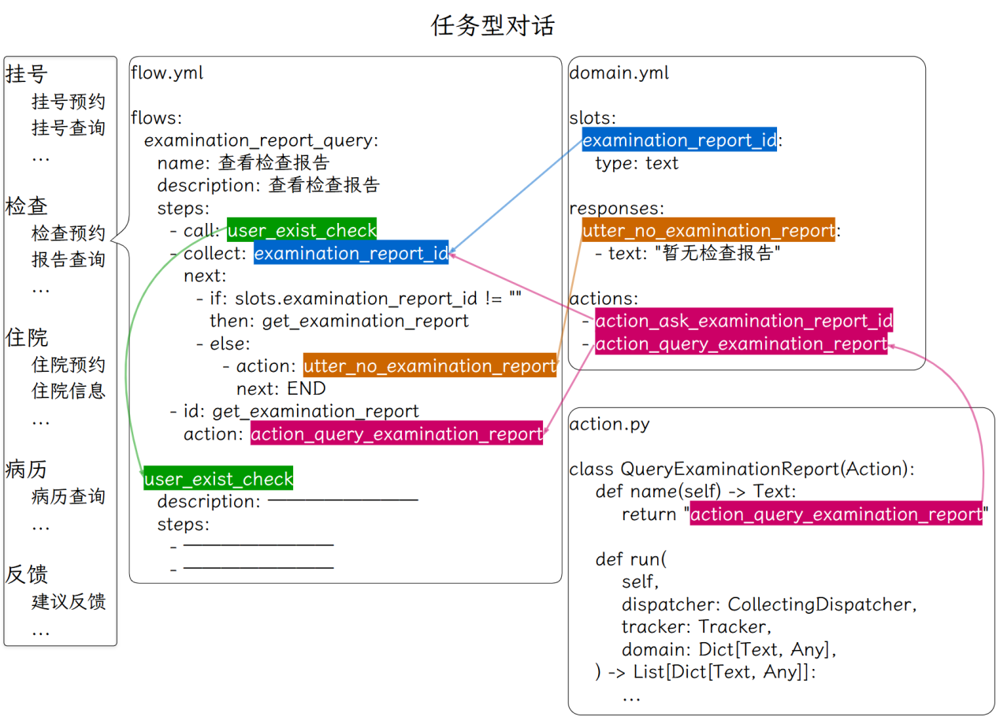
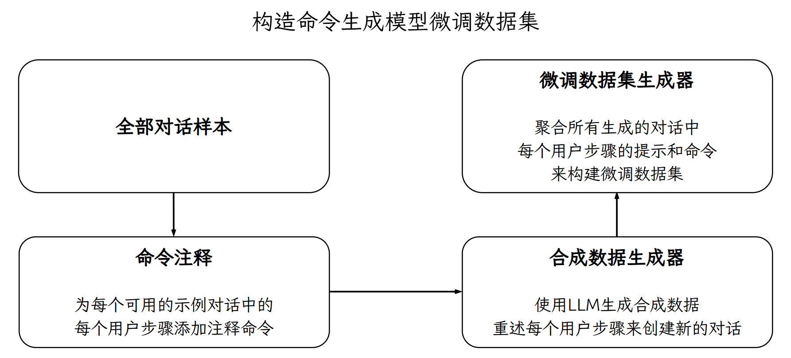
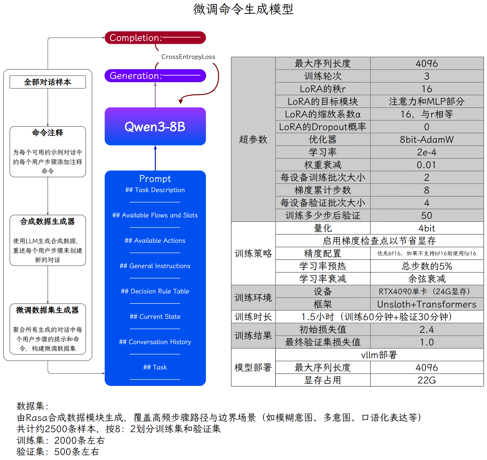
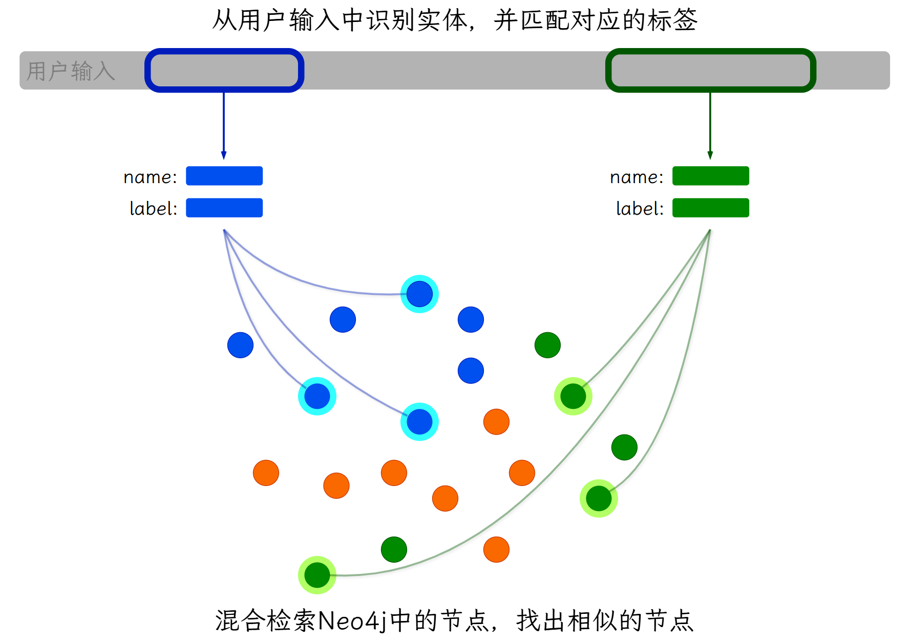
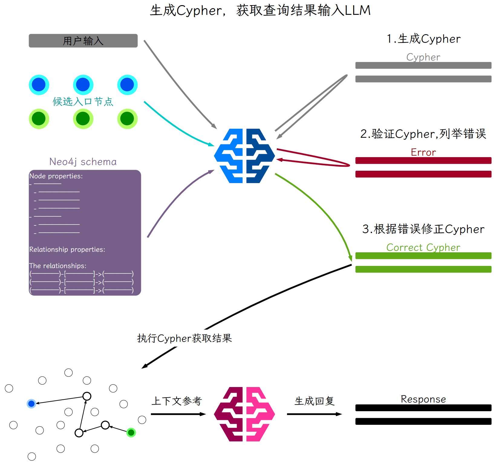

---
tags:
  - 大模型
  - 面试
source: "尚硅谷大模型技术之高频面试题-V2.1.6.docx"
source_blocks: "3521-3645"
reviewed: 2026-10-21
---

# 医疗RAG客服的检索、时效与拒答

医疗检索问答需要把适用性与证据不足显式暴露出来。

前篇：[[知识点总结/80-资料与复习/81-面试知识库/08-大模型高频面试题/05-项目实战/21-医疗知识图谱的来源与关系约束|医疗知识图谱的来源与关系约束]] ｜ 后篇：[[知识点总结/80-资料与复习/81-面试知识库/08-大模型高频面试题/05-项目实战/23-ITS技术服务的多智能体与模块分工|ITS技术服务的多智能体与模块分工]]

## 深入理解（新增）

检索应保留资料版本、适用人群和来源级别，回答引用可定位到原文。对相互冲突或过期资料，不能只选择相似度最高的一条，需显示冲突或转交专业审核。

无答案、缺少必要条件和超出知识范围是不同拒答原因。检索阈值需要在领域标注集上校准，不能凭一个通用余弦阈值决定所有问题是否有可靠证据。

工程测试应覆盖同义词、否定、时间变化、互相矛盾材料和没有资料的问题。LLM 裁判可辅助筛查，但关键正确性需由适合领域的审核者评估；这里的示例代码只验证检索指标。


## 核心代码（新增）

以下是可在 CPU 运行的机制或业务契约示例，完整源码与测试见 [[知识点总结/80-资料与复习/81-面试知识库/08-大模型高频面试题/06-代码实验/01-核心代码实验与验证范围|核心代码实验与验证范围]]。示例不包含完整模型训练或外部平台部署。

```python
def retrieval_metrics(retrieved, relevant, k=5):
    if not relevant:
        raise ValueError("no-answer cases must be evaluated separately")
    top = list(dict.fromkeys(retrieved))[:k]
    hit = set(top) & set(relevant)
    reciprocal_rank = next((1 / rank for rank, doc in enumerate(top, 1) if doc in relevant), 0.0)
    return {"recall_at_k": len(hit) / len(set(relevant)), "mrr": reciprocal_rank}

def check_citations(claims, retrieved_source_ids):
    """Validate reference membership only; this does not verify factual support."""
    allowed = set(retrieved_source_ids)
    problems = []
    for index, claim in enumerate(claims):
        refs = claim.get("source_ids", [])
        if not refs:
            problems.append((index, "missing citation"))
        for ref in refs:
            if ref not in allowed:
                problems.append((index, "unknown source: " + ref))
    return problems

m = retrieval_metrics(["c2", "c1", "c1"], {"c1", "c3"}, k=3)
assert m == {"recall_at_k": 0.5, "mrr": 0.5}

claims = [{"source_ids":["doc-v2:chunk-3"]}]
assert check_citations(claims, {"doc-v2:chunk-3"}) == []
# 引用存在不等于引用支持结论，事实支持关系仍须另查。
```

## 追问与验证（新增）

加入一条词面高度相似但适用人群不同的材料，检查排序与回答是否保留适用条件，并测试无答案问题的拒答。

## 官方资料与论文

- [Retrieval-Augmented Generation](https://arxiv.org/abs/2005.11401)

核验日期：2026-10-21。链接中的 `stable`、`main` 或平台文档会继续变化；新增纯 Python/NumPy 实验与原文旧版框架代码已分开标注。

## 原文保留

> [!warning] 原文批注
> 检索命中不等于结论适用于具体个人；自动生成不得补造缺失的诊疗依据。
>
> 原文的团队人数、业务规模、效果百分比、硬件与成本均保留为教材案例陈述；本次未独立复现这些项目指标。

<!-- source-block:3521 -->
### 互联网医疗智能RAG客服项目（Rasa Pro）

<!-- source-block:3522 -->
#### 项目周期

<!-- source-block:3523 -->
- 2人团队，总计约5.5个月。

<!-- source-block:3524 -->
- 需求分析与技术选型2周

<!-- source-block:3525 -->
- 环境搭建与熟悉框架3周

<!-- source-block:3526 -->
- 基础任务流开发与集成4周

<!-- source-block:3527 -->
- 测试与部署2周

<!-- source-block:3528 -->
- GraphRAG流程开发1周

<!-- source-block:3529 -->
- 集成与调试2周

<!-- source-block:3530 -->
- LLM微调数据准备2周

<!-- source-block:3531 -->
- LLM微调与评估1周

<!-- source-block:3532 -->
- 模型部署与测试2周

<!-- source-block:3533 -->
- 更多任务流扩展4周

<!-- source-block:3534 -->
#### 功能介绍

<!-- source-block:3535 -->
基于Rasa Pro框架结合LLM和知识图谱构建的互联网医疗智能客服系统，主要有以下功能：

<!-- source-block:3536 -->
提供任务型对话，根据预设流程进行对话，通过多轮对话交互帮助用户完成特定任务，如挂号预约、检查预约、查看病历相关业务流程等。

<!-- source-block:3537 -->
提供知识库问答对话，基于知识图谱和GraphRAG，支持疾病信息咨询、症状解读、预防手段查询等复杂问题和多跳推理。

<!-- source-block:3538 -->
支持意外对话修复和闲聊，接入LLM支持用户的非业务对话，并对回复内容做出严肃限制，避免涉及敏感内容的回复。

<!-- source-block:3539 -->
#### 实现流程

<!-- source-block:3540 -->
##### 调用流程

<!-- source-block:3541 -->
部署服务：Rasa Pro + LLM（vllm部署） + 知识图谱（neo4j）+ Embedding模型（fastapi+uvicorn）

<!-- source-block:3542 -->
后端服务：Rasa提供restful接口，供前端调用。

<!-- source-block:3543 -->
前端服务：公司自研web、app，调用后端服务。

<!-- source-block:3544 -->
##### 实现流程

<!-- source-block:3545 -->


<!-- source-block:3546 -->
用户query

<!-- source-block:3547 -->
=》Rasa对话理解（读取tracker store，调用LLM）

<!-- source-block:3548 -->
=》Rasa对话管理器（执行flow或者pattern）

<!-- source-block:3549 -->
-》匹配到flow，执行flow和对应的action，返回结果

<!-- source-block:3550 -->
-》未匹配到flow，执行pattern\_search -&gt; 执行企业搜索策略 -&gt; 调用GraphRAG

<!-- source-block:3551 -->
-》标签路由：LLM识别问题涉及的节点类型和实体

<!-- source-block:3552 -->
-》节点检索：使用混合检索找到候选入口节点

<!-- source-block:3553 -->
-》Cypher生成：LLM根据入口节点和问题生成Cypher查询语句

<!-- source-block:3554 -->
-》语句验证：验证Cypher语句的正确性

<!-- source-block:3555 -->
-》语句校正：如有错误则进行校正

<!-- source-block:3556 -->
-》执行查询：在Neo4j中执行Cypher查询

<!-- source-block:3557 -->
-》返回结果：将查询结果返回

<!-- source-block:3558 -->
-》pattern\_search无结果-》最终回退到pattern-chat闲聊

<!-- source-block:3559 -->
-》更新tracker store：添加新对话、更新slot等

<!-- source-block:3560 -->
=》Rasa NLG：将结果输入到LLM上下文，由LLM生成回复

<!-- source-block:3561 -->
#### 技术细节

<!-- source-block:3562 -->
##### Rasa Pro框架介绍

<!-- source-block:3563 -->


<!-- source-block:3564 -->
**CALM由三部分组成：对话理解、对话管理、响应生成**

<!-- source-block:3565 -->
**对话理解：**

<!-- source-block:3566 -->
当用户发送消息时，LLM命令生成器从tracker store读取完整对话记录与已收集的信息，调用LLM，识别用户意图、提取槽位，并生成下一步的命令列表，发送给对话管理器。

<!-- source-block:3567 -->
这里prompt的内容包括：

<!-- source-block:3568 -->
① 任务描述

<!-- source-block:3569 -->
② 可用的Flows和Slots（开启流程检索，只放匹配度高的几个流程）

<!-- source-block:3570 -->
③ 可用操作：start flow、set slot、search and reply等

<!-- source-block:3571 -->
④ 通用指令：指令+描述

<!-- source-block:3572 -->
⑤ 决策规则表：满足xx条件，触发xx指令=》生成xx命令

<!-- source-block:3573 -->
⑥ 当前状态：活跃的flow、当前请求的slot和已填充的slots等

<!-- source-block:3574 -->
⑦ 对话历史

<!-- source-block:3575 -->
⑧ 要求生成最新命令序列

<!-- source-block:3576 -->
这里使用的SearchReadyLLMCommandGenerator，可以触发RAG。

<!-- source-block:3577 -->
**对话管理：**

<!-- source-block:3578 -->
对话管理器接收命令序列，采取下一步操作：

<!-- source-block:3579 -->
启动、停止或回复流程

<!-- source-block:3580 -->
对话模式流程处理意外交互

<!-- source-block:3581 -->
执行企业搜索RAG

<!-- source-block:3582 -->
收集信息

<!-- source-block:3583 -->
触发action

<!-- source-block:3584 -->
**响应生成：**

<!-- source-block:3585 -->
利用上下文响应重述器，生成自然的回复，提高对话的流程性和连贯性。

<!-- source-block:3586 -->
这里配置了LLM进行对执行结果的重述响应。

<!-- source-block:3587 -->
**Rasa构建AI助手流程**

<!-- source-block:3588 -->
**配置rasa：pipeline、policy、endpoint等**

<!-- source-block:3589 -->
**根据业务设计和用户行为设计流程。**

<!-- source-block:3590 -->
**编写流程中设计的槽位、响应、动作等。**

<!-- source-block:3591 -->
自定义动作通过继承Action类并重写run方法来实现，可以调用外部API，查询数据库或执行其他逻辑。

<!-- source-block:3592 -->
槽位和对话历史会自动存储在track store中。

<!-- source-block:3593 -->
**训练并调试助手。在调试过程中将对话保存为端到端测试示例。**

<!-- source-block:3594 -->
**微调小型语言模型用于执行命令生成任务。将其部署并集成到Rasa中。**

<!-- source-block:3595 -->
##### 任务型对话

<!-- source-block:3596 -->


<!-- source-block:3597 -->
在流程中定义一个业务操作的各个步骤。

<!-- source-block:3598 -->
通过槽位存储操作过程中所需的信息。

<!-- source-block:3599 -->
通过定义响应来引导LLM如何回复用户。

<!-- source-block:3600 -->
通过编写自定义动作来调用外部API，查询或操作业务数据库，来获取业务相关信息或执行用户操作。

<!-- source-block:3601 -->
##### 信息型对话

<!-- source-block:3602 -->
结合知识图谱与GraphRAG，支持复杂的疾病查询、症状解读等功能。

<!-- source-block:3603 -->
##### 生成命令生成模型微调数据

<!-- source-block:3604 -->


<!-- source-block:3605 -->
准备覆盖重要对话流程的端到端测试数据，执行rasa命令生成微调数据集。

<!-- source-block:3606 -->
##### 命令生成模型微调与部署

<!-- source-block:3607 -->
##### 数据集

<!-- source-block:3608 -->
由Rasa合成数据模块生成，覆盖高频步骤路径与边界场景（如模糊意图、多意图、口语化表达等）。

<!-- source-block:3609 -->
共计约1万条样本，按8：2划分训练集和验证集。

<!-- source-block:3610 -->
训练集：8000条左右。

<!-- source-block:3611 -->
验证集：2000条左右。

<!-- source-block:3612 -->
##### 模型训练

<!-- source-block:3613 -->
| 预训练模型 | Qwen3-8B |  |  |
| --- | --- | --- | --- |
| 超参数 | 最大序列长度 | 4096 |  |
| 训练轮次 | 3 |  |  |
| LoRA | 秩r | 16 |  |
| 目标模块 | 注意力和MLP部分 |  |  |
| 缩放系数α | 16，与r相等 |  |  |
| Dropout概率 | 0 |  |  |
| 不微调bias |  |  |  |
| 不使用秩稳定LoRA |  |  |  |
| 优化器 | 8bit-AdamW |  |  |
| 学习率 | 2e-4 |  |  |
| 权重衰减 | 0.01 |  |  |
| 每设备训练批次大小 | 2 |  |  |
| 梯度累计步数 | 8 |  |  |
| 每设备验证批次大小 | 4 |  |  |
| 训练多少步后验证一次 | 50 |  |  |
| 训练策略 | 量化 | 4bit |  |
| 启用梯度检查点以节省显存 |  |  |  |
| 精度配置 | 优先bf16，如果不支持bf16则使用fp16 |  |  |
| 学习率预热 | 总步数的5% |  |  |
| 学习率衰减 | 余弦衰减 |  |  |
| 训练环境 | 设备 | V100 32GB |  |
| 框架 | Unsloth+Transformers |  |  |
| 训练时长 | 1.5小时（训练60分钟+验证30分钟） |  |  |
| 训练结果 | 初始损失值 | 2.4 |  |
| 最终验证集损失值 | 1.0 |  |  |
| 模型部署 | vllm部署 |  |  |
| 最大序列长度 | 4096 |  |  |
| 显存占用 | 22G |  |  |

<!-- source-block:3614 -->


<!-- source-block:3615 -->
##### 信息型对话（GraphRAG）

<!-- source-block:3616 -->
LLM根据Prompt从用户输入中提取入口节点实体和其对应的类型。

<!-- source-block:3617 -->
获取入口节点实体和标签之后，使用混合检索从Neo4j中检索出若干候选入口节点。

<!-- source-block:3618 -->


<!-- source-block:3619 -->
LLM根据用户输入、候选入口节点、Neo4j的schema信息，生成Cypher查询语句。

<!-- source-block:3620 -->
将生成的Cypher语句交给LLM进行验证，返回Cypher中的存在的语法与逻辑错误。

<!-- source-block:3621 -->
LLM根据验证出的错误信息对Cypher进行修正，得到最终的Cypher语句。

<!-- source-block:3622 -->
执行查询语句，将查询结果返回LLM作为上下文参考。

<!-- source-block:3623 -->
LLM根据用户输入和上下文参考生成回复。

<!-- source-block:3624 -->


<!-- source-block:3625 -->
#### 项目总结

<!-- source-block:3626 -->
该项目实现了基于Rasa Pro框架的互联网医疗智能客服系统，集成了大语言模型、任务型对话流程管理、知识图谱和GraphRAG。

<!-- source-block:3627 -->
能够自动化处理挂号预约、检查预约、住院管理、病历查看、疾病症状咨询等核心业务场景，提供高效的客户服务解决方案。

<!-- source-block:3628 -->
项目主要包含任务型对话部分和信息型对话部分，支持闲聊。

<!-- source-block:3629 -->
任务型对话针对结构化的目标导向任务，如挂号预约或检查报告查询，通过预定义流程管理输入输出。

<!-- source-block:3630 -->
信息型对话则集成RAG和GraphRAG，利用外部知识库响应用户问题，如疾病信息咨询、症状解读等。

<!-- source-block:3631 -->
首先我们使用Rasa Pro框架构建AI助手，基于CALM（对话理解、管理、响应生成）设计流程。

<!-- source-block:3632 -->
在对话理解中，采用SearchReadyLLMCommandGenerator，根据prompt将用户消息转换为命令。多轮对话的对话历史、槽位信息由tracker store存储和更新。

<!-- source-block:3633 -->
prompt包括当前状态、对话历史、可用流程/槽位/动作、可用操作、决策规则等。

<!-- source-block:3634 -->
对话管理接收命令执行操作，如路由流程、收集信息、执行动作、或处理意外交互，通过对话模式（如修复、导航、外部支持）处理非线性对话。

<!-- source-block:3635 -->
响应生成利用上下文重述器生成自然回复。

<!-- source-block:3636 -->
构建流程时，在YAML文件中定义流程ID、描述和步骤，包括收集信息、执行动作、设置槽位等；编写槽位存储信息、响应引导回复、自定义动作调用外部API或数据库。

<!-- source-block:3637 -->
为优化命令生成并提高响应速度，我们准备了端到端测试数据，使用Rasa命令标注模块提取命令，合成数据生成模块创建重述版本，最终生成微调数据集。

<!-- source-block:3638 -->
数据集覆盖高频路径和边界场景，共计约1万条样本，训练集8000条、验证集2000条。

<!-- source-block:3639 -->
预训练模型选择Qwen3-8B，采用LoRA微调。训练时使用4bit量化、梯度检查点、bf16精度。每设备训练批次大小2，梯度累计步数8；使用Unsloth在V100单卡上训练。

<!-- source-block:3640 -->
之后使用vllm部署模型，最大序列长度4096。

<!-- source-block:3641 -->
对于信息型对话我们结合了知识图谱和GraphRAG。

<!-- source-block:3642 -->
LLM从用户输入提取入口节点实体和类型，使用混合检索从Neo4j中获取候选节点。

<!-- source-block:3643 -->
根据用户输入、候选节点和schema生成Cypher查询语句，之后LLM验证并修正语法逻辑错误。

<!-- source-block:3644 -->
得到修正后的Cypher语句后执行查询，将结果作为上下文参考生成回复。

<!-- source-block:3645 -->
结合任务型对话和信息型对话功能，最终实现了支持多场景的AI助手，可满足不同业务的需求。
