---
tags:
  - 大模型
  - 面试
source: "尚硅谷大模型技术之高频面试题-V2.1.6.docx"
source_blocks: "3646-3694"
reviewed: 2026-10-21
---

# ITS技术服务的多智能体与模块分工

多智能体是否有价值，取决于职责、状态和调度成本是否清晰。

前篇：[[知识点总结/80-资料与复习/81-面试知识库/08-大模型高频面试题/05-项目实战/22-医疗RAG客服的检索、时效与拒答|医疗RAG客服的检索、时效与拒答]] ｜ 后篇：[[知识点总结/80-资料与复习/81-面试知识库/08-大模型高频面试题/05-项目实战/24-ITS技术服务的工具调用、SSE与性能|ITS技术服务的工具调用、SSE与性能]]

## 深入理解（新增）

技术服务可分为入口路由、知识检索、操作建议、工具执行与结果汇总。不同 agent 应有明确输入输出 schema，不能仅用不同系统提示词就宣称完成职责隔离。

多 agent 增加了模型调用、上下文传递与错误传播。若步骤固定且分支有限，显式状态图通常更易验证；只有当任务需要动态规划或专门上下文时，才值得引入额外代理。

共享状态中保存证据 ID、工具结果和阶段状态；汇总器不能把代理的推测升级成已验证事实。每次调用都应记录耗时、token 与终止原因，判断复杂度是否换来实际任务收益。


## 核心代码（新增）

以下是可在 CPU 运行的机制或业务契约示例，完整源码与测试见 [[知识点总结/80-资料与复习/81-面试知识库/08-大模型高频面试题/06-代码实验/01-核心代码实验与验证范围|核心代码实验与验证范围]]。示例不包含完整模型训练或外部平台部署。

```python
import json

def validate_tool_call(payload):
    data = json.loads(payload)
    if not isinstance(data, dict) or set(data) != {"tool", "args"}:
        raise ValueError("invalid envelope")
    if data["tool"] != "get_order" or not isinstance(data["args"], dict):
        raise ValueError("tool not allowed")
    order_id = data["args"].get("order_id")
    if set(data["args"]) != {"order_id"} or not isinstance(order_id, str) or not order_id.isdecimal():
        raise ValueError("invalid order_id")
    return data

def route_customer_request(intent, slots, confirmed=False):
    if intent not in {"knowledge", "order_status", "cancel_order"}:
        return {"next": "clarify", "missing": ["intent"]}
    if intent == "knowledge":
        return {"next": "retrieve"}
    order_id = slots.get("order_id")
    if not isinstance(order_id, str) or not order_id.isdecimal():
        return {"next": "clarify", "missing": ["order_id"]}
    if intent == "cancel_order" and not confirmed:
        return {"next": "confirm", "order_id": order_id}
    # The execution service must still enforce identity, ownership and idempotency.
    return {"next": "execute", "tool": intent, "order_id": order_id}

call = validate_tool_call(
    '{"tool":"get_order","args":{"order_id":"123"}}')
assert call["args"]["order_id"] == "123"
# 接下来由执行服务核验调用者身份与订单归属；此函数未实现授权。

next_step = route_customer_request("cancel_order", {"order_id":"123"})
assert next_step["next"] == "confirm"
```

## 追问与验证（新增）

把同一组请求分别交给单图工作流和多 agent 方案，固定预算比较成功率、调用次数和尾延迟。

## 官方资料与论文

- [LangGraph 工作流](https://docs.langchain.com/oss/python/langgraph/overview)
- [Deep Agents 官方概览](https://docs.langchain.com/oss/python/deepagents/overview)

核验日期：2026-10-21。链接中的 `stable`、`main` 或平台文档会继续变化；新增纯 Python/NumPy 实验与原文旧版框架代码已分开标注。

## 原文保留

> [!warning] 原文批注
> 多智能体数量不是系统能力指标；需要用职责隔离、预算和端到端结果证明其必要性。
>
> 原文的团队人数、业务规模、效果百分比、硬件与成本均保留为教材案例陈述；本次未独立复现这些项目指标。

<!-- source-block:3646 -->
### ITS技术服务系统

<!-- source-block:3647 -->
#### 项目周期与分工

<!-- source-block:3648 -->
- 3人团队，一个半月

<!-- source-block:3649 -->
- 需求分析&设计2周

<!-- source-block:3650 -->
- 核心功能开发2周

<!-- source-block:3651 -->
- 前端开发&集成2周

<!-- source-block:3652 -->
- 测试&优化&上线2周

<!-- source-block:3653 -->
##### 第一阶段：需求分析与架构设计（week 1-2）

<!-- source-block:3654 -->
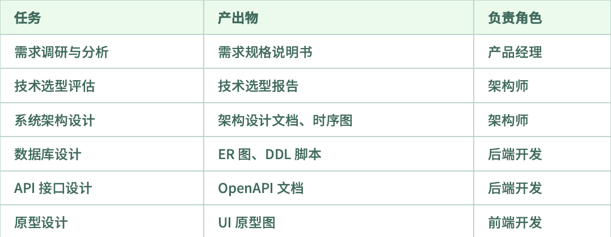

<!-- source-block:3655 -->
##### 第二阶段：核心功能开发（week 3-4）

<!-- source-block:3656 -->
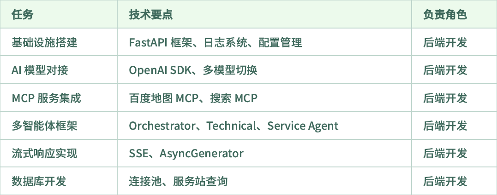

<!-- source-block:3657 -->
##### 第三阶段：前端开发与联调（week 4-5）

<!-- source-block:3658 -->
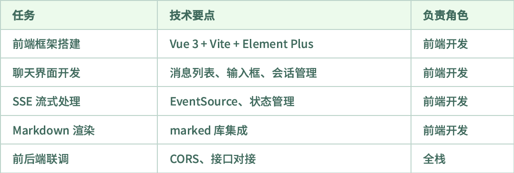

<!-- source-block:3659 -->
##### 第四阶段：测试与上线（week 5-6）

<!-- source-block:3660 -->
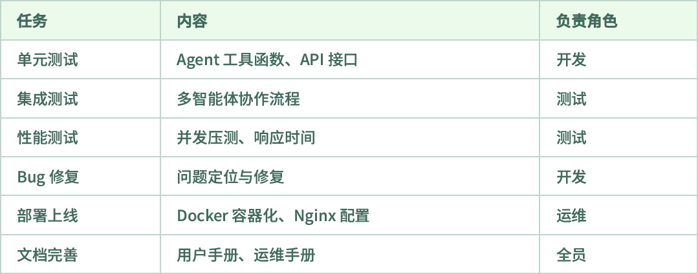

<!-- source-block:3661 -->
##### 团队分工建议：

<!-- source-block:3662 -->
后端开发（1-2人）：API开发、多智能体框架、MCP集成，数据库

<!-- source-block:3663 -->
前端开发（1人）：Vue界面、SSE处理、Markdown渲染

<!-- source-block:3664 -->
架构/全栈（1人）：架构设计、技术攻关、Code Review

<!-- source-block:3665 -->
#### 项目概述

<!-- source-block:3666 -->
##### 项目背景

<!-- source-block:3667 -->
为企业客户提供⼀站式智能客服解决⽅案，涵盖技术咨询、实时资讯查询、线下服务站定位与导航等功能。

<!-- source-block:3668 -->
技术咨询：解答⽤⼾的技术问题（如系统蓝屏、软件故障等）。

<!-- source-block:3669 -->
实时资讯：提供股票⾏情、天⽓预报、新闻等实时信息 。

<!-- source-block:3670 -->
服务站查询：基于用户位置推荐最近的线下服务站并提供导航。

<!-- source-block:3671 -->
##### 技术选型

<!-- source-block:3672 -->
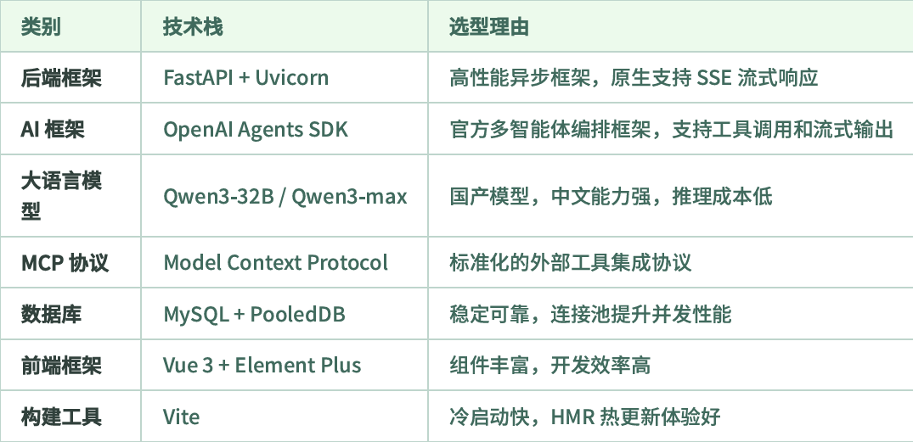

<!-- source-block:3673 -->
#### 整体架构设计

<!-- source-block:3674 -->
##### 系统架构

<!-- source-block:3675 -->
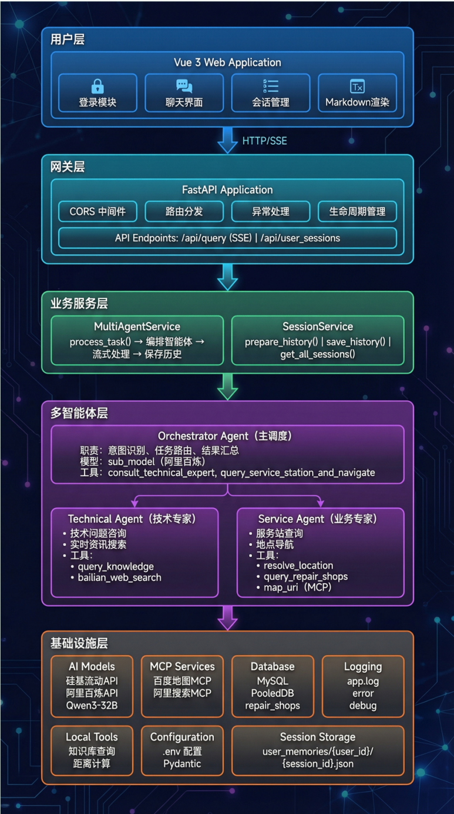

<!-- source-block:3676 -->
##### 多智能体协作原理图

<!-- source-block:3677 -->
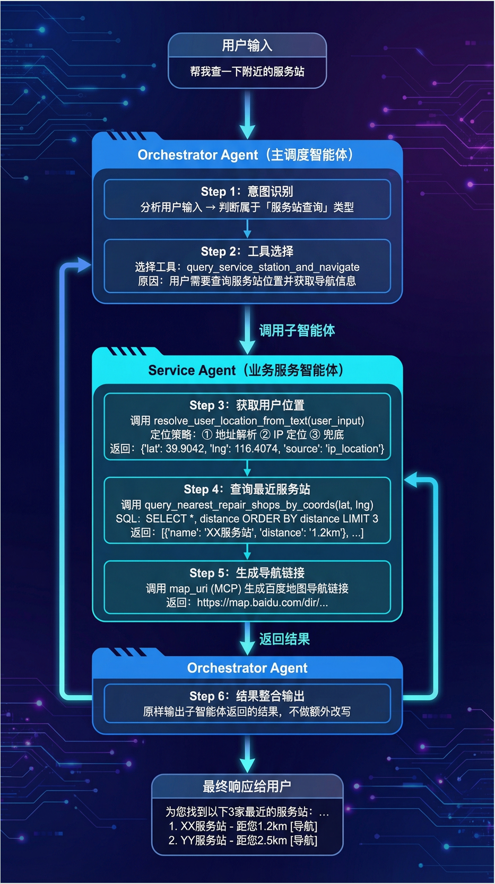

<!-- source-block:3678 -->
##### 数据流向图

<!-- source-block:3679 -->
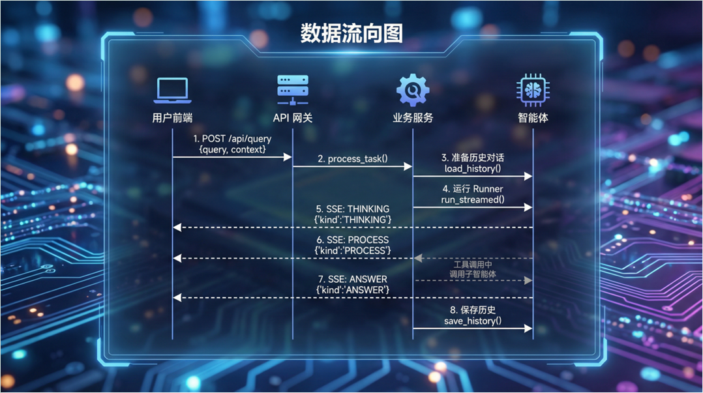

<!-- source-block:3680 -->
#### 核心模块实现

<!-- source-block:3681 -->
##### 多智能体编排模块

<!-- source-block:3682 -->
##### 架构设计

<!-- source-block:3683 -->
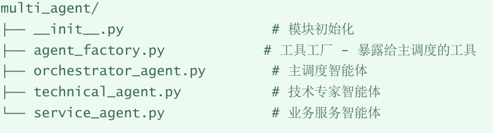

<!-- source-block:3684 -->
##### 主调度智能体实现流程

<!-- source-block:3685 -->
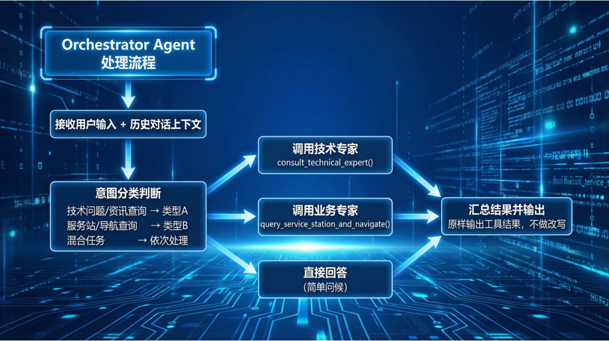

<!-- source-block:3686 -->
##### 流式响应模块流程

<!-- source-block:3687 -->
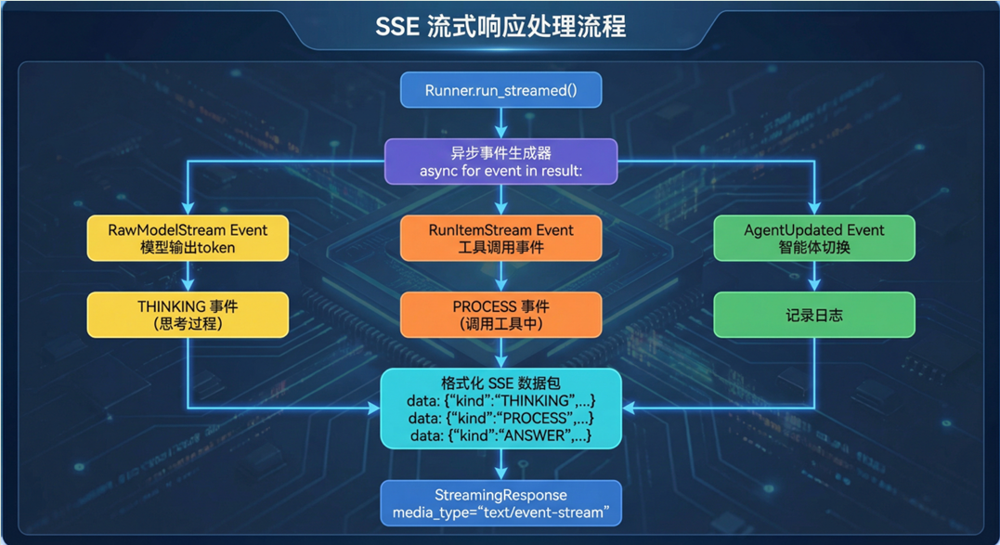

<!-- source-block:3688 -->
##### MCP服务架构图

<!-- source-block:3689 -->
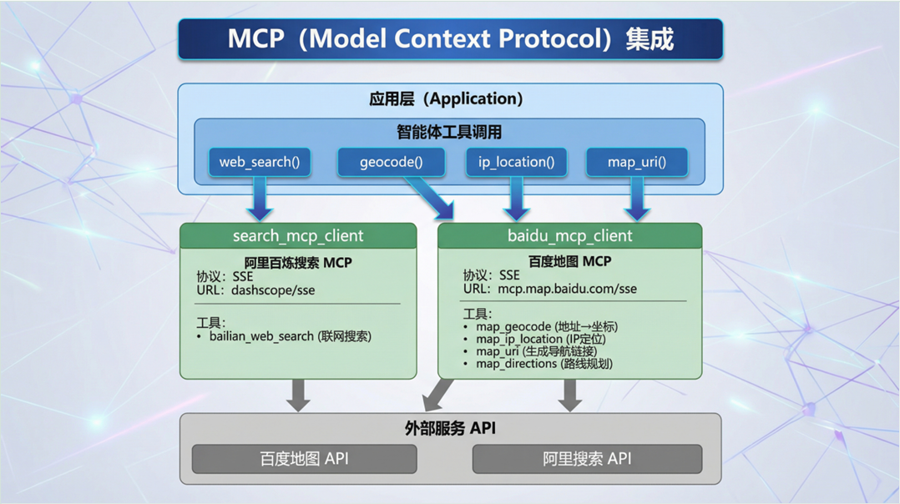

<!-- source-block:3690 -->
##### 会话管理模块

<!-- source-block:3691 -->
##### 会话存储架构

<!-- source-block:3692 -->
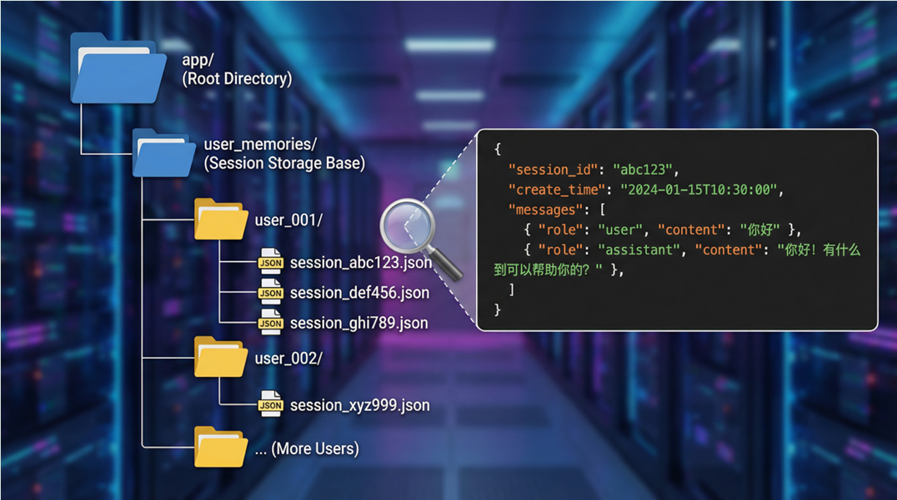

<!-- source-block:3693 -->
##### 会话管理流程

<!-- source-block:3694 -->
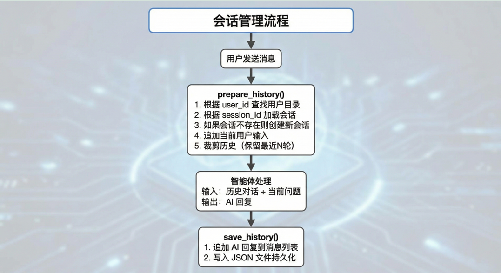
