---
tags:
  - 大模型
  - 面试
source: "尚硅谷大模型技术之高频面试题-V2.1.6.docx"
source_blocks: "3695-3817"
reviewed: 2026-10-21
---

# ITS技术服务的工具调用、SSE与性能

实现层要让工具调用、流式输出和取消机制共享一致的任务状态。

前篇：[[知识点总结/80-资料与复习/81-面试知识库/08-大模型高频面试题/05-项目实战/23-ITS技术服务的多智能体与模块分工|ITS技术服务的多智能体与模块分工]] ｜ 后篇：[[知识点总结/80-资料与复习/81-面试知识库/08-大模型高频面试题/05-项目实战/25-ITS技术服务的项目表达与证据|ITS技术服务的项目表达与证据]]

## 深入理解（新增）

SSE 中应区分 progress、token、tool_result、error 和 done 等事件。生成了部分 token 不代表任务完成；客户端只能在明确 done 或终态时将状态标成成功。

连接断开后，服务端需释放模型流和后台任务，或者明确将其转为可查询的异步任务。重连依赖事件 ID 和保留策略，不能假定 HTTP 重新建立就能自动从上次字符继续。

并发上限应同时考虑模型连接、数据库池与工具服务容量。吞吐优化要观察队列等待和 p95/p99，而非只统计平均生成速度。下面事件编码和限流函数用于验证协议核心，不包含完整 Web 服务。


## 核心代码（新增）

以下是可在 CPU 运行的机制或业务契约示例，完整源码与测试见 [[知识点总结/80-资料与复习/81-面试知识库/08-大模型高频面试题/06-代码实验/01-核心代码实验与验证范围|核心代码实验与验证范围]]。示例不包含完整模型训练或外部平台部署。

```python
import asyncio
import json

def sse_event(event, data, event_id):
    if any(c in event for c in "\r\n") or any(c in str(event_id) for c in "\r\n"):
        raise ValueError("event/id must be single-line")
    body = json.dumps(data, ensure_ascii=False)
    return f"id: {event_id}\nevent: {event}\ndata: {body}\n\n"

async def bounded_map(items, operation, concurrency=4, timeout=1.0):
    semaphore = asyncio.Semaphore(concurrency)
    async def one(item):
        async with semaphore:
            return await asyncio.wait_for(operation(item), timeout=timeout)
    return await asyncio.gather(*(one(item) for item in items))

event = sse_event("progress", {"state": "running"}, "task-1:1")
assert event.endswith("\n\n")
# 最终成功必须另发 done/终态，不能把 progress 当成成功。

async def fake_operation(item):
    await asyncio.sleep(0.001)
    return item * 2

assert asyncio.run(bounded_map([1, 2], fake_operation)) == [2, 4]
```

## 追问与验证（新增）

让客户端在第十个 token 后断开，检查后台模型请求是否取消；再测试错误事件是否仍被前端误标成功。

## 官方资料与论文

- [asyncio 任务与超时](https://docs.python.org/3/library/asyncio-task.html)
- [LangGraph 工作流](https://docs.langchain.com/oss/python/langgraph/overview)

核验日期：2026-10-21。链接中的 `stable`、`main` 或平台文档会继续变化；新增纯 Python/NumPy 实验与原文旧版框架代码已分开标注。

## 原文保留

> [!warning] 原文批注
> SSE 是传输协议，不会自动提供任务持久化、断点续传或业务完成保证。
>
> 原文的团队人数、业务规模、效果百分比、硬件与成本均保留为教材案例陈述；本次未独立复现这些项目指标。

<!-- source-block:3695 -->
### 技术细节与痛点（常问！！！）

<!-- source-block:3696 -->
#### 核心技术点

<!-- source-block:3697 -->
##### 多智能体协作机制

<!-- source-block:3698 -->
**技术要点：**

<!-- source-block:3699 -->
- 分层设计：主调度+专家的两级架构，职责分离

<!-- source-block:3700 -->
- 工具转换：使用@function\_tool装饰器将子智能体包装为工具

<!-- source-block:3701 -->
- 上下文传递：通过工具参数传递用户原始输入

<!-- source-block:3702 -->
- 异步执行：子智能体内部使用Runner.run()独立运行

<!-- source-block:3703 -->
**设计优势：**

<!-- source-block:3704 -->
**优势1：可扩展性强**

<!-- source-block:3705 -->
新增领域专家只需：

<!-- source-block:3706 -->
- 创建新的Agent定义

<!-- source-block:3707 -->
- 在工厂中注册为@function\_tool

<!-- source-block:3708 -->
- 在主调度提示词中添加工具说明

<!-- source-block:3709 -->
**优势2：故障隔离**

<!-- source-block:3710 -->
- 某个子智能体异常不会影响其他智能体

<!-- source-block:3711 -->
- 主调度可以捕获异常并返回友好提示

<!-- source-block:3712 -->
**优势3：独立优化**

<!-- source-block:3713 -->
每个子只能体可以独立调优：

<!-- source-block:3714 -->
- 使用不同模型

<!-- source-block:3715 -->
- 使用不同的提示词

<!-- source-block:3716 -->
- 使用不同的工具集

<!-- source-block:3717 -->
##### SSE流式响应实现

<!-- source-block:3718 -->
**技术要点：**

<!-- source-block:3719 -->
- AsyncGenerator：Python异步生成器实现流式产出

<!-- source-block:3720 -->
- 事件分类：THINKING / PROCESS / ANSWER 三类事件

<!-- source-block:3721 -->
- 前端解析：ReadableStream + TextDecoder 逐块读取

<!-- source-block:3722 -->
- 状态管理：前端维护消息列表状态，实时更新 UI

<!-- source-block:3723 -->
**数据格式：**

<!-- source-block:3724 -->
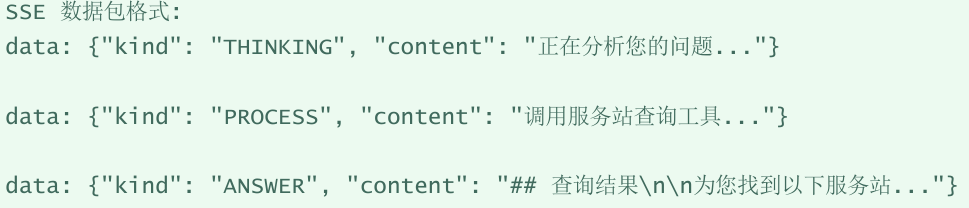

<!-- source-block:3725 -->
##### MCP协议集成

<!-- source-block:3726 -->
**技术要点：**

<!-- source-block:3727 -->
- 协议标准：Model Context Protocol 是标准化的⼯具集成协议

<!-- source-block:3728 -->
- 传输方式：使⽤ SSE (Server-Sent Events) 作为传输层

<!-- source-block:3729 -->
- 工具发现：MCP 服务⾃动暴露可⽤⼯具列表

<!-- source-block:3730 -->
- 生命周期：应⽤启动时连接，关闭时清理

<!-- source-block:3731 -->
**集成模式：**

<!-- source-block:3732 -->
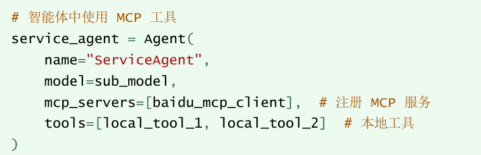

<!-- source-block:3733 -->
#### 痛点问题与解决方案

<!-- source-block:3734 -->
##### 用户定位不准确问题

<!-- source-block:3735 -->
**问题描述：**

<!-- source-block:3736 -->
用户可能不提供具体地址，或提供的地址无法解析，导致服务站推荐不准确。

<!-- source-block:3737 -->
**解决方案**

<!-- source-block:3738 -->
三级定位降级策略

<!-- source-block:3739 -->
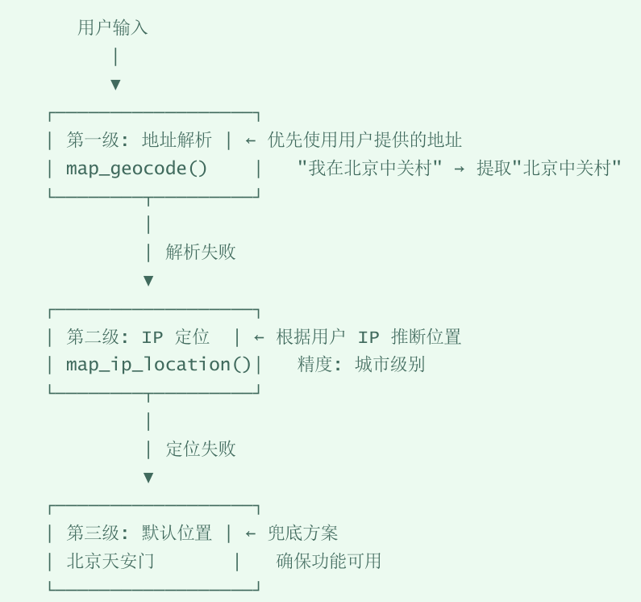

<!-- source-block:3740 -->
##### 智能体意图误判问题

<!-- source-block:3741 -->
**问题描述：**

<!-- source-block:3742 -->
用户输入模糊时，主调度智能体可能选择错误的子智能体处理。

<!-- source-block:3743 -->
**解决方案**

<!-- source-block:3744 -->
提示词工程优化

<!-- source-block:3745 -->
**核心原则：**

<!-- source-block:3746 -->
- 任务完整性原则：

<!-- source-block:3747 -->
只处理用户当前消息中“明确提到”的任务，禁止推测用户可能的隐含需求。

<!-- source-block:3748 -->
- 工具选择规则：

<!-- source-block:3749 -->
| 用户意图关键词 | 选择工具 |
| --- | --- |
| 技术问题、故障、蓝屏、报错 | consult\_technical\_expert |
| 股票、天气、新闻、实时 | consult\_technical\_expert |
| 服务站、维修点、附近、导航 | query\_service\_station\_and\_navigate |
| 怎么去、路线、位置 | query\_service\_station\_and\_navigate |

<!-- source-block:3750 -->
**禁止事项：**

<!-- source-block:3751 -->
- 不要主动添加用户未提及的任务

<!-- source-block:3752 -->
- 不要对工具返回结果进行二次改写

<!-- source-block:3753 -->
- 不要在明确需求时推荐导航

<!-- source-block:3754 -->
##### 并发请求数据库连接耗尽

<!-- source-block:3755 -->
**问题描述：**

<!-- source-block:3756 -->
高并发场景下频繁创建数据库连接导致性能下降或者连接耗尽。

<!-- source-block:3757 -->
**解决方案**

<!-- source-block:3758 -->
连接池管理：

<!-- source-block:3759 -->
**功能：**

<!-- source-block:3760 -->
连接池管理-创建和管理数据库连接的池子

<!-- source-block:3761 -->
连接复用-重复现有连接，避免频繁创建/销毁连接的开销

<!-- source-block:3762 -->
资源控制-限制并发连接数，防止数据库过载

<!-- source-block:3763 -->
线程安全-提供线程安全的连接获取机制

<!-- source-block:3764 -->
**技术实现：**

<!-- source-block:3765 -->
单例模式：使用类变量\_pool确保全局只有一个连接池实例

<!-- source-block:3766 -->
懒加载：只有在首次调用get\_pool()时才创建连接池

<!-- source-block:3767 -->
使用DBUtils库：依赖dbutils.pooled\_db.PooledDB实现连接池

<!-- source-block:3768 -->
PyMySQL驱动：使用PyMySQL作为MySQL数据库驱动程序

<!-- source-block:3769 -->
使用示例：

<!-- source-block:3770 -->
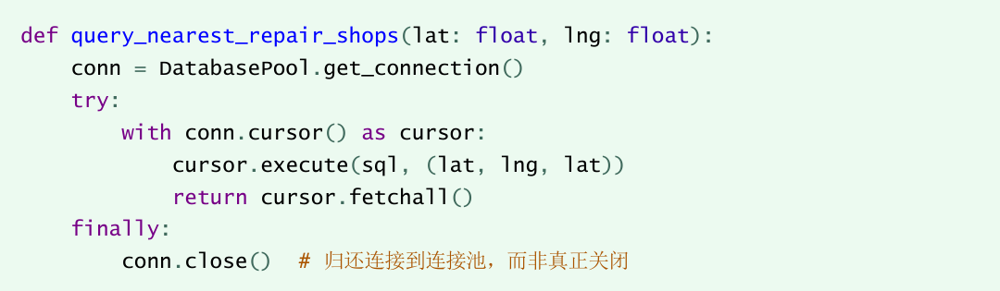

<!-- source-block:3771 -->
##### 前端消息状态管理复杂

<!-- source-block:3772 -->
**问题描述：**

<!-- source-block:3773 -->
流式响应场景下，需要处理多种消息类型（思考、过程、答案），状态管理容易混乱。

<!-- source-block:3774 -->
**解决方案**

<!-- source-block:3775 -->
消息类型分离与状态管理：

<!-- source-block:3776 -->
首先枚举消息类型：

<!-- source-block:3777 -->
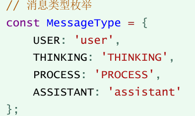

<!-- source-block:3778 -->
然后定义状态变量：

<!-- source-block:3779 -->
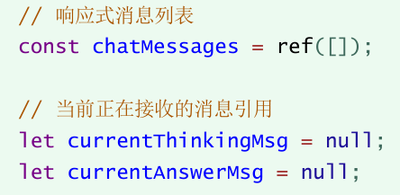

<!-- source-block:3780 -->
THINKING类型消息处理：

<!-- source-block:3781 -->
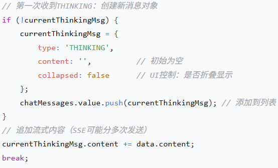

<!-- source-block:3782 -->
ANSWER类型消息处理：

<!-- source-block:3783 -->
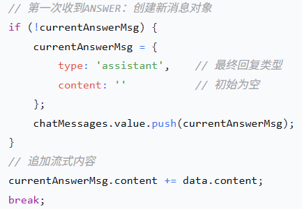

<!-- source-block:3784 -->
##### MCP服务连接不稳定的问题

<!-- source-block:3785 -->
**问题描述：**

<!-- source-block:3786 -->
外部MCP服务（百度地图、搜索引擎）可能出现网络波动或服务不可用。

<!-- source-block:3787 -->
**解决方案**

<!-- source-block:3788 -->
优雅降级和错误处理：

<!-- source-block:3789 -->
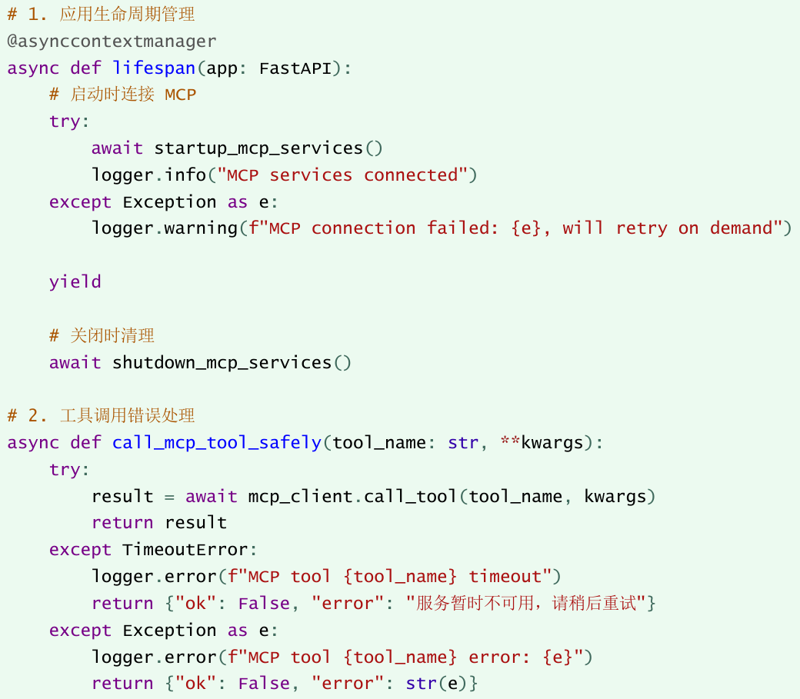

<!-- source-block:3790 -->
#### 性能优化实践

<!-- source-block:3791 -->
##### 历史对话裁剪

<!-- source-block:3792 -->
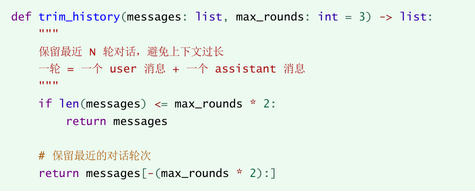

<!-- source-block:3793 -->
##### 距离计算优化

<!-- source-block:3794 -->
Haversine 公式

<!-- source-block:3795 -->
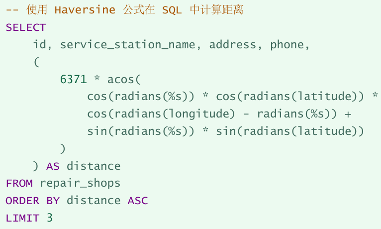

<!-- source-block:3796 -->
### 项目总结

<!-- source-block:3797 -->
#### 项目亮点

<!-- source-block:3798 -->
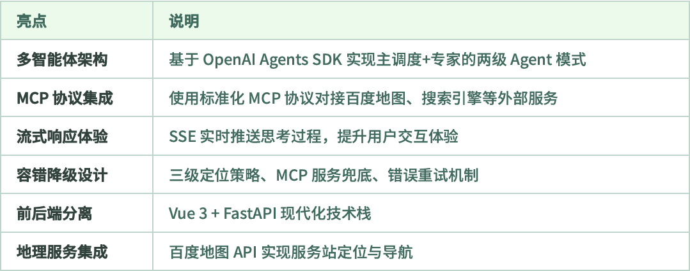

<!-- source-block:3799 -->
#### 技术收获

<!-- source-block:3800 -->
**OpenAI Agents SDK使用**

<!-- source-block:3801 -->
- 多智能体编排与协作

<!-- source-block:3802 -->
- @function\_tool工具定义

<!-- source-block:3803 -->
- Runner流式执行机制

<!-- source-block:3804 -->
**MCP协议实践**

<!-- source-block:3805 -->
- MCPServerSse客户端使用

<!-- source-block:3806 -->
- 工具自动发现与调用

<!-- source-block:3807 -->
- 生命周期管理

<!-- source-block:3808 -->
**FastAPI开发经验**

<!-- source-block:3809 -->
- Pydantic数据验证

<!-- source-block:3810 -->
- AsyncGenerator流式响应

<!-- source-block:3811 -->
- CORS跨域配置

<!-- source-block:3812 -->
**系统设计思维**

<!-- source-block:3813 -->
- 分层架构设计

<!-- source-block:3814 -->
- 容错和降级策略

<!-- source-block:3815 -->
- 提示词工程优化

<!-- source-block:3816 -->
#### 可优化方向

<!-- source-block:3817 -->
| 方向 | 具体优化 |
| --- | --- |
| 性能优化 | 添加Redis缓存相似问题响应 |
| 功能扩展 | 用户画像、个性化推荐、多租户支持 |
| AI增强 | 向量数据库语义检索、多轮对话摘要 |
| 监控告警 | 接入Prometheus + Grafana监控 |
| 部署优化 | Docker容器化、K8s编排、CI/CD流水线 |
