---
tags:
  - 大模型
  - 面试
source: "尚硅谷大模型技术之高频面试题-V2.1.6.docx"
source_blocks: "3981-4109"
reviewed: 2026-10-21
---

# ITS知识库的数据摄入与混合检索

知识库摄入与检索必须共享稳定的文档和块标识。

前篇：[[知识点总结/80-资料与复习/81-面试知识库/08-大模型高频面试题/05-项目实战/25-ITS技术服务的项目表达与证据|ITS技术服务的项目表达与证据]] ｜ 后篇：[[知识点总结/80-资料与复习/81-面试知识库/08-大模型高频面试题/05-项目实战/27-ITS知识库的故障定位与优化实验|ITS知识库的故障定位与优化实验]]

## 深入理解（新增）

解析后的内容应保留标题、代码块、表格和页码，技术文档中的命令参数不能被清洗规则误删。chunk_id 可由文档版本与块位置构成，便于融合去重和精确引用。

混合检索的词项与向量分支必须使用相同的权限与版本过滤。先融合再过滤可能让跨租户证据进入上下文；缓存键也应包含访问范围和索引版本。

摄入任务应可幂等重跑，失败阶段保留状态；索引写入完成后再发布可见版本，避免查询读到一半新文档、一半旧文档。下面分块与 RRF 是可单独测试的两个核心。


## 核心代码（新增）

以下是可在 CPU 运行的机制或业务契约示例，完整源码与测试见 [[知识点总结/80-资料与复习/81-面试知识库/08-大模型高频面试题/06-代码实验/01-核心代码实验与验证范围|核心代码实验与验证范围]]。示例不包含完整模型训练或外部平台部署。

```python
from collections import defaultdict

def chunk_with_offsets(text, size=100, overlap=20):
    if not 0 <= overlap < size:
        raise ValueError("require 0 <= overlap < size")
    result = []
    start = 0
    while start < len(text):
        end = min(len(text), start + size)
        result.append({"start": start, "end": end, "text": text[start:end]})
        if end == len(text):
            break
        start = end - overlap
    return result

def rrf_fuse(rankings, constant=60):
    if constant <= 0:
        raise ValueError("constant must be positive")
    scores = defaultdict(float)
    for ranking in rankings:
        seen = set()
        for rank, doc_id in enumerate(ranking, start=1):
            if doc_id in seen:
                continue
            seen.add(doc_id)
            scores[doc_id] += 1 / (constant + rank)
    return sorted(scores.items(), key=lambda item: (-item[1], item[0]))

def select_visible_chunks(chunks, tenant_id, user_groups, active_versions):
    """Demo ACL contract; identity/groups must come from the trusted server."""
    groups = set(user_groups)
    return [dict(c) for c in chunks
            if c["tenant_id"] == tenant_id
            and c["version"] == active_versions.get(c["doc_id"])
            and bool(groups & set(c["allowed_groups"]))]

source = "订单退款规则：申请后进入审核，审核完成后返回结果。"
chunks = chunk_with_offsets(source, size=12, overlap=3)
assert all(source[c["start"]:c["end"]] == c["text"] for c in chunks)

ranked = rrf_fuse([["sku-A", "sku-B"], ["sku-B", "sku-C"]])
assert ranked[0][0] == "sku-B"

chunks = [{"tenant_id":"shop-A", "doc_id":"d1", "version":2,
           "allowed_groups":["staff"], "text":"示例知识"}]
visible = select_visible_chunks(chunks, "shop-A", ["staff"], {"d1":2})
assert len(visible) == 1
assert select_visible_chunks(chunks, "shop-B", ["staff"], {"d1":2}) == []
```

## 追问与验证（新增）

重复摄入同一文档，再更新其中一个段落，检查块数量、版本切换与引用定位是否一致。

## 官方资料与论文

- [Retrieval-Augmented Generation](https://arxiv.org/abs/2005.11401)
- [BGE-M3 原论文](https://arxiv.org/abs/2402.03216)

核验日期：2026-10-21。链接中的 `stable`、`main` 或平台文档会继续变化；新增纯 Python/NumPy 实验与原文旧版框架代码已分开标注。

## 原文保留

> [!warning] 原文批注
> 文档上传成功、解析成功、索引完成和对查询可见是不同状态，不应合并成一个布尔值。
>
> 原文的团队人数、业务规模、效果百分比、硬件与成本均保留为教材案例陈述；本次未独立复现这些项目指标。

<!-- source-block:3981 -->
### ITS多智能体知识库系统

<!-- source-block:3982 -->
#### 项目周期与分工

<!-- source-block:3983 -->
- 3人团队，6周

<!-- source-block:3984 -->
- 需求分析&设计：1周

<!-- source-block:3985 -->
- 数据采集模块：1周

<!-- source-block:3986 -->
- 知识库核心开发：2周

<!-- source-block:3987 -->
- RAG问答&前端：1周

<!-- source-block:3988 -->
- 测试&优化&上线：1周

<!-- source-block:3989 -->
##### 第一阶段：需求分析与架构设计（Week 1）

<!-- source-block:3990 -->
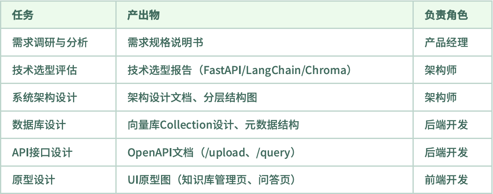

<!-- source-block:3991 -->
##### 第二阶段：数据采集模块开发（Week 2）

<!-- source-block:3992 -->
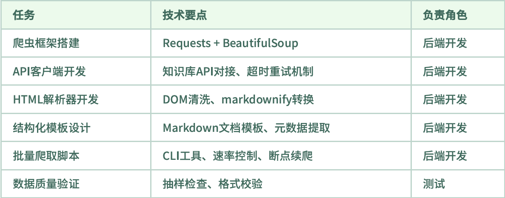

<!-- source-block:3993 -->
##### 第三阶段：知识库核心模块开发（Week 3-4）

<!-- source-block:3994 -->
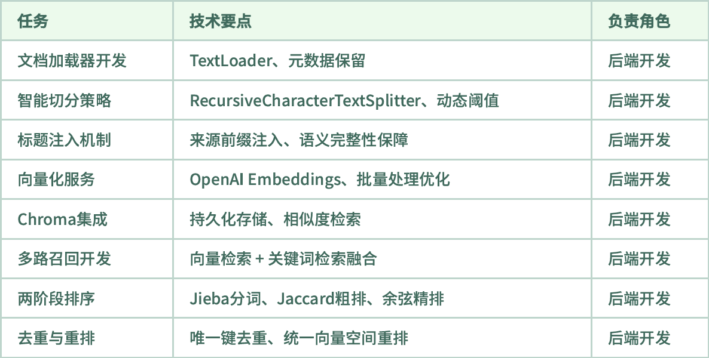

<!-- source-block:3995 -->
##### 第四阶段：RAG问答与前端开发（Week 5）

<!-- source-block:3996 -->
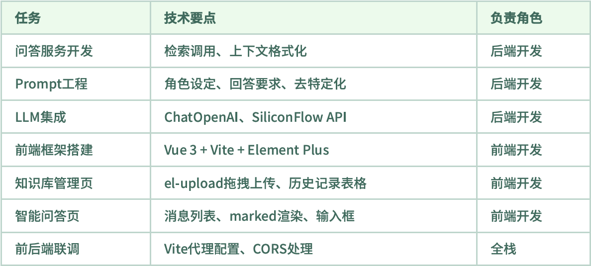

<!-- source-block:3997 -->
##### 第五阶段：测试与上线（Week 6）

<!-- source-block:3998 -->
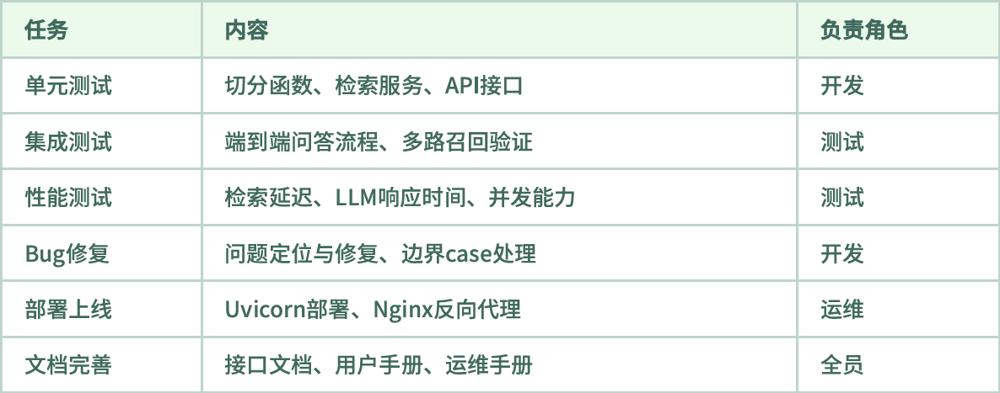

<!-- source-block:3999 -->
##### 团队分工建议

<!-- source-block:4000 -->
| 角色 | 职责 |
| --- | --- |
| 后端开发（1-2人） | 数据采集、文档处理、检索服务、问答服务 |
| 前端开发（1人） | Vue界面、文件上传、Markdown渲染、交互优化 |
| 架构/全栈（1人） | 架构设计、技术攻关、Code Review、性能调优 |

<!-- source-block:4001 -->
#### 项目概述

<!-- source-block:4002 -->
##### 项目背景

<!-- source-block:4003 -->
**业务场景：**

<!-- source-block:4004 -->
为企业提供一战式智能知识库解决方案，实现技术支持文档的智能检索与问答，帮助用户快速获取精准答案。

<!-- source-block:4005 -->
**核心价值：**

<!-- source-block:4006 -->
- 智能问答：基于RAG技术，将用户自然语言问题转化为精准的知识库检索，并生成结构化答案

<!-- source-block:4007 -->
- 多路召回：融合向量检索和关键词检索，显著提升召回率和检索准确性

<!-- source-block:4008 -->
- 知识管理：支持文档上传、自动切分、向量化存储，构建企业专属知识库

<!-- source-block:4009 -->
##### 技术选型

<!-- source-block:4010 -->
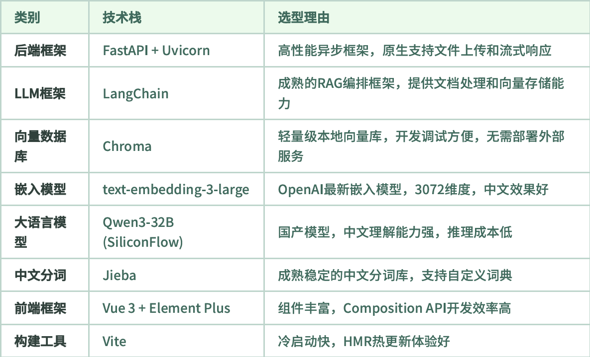

<!-- source-block:4012 -->
#### 整体架构设计

<!-- source-block:4013 -->
##### 系统架构图

<!-- source-block:4014 -->
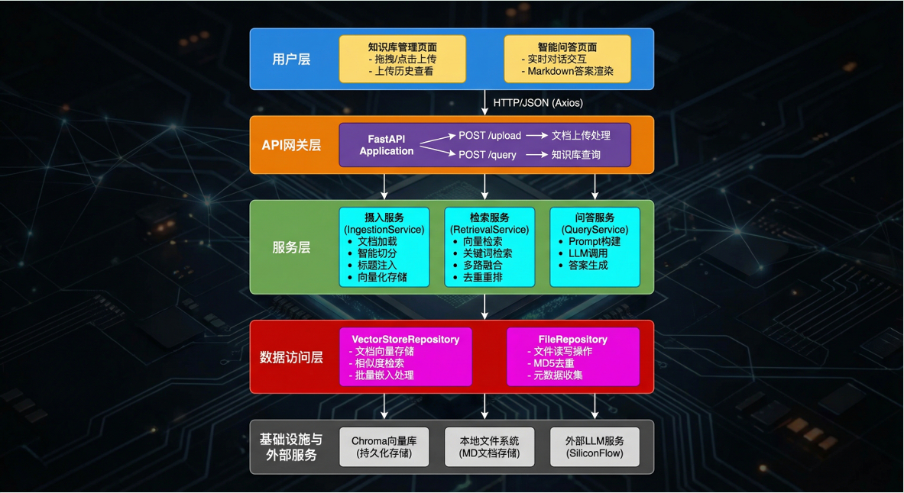

<!-- source-block:4015 -->
##### RAG核心流程图

<!-- source-block:4016 -->
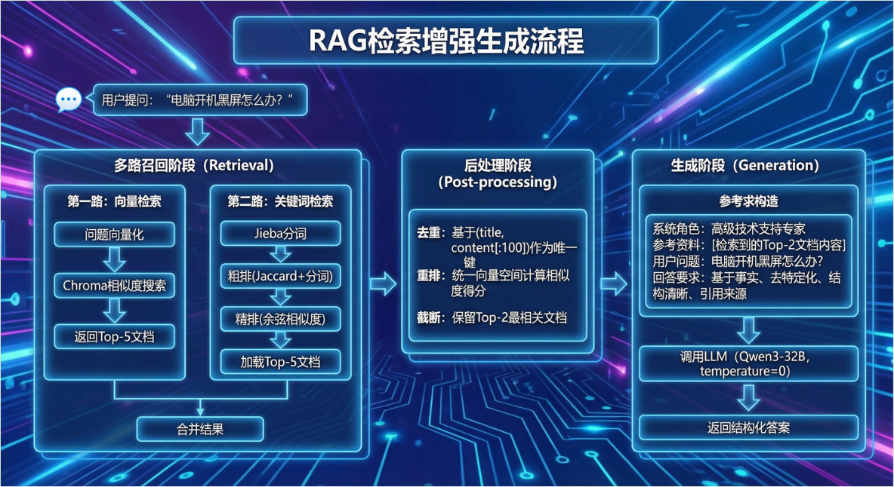

<!-- source-block:4017 -->
#### 核心模块详解

<!-- source-block:4018 -->
##### 数据采集模块（Crawler）

<!-- source-block:4019 -->
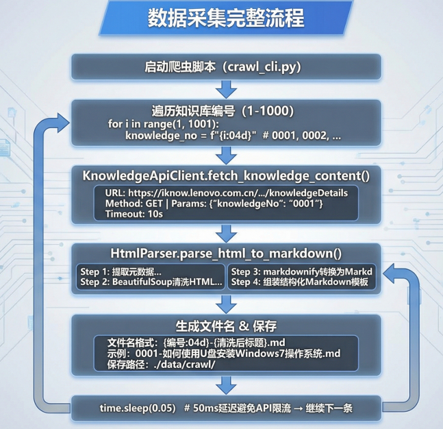

<!-- source-block:4020 -->
数据采集是知识库系统的基础，整个流程分为五个阶段。

<!-- source-block:4021 -->
##### 第一阶段：

<!-- source-block:4022 -->
- 首先启动我们的爬虫脚本（crawl\_cli.py）

<!-- source-block:4023 -->
- 遍历我们的知识库编号(1-1000)

<!-- source-block:4024 -->
- 格式化编号0001，0002……

<!-- source-block:4025 -->
##### 第二阶段（API调用获取数据）：

<!-- source-block:4026 -->
- 向知识库API发送GET请求

<!-- source-block:4027 -->
- 传入konwledgeNo参数

<!-- source-block:4028 -->
- 设置10s保护

<!-- source-block:4029 -->
- 获取原始HTML内容

<!-- source-block:4030 -->
##### 第三阶段（HTML转Markdown）：

<!-- source-block:4031 -->
- 提取元数据（标题/摘要/关键词）

<!-- source-block:4032 -->
- BeautifulSoup清洗HTML（移除script/style）

<!-- source-block:4033 -->
- markdownify转换为markdown

<!-- source-block:4034 -->
- 组装结构化markdown模板

<!-- source-block:4035 -->
##### 第四阶段（文件保存）：

<!-- source-block:4036 -->
- 生成文件名（文件名格式: {编号:04d}-{清洗后标题}.md）

<!-- source-block:4037 -->
- 保存到./data/crawl/

<!-- source-block:4038 -->
##### 第五阶段（速率控制）：

<!-- source-block:4039 -->
设置50ms延迟避免API限流→继续下一条

<!-- source-block:4040 -->
##### 文档摄入模块

<!-- source-block:4041 -->
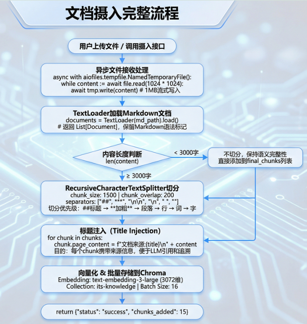

<!-- source-block:4042 -->
文档摄入是将原始文档转化为可检索向量的核心环节，整个流程分为六个阶段。

<!-- source-block:4043 -->
##### 第一阶段（异步文件接收）：

<!-- source-block:4044 -->
- 当前用户通过前端上传文件或者调用/upload接口时，FastAPI使用aiofiles库进行异步文件处理；

<!-- source-block:4045 -->
- 采用1MB缓冲的流式读写方式，避免大文件一次性加载到内存导致OOM问题；

<!-- source-block:4046 -->
- 文件首先写入临时目录，处理完成后再移动到正式目录。

<!-- source-block:4047 -->
##### 第二阶段（加载Markdown文档）：

<!-- source-block:4048 -->
使用LangChain的TextLoade加Markdown文档，该加载器会保留Markdown的语法 标记（如 ## 标题、 \*\* 加粗），返回Document对象列表，每个对象包含page\_content （⽂本内容）和metadata（元数据）两个属性。

<!-- source-block:4049 -->
##### 第三阶段（动态切分策略）：

<!-- source-block:4050 -->
系统会判断⽂档⻓度：如果内容少于3000字符，认为是⼩⽂档，直接保持完整不切分，避免过度碎⽚化导致语义割裂；如果内容超过3000字符，则使⽤RecursiveCharacter-TextSplitter 进⾏递归切分，设置每块1500字符、重叠200字符，分隔符按语义优先级排列。

<!-- source-block:4051 -->
##### 第四阶段（标题注入机制）：

<!-- source-block:4052 -->
对于每个切分后的chunk，在内容开头添加文档来源:{原文档标题}前缀；这样做的⽬的是让每个chunk都携带来源信息，即使被切分后也能追溯到原⽂档，便于LLM在回答时正确引⽤来源。

<!-- source-block:4053 -->
##### 第五阶段（向量化和批量存储）：

<!-- source-block:4054 -->
调⽤OpenAI的text embedding 3 large 模型将⽂本转换为3072 维向量；为避免单次API调⽤超限，采⽤batch\_size=16的分批处理策略；最终将向量存储到 Chroma数据库的 its knowledge 集合中。

<!-- source-block:4055 -->
第六阶段：返回摄入结果，包含添加的chunk数量供前端展示。

<!-- source-block:4056 -->
##### 检索服务模块

<!-- source-block:4057 -->
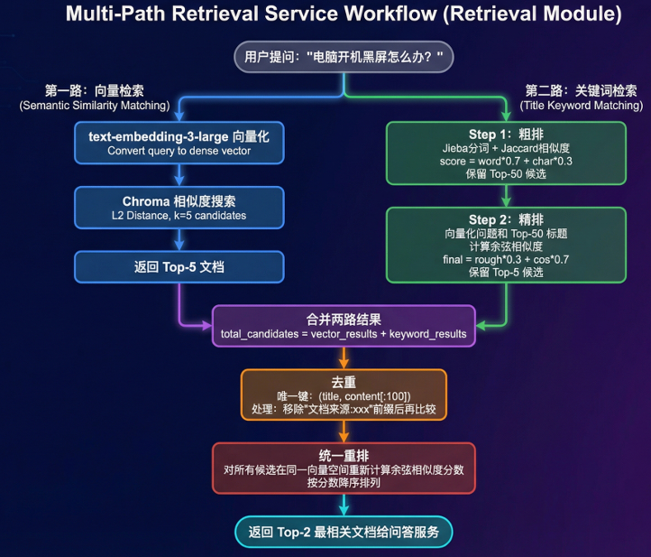

<!-- source-block:4058 -->
检索服务模块时RAG系统的核心，采用多路召回策略提高检索质量，整个流程分为5个阶段。

<!-- source-block:4059 -->
##### 第一阶段（并行的双路检索）：

<!-- source-block:4060 -->
- 第一路是向量检索，将用户问题勇敢text-embedding-3-large模型转换为3072维向量，然后在Chroma向量数据库中执行显示路检索，返回L2距离最小的Top-5文档；这一路的优势是能捕获语义相似性，比如“电脑无法开机”和“计算机启动失败”虽然泳池不同但语义相近。

<!-- source-block:4061 -->
- 第二路是关键词检索，不依赖向量而是直接匹配标题中的关键词；这一路的优势是对精确匹配场景（如型号、代码错误）效果更好。

<!-- source-block:4062 -->
##### 第二阶段（关键词的两阶段排序）：

<!-- source-block:4063 -->
**粗排阶段**

<!-- source-block:4064 -->
- 使⽤Jieba对⽤⼾问题和所有⽂档标题进⾏中⽂分词，计算Jaccard相似度；

<!-- source-block:4065 -->
- 公式是分词交集大小/分词并集大小 ，同时加⼊字符级别的相似度作为补充，最终分数按7:3加权；

<!-- source-block:4066 -->
- 粗排从全量⽂档中快速筛选出Top-50候选，⼤幅缩⼩精排的计算范围。

<!-- source-block:4067 -->
**精排阶段**

<!-- source-block:4068 -->
将问题和Top-50标题都向量化，计算余弦相似度，与粗排分数按3:7加权得到最终分数，保留Top-5。

<!-- source-block:4069 -->
##### 第三阶段（合并去重）：

<!-- source-block:4070 -->
将两路检索的结果合并，可能存在同⼀⽂档被两路都召回的情况；使⽤(标题, 内容前100字符) 作为唯⼀键进⾏去重，注意需要先移除"⽂档来源:xxx前缀再⽐较，确保不同chunk能被正确识别为同⼀⽂档的⽚段。

<!-- source-block:4071 -->
##### 第四阶段（统一重排序）：

<!-- source-block:4072 -->
因为两路检索使⽤了不同的打分机制（L2距离vs余弦相似度），需要在同⼀向量空间重新计算分数；对每个去重后的候选⽂档，取内容前500字符进⾏向量化，与问题向量计 算余弦相似度作为最终得分。

<!-- source-block:4073 -->
##### 第五阶段（生成回复）：

<!-- source-block:4074 -->
按分数降序排列后，返回Top-2⽂档给问答服务，这两个⽂档将作为LLM⽣成答案的上下⽂。

<!-- source-block:4075 -->
##### 问答服务模块（Query）

<!-- source-block:4076 -->
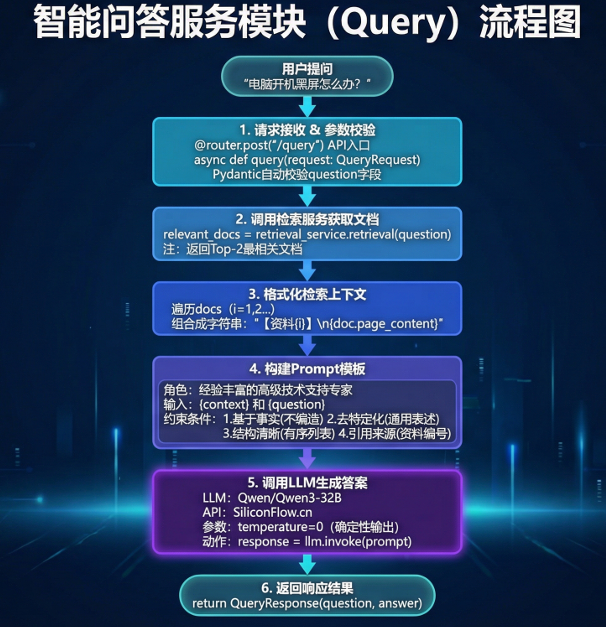

<!-- source-block:4077 -->
问答服务是将检索结果转化为⾃然语⾔答案的关键环节，整个流程分为五个阶段。

<!-- source-block:4078 -->
##### 第一阶段（请求接收和参数校验）：

<!-- source-block:4079 -->
前端通过axios发送POST请求到 /query 接⼝，请求体包含question 字段；FastAPI使⽤Pydantic的QueryRequest 模型自动进⾏参数校验，确保question 字段存在且为字符串类型，校验失败会⾃动返回422错误码和详细的错误信息。

<!-- source-block:4080 -->
##### 第二阶段（调用检索服务）：

<!-- source-block:4081 -->
实例化 RetrievalService 并调⽤其retrieval() ⽅法，传⼊用户问题；检索服务会执⾏多路召回、去重、重排等⼀系列操作，最终返回Top-2最相关的⽂档列表；这两个文档将作为LLM生成答案的上下⽂参考。

<!-- source-block:4082 -->
##### 第三阶段（格式化检索上下文）：

<!-- source-block:4083 -->
将检索到的⽂档列表转换为结构化的⽂本；每个⽂档添加【资料 1】 、【资料2】的编号前缀，便LLM在回答时引⽤；多个文档之间用双换行分隔，保持清晰的层次结构。

<!-- source-block:4084 -->
##### 第四阶段（Prompt工程）：

<!-- source-block:4085 -->
这是影响答案质量的关键环节。Prompt，模板包括四个部分：

<!-- source-block:4086 -->
- 首先是系统角色设定，将LLM定位为"经验丰富的⾼级技术支持专家"；

<!-- source-block:4087 -->
- 其次是参考资料区，注⼊格式化后的检索上下⽂；

<!-- source-block:4088 -->
- 然后是用户问题区；

<!-- source-block:4089 -->
- 最后是回答要求，明确指导LLM的⾏为⸺基于事实回答不编造、 去特定化处理移除品牌型号、使⽤有序列表保持结构清晰、引⽤来源便于溯源验证。

<!-- source-block:4090 -->
##### 第五阶段（调用LLM生成答案）：

<!-- source-block:4091 -->
使⽤LangChain封装的ChatOpenAI 客户端，配置SiliconFlow的API地址和千问3-32B模型；关键参数是temperature=0，设置为0意味着确定性输出，相同的输⼊会得到相同的输出，避免随机性导致的不⼀致问题；LLM返回的答案是Markdown格式，最后将问题和答案封装成QueryResponse返回给前端渲染。

<!-- source-block:4092 -->
##### 前端交互模块

<!-- source-block:4093 -->
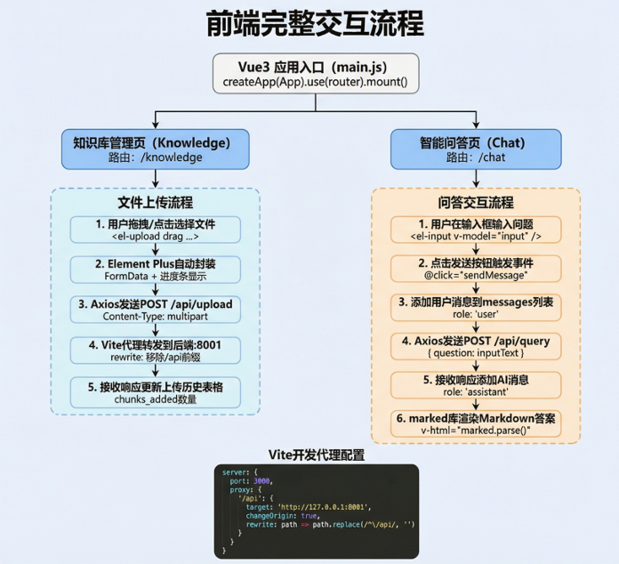

<!-- source-block:4094 -->
前端交互模块提供⽤⼾友好的界⾯，整个流程分为两条主线：知识库管理和智能问答。

<!-- source-block:4095 -->
##### 知识库管理流程：

<!-- source-block:4096 -->
**第⼀阶段，用户在知识库管理⻚⾯可以通过拖拽⽂件到上传区域，或点击选择⽂件的⽅式上传Markdown⽂档；Element Plus的el-upload 组件配置了drag属性⽀持拖拽上传。**

<!-- source-block:4097 -->
**第二阶段，组件⾃动将⽂件封装成 FormData 格式，并显示上传进度条给用户实时反馈。**

<!-- source-block:4098 -->
**第三阶段，Axios发送POST请求到/api/upload接⼝，Content-Type设置为multipart/form data 。**

<!-- source-block:4099 -->
**第四阶段，Vite开发服务器的proxy配置拦截 /api 前缀的请求，转发到后端8001端口，同时移除 /api 前缀确保路径正确。**

<!-- source-block:4100 -->
**第五阶段，接收后端响应后触发on success 回调，将上传结果（⽂件名、chunks\_added数量、状态）添加到上传历史表格中展示。**

<!-- source-block:4101 -->
##### 智能问答流程：

<!-- source-block:4102 -->
**第⼀阶段，用户在Chat⻚⾯的输⼊框中输⼊自然语言问题，输⼊框使⽤v-model双向绑定到inputText响应式变量。**

<!-- source-block:4103 -->
**第二阶段，点击发送按钮触发sendMessage方法。**

<!-- source-block:4104 -->
**第三阶段，⾸先将用户消息添加到消息列表，设置 role: 'user' 标识为用户消息，界面立即显示用户发送的内容。**

<!-- source-block:4105 -->
**第四阶段，调⽤封装好的queryKnowledge API函数发送POST请求，传⼊问题字符串，等待后端处理和LLM⽣成答案。**

<!-- source-block:4106 -->
**第五阶段，接收到后端响应后，将AI回复添加到消息列表，设置role: 'assistant' 标识为AI消息。**

<!-- source-block:4107 -->
**第六阶段，使⽤marked库将Markdown格式的答案渲染为HTML，通过v-html指令插⼊到消息⽓泡中，支持有序列表、代码块语法⾼亮、链接可点击等丰富的格式展示。**

<!-- source-block:4108 -->
##### 跨境问题解决：

<!-- source-block:4109 -->
开发环境下前端运行在3000端口，后端运⾏在8001端口，直接请求会触发浏览器的CORS限制；通过Vite的proxy配置将 /api 前缀的请求代理到后端，实现同源请求绕过跨域限制；生产环境可使⽤Nginx做反向代理实现相同效果。
