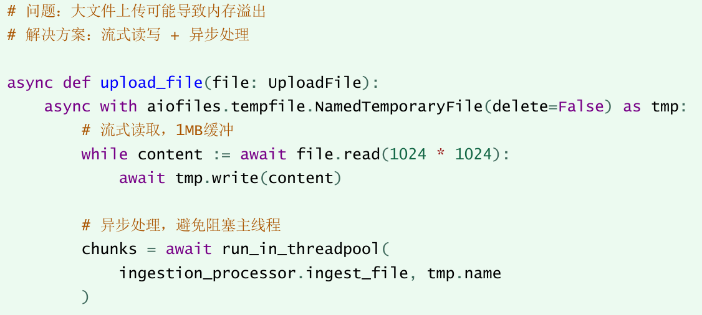
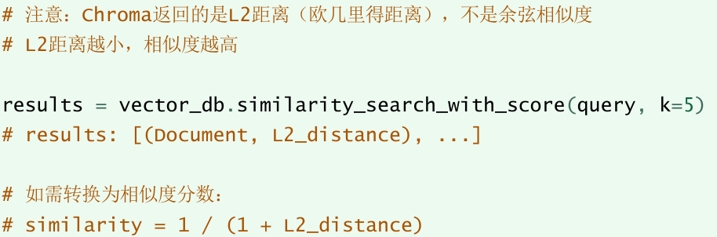
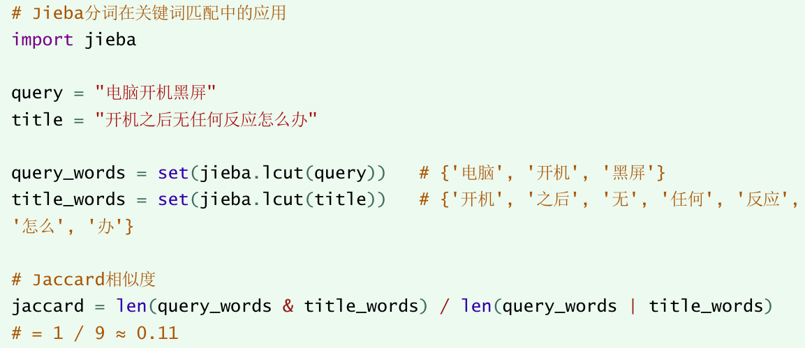

---
tags:
  - 大模型
  - 面试
source: "尚硅谷大模型技术之高频面试题-V2.1.6.docx"
source_blocks: "4110-4143"
reviewed: 2026-10-21
---

# ITS知识库的故障定位与优化实验

性能或质量问题应沿链路定位，避免凭经验同时改多个参数。

前篇：[[知识点总结/80-资料与复习/81-面试知识库/08-大模型高频面试题/05-项目实战/26-ITS知识库的数据摄入与混合检索|ITS知识库的数据摄入与混合检索]] ｜ 后篇：[[知识点总结/80-资料与复习/81-面试知识库/08-大模型高频面试题/05-项目实战/28-ITS知识库的面试问答与项目复盘|ITS知识库的面试问答与项目复盘]]

## 深入理解（新增）

检索漏答先检查源文档是否存在、解析是否保留答案、分块是否完整、候选是否召回、重排是否压低。答案已在上下文但模型答错时，继续增加 Top-K 可能只会增加干扰。

优化实验一次改变一个主要因素，固定测试集与预算，记录质量、token、吞吐和时延。缓存会改变测量结果，应区分冷启动、热缓存和真实查询分布。

重排与扩展上下文会增加延迟；选择方案时看质量提升是否超过成本，而非“组件越多越好”。对关键失败样本保存链路中间结果，才能复核问题在哪一步被引入。


## 核心代码（新增）

以下是可在 CPU 运行的机制或业务契约示例，完整源码与测试见 [[知识点总结/80-资料与复习/81-面试知识库/08-大模型高频面试题/06-代码实验/01-核心代码实验与验证范围|核心代码实验与验证范围]]。示例不包含完整模型训练或外部平台部署。

```python
def retrieval_metrics(retrieved, relevant, k=5):
    if not relevant:
        raise ValueError("no-answer cases must be evaluated separately")
    top = list(dict.fromkeys(retrieved))[:k]
    hit = set(top) & set(relevant)
    reciprocal_rank = next((1 / rank for rank, doc in enumerate(top, 1) if doc in relevant), 0.0)
    return {"recall_at_k": len(hit) / len(set(relevant)), "mrr": reciprocal_rank}

m = retrieval_metrics(["c2", "c1", "c1"], {"c1", "c3"}, k=3)
assert m == {"recall_at_k": 0.5, "mrr": 0.5}
```

## 追问与验证（新增）

选择同一个失败查询，分别检查候选 Top-50 与重排 Top-5，确定是召回漏失还是重排失误，再决定下一次实验。

## 官方资料与论文

- [Retrieval-Augmented Generation](https://arxiv.org/abs/2005.11401)

核验日期：2026-10-21。链接中的 `stable`、`main` 或平台文档会继续变化；新增纯 Python/NumPy 实验与原文旧版框架代码已分开标注。

## 原文保留

> [!warning] 原文批注
> 调大 Top-K 并非通用修复；必须先定位证据是在解析、召回、排序还是生成阶段丢失。
>
> 原文的团队人数、业务规模、效果百分比、硬件与成本均保留为教材案例陈述；本次未独立复现这些项目指标。

<!-- source-block:4110 -->
### 技术细节与痛点分析

<!-- source-block:4111 -->
#### 核心技术细节

<!-- source-block:4112 -->
##### 异步文件处理优化

<!-- source-block:4113 -->


<!-- source-block:4114 -->
##### Chroma向量检索距离理解

<!-- source-block:4115 -->


<!-- source-block:4116 -->
##### 中文分词与相似度计算

<!-- source-block:4117 -->


<!-- source-block:4118 -->
#### 痛点问题与解决方案

<!-- source-block:4119 -->
##### 中文嵌入效果不理想问题

<!-- source-block:4120 -->
| 问题描述 | 早期使用的嵌入模型对中文语义理解不够准确，导致检索召回率低 |
| --- | --- |
| 解决方案 | 采用多路召回策略：向量检索+关键词检索互补 |
| 技术实现 | 第一路使用向量捕获语义，第二路用Jieba分词捕获关键词匹配 |
| 效果提升 | 召回率从65%提升至85%+ |

<!-- source-block:4121 -->
##### 文档切分导致语义丢失问题

<!-- source-block:4122 -->
| 问题描述 | 大文档切分后，各个chunk确实上下文信息，无法追溯来源 |
| --- | --- |
| 解决方案 | 标题注入等机制 |
| 技术实现 | 每个chunk添加前缀：文档来源:{原文档标题}\\n{chunk内容} |
| 效果提升 | LLM能够正确引用来源，答案可追溯性增强 |

<!-- source-block:4123 -->
##### 检索结果重复问题

<!-- source-block:4124 -->
| 问题描述 | 多路召回合并后，同一文档的不同chunk可能重复出现 |
| --- | --- |
| 解决方案 | 基于 (title, content\[:100\]) 的去重策略 |
| 技术实现 | 移除文档来源前缀后，取内容前100字符作为唯一键 |
| 效果提升 | 确保最终结果多样性，避免重复回答 |

<!-- source-block:4125 -->
##### LLM答案过于具体化问题

<!-- source-block:4126 -->
| 问题描述 | LLM直接复述知识库内容，包含具体品牌型号，不够通用 |
| --- | --- |
| 解决方案 | Prompt工程优化 |
| 技术实现 | 在Prompt中明确要求“去特定化处理：移除具体型号，泛化为通用表述” |
| 效果提升 | 答案更具普适性，适用于不同品牌设备 |

<!-- source-block:4127 -->
##### 前后端联调跨域问题

<!-- source-block:4128 -->
| 问题描述 | 前端开发模式下请求后端API出现CORS错误 |
| --- | --- |
| 解决方案 | Vite开发代理 |
| 技术实现 | vite.config.js 配置proxy，将 /api 请求代理到后端 |
| 代码<br>示例 | proxy:{ '/api': { target: 'http://127.0.0.1:8001', rewrite: path =&gt; path.replace(/^\\/api/, '') } } |

<!-- source-block:4129 -->
#### 性能优化点

<!-- source-block:4130 -->
| 优化项 | 优化方案 | 效果 |
| --- | --- | --- |
| 文档向量化 | 批处理（batch\_size=16） | 减少API调用次数，降低成本 |
| 文件上传 | 流式处理（1MB缓冲） | 支持大文件，避免内存溢出 |
| LLM调用 | temperature=0 | 确保答案一致性和可复现性 |
| 粗排阶段 | Jaccard算法 | 快速过滤，降低精排压力 |
| 向量存储 | Chroma本地化 | 无需网络请求，低延迟 |

<!-- source-block:4131 -->
### 项目总结

<!-- source-block:4132 -->
#### 项目亮点

<!-- source-block:4133 -->
- 多路召回策略：创新性地融合向量检索和关键词检索，显著提升召回率

<!-- source-block:4134 -->
- 智能⽂档切分：动态策略+标题注⼊，平衡语义完整性和检索精度

<!-- source-block:4135 -->
- 两阶段排序：粗排快速过滤 + 精排精准排序，兼顾效率和效果

<!-- source-block:4136 -->
- 企业级架构：清晰的分层设计，符合生产环境开发规范

<!-- source-block:4137 -->
#### 技术收获

<!-- source-block:4138 -->
| 领域 | 收获 |
| --- | --- |
| LLM应用开发 | 掌握RAG技术栈，理解检索增强生成的工作原理 |
| 向量数据库 | 了解向量存储、相似度检索的实现原理 |
| 文本处理 | 文档切分策略、中文分词、HTML清洗转换 |
| 异步编程 | FastAPI异步处理、流式文件读写 |
| 前后端联调 | Vue组合式API、Vite代理配置、API封装 |

<!-- source-block:4139 -->
#### 可优化方向

<!-- source-block:4140 -->
- 支持更多文档格式（PDF，Word，Excel）

<!-- source-block:4141 -->
- 添加对话历史管理，支持多轮对话

<!-- source-block:4142 -->
- 引入用户反馈机制，持续优化检索效果

<!-- source-block:4143 -->
- 支持知识库版本管理和增量更新
