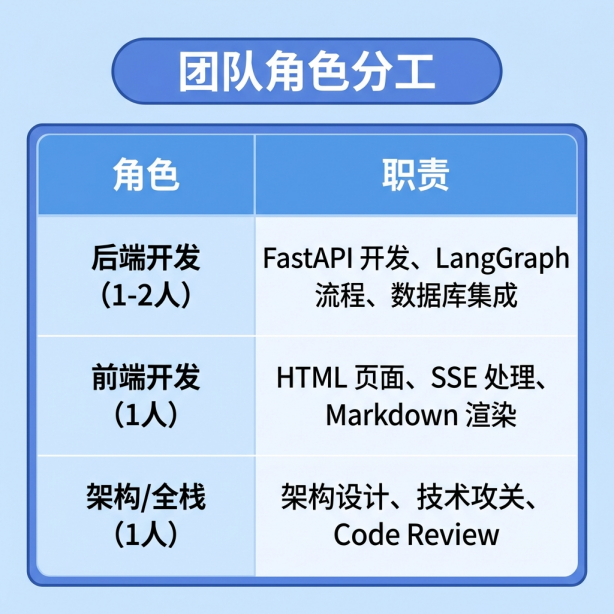
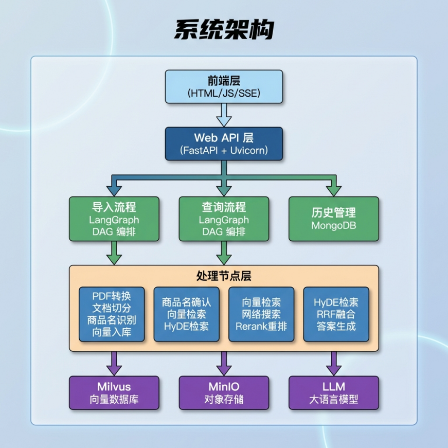
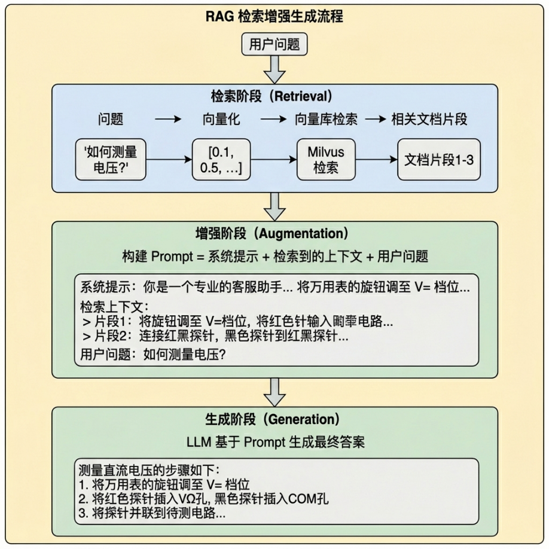
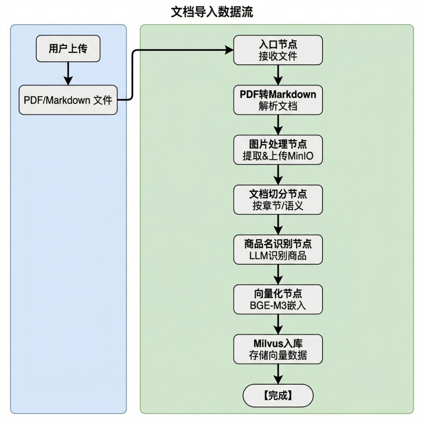

---
tags:
  - 大模型
  - 面试
source: "尚硅谷大模型技术之高频面试题-V2.1.6.docx"
source_blocks: "4288-4359"
reviewed: 2026-10-21
---

# 掌柜智库的文档、多模态与索引

多模态文档摄入应保存原始资产与派生描述之间的对应关系。

前篇：[[知识点总结/80-资料与复习/81-面试知识库/08-大模型高频面试题/05-项目实战/28-ITS知识库的面试问答与项目复盘|ITS知识库的面试问答与项目复盘]] ｜ 后篇：[[知识点总结/80-资料与复习/81-面试知识库/08-大模型高频面试题/05-项目实战/30-掌柜智库的融合检索、重排与SSE|掌柜智库的融合检索、重排与SSE]]

## 深入理解（新增）

图片由视觉模型生成描述后再送入文本 embedding，是派生文本检索，不等同于原生图文联合向量。描述可能漏掉图中细节或产生错误，必须保留原图、页码、描述模型版本和置信审核状态。

PDF 转 Markdown 需要检查表格、标题层级与图片位置。商品名识别可以帮助元数据过滤，但识别结果不能无条件覆盖源字段；有歧义时保留候选与证据。

MinIO 或文件存储、任务状态库、Milvus 索引承担不同职责。对象上传后索引失败时，应能从状态恢复并重试，避免重复文件和孤立索引。对外只发布完成且版本一致的资产集合。


## 核心代码（新增）

以下是可在 CPU 运行的机制或业务契约示例，完整源码与测试见 [[知识点总结/80-资料与复习/81-面试知识库/08-大模型高频面试题/06-代码实验/01-核心代码实验与验证范围|核心代码实验与验证范围]]。示例不包含完整模型训练或外部平台部署。

```python
def chunk_with_offsets(text, size=100, overlap=20):
    if not 0 <= overlap < size:
        raise ValueError("require 0 <= overlap < size")
    result = []
    start = 0
    while start < len(text):
        end = min(len(text), start + size)
        result.append({"start": start, "end": end, "text": text[start:end]})
        if end == len(text):
            break
        start = end - overlap
    return result

def select_visible_chunks(chunks, tenant_id, user_groups, active_versions):
    """Demo ACL contract; identity/groups must come from the trusted server."""
    groups = set(user_groups)
    return [dict(c) for c in chunks
            if c["tenant_id"] == tenant_id
            and c["version"] == active_versions.get(c["doc_id"])
            and bool(groups & set(c["allowed_groups"]))]

source = "订单退款规则：申请后进入审核，审核完成后返回结果。"
chunks = chunk_with_offsets(source, size=12, overlap=3)
assert all(source[c["start"]:c["end"]] == c["text"] for c in chunks)

chunks = [{"tenant_id":"shop-A", "doc_id":"d1", "version":2,
           "allowed_groups":["staff"], "text":"示例知识"}]
visible = select_visible_chunks(chunks, "shop-A", ["staff"], {"d1":2})
assert len(visible) == 1
assert select_visible_chunks(chunks, "shop-B", ["staff"], {"d1":2}) == []
```

## 追问与验证（新增）

用一页带商品图、参数表和脚注的 PDF，逐项核对解析和描述，再检查回答引用能否回到对应资产。

## 官方资料与论文

- [BGE-M3 原论文](https://arxiv.org/abs/2402.03216)
- [Retrieval-Augmented Generation](https://arxiv.org/abs/2005.11401)

核验日期：2026-10-21。链接中的 `stable`、`main` 或平台文档会继续变化；新增纯 Python/NumPy 实验与原文旧版框架代码已分开标注。

## 原文保留

> [!warning] 原文批注
> BGE-M3 是文本模型；若流程用视觉模型先描述图片，应明确这是两阶段派生文本方案。
>
> 原文的团队人数、业务规模、效果百分比、硬件与成本均保留为教材案例陈述；本次未独立复现这些项目指标。

<!-- source-block:4288 -->
### 掌柜智库

<!-- source-block:4289 -->
#### 项目周期与分工

<!-- source-block:4290 -->
- 2人团队，6周

<!-- source-block:4291 -->
- 需求分析&设计：1周

<!-- source-block:4292 -->
- 文档导入（导入节点）：2周

<!-- source-block:4293 -->
- 检索服务（查询节点）：1周

<!-- source-block:4294 -->
- 问答服务（SSE&前端）：1周

<!-- source-block:4295 -->
- 测试&优化&上线：1周

<!-- source-block:4296 -->
| 任务 | 产出物 | 负责角色 |
| --- | --- | --- |
| 需求调研与分析 | 需求规格说明书 | 产品经理 |
| 技术选型评估 | 技术选型报告（框架、模型、向量库、文档库、文件服务） | 架构师 |
| 系统架构设计 | 架构设计文档、流程图 | 架构师 |
| 数据库设计 | Milvus Collection、Mongo Collection | 后端开发 |
| API接口设计 | OpenAPI文档（/upload、/status、/query、/stream、/history） | 后端开发 |
| 原型和页面 | UI原型图和html页面（知识库管理页、问答页） | 前端开发 |

<!-- source-block:4297 -->
##### 第一阶段：需求分析与架构设计（Week 1）

<!-- source-block:4298 -->
##### 第二阶段：数据采集模块开发（Week 2-3）

<!-- source-block:4299 -->
| 任务 | 技术要点 | 负责角色 |
| --- | --- | --- |
| 基础设施搭建 | FastAPI 框架、日志系统、配置管理 | 后端开发 |
| 文件上传模块 | MinIO 集成、本地存储、任务状态管理 | 后端开发 |
| PDF 解析模块 | MinerU 集成、PDF 转 Markdown | 后端开发 |
| 图片处理模块 | Qwen3-VL-Flash 图片描述生成 | 后端开发 |
| 文档分割模块 | LangChain RecursiveCharacterTextSplitter | 后端开发 |
| 商品名识别模块 | LLM 提示词工程、JSON 解析 | 后端开发 |
| 向量化模块 | BGE-M3 混合向量生成 | 后端开发 |
| Milvus 导入模块 | 批量插入、集合管理 | 后端开发 |

<!-- source-block:4300 -->
##### 第三阶段：知识库检索模块开发（Week 4）

<!-- source-block:4301 -->
| 任务 | 技术要点 | 负责角色 |
| --- | --- | --- |
| 商品名确认节点 | LLM 提取 + Milvus 对齐 + 分数过滤 | 后端开发 |
| 向量检索节点 | BGE-M3 混合检索、过滤表达式 | 后端开发 |
| HyDE 检索节点 | 假设文档生成、二次向量检索 | 后端开发 |
| 网络搜索节点 | DashScope WebSearch MCP | 后端开发 |
| RRF 融合节点 | 多路结果融合、权重配置 | 后端开发 |
| 重排序节点 | qwen3-rerank、断崖检测 | 后端开发 |
| 答案生成节点 | LLM 答案生成、SSE 流式推送、MongoDB记忆管理 | 后端开发 |
| SSE 流式响应 | 队列管理、事件封装 | 后端开发 |

<!-- source-block:4302 -->
##### 第四阶段：RAG问答与前端开发（Week 5）

<!-- source-block:4303 -->
| 任务 | 技术要点 | 负责角色 |
| --- | --- | --- |
| 前端框架搭建 | HTML + JavaScript + CSS | 前端开发 |
| 文档上传页面 | 拖拽上传、进度可视化 | 前端开发 |
| 智能问答页面 | 聊天界面、EventSource 处理 | 前端开发 |
| Markdown 渲染 | marked 库集成 | 前端开发 |
| 前后端联调 | CORS、接口对接 | 全栈 |

<!-- source-block:4304 -->
##### 第五阶段：测试与上线（Week 6）

<!-- source-block:4305 -->
| 任务 | 内容 | 负责角色 |
| --- | --- | --- |
| 单元测试 | 各节点功能测试 | 开发 |
| 集成测试 | 数据采集流程、端到端问答流程、多路召回验证 | 测试 |
| 性能测试 | 检索延迟、LLM响应时间、并发能力 | 测试 |
| Bug修复 | 问题定位与修复、边界case处理 | 开发 |
| 部署上线 | Uvicorn部署、Nginx反向代理 | 运维 |
| 文档完善 | 接口文档、用户手册、运维手册 | 全员 |

<!-- source-block:4306 -->
##### 团队分工建议

<!-- source-block:4307 -->


<!-- source-block:4308 -->
#### 项目概述

<!-- source-block:4309 -->
##### 项目背景

<!-- source-block:4310 -->
**业务场景**

<!-- source-block:4311 -->
为企业客户提供一站式智能知识管理解决方案，涵盖文档自动化解析、多模态内容提取、语义检索、MCP检索等功能。

<!-- source-block:4312 -->
**核心价值：**

<!-- source-block:4313 -->
- 文档智能导入：支持 PDF/Markdown 文档自动解析、图片描述提取、文档分割、向量化存储

<!-- source-block:4314 -->
- 语义检索：基于 BGE-M3 混合向量的语义检索，兼顾语义理解和精确匹配

<!-- source-block:4315 -->
- 多路检索融合：向量检索、HyDE 假设文档检索、MCP网络搜索三路并行

<!-- source-block:4316 -->
- 流式响应：SSE 实时推送查询进度和答案生成过程

<!-- source-block:4317 -->
##### 技术选型

<!-- source-block:4318 -->
| 类别 | 技术栈 | 选型理由 |
| --- | --- | --- |
| 后端框架 | FastAPI + Uvicorn | 高性能异步框架，原生支持 SSE 流式响应 |
| AI 框架 | LangGraph + LangChain | LangGraph 工作流编排，状态管理清晰 |
| 大语言模型 | 通义千问 Qwen-Flash / Qwen3-VL-Flash | 国产模型，中文能力强，API 稳定 |
| 向量模型 | BGE-M3 (1024维) | 混合稠密+稀疏向量，兼顾语义和精确匹配 |
| 重排序模型 | qwen3 rerank | 专门用于重排序，提升 Top-K 准确性 |
| 向量数据库 | Milvus | 支持混合检索，高性能向量数据库 |
| 文档数据库 | MongoDB | 存储历史对话记录 |
| 对象存储 | MinIO | 存储原始文档文件 |
| 文档解析 | MinerU | 开源 PDF 解析工具，支持复杂格式 |
| 前端技术栈 | 原生 HTML + JavaScript + EventSource | 轻量级，SSE 原生支持 |

<!-- source-block:4319 -->
#### 整体架构设计

<!-- source-block:4320 -->
##### 系统架构图

<!-- source-block:4321 -->


<!-- source-block:4322 -->
##### RAG工作机制

<!-- source-block:4323 -->


<!-- source-block:4324 -->
#### 核心模块详解

<!-- source-block:4325 -->
##### 文档导入（import）

<!-- source-block:4326 -->


<!-- source-block:4327 -->
文档摄入是将原始文档转化为可检索向量的核心环节，整个流程分为七个阶段。

<!-- source-block:4328 -->
##### 第一阶段（文档类型判断）：

<!-- source-block:4329 -->
通过文件扩展名判断文档类型，从而进入不同的条件边，执行分支流程

<!-- source-block:4330 -->
##### 第二阶段（PDF转Markdown）：

<!-- source-block:4331 -->
**接收用户上传的PDF文件路径**

<!-- source-block:4332 -->
**使用MinerU工具将PDF解析为Markdown格式**

<!-- source-block:4333 -->
**返回解析后的MD文件供下游使用**

<!-- source-block:4334 -->
##### 第三阶段（Markdown图片处理）：

<!-- source-block:4335 -->
**扫描MD文件中的所有图片引用**

<!-- source-block:4336 -->
**提取每张图片的上下文（标题、上文、下文）**

<!-- source-block:4337 -->
**使用VLM生成图片描述摘要**

<!-- source-block:4338 -->
**上传图片到MinIO对象存储**

<!-- source-block:4339 -->
**替换MD中的本地图片路径为远程URL和描述**

<!-- source-block:4340 -->
##### 第四阶段（文档切分）：

<!-- source-block:4341 -->
**根据Markdown标题层级切分文档（1-6级标题）**

<!-- source-block:4342 -->
**对过长章节进行递归切分**

<!-- source-block:4343 -->
**对过短章节进行合并**

<!-- source-block:4344 -->
**添加元数据（title, parent\_title, file\_title, part）**

<!-- source-block:4345 -->
##### 第五阶段（商品名识别）：

<!-- source-block:4346 -->
**从文档前K个chunk中提取上下文**

<!-- source-block:4347 -->
**使用LLM识别商品名称**

<!-- source-block:4348 -->
**将商品名向量化（BGE-M3）**

<!-- source-block:4349 -->
**存储到Milvus商品名集合**

<!-- source-block:4350 -->
**回填item\_name到所有chunks**

<!-- source-block:4351 -->
##### 第六阶段（批量嵌入节点）：

<!-- source-block:4352 -->
**对所有chunks进行批量向量化**

<!-- source-block:4353 -->
**拼接 item\_name + content 作为嵌入内容**

<!-- source-block:4354 -->
**生成混合向量（dense + sparse）**

<!-- source-block:4355 -->
**将向量注入到每个chunk中**

<!-- source-block:4356 -->
##### 第七阶段（Milvus导入节点）：

<!-- source-block:4357 -->
**确保Milvus集合存在（schema + index）**

<!-- source-block:4358 -->
**批量插入chunks到Milvus**

<!-- source-block:4359 -->
**回填chunk\_id到chunks**
