---
tags:
  - 大模型
  - 面试
source: "尚硅谷大模型技术之高频面试题-V2.1.6.docx"
source_blocks: "4360-4484"
reviewed: 2026-10-21
---

# 掌柜智库的融合检索、重排与SSE

融合检索、重排和流式回答需要共享证据 ID 与版本。

前篇：[[知识点总结/80-资料与复习/81-面试知识库/08-大模型高频面试题/05-项目实战/29-掌柜智库的文档、多模态与索引|掌柜智库的文档、多模态与索引]] ｜ 后篇：[[知识点总结/80-资料与复习/81-面试知识库/08-大模型高频面试题/05-项目实战/31-掌柜智库的指标、追问与扩展设计|掌柜智库的指标、追问与扩展设计]]

## 深入理解（新增）

Dense 与 sparse 路径的候选统一为 chunk_id 后再融合，过滤条件保持一致。RRF 的常数改变前排名次差距的影响，不代表可直接解释为相关概率；重排分数也需在独立标注集校准。

生成器应接收正文、来源与可引用片段，输出引用后校验 source_id 是否在本次检索结果中。SSE 可以先发送检索进度，再发送答案 token，最后发送完整引用与终态，防止前端把半句答案当最终结论。

端到端时延包括模型排队和重排成本，增加候选数应基于召回收益与时延预算共同决策。保存检索轨迹，才能解释某次答案为何引用旧版商品资料。


## 核心代码（新增）

以下是可在 CPU 运行的机制或业务契约示例，完整源码与测试见 [[知识点总结/80-资料与复习/81-面试知识库/08-大模型高频面试题/06-代码实验/01-核心代码实验与验证范围|核心代码实验与验证范围]]。示例不包含完整模型训练或外部平台部署。

```python
import json
from collections import defaultdict

def rrf_fuse(rankings, constant=60):
    if constant <= 0:
        raise ValueError("constant must be positive")
    scores = defaultdict(float)
    for ranking in rankings:
        seen = set()
        for rank, doc_id in enumerate(ranking, start=1):
            if doc_id in seen:
                continue
            seen.add(doc_id)
            scores[doc_id] += 1 / (constant + rank)
    return sorted(scores.items(), key=lambda item: (-item[1], item[0]))

def sse_event(event, data, event_id):
    if any(c in event for c in "\r\n") or any(c in str(event_id) for c in "\r\n"):
        raise ValueError("event/id must be single-line")
    body = json.dumps(data, ensure_ascii=False)
    return f"id: {event_id}\nevent: {event}\ndata: {body}\n\n"

def check_citations(claims, retrieved_source_ids):
    """Validate reference membership only; this does not verify factual support."""
    allowed = set(retrieved_source_ids)
    problems = []
    for index, claim in enumerate(claims):
        refs = claim.get("source_ids", [])
        if not refs:
            problems.append((index, "missing citation"))
        for ref in refs:
            if ref not in allowed:
                problems.append((index, "unknown source: " + ref))
    return problems

ranked = rrf_fuse([["sku-A", "sku-B"], ["sku-B", "sku-C"]])
assert ranked[0][0] == "sku-B"

event = sse_event("progress", {"state": "running"}, "task-1:1")
assert event.endswith("\n\n")
# 最终成功必须另发 done/终态，不能把 progress 当成成功。

claims = [{"source_ids":["doc-v2:chunk-3"]}]
assert check_citations(claims, {"doc-v2:chunk-3"}) == []
# 引用存在不等于引用支持结论，事实支持关系仍须另查。
```

## 追问与验证（新增）

让两条召回路径返回同一 chunk 的不同排名，检查融合去重；再让模型引用不存在的 source_id，确认结果校验能发现。

## 官方资料与论文

- [BGE-M3 原论文](https://arxiv.org/abs/2402.03216)
- [Retrieval-Augmented Generation](https://arxiv.org/abs/2005.11401)
- [asyncio 任务与超时](https://docs.python.org/3/library/asyncio-task.html)

核验日期：2026-10-21。链接中的 `stable`、`main` 或平台文档会继续变化；新增纯 Python/NumPy 实验与原文旧版框架代码已分开标注。

## 原文保留

> [!warning] 原文批注
> 检索器分数、融合分数和重排分数的量纲不同，不能直接平均或共用固定阈值。
>
> 原文的团队人数、业务规模、效果百分比、硬件与成本均保留为教材案例陈述；本次未独立复现这些项目指标。

<!-- source-block:4360 -->
#### 检索服务模块（query）

<!-- source-block:4361 -->
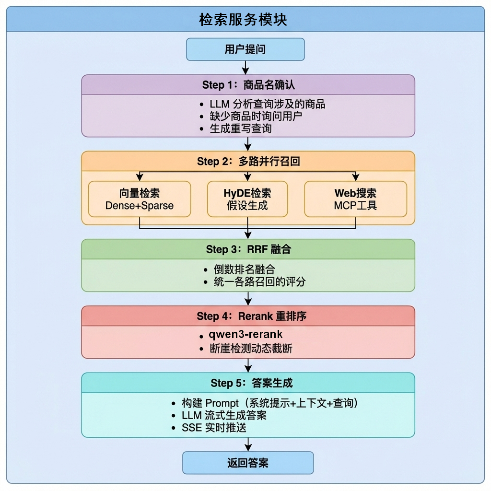

<!-- source-block:4362 -->
检索服务模块是RAG系统的核心，采用多路召回策略提高检索质量，整个流程分为5个阶段。

<!-- source-block:4363 -->
##### 第一阶段（商品名确认）：

<!-- source-block:4364 -->
**核心任务：搞清楚用户到底在问什么产品**

<!-- source-block:4365 -->
**具体功能：**

<!-- source-block:4366 -->
**LLM提取商品名：用大模型从用户问题中识别产品名称（如"Brother HAK180 烫金机"）**

<!-- source-block:4367 -->
**问题改写：把模糊问题变成完整问题（如"这个怎么用？" → "Brother HAK180 烫金机怎么用？"）**

<!-- source-block:4368 -->
**向量对齐：把提取的商品名到数据库里比对，确认是不是标准名称**

<!-- source-block:4369 -->
**评分对齐（置信度判断、下游流程决策）：**

<!-- source-block:4370 -->
- 分数 &gt; 0.85 → 直接确认

<!-- source-block:4371 -->
- 分数 0.6-0.85 → 让用户选择候选商品

<!-- source-block:4372 -->
- 分数 &lt; 0.6 → 提示用户重新提供型号

<!-- source-block:4373 -->
**保存对话历史：把用户问题和关联的商品名存入 MongoDB**

<!-- source-block:4374 -->
##### 第二阶段（向量检索）：

<!-- source-block:4375 -->
**核心任务：用用户问题去知识库里找相关文档**

<!-- source-block:4376 -->
**具体功能：**

<!-- source-block:4377 -->
- 文本向量化：把用户问题转换成稠密 + 稀疏向量

<!-- source-block:4378 -->
- 混合检索：同时用两种向量到 Milvus 数据库搜索

<!-- source-block:4379 -->
- 商品名过滤：只检索指定产品的资料（如只查 HAK180 的文档）

<!-- source-block:4380 -->
- 返回 Top K：选出最相关的 K 条知识切片

<!-- source-block:4381 -->
##### 第三阶段（HyDE检索）：

<!-- source-block:4382 -->
**核心任务：用"假设答案"来辅助检索，提高召回率**

<!-- source-block:4383 -->
**具体功能：**

<!-- source-block:4384 -->
- 生成假设文档：让大模型根据问题编一个"理想答案"

<!-- source-block:4385 -->
- 组合检索：把"用户问题 + 假设答案"一起向量化

<!-- source-block:4386 -->
- 混合搜索：用组合向量到知识库检索

<!-- source-block:4387 -->
- 双重保障：和第一个检索节点配合，增加召回率

<!-- source-block:4388 -->
##### 第四阶段（MCP网络检索）：

<!-- source-block:4389 -->
**核心任务：本地知识库不够时，去网上搜最新信息**

<!-- source-block:4390 -->
**具体功能：**

<!-- source-block:4391 -->
- MCP 协议调用：通过标准化协议连接外部搜索工具

<!-- source-block:4392 -->
- 联网搜索：调用百炼平台的 WebSearch 工具

<!-- source-block:4393 -->
- 结果解析：把搜索结果整理成统一格式（标题、URL、摘要）

<!-- source-block:4394 -->
- 补充信息：和本地检索结果一起进入下一步

<!-- source-block:4395 -->
##### 第五阶段（RRF融合）：

<!-- source-block:4396 -->
**核心任务：把不同来源的搜索结果合并成一份榜单**

<!-- source-block:4397 -->
**具体功能：**

<!-- source-block:4398 -->
- 收集多路结果：汇集向量检索、HyDE 检索的结果

<!-- source-block:4399 -->
- RRF 公式打分：用"倒数排名融合"算法给每个文档算综合分

<!-- source-block:4400 -->
- 去重排序：同一个文档在多个路都命中时，分数更高

<!-- source-block:4401 -->
- 输出融合列表：按综合得分从高到低排列

<!-- source-block:4402 -->
##### 第六阶段（重排序）：

<!-- source-block:4403 -->
**核心任务：对融合后的结果进行精细打分，选出最相关的**

<!-- source-block:4404 -->
**具体功能：**

<!-- source-block:4405 -->
- 多源合并：把本地知识和网络搜索结果统一格式

<!-- source-block:4406 -->
- 精排打分：用 Cross-Encoder 模型给每个文档打精确分

<!-- source-block:4407 -->
- 断崖检测：智能判断取多少条记录

<!-- source-block:4408 -->
##### 第七阶段（答案输出）：

<!-- source-block:4409 -->
**核心任务：用检索到的资料 + 大模型生成最终回答**

<!-- source-block:4410 -->
**具体功能：**

<!-- source-block:4411 -->
- Prompt 构建：把历史对话、检索资料、商品信息组装成提示词

<!-- source-block:4412 -->
- 字符预算控制：上下文最多 12000 字符，避免超出大模型限制

<!-- source-block:4413 -->
- 大模型生成：调用 LLM 根据资料生成回答

<!-- source-block:4414 -->
- 流式输出：支持像 ChatGPT 一样一个字一个字地输出

<!-- source-block:4415 -->
- 图片提取：从文档中自动提取相关图片 URL 给前端展示

<!-- source-block:4416 -->
- 保存历史：把最终答案存入 MongoDB

<!-- source-block:4417 -->
#### 前后端交互与 SSE 功能总结

<!-- source-block:4418 -->
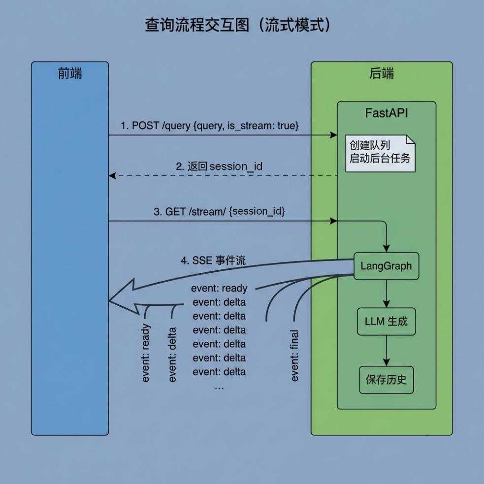

<!-- source-block:4419 -->
##### 整体架构概述

<!-- source-block:4420 -->
项目采用 FastAPI + SSE 流式推送 架构，支持实时问答和文件导入两大核心功能。

<!-- source-block:4421 -->
关键设计思想：

<!-- source-block:4422 -->
- 异步非阻塞：长时间任务在后台运行，接口立即返回

<!-- source-block:4423 -->
- SSE 实时推送：前端建立长连接，后端逐步推送处理进度和结果

<!-- source-block:4424 -->
- CORS 跨域配置：允许前端跨域访问

<!-- source-block:4425 -->
##### SSE机制详解

<!-- source-block:4426 -->
**SSE 事件类型**

<!-- source-block:4427 -->
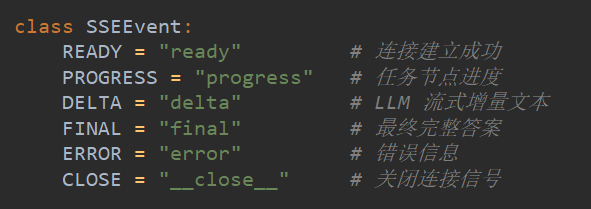

<!-- source-block:4428 -->
**SSE 消息格式**

<!-- source-block:4429 -->
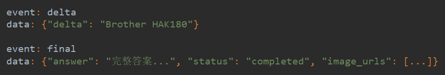

<!-- source-block:4430 -->
**核心工作流程**

<!-- source-block:4431 -->
前端请求→后端创建Queue→后台任务执行→push到Queue→SSE Generator读取→推送给前端

<!-- source-block:4432 -->
##### 前后端交互模式对比

<!-- source-block:4433 -->
**模式 A：流式查询（SSE）**

<!-- source-block:4434 -->
前端: POST /query (is\_stream=true)

<!-- source-block:4435 -->
后端: 立即返回 {"message":"结果正在处理中...", "session\_id":"xxx"}

<!-- source-block:4436 -->
前端: GET /stream/{session\_id} (建立SSE连接)

<!-- source-block:4437 -->
后端:

<!-- source-block:4438 -->
→ 推送 "ready" 事件

<!-- source-block:4439 -->
→ 执行工作流...

<!-- source-block:4440 -->
→ 节点执行时 push\_to\_session("delta", {...})

<!-- source-block:4441 -->
→ SSE Generator 实时推送给前端

<!-- source-block:4442 -->
→ 推送 "final" 事件（含答案+图片URL）

<!-- source-block:4443 -->
→ 清理队列，关闭连接

<!-- source-block:4444 -->
**模式 B：同步查询**

<!-- source-block:4445 -->
前端: POST /query (is\_stream=false)

<!-- source-block:4446 -->
后端: 同步执行整个工作流，等待完成

<!-- source-block:4447 -->
后端: 返回 {"answer":"完整答案", "session\_id":"xxx"}

<!-- source-block:4448 -->
**模式 C：文件导入（轮询）**

<!-- source-block:4449 -->
前端: POST /upload (上传文件)

<!-- source-block:4450 -->
后端: 保存到本地 + MinIO，启动后台任务，返回 task\_ids

<!-- source-block:4451 -->
前端: 定时轮询 GET /status/{task\_id}

<!-- source-block:4452 -->
后端: 返回

<!-- source-block:4453 -->
{"status":"processing", "done\_list":\["node1","node2"\], "running\_list":\["node3"\]}

<!-- source-block:4454 -->
##### 非阻塞架构

<!-- source-block:4455 -->
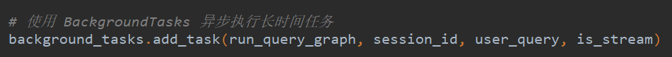

<!-- source-block:4456 -->
### 技术细节与痛点分析

<!-- source-block:4457 -->
#### 核心技术细节

<!-- source-block:4458 -->
##### 文档切分长度阈值控制

<!-- source-block:4459 -->
文档切分时，chunk过大会导致检索精度下降，chunk过小会丢失上下文信息。

<!-- source-block:4460 -->
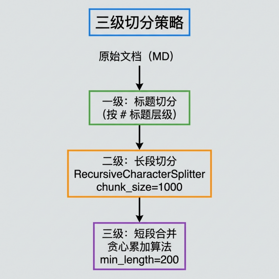

<!-- source-block:4461 -->
##### 多路检索并发执行

<!-- source-block:4462 -->
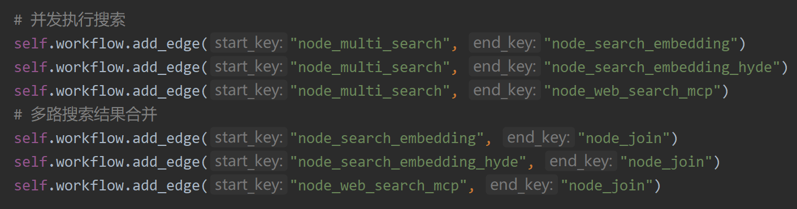

<!-- source-block:4463 -->
##### Prompt字符预算控制

<!-- source-block:4464 -->
上下文最大字符数计算，遍历累加超限时 break

<!-- source-block:4465 -->
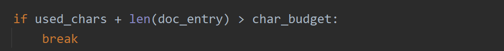

<!-- source-block:4466 -->
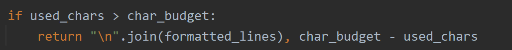

<!-- source-block:4467 -->
##### 品名对齐 - 置信度阈值分级

<!-- source-block:4468 -->
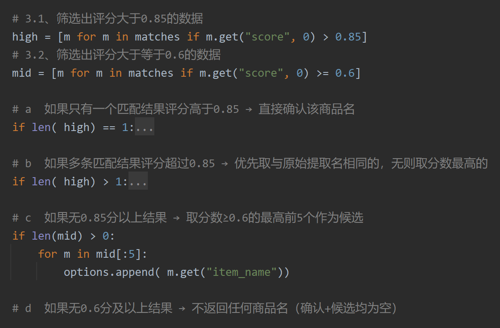

<!-- source-block:4469 -->
##### RRF 融合排序

<!-- source-block:4470 -->
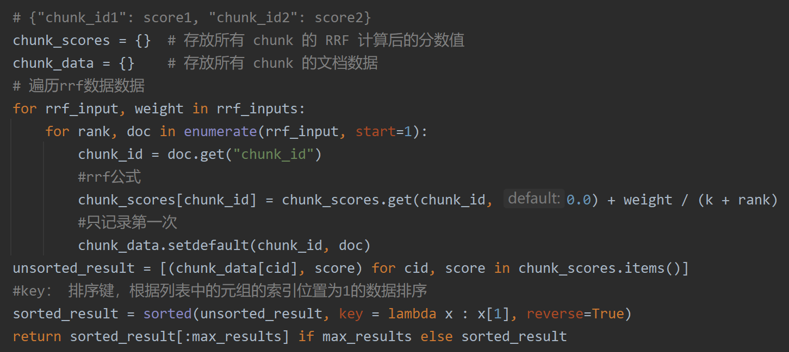

<!-- source-block:4471 -->
##### 断崖检测截断

<!-- source-block:4472 -->
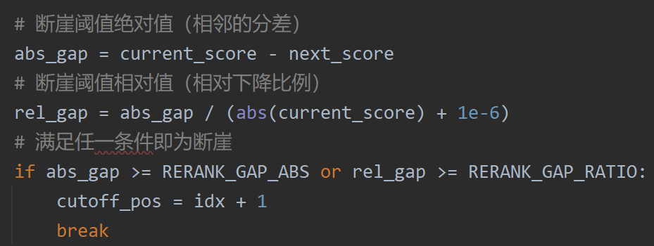

<!-- source-block:4473 -->
#### 痛点问题与解决方案

<!-- source-block:4474 -->
##### 文档切分导致语义丢失问题

<!-- source-block:4475 -->
| 问题描述 | 大文档切分后，各个chunk丢失上下文信息，无法追溯来源 |
| --- | --- |
| 解决方案 | 标题注入等机制 |
| 技术实现 | 每个chunk添加前缀：文档来源:{原文档标题}\\n{chunk内容} |
| 效果提升 | LLM能够正确引用来源，答案可追溯性增强 |

<!-- source-block:4476 -->
##### 向量数据库批量插入性能问题

<!-- source-block:4477 -->
| 问题描述 | 大批量导入时：逐条插入Milvus效率低下，一次性导入超过模型处理能力 |
| --- | --- |
| 解决方案 | 使用分批次处理机制 |
| 技术实现 | 将大批量数据切分成小批次数据插入 |
| 效果提升 | 提高效率的同时兼顾了模型的处理能力 |

<!-- source-block:4478 -->
##### 商品名误判问题

<!-- source-block:4479 -->
| 问题描述 | LLM 提取商品名时可能出现误判。 |
| --- | --- |
| 解决方案 | 两级过滤机制 |
| 技术实现 | LLM提取商品名后使用向量对齐和评分对齐再次确认商品名 |
| 效果提升 | 即保证了召回率又控制了精度 |

<!-- source-block:4480 -->
##### 历史记录商品名缺失问题

<!-- source-block:4481 -->
| 问题描述 | 多轮对话后才明确商品名，导致前几轮对话的 item\_names 字段为空。 |
| --- | --- |
| 解决方案 | 延迟回填机制 |
| 技术实现 | 回填历史记录中空的 item\_names并存入mongodb |
| 效果提升 | 确保历史记录的完整性<br>支持后续的对话上下文分析<br>方便数据统计和分析 |

<!-- source-block:4482 -->
##### LLM调用稳定性问题

<!-- source-block:4483 -->
| 问题描述 | 大量并发的LLM调用可能导致API限流或超时。 |
| --- | --- |
| 解决方案 | 信号量控制 |
| 技术实现 | 使用双端队列限制同时进行的LLM调用数量 |
| 效果提升 | 避免模型API接口限流 |
