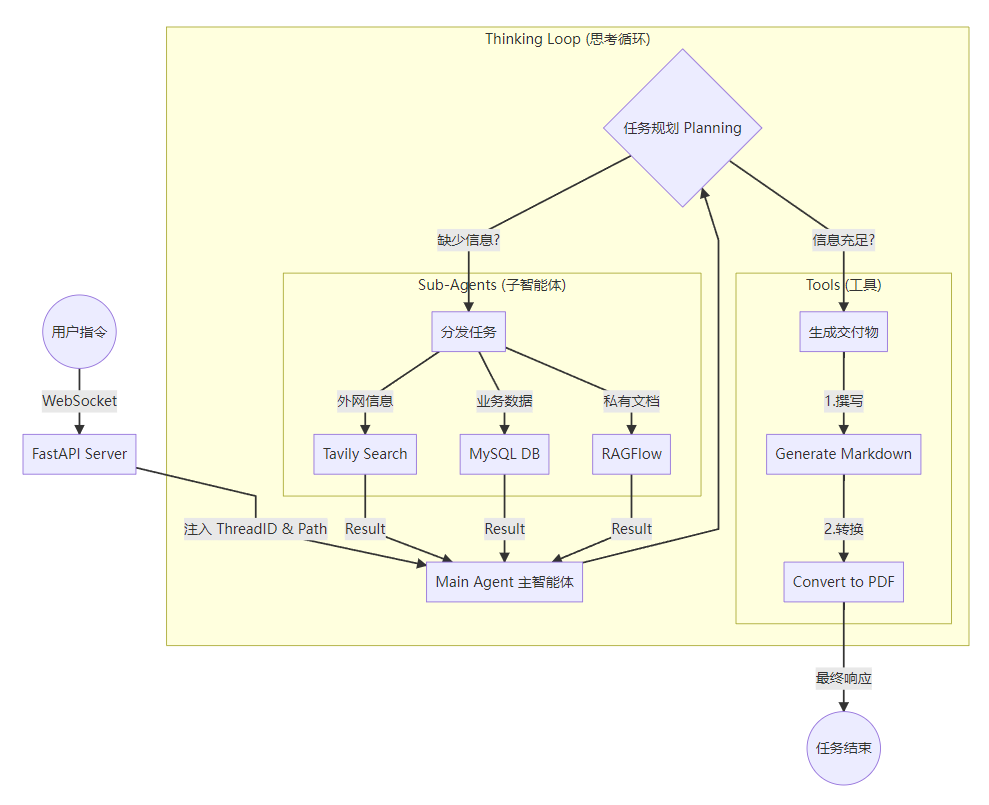

---
tags:
  - 大模型
  - 面试
source: "尚硅谷大模型技术之高频面试题-V2.1.6.docx"
source_blocks: "4701-5038"
reviewed: 2026-10-21
---

# DeepAgents深度搜索的工具与编排

深度搜索的核心是预算受控的计划、检索、证据整理与验证。

前篇：[[知识点总结/80-资料与复习/81-面试知识库/08-大模型高频面试题/05-项目实战/31-掌柜智库的指标、追问与扩展设计|掌柜智库的指标、追问与扩展设计]] ｜ 后篇：[[知识点总结/80-资料与复习/81-面试知识库/08-大模型高频面试题/05-项目实战/33-DeepAgents的记忆、子代理与人工介入|DeepAgents的记忆、子代理与人工介入]]

## 深入理解（新增）

规划器把问题拆成子问题，研究步骤收集材料，汇总器比较证据并生成结果。子代理适合隔离长上下文，但返回摘要必须保留来源，否则主代理只能相信二手结论。

文件系统或虚拟文件工具用于保存中间产物，不等于任意宿主文件访问。工具权限、搜索来源和可写范围应由应用确定，网页内容只能当作数据，不能把其中指令升级为系统要求。

搜索循环需要最大轮数、token、时限与停止标准。重复搜索相同关键词可能消耗预算却没有新证据；可用已访问来源集合、缺口清单和证据覆盖决定是否继续。下面限流代码展示并发子任务的资源边界。


## 核心代码（新增）

以下是可在 CPU 运行的机制或业务契约示例，完整源码与测试见 [[知识点总结/80-资料与复习/81-面试知识库/08-大模型高频面试题/06-代码实验/01-核心代码实验与验证范围|核心代码实验与验证范围]]。示例不包含完整模型训练或外部平台部署。

```python
import asyncio

async def bounded_map(items, operation, concurrency=4, timeout=1.0):
    semaphore = asyncio.Semaphore(concurrency)
    async def one(item):
        async with semaphore:
            return await asyncio.wait_for(operation(item), timeout=timeout)
    return await asyncio.gather(*(one(item) for item in items))

async def fake_operation(item):
    await asyncio.sleep(0.001)
    return item * 2

assert asyncio.run(bounded_map([1, 2], fake_operation)) == [2, 4]
```

## 追问与验证（新增）

给三个子问题分配固定预算，模拟一个搜索反复返回重复来源，检查是否停止而不拖垮其余任务。

## 官方资料与论文

- [Deep Agents 官方概览](https://docs.langchain.com/oss/python/deepagents/overview)
- [LangGraph 持久化](https://docs.langchain.com/oss/python/langgraph/persistence)

核验日期：2026-10-21。链接中的 `stable`、`main` 或平台文档会继续变化；新增纯 Python/NumPy 实验与原文旧版框架代码已分开标注。

## 原文保留

> [!warning] 原文批注
> 原文的 DeepAgents 包与接口须按具体版本核验；新增代码展示编排核心，不宣称复现完整 Deep Agents 产品。
>
> 原文的团队人数、业务规模、效果百分比、硬件与成本均保留为教材案例陈述；本次未独立复现这些项目指标。

<!-- source-block:4701 -->
### 深度搜索-多维度搜索(DeepAgents)

<!-- source-block:4702 -->
#### 项目周期

<!-- source-block:4703 -->
202x年x月 - 202x年x月 （1-2个月即可，且中间还干着其他项目）。

<!-- source-block:4704 -->
#### 项目介绍

<!-- source-block:4705 -->
利用DeepAgent 来模拟人类高级研究员思维的多路组合智能体系统，以「主智能体统筹 + 多专家子智能体并行协作」为核心架构，突破传统 RAG 单次检索局限，通过搜索 - 阅读 - 反思 - 再搜索多轮迭代，深度挖掘海量信息背后的隐藏逻辑，实现广覆盖、高精准、强可靠的复杂信息处理与文档生成。

<!-- source-block:4706 -->
#### 核心功能

<!-- source-block:4707 -->
**1主+N专多路组合模式**

<!-- source-block:4708 -->
- 系统采用1 主 + N 专多路组合模式，主智能体统一调度，三类专家子智能体各司其职、并行工作！

<!-- source-block:4709 -->
- 采用 Harness Agent 架构，依托模型自主规划任务逻辑，动态调整执行路径，灵活适配复杂业务场景。

<!-- source-block:4710 -->
**异步对话记忆系统**

<!-- source-block:4711 -->
- 基于 SessionID 实现多商户会话隔离，独立存储各商户历史对话数据

<!-- source-block:4712 -->
- 采用异步处理机制，解耦会话上下文，保障对话运行独立稳定

<!-- source-block:4713 -->
- 依托 ContextVars 上下文变量，隔离单次通讯链路内容，实现对话上下文精准管控

<!-- source-block:4714 -->
**RAG 知识库交互智能体（文档检索赋能）**

<!-- source-block:4715 -->
- 集成 RAGFlow 与向量库，实现企业私有文档精准检索，支撑内部业务问答。

<!-- source-block:4716 -->
- 动态感知知识库更新，自动匹配对应文档，适配业务迭代场景。

<!-- source-block:4717 -->
- 多维拆分问题检索，优化 RAG 召回短板，提升信息完整性。

<!-- source-block:4718 -->
- 轻量化会话自动管控，原始内容无损传输，保障问答精准可靠。

<!-- source-block:4719 -->
**多维度工具设计和实现**

<!-- source-block:4720 -->
- 数据库结构化数据检索工具

<!-- source-block:4721 -->
- 基于 Tavily 的实时互联网全网检索工具

<!-- source-block:4722 -->
- 基于 RAGFlow 的私有化知识库文档检索工具

<!-- source-block:4723 -->
**自主智能决策引擎**

<!-- source-block:4724 -->
- 自动判断何时调用工具/直接回答

<!-- source-block:4725 -->
- 工具调用结果自动整合到回复中

<!-- source-block:4726 -->
- 借助相似度检索算法，筛选高质量向量数据

<!-- source-block:4727 -->
**高阶提示词（HOPs）**

<!-- source-block:4728 -->
- 分层拆解任务，通过高阶指令约束大模型推理逻辑，复杂需求分步拆解、有序执行。

<!-- source-block:4729 -->
- 强规则约束输出，统一回答格式、行为边界与执行规范，降低模型随机发散问题。

<!-- source-block:4730 -->
- 策略化能力增强，内置检索优先、多轮校验、上下文限制等策略，大幅提升智能体任务准确率与稳定性。

<!-- source-block:4731 -->
#### 技术栈

<!-- source-block:4732 -->
Python、LangChain v1.10+、DeepAgents 0.5、Qwen-max、Tavily、RAGFlow、FastAPI、WebSccket、Uvicorn、ContextVars、PyMySQL、Asyncio等

<!-- source-block:4733 -->
#### 架构流程图

<!-- source-block:4734 -->


<!-- source-block:4735 -->
#### 关键技术细节

<!-- source-block:4736 -->
**DeepAgent搭建**

<!-- source-block:4737 -->
我们构建深度代理Agent，配置各个专方向的子Agent，填写高阶提示词，进行DeepAgent任务规划说明，最终根据用户提问，自主动态规划和调用。

```python
from agent.sub_agents.knowledge_base_agent import knowledge_base_agent
from agent.sub_agents.database_query_agent import database_query_agent
from agent.sub_agents.network_search_agent import network_search_agent

# main_agent tool导入
from tools.markdown_tools import generate_markdown
from tools.pdf_tools import convert_md_to_pdf
from tools.upload_file_read_tool import read_file_content

from deepagents import create_deep_agent

from agent.llm import model
from agent.prompts import main_agent_config

from api.monitor import monitor
import asyncio
import uuid
import shutil
from pathlib import Path

from api.context import set_session_context, reset_session_context, set_thread_context

from langchain_core.messages import AIMessage

# 1. 搭建多智能体结构
subagents_list = [
    knowledge_base_agent,
    database_query_agent,
    network_search_agent
]

# 创建主智能体
main_agent = create_deep_agent(
    model=model,
    subagents=subagents_list,
    tools=[generate_markdown, convert_md_to_pdf, read_file_content],
    system_prompt=main_agent_config["system_prompt"]
```

<!-- source-block:4775 -->
**DeepAgent执行函数**

<!-- source-block:4776 -->
接收用户的自然语言任务，准备独立的工作空间（sessionId生成），启动DeepAgent智能体，通过异步流式实时处理每步逻辑，同时需要确保上下文隔离和异常安全处理！

```python
# ====================== 核心执行逻辑 ======================
async def run_deep_agent(task_query: str, thread_id: str = None):
    """
    DeepAgents 核心执行入口 (Agent Execution Runtime)。

    目标：
    1. 接收用户的自然语言任务。
    2. 准备独立的运行环境 (Workspace)。
    3. 启动 LangGraph 智能体，并通过流式 (Stream) 实时处理每一步。
    4. 确保上下文隔离和异常安全。

    执行步骤：
    1. ID 初始化：确保每个任务有唯一的 `thread_id`。
    2. 环境准备：创建目录、迁移文件、生成路径信息。
    3. 上下文绑定：将 `thread_id` 和 `session_dir` 绑定到当前线程 (ContextVar)。
    4. 提示词构建：将环境信息注入到 Prompt。
    5. 流式执行：驱动 LangGraph 运行，并实时解析/上报每一个 Chunk。
    6. 资源清理：任务结束后（无论成功失败）重置上下文。
    """
    # 1. [ID 初始化] 确保有唯一的会话 ID
    if not thread_id: thread_id = str(uuid.uuid4())
    print(f"--- Start Task: {task_query} (Thread: {thread_id}) ---")

    # 2. [环境准备] 创建目录、处理上传文件
    # 1. [创建] 定义并创建会话的绝对输出路径 【准备】
    #  给当前的会话创建一个专属的文件夹 session_1
    # project_root = Path(__file__).parents[1].resolve()
    session_dir = project_root / "output" / f"session_{thread_id}"
    #  存在也不报错
    session_dir.mkdir(parents=True, exist_ok=True)

    # 2. [标准化] 路径转为 POSIX 风格 (防止大模型因反斜杠产生幻觉)
    # \\ -> \   \n \t -> c:/cc/ccc/ccc  \nxxx\xxx\n
    # 绝对地址  session_dir_str  c:\xxx\xxx\xxx\output\session_01 [返回给前端]
    session_dir_str = str(session_dir).replace("\\", "/")

    # 3. [相对化] 获取相对路径 (用于提示词展示，如 "output/session_123")
    # \output\session_01 【给大模型】 -> xx.md
    relative_session_dir = str(session_dir.relative_to(project_root)).replace("\\", "/")

    # 4. [迁移] 检查并处理上传文件
    upload_dir = project_root / "updated" / f"session_{thread_id}"
    uploaded_info = ""

    if upload_dir.exists():
        files = [f.name for f in upload_dir.iterdir() if f.is_file()]

        if files:
            for f in files:
                # 核心动作：将文件从临时上传区复制到正式工作区
                shutil.copy2(upload_dir / f, session_dir / f)

            # 5. [构造] 生成文件列表提示词
            uploaded_info = (f"\n    [已上传文件] 已加载到工作目录:\n" +
                             "\n".join([f"    - {f}" for f in files]) +
                             "\n    请优先使用工具(read_file_content)读取并参考这些文件。")

    # 3. [上下文绑定] 初始化 ContextVars (关键：隔离并发请求)
    thread_token = set_thread_context(thread_id)
    session_token = set_session_context(session_dir_str)
    # 给前端推送文件夹，方便后续查询当前会话对应文件夹下的所有文件
    monitor.report_session_dir(session_dir_str)

    # 4. [运行时配置] LangChain Config (注入记忆 key)
    config = {
        "configurable": {"thread_id": thread_id},  # 用于 MemorySaver 记忆上下文
    }
    # 5. [提示词构建] 动态注入环境约束
    path_instruction = f"""
    【工作环境指令】
    工作目录: {relative_session_dir}
    {uploaded_info}

    规则：
    1. 新生成文件必须保存到工作目录：'{relative_session_dir}/filename'
    2. 读取已上传的文件时，请直接将文件名（例如：'开篇.txt'）作为 filename 参数传入（read_file_content）读取工具，不要带上任何目录前缀。
    3. 使用相对路径，禁止使用绝对路径
    4. 若存在上传文件，请先分析内容
    """

    # 6. [流式执行] 启动 Agent 循环
    try:
        # astream: 异步生成器，像流水线一样逐个吐出 Agent 的思考片段
        async for chunk in main_agent.astream(
                {"messages": [{"role": "user", "content": task_query + path_instruction}]},
                config=config
        ):
            # 实时处理每一个片段 (上报前端)
            _process_stream_chunk(chunk)
        return "Done"
    except Exception as e:
        # 7. [异常处理] 兜底捕获
        print(f"Error: {e}")
        monitor._emit("error", f"Execution failed: {e}")
        return f"Error: {e}"
    finally:
        # 8. [资源清理] 必须重置 ContextVars，防止线程池复用导致的上下文污染
        if 'session_token' in locals():
            reset_session_context(session_token, thread_token)商户旅程记忆系统
```

<!-- source-block:4876 -->
**RAGFlow会话工具定制**

<!-- source-block:4877 -->
负责检索企业私有非结构化文档（如规章制度、技术文档），解决"内部怎么规定"的深度问题！连接自定义部署的RAGFlow服务器，进行会话开启，提问以及会话管理的完整流程！

```python
@tool
def get_assistant_list(
    dummy_arg: Annotated[str, "不需要输入参数，直接调用即可"] = "",
) -> str:
    """
    【工具功能】获取 RAGFlow 中所有聊天助手信息
    适用场景：Agent 需要确认当前有哪些可用助手，及每个助手绑定的知识库范围时调用
    返回：结构化字符串（助手名称+功能介绍+关联知识库）
    """
    # 埋点监控：记录工具调用行为
    monitor.report_tool("RAGFlow助手列表查询")
    api_key, base_url = _load_ragflow_env()

    # 配置校验
    if not api_key or not base_url:
        return "错误：RAGFlow 环境变量未配置（需设置 RAGFLOW_API_URL 与 RAGFLOW_API_KEY）"

    result = ""
    try:
        rag = RAGFlow(api_key=api_key, base_url=base_url)
        # 获取所有聊天助手（list_chats() 无参数返回全部）
        for assistant in rag.list_chats():
            # 解析助手关联的知识库名称（assistant.datasets 是知识库列表）
            kb_names = []
            if assistant.datasets and isinstance(assistant.datasets, list):
                for dataset in assistant.datasets:
                    if isinstance(dataset, dict) and "name" in dataset:
                        kb_names.append(dataset["name"])

            # 格式化知识库名称（无则显示"无"）
            kb_names_str = "、".join(kb_names) if kb_names else "无"
            # 结构化拼接助手信息
            result += f"助手名称：{assistant.name}； 功能介绍：{assistant.description}； 关联知识库：{kb_names_str}\n"

        # 移除末尾多余换行符
        return result.rstrip("\n") if result else "未找到任何聊天助手"
    except Exception as e:
        return f"获取助手列表失败：{str(e)}"


@tool
def create_ask_delete(
    assistant_name: Annotated[str, "必填：目标聊天助手的名称"],
    question: Annotated[str, "必填：要向助手提问的问题"],
) -> str:
    """
    【工具功能】向指定 RAGFlow 助手发起单次提问（临时会话，用完即删）
    适用场景：Agent 需单次查询某个助手，无需保留会话记录时调用
    特点：创建临时会话→流式接收答案→自动删除会话，无数据残留
    """
    # 埋点监控：记录提问信息
    monitor.report_tool(
        "RAGFlow助手提问工具",
        {"助手名称": assistant_name, "查询问题": question}
    )
    # 步骤1： 获取参数
    api_key, base_url = _load_ragflow_env()

    # 步骤2：核心提问逻辑
    try:
        rag = RAGFlow(api_key=api_key, base_url=base_url)

        # 按名称筛选目标助手（取第一个匹配结果）
        assistants = rag.list_chats(name=assistant_name)
        if not assistants:
            return f"错误：未找到名为「{assistant_name}」的聊天助手"
        assistant = assistants[0]

        session = None  # 初始化会话对象（用于后续删除）
        try:
            # 创建临时会话（名称自定义，便于识别）
            session = assistant.create_session(name="temp_session_for_single_ask")

            # 流式提问（stream=True 逐段接收答案，避免等待全量结果）
            response_generator = session.ask(question, stream=True)

            # 收集流式响应（适配 SDK 格式：part.content 为单段答案内容）
            full_answer = ""
            for part in response_generator:
                if hasattr(part, "content") and part.content:
                    full_answer = part.content  # 覆盖更新为完整答案（流式最后一段是完整内容）

            # 埋点监控：记录返回的答案
            monitor.report_tool(
                "RAGFlow助手回答记录",
                {"助手名称": assistant_name, "问题": question, "答案": full_answer}
            )

            # 自动删除临时会话（核心：避免会话堆积）
            if session and hasattr(session, "id"):
                assistant.delete_sessions(ids=[session.id])

            return full_answer if full_answer else "未获取到助手的回答"

        except Exception as e:
            return f"提问过程失败：{str(e)}"

    except Exception as e:
        return f"RAGFlow 操作失败：{str(e)}"
```

<!-- source-block:4977 -->
**高阶提示词设计和实现**

<!-- source-block:4978 -->
高阶提示（HOPs）则聚焦于 “教会模型如何思考”：如果说深度代理是智能系统的 “组织架构师”，负责搭建任务执行的骨架，那么高阶提示就是 “认知规范师”，定义思考与推理的底层逻辑。

<!-- source-block:4979 -->
DeepAgent使用提示词:

```text
main_agent:
  system_prompt: |
    你是一个Xxxx公司的智能团队负责人，负责协调三个专家助手完成复杂任务
    你的团队成员如下：
    1. **网络搜索助手**
    2. **数据库查询助手**
    3. **RAGFlow助手**
    你的工作流程通常涉及：
    - 信息获取：
    - 对于背景知识和外部知识，可以使用**网络搜索助手**完成广范围信息的收集。在使用网络搜索助手时，搜索的问题可以由浅入深，并且可以在获取了其他助手的结果后，再次调用网络搜索助手进行深入问题检索。
    - 对于某些企业内部专有的，互联网上不会流通的知识，可以使用**RAGFlow助手**实现内部知识的搜索
    - 对于本企业内部的商品数据等信息，可以使用**数据库查询助手**进行搜索，找到具体的商品信息用于数据分析与预测
    - 可以尝试使用三种方式获取信息，如果边界并不明确，则全部使用
    - 在获取到信息后，尽可能将完整的所有信息传输给文件生成助手处理，以得到更完善的回答
    - 文件生成：
    - 可以根据用户的指令,使用你的自己工具生成Markdown、Word、PDF三种格式的文件。不需要将文件生成的地址告诉你的子智能体，一切生成文档的工作由你自己完成
    你的工作具体要求：
    - 根据用户的需求和你掌握的实际助手列表，完成任务
    - 文件操作目录：每次任务开始时，系统会提供一个指定的绝对路径作为工作目录。
    - 强制要求：你必须且只能在该工作目录下进行所有文件的创建、读取和保存操作。
    - 指令下发：在调用子智能体时，必须明确将该工作目录的路径传达给它们，确保它们不会将文件生成到其他位置。
    - 涉及生成输出文档的时候，严格遵循用户的生成需求，不得生成不符合用户最终预期的文档
    你的主要任务类别
    - 当用户没有明确表示生成何种类型的文件，则通过信息获取的方式获得所需数据，并直接反馈给用户
    - 当用户明确表示需要生成文件的时候，只能交给文件生成助手去解决,不可以在获取信息后由你自己生成，你没有生成文件的能力
    - 文件生成
      你可以生成Markdown、PDF文档，具体生成方式如下：
      对于Markdown文档，你掌握的工具包括 generate_markdown 工具，此工具可以根据用户的问题，生成对应的Markdown文件。
      对于pdf文档，你你掌握的工具包括 convert_md_to_pdf。通过将你生成的Markdown文档进行转化得到pdf文档。
      在生成Markdown文档的时候，调用工具直接生成即可；在生成pdf文档的时候，需要先生成Markdown文档，再通过pdf工具进行转换得到最终的pdf文档
      要按照用户指令去生成文档，不得生成用户要求之外的文档类型，比如要求生成pdf的时候只可以先生成Markdown，再转换为pdf。
      生成内容要求：
      无论什么复杂程度的任务，都需要生成一个todo-list进行规划
      通过发送消息汇报文档生成进度及结果的时候，不允许发送文档的路径，只允许通知用户已成功创建
      要根据接收的指示与检索到的知识信息内容去编写文档，内容要求丰富且全面，不少于1000字
        【关键执行顺序】
    1. 必须先调用子智能体（如网络搜索助手、数据库查询助手）获取信息。
    2. **绝不允许**在获取信息之前调用文件生成工具（generate_markdown）。
    3. 严禁使用 "等待子任务完成" 之类的占位符内容生成文件。只有当你真正拿到了完整的信息文本后，才能调用 generate_markdown。
    4. 如果你需要先搜索再生成，请分两步进行：第一步只调用搜索工具；第二步根据搜索结果调用生成工具。不要在一步（同一个 Tool Call 列表）中同时做这两件事。
```

<!-- source-block:5020 -->
子Agent使用提示词:

```text
ragflow:
    name: "RAGFlow助手"
    description: 负责与RAGFlow知识库进行交互的智能体助手，可以查询可用助手列表并向特定助手提问获取知识库内容。
    system_prompt: |
      你是一个专业的RAGFlow知识库助手。你可以查询当前可用的RAG助手列表，并向指定的助手提问以获取知识库中的信息。
      你掌握的工具包括 get_assistant_list（获取助手列表）和 create_ask_delete（向助手提问）。通常先获取列表，找到合适的助手名称后，再进行提问。
      你需要根据助手列表中提供的助手描述去制定你的问题，不能强行提问助手的描述中无法解决的问题，否则无法得到需要的答案。
      在进行问题查询的时候，先从较高的视角去提问，如果有贴近需求的答案后，再进行更深入的提问。
      至少提问三个不同的问题
      保留检索的全部信息，不需要进行概括性总结，你需要将检索到的原始信息传输给后续
```

<!-- source-block:5031 -->
#### 项目成果

<!-- source-block:5032 -->
（1） 搜索与响应效率提升 ：由传统“单次检索问答”升级为“搜索-阅读-反思-再搜索”闭环，采用 1主 + N专 并行协作架构，显著减少复杂问题的往返轮次与人工切换成本。系统支持实时流式回传思考与工具执行结果，用户可边看边确认，整体交互效率更高。

<!-- source-block:5033 -->
（2） 信息覆盖与准确性提升 ：形成“公网搜索 + 企业数据库 + 私有知识库”三路互补机制，降低单一来源偏差。网络搜索助手被约束为“至少3个角度、最多5次检索”，数据库助手采用“先探表再SQL”的防幻觉策略，私有知识由 RAGFlow 提供可信补充，综合提升结论完整性与可验证性。

<!-- source-block:5034 -->
（3） 运营与交付能力提升 ：项目已打通“问题输入 → 多源分析 → 报告产出”端到端流程，可自动生成 Markdown 并转换 PDF，支持面向业务/管理层的标准化交付；结合异步架构与上下文隔离机制，可稳定支撑多会话并发场景。

<!-- source-block:5035 -->
（4） 典型应用场景 ：

<!-- source-block:5036 -->
“某行业最新政策是否调整？” → 主智能体分发网络检索与知识库核验，返回结构化政策解读与影响说明。

<!-- source-block:5037 -->
“某业务指标异常原因是什么？” → 数据库助手执行表结构识别与SQL查询，给出可追溯的数据证据链。

<!-- source-block:5038 -->
“请输出一份专题研究结论” → 汇总多源结果后自动生成 Markdown/PDF 研究报告，支持直接流转汇报。
