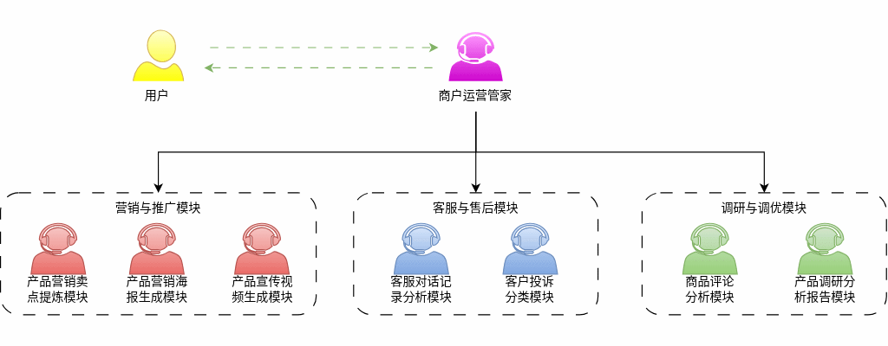
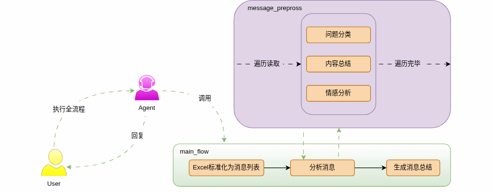
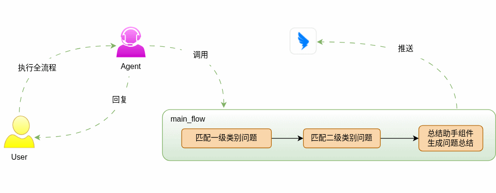
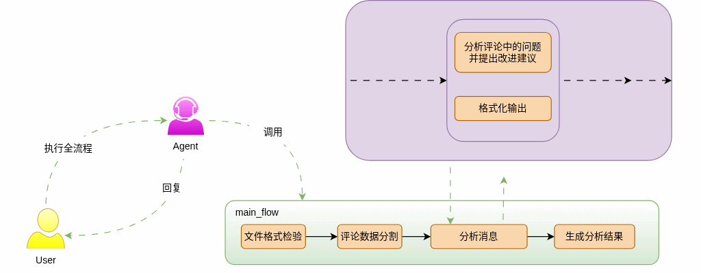
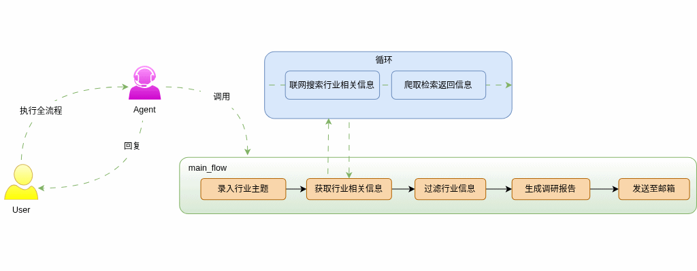
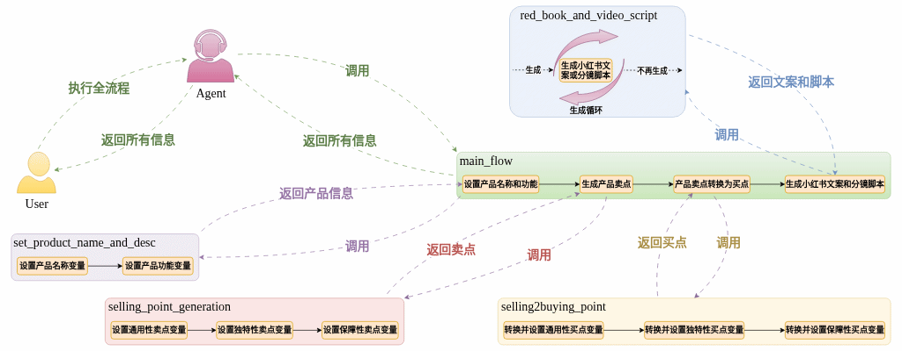
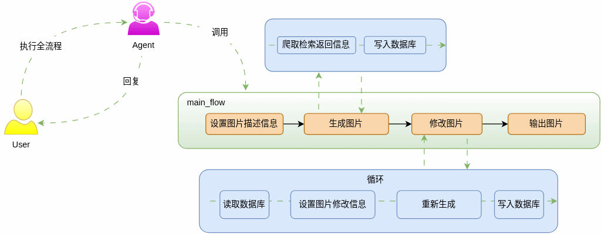
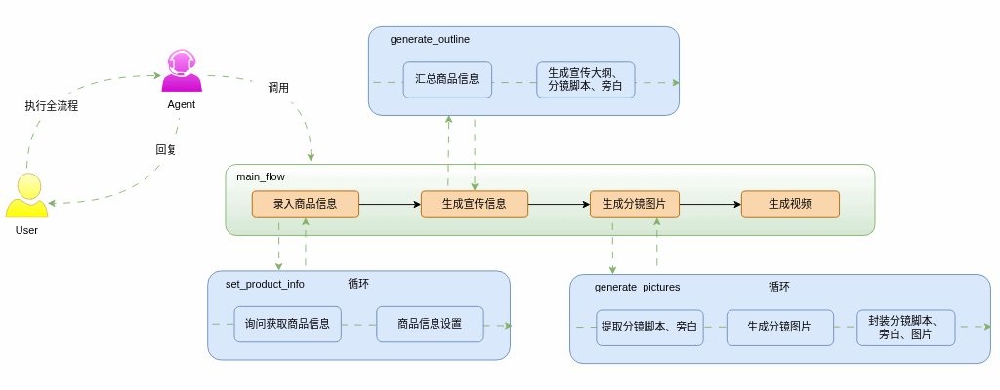

---
tags:
  - 大模型
  - 面试
source: "尚硅谷大模型技术之高频面试题-V2.1.6.docx"
source_blocks: "5088-5241"
reviewed: 2026-10-21
---

# Coze商户管家的结构化工作流

低代码节点也应遵守类型、状态和失败契约。

前篇：[[知识点总结/80-资料与复习/81-面试知识库/08-大模型高频面试题/05-项目实战/33-DeepAgents的记忆、子代理与人工介入|DeepAgents的记忆、子代理与人工介入]] ｜ 后篇：[[知识点总结/80-资料与复习/81-面试知识库/08-大模型高频面试题/05-项目实战/35-Coze商户管家的可靠性与项目核验|Coze商户管家的可靠性与项目核验]]

## 深入理解（新增）

商户管家先把需求解析成结构化字段，再按工作流调用知识、数据库或外部插件。每个节点应定义输入、输出、缺失字段与失败分支；不能用“LLM 返回了 JSON”代替字段与业务校验。

循环和并发节点需要上限，调用第三方接口要设置超时、重试及幂等。远端已受理但本地超时时，应先查任务状态而不是直接重发，防止重复创建操作。

发布时记录 workflow_id 与版本，保存节点配置和样例输入输出用于回归。平台界面、套餐和渠道能力会变化，新增内容只引用当前官方接口，不复写未经验证的固定限制。


## 核心代码（新增）

以下是可在 CPU 运行的机制或业务契约示例，完整源码与测试见 [[知识点总结/80-资料与复习/81-面试知识库/08-大模型高频面试题/06-代码实验/01-核心代码实验与验证范围|核心代码实验与验证范围]]。示例不包含完整模型训练或外部平台部署。

```python
import asyncio
import json

def validate_tool_call(payload):
    data = json.loads(payload)
    if not isinstance(data, dict) or set(data) != {"tool", "args"}:
        raise ValueError("invalid envelope")
    if data["tool"] != "get_order" or not isinstance(data["args"], dict):
        raise ValueError("tool not allowed")
    order_id = data["args"].get("order_id")
    if set(data["args"]) != {"order_id"} or not isinstance(order_id, str) or not order_id.isdecimal():
        raise ValueError("invalid order_id")
    return data

async def bounded_map(items, operation, concurrency=4, timeout=1.0):
    semaphore = asyncio.Semaphore(concurrency)
    async def one(item):
        async with semaphore:
            return await asyncio.wait_for(operation(item), timeout=timeout)
    return await asyncio.gather(*(one(item) for item in items))

def route_customer_request(intent, slots, confirmed=False):
    if intent not in {"knowledge", "order_status", "cancel_order"}:
        return {"next": "clarify", "missing": ["intent"]}
    if intent == "knowledge":
        return {"next": "retrieve"}
    order_id = slots.get("order_id")
    if not isinstance(order_id, str) or not order_id.isdecimal():
        return {"next": "clarify", "missing": ["order_id"]}
    if intent == "cancel_order" and not confirmed:
        return {"next": "confirm", "order_id": order_id}
    # The execution service must still enforce identity, ownership and idempotency.
    return {"next": "execute", "tool": intent, "order_id": order_id}

call = validate_tool_call(
    '{"tool":"get_order","args":{"order_id":"123"}}')
assert call["args"]["order_id"] == "123"
# 接下来由执行服务核验调用者身份与订单归属；此函数未实现授权。

async def fake_operation(item):
    await asyncio.sleep(0.001)
    return item * 2

assert asyncio.run(bounded_map([1, 2], fake_operation)) == [2, 4]

next_step = route_customer_request("cancel_order", {"order_id":"123"})
assert next_step["next"] == "confirm"
```

## 追问与验证（新增）

删除一个必填字段并模拟插件超时，确认进入明确的澄清或失败分支，不输出“操作成功”。

## 官方资料与论文

- [扣子：执行工作流 API](https://docs.coze.cn/developer_guides_workflow_run)
- [扣子：代码节点与异常分支](https://docs.coze.cn/guides_code_node)

核验日期：2026-10-21。链接中的 `stable`、`main` 或平台文档会继续变化；新增纯 Python/NumPy 实验与原文旧版框架代码已分开标注。

## 原文保留

> [!warning] 原文批注
> 低代码工作流并不免除类型校验、授权、幂等与错误处理；原文截图和限制属于资料版本。
>
> 原文的团队人数、业务规模、效果百分比、硬件与成本均保留为教材案例陈述；本次未独立复现这些项目指标。

<!-- source-block:5088 -->
### 商户运营管家（Coze）

<!-- source-block:5089 -->
#### 项目周期

<!-- source-block:5090 -->
1-2人，2个月即可。

<!-- source-block:5091 -->
参考周期：

<!-- source-block:5092 -->
需求分析与方案设计1 周

<!-- source-block:5093 -->
模块搭建与核心配置2 周（可适当延长）

<!-- source-block:5094 -->
数据与外部工具对接1 周

<!-- source-block:5095 -->
流程调试与功能优化2 周

<!-- source-block:5096 -->
效果验证与上线2周

<!-- source-block:5097 -->
#### 项目简介

<!-- source-block:5098 -->
商户运营管家是面向中小商户打造的一体化智能运营辅助系统，该项目基于Coze平台搭建了一套智能体 + 工作流驱动的应用系统。

<!-- source-block:5099 -->
围绕商户核心运营痛点（客服数据难沉淀、用户反馈难分析、营销素材制作成本高），整合三大核心业务线：

<!-- source-block:5100 -->
客服与售后模块：实现客服对话智能分析、投诉自动分类，沉淀服务数据，辅助售后流程优化；

<!-- source-block:5101 -->
调研与优化模块：通过商品评论情感分析、市场调研数据整合，自动生成可视化分析报告，指导产品优化；

<!-- source-block:5102 -->
营销与推广模块：基于用户好评与商品卖点，一键提炼营销卖点、生成海报与宣传视频，降低内容制作门槛。

<!-- source-block:5103 -->
通过结合大模型与低代码平台能力，帮助商家实现客服效率提升、用户洞察增强以及营销内容生产自动化，从而提升整体经营效率与转化效果。

<!-- source-block:5104 -->
#### 整体架构设计

<!-- source-block:5105 -->
##### 核心模块划分

<!-- source-block:5106 -->
商户运营管家系统分为三个大模块、七个小模块。采用分层架构（前端交互层、业务逻辑层、数据层）设计，保证模块解耦且可扩展，整体架构如下：

<!-- source-block:5107 -->
**客服与售后模块**

<!-- source-block:5108 -->
- 客服对话记录分析模块

<!-- source-block:5109 -->
- 解析客服聊天记录，提取客户诉求、高频问题、服务质量指标等

<!-- source-block:5110 -->
- 客户投诉分类模块

<!-- source-block:5111 -->
- 自动分类投诉类型（如物流、质量、售后），生成投诉统计报表

<!-- source-block:5112 -->
**调研与优化模块**

<!-- source-block:5113 -->
- 商品评论分析模块

<!-- source-block:5114 -->
- 情感分析、关键词提取，挖掘用户对商品的褒贬点、改进建议

<!-- source-block:5115 -->
- 产品调研分析报告模块

<!-- source-block:5116 -->
整合评论、竞品、市场数据，自动生成可视化调研分析报告

<!-- source-block:5117 -->
**营销与推广模块**

<!-- source-block:5118 -->
- 产品营销卖点提炼模块

<!-- source-block:5119 -->
- 基于商品属性、用户好评、竞品差异，自动提炼核心营销卖点

<!-- source-block:5120 -->
- 产品营销海报生成模块

<!-- source-block:5121 -->
- 基于卖点自动生成多风格海报模板，支持自定义编辑

<!-- source-block:5122 -->
- 一键生成产品宣传视频模块

<!-- source-block:5123 -->
- 整合卖点、素材库，自动剪辑生成短视频（如抖音 / 快手风格）

<!-- source-block:5124 -->
##### 整体架构图

<!-- source-block:5125 -->
- 

<!-- source-block:5126 -->
##### 业务分层

<!-- source-block:5127 -->
- 数据采集层：对接电商平台评论 / 客服接口，或通过 Coze 表单手动上传对话记录、评论数据；

<!-- source-block:5128 -->
- 分析处理层：由客服 / 调研模块的 Bot 完成对话 / 评论分析、投诉分类、数据统计；

<!-- source-block:5129 -->
- 数据流转层：分析结果同步至知识库 / 数据节点，为营销模块提供输入；

<!-- source-block:5130 -->
- 内容生成层：营销模块基于分析数据，自动提炼卖点并生成海报、视频素材；

<!-- source-block:5131 -->
- 结果输出层：通过 Coze 对话界面、API 接口或文件导出，向商户提供分析报告、营销素材与运营建议。

<!-- source-block:5132 -->
#### 技术架构设计

<!-- source-block:5133 -->
##### 技术架构

<!-- source-block:5134 -->
主要开发平台：Coze可视化工作流引擎。。

<!-- source-block:5135 -->
采用 “低代码工作流 + 大模型 + 插件生态” 的三层架构

<!-- source-block:5136 -->
**前端交互层（Coze 对话界面、自定义表单、卡片组件）**

<!-- source-block:5137 -->
提供商户交互入口，支持数据上传、结果查看、素材预览

<!-- source-block:5138 -->
**业务逻辑层（Coze 工作流（Workflow）、大模型（LLM）、提示词工程）**

<!-- source-block:5139 -->
实现各模块核心逻辑：对话分析、情感分析、卖点提炼、流程编排

<!-- source-block:5140 -->
**工具与数据层（知识库（Knowledge Base）、API 插件、数据节点）**

<!-- source-block:5141 -->
提供数据存储、外部能力对接（如海报生成 API）、结果导出

<!-- source-block:5142 -->
##### 关键技术选型

<!-- source-block:5143 -->
大模型：优先使用 Coze 内置的通义千问系列模型，用于对话理解、情感分析、文案生成；复杂多模态任务可对接外部模型 API。

<!-- source-block:5144 -->
数据存储：Coze 知识库（用于沉淀对话、评论、报告数据）+ 变量节点 / 数据库插件（用于结构化数据存储，如投诉分类统计结果）。

<!-- source-block:5145 -->
外部插件：

<!-- source-block:5146 -->
数据采集：电商平台评论 API 插件、Excel/CSV 导入插件；

<!-- source-block:5147 -->
内容生成：第三方海报生成 API、视频剪辑 API（如剪映开放平台）；

<!-- source-block:5148 -->
结果导出：Excel/Word 导出插件、PDF 生成插件。

<!-- source-block:5149 -->
工作流编排：Coze Workflow，实现跨模块数据流转（如 “评论分析结果→卖点提炼→海报生成” 的自动化流程）。

<!-- source-block:5150 -->
#### 实现流程图

<!-- source-block:5151 -->
##### 系统总架构

<!-- source-block:5152 -->


<!-- source-block:5153 -->
##### 核心子流程图

<!-- source-block:5154 -->
商户运营管家系统分为三个大模块、七个小模块。

<!-- source-block:5155 -->
##### 客服与售后模块

<!-- source-block:5156 -->
**客服对话记录分析模块**

<!-- source-block:5157 -->


<!-- source-block:5158 -->
**客户投诉分类模块**

<!-- source-block:5159 -->
- 

<!-- source-block:5160 -->
##### 调研与优化模块

<!-- source-block:5161 -->
**商品评论分析模块**

<!-- source-block:5162 -->
- 

<!-- source-block:5163 -->
**产品调研分析报告模块**

<!-- source-block:5164 -->


<!-- source-block:5165 -->
##### 营销与推广模块

<!-- source-block:5166 -->
**产品营销卖点提炼模块**

<!-- source-block:5167 -->
- 

<!-- source-block:5168 -->
**产品营销海报生成模块**

<!-- source-block:5169 -->
- 

<!-- source-block:5170 -->
**一键生成产品宣传视频模块**

<!-- source-block:5171 -->


<!-- source-block:5172 -->
#### 关键实现细节

<!-- source-block:5173 -->
##### 客服与售后模块

<!-- source-block:5174 -->
##### 客服对话记录分析模块

<!-- source-block:5175 -->
数据接入：通过 Coze 表单支持商户上传客服聊天记录（文本 / CSV），或通过 API 插件对接电商平台客服数据接口；

<!-- source-block:5176 -->
核心逻辑：使用大模型 + 提示词工程，实现对话内容的结构化解析，提取客户诉求、服务响应时长、高频问题等指标；

<!-- source-block:5177 -->
【提示词示例】：

<!-- source-block:5178 -->
请分析以下客服对话记录，

<!-- source-block:5179 -->
提取：

<!-- source-block:5180 -->
1.用户咨询的核心问题；2.客服响应时长；3.是否解决用户问题；4.对话中的高频关键词。输出JSON格式结果。

<!-- source-block:5181 -->
结果存储：将分析结果存入知识库，用于后续投诉分类与服务质量统计。

<!-- source-block:5182 -->
##### 客户投诉分类模块

<!-- source-block:5183 -->
触发方式：对接客服对话分析模块的结果，自动识别投诉类对话；或通过商户手动上传投诉工单；

<!-- source-block:5184 -->
分类逻辑：通过 Few-shot 提示词，训练大模型识别投诉类型（如物流问题、质量问题、售后问题、服务态度问题），并生成分类统计报表；

<!-- source-block:5185 -->
输出形式：支持按时间、商品、投诉类型生成统计看板，导出 Excel 报表。

<!-- source-block:5186 -->
##### 调研与优化模块

<!-- source-block:5187 -->
##### 商品评论分析模块

<!-- source-block:5188 -->
数据采集：通过 API 插件对接电商平台评论接口，或支持商户批量导入评论数据；

<!-- source-block:5189 -->
核心能力：大模型实现情感分析（正面 / 负面 / 中性）、关键词提取、用户褒贬点挖掘；

<!-- source-block:5190 -->
数据同步：将分析结果（如好评关键词、差评原因）存入知识库，为调研报告与卖点提炼模块提供数据支持。

<!-- source-block:5191 -->
##### 产品调研分析报告模块

<!-- source-block:5192 -->
数据整合：自动拉取评论分析数据、竞品数据（可通过插件对接第三方数据平台）、市场趋势数据；

<!-- source-block:5193 -->
报告生成：通过大模型生成结构化报告，包含用户画像、产品优缺点、竞品对比、优化建议；

<!-- source-block:5194 -->
可视化展示：利用 Coze 卡片组件或导出插件，生成带图表的 PDF/Word 报告。

<!-- source-block:5195 -->
##### 营销与推广模块

<!-- source-block:5196 -->
##### 产品营销卖点提炼模块

<!-- source-block:5197 -->
输入来源：商品基础信息、好评关键词、竞品差异点（来自调研分析报告）；

<!-- source-block:5198 -->
提炼逻辑：通过提示词引导大模型提炼差异化卖点，生成多版本营销文案（适配海报、视频场景）；

<!-- source-block:5199 -->
【提示词示例】：

<!-- source-block:5200 -->
基于以下商品信息和用户好评，提炼3-5个核心营销卖点，每个卖点配1句宣传语，突出与竞品的差异，适配电商平台宣传场景。

<!-- source-block:5201 -->
结果复用：将提炼的卖点同步至海报、视频生成模块，实现营销内容的自动化生成。

<!-- source-block:5202 -->
##### 产品营销海报生成模块

<!-- source-block:5203 -->
模板配置：在 Coze 中预设多套海报模板（如电商主图、详情页海报、活动海报），配置变量占位符；

<!-- source-block:5204 -->
自动填充：接收卖点提炼模块的结果，自动替换模板变量，调用第三方 AI 绘画 API 或海报生成插件生成图片；

<!-- source-block:5205 -->
预览与导出：支持商户在线预览海报，调整卖点文案，导出高清图片。

<!-- source-block:5206 -->
##### 一键生成产品宣传视频模块

<!-- source-block:5207 -->
模板与脚本：预设短视频模板（如抖音 / 快手风格、产品种草视频），通过大模型根据卖点生成视频脚本；

<!-- source-block:5208 -->
素材生成：调用视频生成 API，自动剪辑商品图片、卖点文案、背景音乐，生成成品视频；

<!-- source-block:5209 -->
结果导出：支持导出不同分辨率的视频文件，适配多平台发布需求。

<!-- source-block:5210 -->
#### 项目成果

<!-- source-block:5211 -->
功能完整的 Coze 应用：包含 7 个业务 Bot，覆盖客服售后、调研优化、营销推广全流程；

<!-- source-block:5212 -->
数据闭环能力：实现从用户反馈收集→数据分析→营销内容生成的自动化流转，无需人工二次处理；

<!-- source-block:5213 -->
运营效率提升：

<!-- source-block:5214 -->
客服与售后：对话分析、投诉分类效率提升 80%，服务数据沉淀自动化；

<!-- source-block:5215 -->
调研优化：商品评论分析、调研报告生成时间从数小时缩短至分钟级；

<!-- source-block:5216 -->
营销推广：卖点提炼、海报 / 视频生成时间从 1-2 天缩短至 10 分钟内；

<!-- source-block:5217 -->
可复用模板库：沉淀多套海报、视频、报告模板，支持快速复用，降低二次开发成本。

<!-- source-block:5218 -->
#### 技术亮点

<!-- source-block:5219 -->
低代码快速落地：基于 Coze 平台，无需复杂后端开发，仅通过工作流编排、提示词工程与插件对接，即可实现复杂 AI 运营场景；

<!-- source-block:5220 -->
跨模块数据闭环：通过 Coze 知识库与工作流变量，实现 7 个子模块间的数据自动流转，打通 “分析→优化→营销” 的业务链路；

<!-- source-block:5221 -->
多模态内容生成：整合文本分析、图像生成、视频生成能力，从结构化数据自动生成可视化报告与营销素材；

<!-- source-block:5222 -->
可扩展的插件化架构：支持灵活接入第三方 API（如电商平台接口、AI 生成工具），可根据商户需求快速扩展功能；

<!-- source-block:5223 -->
轻量化部署：基于 Coze 平台部署，无需服务器维护，商户通过网页 / 小程序即可访问使用，降低使用门槛。

<!-- source-block:5224 -->
#### 面试项目阐述

<!-- source-block:5225 -->
##### 项目背景

<!-- source-block:5226 -->
在电商运营场景中，中小商户普遍面临三大痛点：客服对话数据无法沉淀、用户反馈难以及时分析、营销素材制作成本高、周期长。为解决这些问题，基于 Coze 低代码 AI 平台，搭建了一站式商户运营管家系统，实现从客服售后、调研优化到营销推广的全流程自动化。

<!-- source-block:5227 -->
##### 核心职责

<!-- source-block:5228 -->
负责整体方案设计，将商户运营需求拆解为三大模块、七个子模块，规划模块间的数据流转逻辑；

<!-- source-block:5229 -->
基于 Coze 平台搭建各业务 Bot，配置工作流、提示词与外部插件，实现对话分析、情感分析、卖点提炼等核心能力；

<!-- source-block:5230 -->
打通跨模块数据闭环，实现评论分析结果自动同步至调研报告与营销素材生成流程；

<!-- source-block:5231 -->
设计并沉淀可复用的海报、视频、报告模板，提升项目的可扩展性与商户使用效率。

<!-- source-block:5232 -->
##### 技术难点与解决思路

<!-- source-block:5233 -->
难点 1：跨模块数据流转复杂，容易出现数据孤岛

<!-- source-block:5234 -->
解决：通过 Coze 知识库 + 工作流变量节点，统一数据格式，实现分析结果在不同模块间的自动同步，避免人工干预。

<!-- source-block:5235 -->
难点 2：营销素材生成的个性化与效率平衡

<!-- source-block:5236 -->
解决：预设多套模板，通过提示词引导大模型提炼卖点并适配模板变量，既保证内容的个性化，又实现素材生成的自动化。

<!-- source-block:5237 -->
难点 3：非结构化对话 / 评论数据的结构化解析

<!-- source-block:5238 -->
解决：通过 Few-shot 提示词工程，训练大模型按指定格式解析对话与评论数据，实现高频问题、情感倾向、投诉类型的自动识别。

<!-- source-block:5239 -->
##### 项目价值

<!-- source-block:5240 -->
该项目将商户运营中大量重复、低效的工作（如对话分析、评论统计、素材制作）实现自动化，将客服数据沉淀、用户反馈分析、营销素材生成的整体效率提升80%以上。同时，基于低代码平台的架构，让项目可快速复制推广，适配不同品类的电商商户，具备较强的业务复用性与扩展性。
