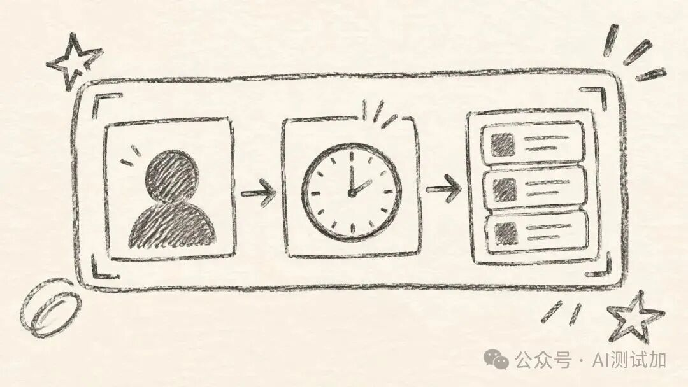

# 真实案例:小红书怎么让"评测现场"可复查、可下钻

> Source: wechat
> Author: AI测试加
> Original: https://mp.weixin.qq.com/s/Yb2ibgENl1DUI89gebRVfQ

---

淘宝那篇讲了在线评测怎么做成日级流水线,美团那篇讲了评测闭环怎么推动 Agent 变强。这篇看小红书的实践——它回答了一个不一样的问题:当评测对象是"一次推荐"时,**怎么确保每次判断都能回到现场、可复查、可下钻**。核心概念:评测本身也是个 Agent。

---

## 一、这篇讲的是什么

小红书给推荐系统的评测建了一个"评测 Agent",用"上下文驱动 + LLM-as-Judge"的方式,对推荐结果做分维度语义评测。

为什么需要它?因为行为指标有个天然短板:CTR、停留时长、互动率能告诉你"用户行为变没变",却说不清"推荐内容到底发生了什么变化"。

举个文章里的例子:**两组推荐可能拿到接近的 CTR,但内容结构完全不同**——一组靠兴趣匹配加内容探索,另一组靠更强的标题刺激拿点击、同时出现类目集中。两个体验被压缩成两个相近的数字,只凭 CTR 根本分不出来;反过来,内容结构改善了,行为指标也不一定立刻涨。实验分析需要一组来自"内容侧"的证据来补位。

行为指标验证线上效果,语义评测提供可下钻的内容证据——两者对应同一次推荐,但各管一段。

> [!note]- 批注｜CTR 接近时，内容侧多回答了什么
> 在同一曝光口径下，CTR 是点击占比。两组各有 100 次曝光和 10 次点击，CTR 都是 10%。要判断内容结构是否一样，需要展开各自的有序列表，查看品类占比、标题相似度、兴趣匹配等证据。
>
> 策略有没有改变用户响应，仍要看线上实验。如果把点击直接喂给裁判，裁判可能把「被点了」当成「推荐得好」，评分就会带入待解释的行为结果。

过去这类内容侧判断靠人工抽样:评测人员要补齐背景、逐篇检查、汇总结论,覆盖规模和一致性都受限。LLM 让规模化语义理解成为可能,但**一次模型调用不等于可靠评测**——稳定的判断需要清晰的上下文边界、评分标准,以及规则和模型之间的明确分工。

---

## 二、评测单元:不是单篇内容,是一次完整推荐

普通内容质检看一篇内容本身安不安全、完不完整、优不优质。但推荐评测要回答的是:**这些内容,在此时、以这个顺序,呈现给这个用户时,整体表现如何?**

所以最小评测单元不是孤立的内容,而是"一次带有完整现场的推荐请求"。文章给了一个很漂亮的概括:

**EvaluationContext = &#92;\<用户状态, 请求时间, 有序内容列表&#92;\>**

- **用户状态**

  :用户画像、长期兴趣、近期消费——决定内容适不适合当前用户
- **请求时间**

  :推荐实际发生的时间——决定内容当时还有没有效
- **有序内容列表**

  :用户实际看到的内容和顺序——判断单篇质量之外的重复、集中、整刷体验

三要素任一变化,评测样本就变。同一个露营笔记:对长期关注户外的用户是稳定兴趣,对刚连续刷过好几篇露营的用户就是重复;同一篇节日攻略,活动前后时效判断完全不同。

> [!note]- 批注｜按请求时点恢复推荐现场
> 假设请求 `R17` 在 11 月 20 日 10:00 发生，用户按顺序收到节日攻略、露营教程和露营装备清单。11:00 发生的点击可能改变用户画像。回放 `R17` 时，应恢复 10:00 推荐发生时可用的画像和内容版本，并按当时的位置还原列表。
>
> 采样时记录列表来自服务端返回还是客户端实际曝光。如果列表返回三条、用户只看到前两条，两个口径可能得出不同的重复率。把列表来源和位置随请求一起记录，汇总时才能比较同口径的样本。

一个关键认知:**上下文驱动不是往 Prompt 里塞更多字段**。它改变的是评测系统组织采样、执行和结果的方式:

- 采样以推荐请求为单位,保存当时的用户状态、请求时间、有序内容
- 评测同时覆盖单篇、完整列表、用户请求三个粒度
- 每个结果都绑定对应上下文和评测版本,不能脱离现场单独解释
- 上下文缺失、获取失败、未请求要分别记录,不能让模型自己脑补
- 只有采样、执行、结果都围绕同一次推荐请求组织,上下文才算真正进了评测体系

> [!note]- 批注｜缺失、获取失败和未请求
> 确认画像为空、读取画像超时、当前维度无需读取画像，分别对应数据缺失、执行失败、未请求。失败可能需要重试，缺失需要查数据来源，未请求在仅看单篇内容的场景下可能符合预期。分开记录后，才能判断低覆盖率该修哪一步。

---

## 三、评测 Agent:把一次判断组织成可追踪的执行链路

拿到上下文后,最直接的做法是把它和"请打分"一起丢给 LLM——能得到一个判断,但很难形成稳定的评测能力。为什么?所有证据堆在同一个 Prompt 里,模型容易跨维度用信息;多个问题压成一个总分后,输入缺失、规则命中、模型失败都分不清。

评测 Agent 的角色就是:**组织上下文、解析评测配置、调度规则与 LLM 评测器**,把一次判断变成有状态、可追踪的执行链路。

换句话说,评测不再是一次"万能 Prompt 调用",而是一条流水线:谁来取证据、谁跑规则、谁调 LLM、谁记录状态,每一步都有安排、有记录。

> [!note]- 批注｜沿评测记录定位失败环节
> 以 `R17` 为例，时效性评测读取请求时间和活动截止时间，多样性评测读取整刷的内容与位置，兴趣匹配读取用户状态。每个分支记录实际读到的证据、执行结果和理由。即使画像获取超时，证据充足的时效性分支仍可完成。

---

## 四、评测标准:拆成独立维度,不压成一个总分

决定判断稳不稳的,是每个评测分支**回答什么问题、能用什么证据**。而推荐体验没法直接压成一个总体分:内容质量看内容本身,时效性依赖推荐发生的时间,兴趣匹配要结合用户状态,多样性必须看完整列表——评价对象和证据都不同,就得拆成彼此独立的维度。

维度分两类:

| 类型 | 作用 | 例子 |
| --- | --- | --- |
| 基础体验维度 | 检查每次推荐都应满足的质量底线 | 兴趣匹配、多样性、内容质量 |
| 目标符合度 | 验证策略想改变的特征是否真出现 | 营销感下降、类目曝光密度下降 |

这样就能把"策略是否生效"和"是否带来体验代价"分开看。

> [!note]- 批注｜策略目标与体验底线
> 假设实验目标是压低营销密度。实验组的营销内容占比从 30% 降到 15%，同时兴趣匹配的 0 分请求变多。前一个结果支持「营销密度下降」，后一个结果提示「一部分请求的兴趣匹配变差」。实验评审需要同时核对目标和上线门槛。

评分用 **0/1/2 三档**,各档条件由评分规则单独定义——不把"好、一般、差"的尺度留给模型自由发挥。每次判断输出**分数、理由、执行状态**:分数和理由表达业务判断,执行状态记录材料是否完整、评测是否成功。

> [!note]- 批注｜把评分规则写成可观察条件
> 以时效性为例，评分规则（Rubric）可以约定，活动在推荐发生前已经结束且正文仍引导报名记 0 分，活动尚未结束但临近截止且没有提醒记 1 分，其余符合要求的样本记 2 分。临近截止的时间窗要提前写清。活动日期无法取得时，记录无法评估并保留空分。这套规则用于演示写法。

几个重要设计:

- **各维度独立保留**

  ,综合分只用于任务概览和样本筛选
- **门控条件**

  :对明确不可接受的问题,设置门控防止其他维度的高分把它盖住
- **诊断要回具体维度**

  、内容、理由、执行状态,不能只看聚合数字
- **点击、停留、互动这些行为数据沿独立链路输出,不作为 LLM 语义评分的证据**

  ,两类结果只在分析阶段对齐——防止"用结果解释结果"

> [!note]- 批注｜门控结果和有效样本的分母
> 假设过期且仍要求报名会触发拦截，即使兴趣匹配和内容质量都得高分，该样本仍须进入拦截记录。统计时效性问题率时，以该维度有效判分的请求作分母，并单列有效覆盖率。缺材料或模型超时的请求如果混入分母，问题率可能被稀释。

---

## 五、规则与 LLM 的三层分工

标准明确了问题边界,不代表所有判断都该交给 LLM。文章给的分工原则非常清晰,我按自己的理解转述成三层:

1. **结构化字段能确定的结论 → 代码直接算。**

    能在字段里定死的,别麻烦模型
2. **代码能稳定提取、但需要语义解释的信息 → 先转成统计特征,再交给 LLM。**

    中间层不裸喂日志,先算成特征
3. **只有依赖用户、内容或策略语境的判断 → 才由 LLM 在限定范围内完成。**

    最后才轮到模型

这个顺序本身就是一种"成本与可靠性的取舍":能用确定性的绝不用概率,概率能解决的绝不让模型自由发挥。

> [!note]- 批注｜同一个请求里怎样分配规则和 LLM
> 如果列表的 4 条内容都有主类目，且 3 条属于露营，代码可以算出露营类目占比 75%，并按事先定义的阈值判定是否命中「类目集中」。3 条露营内容可能分别讲营地、装备和天气，这时判断内容是否在重复同一条信息需要读文本。可以让模型给出对应内容 ID 和证据片段，方便人工逐条复查。

**人工与模型怎么对齐?** 批量任务上线前,人工和模型要在相同输入、相同 Rubric 下独立打分。不一致样本先分清楚问题来自——输入缺失、标准边界模糊、还是模型理解偏差——再决定调整数据、规则还是 Prompt,**而不是直接改分数去迎合人工结果**。

> [!note]- 批注｜从分歧样本找出该修的环节
> 让人工和模型基于同一份材料、按同一套规则独立评分。如果评审员能从网页看到截止日期，而模型输入里缺少日期，先修输入。输入相同时，若两名评审员也频繁在 0 和 1 之间分歧，先把两个档位的边界和样例写清。规则清楚后，若模型仍持续误判，再检查 Prompt 或模型版本。

一致性也不能只看"完全相同率":三档分数容易集中在中间档,单一一致率会高估 Judge 能力。更有意义的观测包括:**加权 Kappa、0 分问题样本的召回率、人与人之间的一致性上限**。

> [!note]- 批注｜加权 Kappa 和 0 分召回率各看什么
> 假设人工给 90 条打 1 分、10 条打 0 分。模型全部给 1 分，完全相同率是 90%，但 0 分召回率为 0/10。0 分召回率的分母是人工判为 0 分的样本数。人工样本里没有 0 分时，这项指标应记为不可计算。
>
> 加权 Kappa 衡量扣除偶然一致后的评分一致性，并允许给不同分歧赋权。选用随档位差距增加的分歧权重时，0 分和 2 分的分歧比 0 分和 1 分的分歧扣得多。比较新旧评测器时，要用同一套权重和同一批样本。人工互评结果是当前样本与规则下的参照。

升级 Prompt、规则或模型时,除了重算一致性,还要在同一批样本上对比新旧版本,由评审者标记新结果相对基线是改善、持平还是退化——衡量的是"输出是否更符合标准",不是"分数变没变"。

> [!note]- 批注｜同一批样本对比新旧评测器
> 换 Prompt 时，可以固定输入快照、规则和模型，逐条对照新旧结果，让评审员判断理由是否引用了正确证据、分档是否更贴合评分条件。调试样本用于找问题，另用一批未参与调试的样本确认改进是否能复现。

---

## 六、可比较、可回放:双版本快照机制

一次任务能出分,不代表结果能跨时间比较。推荐侧的用户画像、Feed 候选状态会变;评测侧的 Prompt、规则阈值、输入裁剪、模型版本也会迭代。这些变量如果不一起记录,**两次评分的差异就无法解释**——可能来自推荐本身,也可能只是输入或判断尺度变了。

所以评测链路要同时固定两类条件:

- **输入快照**

  :记录评测发生在什么现场(用户、请求时间、内容集合、数据状态)
- **评测版本**

  :记录系统依据什么标准判断(Prompt、规则、权重、模型配置)

两者能分别追溯,分数变化才有比较基础。每份结果都会记录实际生效的配置版本,作为解释差异的坐标。回放时先核对快照版本和原配置,可以重现历史结果;显式替换某一项配置,就能比较新旧评测器的判断差异。

> [!note]- 批注｜历史审计、重复执行和版本对比
> 审计历史评分时，查看实际输入、输出、状态和生效配置。重新调用同一评测器时，模型输出仍可能波动，因此应保留原输出，才能准确核对当时的得分和理由。比较两个评测器时，只替换评测版本并共用输入快照。比较两种推荐策略时，固定评测版本，并用相同规则采样两组推荐请求。

一句话:**推荐现场 + 评测标准,两个都要留底,缺一个分数就说不清。**

---

## 七、从单次判断到实验级诊断

实验面对的不是一次请求,而是实验组和对照组里的海量请求。怎么把局部判断组织成可比较的实验级证据,同时保留回到原始现场的路径?

系统的做法是:**每条有效结果都带上维度、粒度、内容位置、分数、理由、实际输入、执行状态、评测版本**——一份结果向上能按实验分组聚合,向下能钻回用户请求、内容列表、单篇证据。

> [!note]- 批注｜按评测粒度取结果
> 实验组用于聚合，请求 ID 用于找回一次推荐，内容位置用于找回该请求中的某次曝光，再用维度和评测版本定位一条判断。比较整刷多样性时，一个请求贡献一个列表级分数。单篇逐条评分适合分析位置差异，直接混入列表级均值会让列表较长的请求获得更大的权重。

实验级比较有个反直觉的设计:**不能退化成两个平均分相减**。相同均值可能对应完全不同的样本结构:差异可能只集中在少量低分请求,也可能出现在特定内容位置;单篇质量稳定时,整刷仍可能类目集中或语义重复。所以还要看有效样本数、分数分布、低分请求、单篇与整刷结果。

> [!note]- 批注｜同均值可以掩盖低分请求
> 同一维度下，A 组两条有效请求的分数为 `[0, 2]`，B 组为 `[1, 1]`，均值都为 1。若 0 分表示触底，A 组触底率为 50%，B 组为 0%。看 0 分率时也要报样本数和有效评测覆盖率。两组缺证据或失败的比例差得多时，先核对被排除样本集中在哪些请求。

某个维度出现差异后,再沿"维度分布 → 用户请求 → 有序内容 → 单篇结果 → 输入证据与判断理由"逐层下钻。以多样性下降为例:实验级结果只能说明整刷结构变了,展开内容列表才能区分——是类目集中、作者类型集中、标题近似,还是语义重复。

分数在这里是**定位索引**,真正支撑诊断的是与分数绑定的内容、证据、理由和执行状态。聚合结论最终落到可复查的推荐现场,而不是一段无法验证的模型总结。

当然这套诊断也有边界:它回答"推荐结果发生了什么变化",不直接证明用户行为改善,也不能单靠内容证据确定系统根因(问题在召回、融合还是打散,要结合推荐链路数据验证)。行为指标仍用于验证用户响应,语义评测解释内容变化,两者各司其职。

> [!note]- 批注｜下钻到结果后，怎样查推荐链路
> 如果低多样性的请求集中出现露营类目，可以按请求 ID 查看各阶段的候选和顺序。候选阶段就高度集中时，先查召回和过滤。候选多样但头部被同类挤占时，继续检查融合、排序和打散。只有最终列表时，可以确认哪些位置和类目发生了集中，进一步定位根因需要各阶段的数据。

---

## 八、一个前瞻:从单次判断走向连续模拟

文章最后提了一句未来方向,我觉得值得记一笔:

再进一步是 **LLM-as-User**——评测对象从"一次固定请求"扩展为"连续交互":模型观察内容、行为模块生成校准过的动作概率、根据曝光和消费更新短期兴趣与疲劳状态、进入下一轮推荐。

难点在于:除了语义判断,还要处理行为生成和状态转移;单次动作准不准、群体行为分布像不像真实日志、历史实验里方向判断对不对,都要分别验证。偏正向、过度理性、多轮误差累积,都会让模拟轨迹偏离真实用户。

所以文章很克制地强调:**LLM-as-User 目前更适合做策略上线前的离线预筛和问题探索,不替代线上 A/B 实验。**

> [!note]- 批注｜从一次评分到会更新状态的模拟
> 在一个模拟示例中，虚拟用户多次看到露营内容却都跳过，模拟器根据曝光和动作更新疲劳状态，再用更新后的状态生成下一轮动作。校准时分别检查单轮点击概率、连续会话长度和重复曝光后的跳过率，再检验模拟能否在已知的历史实验上复现方向。连续模拟属于本文讨论的后续方向。

---

## 九、总结:评测这件事本身的工程化

把淘宝、美团、小红书三篇放在一起,能看出一个大厂共识:

- **淘宝**

  :评测要每天跑,数据清洗是重头戏
- **美团**

  :评测要闭环,先校准尺子再谈优化
- **小红书**

  :评测要可复查,上下文和版本都得留底

三者合起来就是一句话:**评测不是"让模型打个分",而是"把质量判断本身变成一条受约束的工程链路"**——上下文怎么组织、标准怎么写、规则和模型怎么分工、版本怎么记录、结果怎么下钻,每一步都可以被检查、被追溯、被复现。

而 Agent 的价值,来自模型、规则、数据和人工校准之间的**受控协同**。它不会替代真实行为,也无法消除模型偏差——但当每次判断都能对应到具体现场、证据、标准和版本时,"推荐体验好不好"就从依赖专家感受的模糊问题,变成了可观察、可比较、可追溯的工程对象。

---

**本文为原创解读与个人评论,非原文转载。案例信息引自:小红书技术 REDtech 公众号文章《小红书推荐系统评测 Agent:上下文驱动的 LLM-as-Judge 实践》,原文详见:https://mp.weixin.qq.com/s/333qmTTiNsFp9m8h49Slgg 。文中转述均为本文作者按公开信息的理解重述,判断与观点为原创。**
