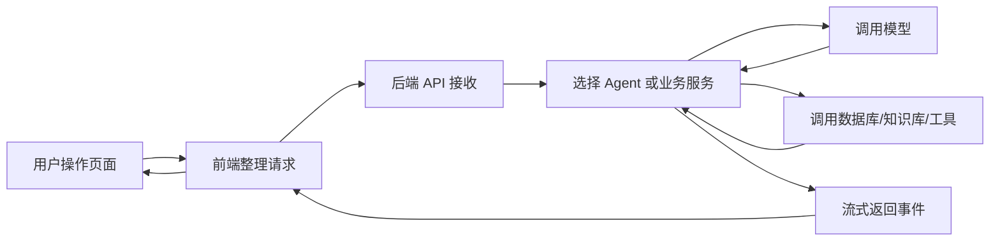

# DB-GPT 功能流程与代码阅读地图

更新时间：2026-10-11

适用版本：DB-GPT `0.8.2`，当前代码提交 `361eb344`

## 一、这篇笔记解决什么问题

这篇笔记面向暂时没有前端、后端开发经验，但准备对 DB-GPT 进行二次开发的人。当前目标不是理解每一行代码，而是先建立三种认识：

1. 用户在页面上操作一个功能后，系统依次做了什么。
2. 每一步由哪个目录或模块负责。
3. 后续修改某类功能时，应该从哪里开始找，而不是在整个仓库里盲目搜索。

这里的“功能”指产品层面的主要能力，例如普通对话、连接数据库、生成 SQL、知识库问答、Agent 调用工具和 AWEL 工作流，不是逐个解释所有 Python 函数。

相关笔记：

- [[03-DB-GPT本地启动与公司数仓接入准备]]
- [[02-DB-GPT智能问数与数据Agent面试题]]

## 二、先建立一个最简单的系统模型

把 DB-GPT 想成一家提供数据分析服务的公司：

| 技术概念 | 可以先理解成 |
|---|---|
| 前端 Web | 接待窗口，收集用户操作并展示结果 |
| API | 办事窗口的受理编号，规定请求从哪里进入 |
| 后端应用 | 业务人员，判断请求应该交给哪个能力处理 |
| Agent | 能够循环思考、选择工具和继续行动的执行者 |
| LLM | 提供语言理解、推理和生成能力的大模型 |
| Tool | Agent 可以调用的具体工具，例如查数据库 |
| Data Source | 可访问的数据库或数仓 |
| RAG | 先检索公司资料，再让模型结合资料回答 |
| Embedding | 把文本转换成向量，用于语义检索 |
| Vector Store | 保存文本向量的数据库，当前使用 Chroma |
| Metadata DB | 保存连接配置、会话、知识库记录等系统状态 |
| AWEL | 把多个处理步骤连接成固定工作流的编排方式 |
| SSE | 后端持续把执行进度分段推送给前端的流式协议 |

一次典型请求可以概括为：



阅读任何功能时，都可以用这条链路定位：

> 页面入口 → 前端请求 → API 路由 → 服务或 Agent → 模型/数据资源 → 返回结果 → 页面渲染

## 三、仓库目录分别负责什么

项目根目录：`/Users/nanan/Documents/DB-GPT`

### 1. `web/`：前端页面

主要技术是 Next.js 和 React。当前阶段不需要先学完整的前端框架，只要知道：

- `web/pages/`：页面入口，例如聊天、知识库、模型配置和流程管理。
- `web/components/`：旧版或通用页面组件。
- `web/new-components/`：新版聊天、分析、连接器等组件。
- `web/client/api/`：前端调用后端 API 的封装。
- `web/hooks/`：把一组页面状态和请求逻辑封装起来。
- `web/utils/`：事件解析、格式转换等通用逻辑。

看到页面上的按钮、输入框或结果卡片时，优先从 `web/pages` 找页面，再沿引用找到 `components`、`hooks` 和 `client/api`。

### 2. `packages/dbgpt-app/`：应用入口与聊天编排

这是当前最值得优先阅读的后端包，主要负责：

- 启动 Web 服务。
- 注册 FastAPI 路由。
- 接收聊天请求。
- 组装模型、知识库、数据库和工具。
- 驱动 ReAct Agent。
- 把过程转换成流式事件返回给前端。

重要入口：

- `src/dbgpt_app/_cli.py`：`dbgpt start webserver` 命令入口。
- `src/dbgpt_app/dbgpt_server.py`：创建服务、初始化并注册 API。
- `src/dbgpt_app/openapi/api_v1/agentic_data_api.py`：当前聊天与 Agent 的核心入口。
- `src/dbgpt_app/openapi/api_v1/tools/`：Agent 可调用的 SQL、代码、HTML 等工具。
- `src/dbgpt_app/knowledge/api.py`：知识库上传、切分、检索等接口。
- `src/dbgpt_app/scene/`：传统聊天、数据库、Excel、知识库和 Dashboard 场景。

### 3. `packages/dbgpt-core/`：核心能力

它像系统的底层发动机，主要包含：

- Agent 抽象和 ReAct 执行逻辑。
- 模型统一接口与不同模型供应商适配。
- RAG 基础接口。
- AWEL 工作流运行能力。
- 会话上下文、记忆和组件机制。

重要方向：

- `src/dbgpt/agent/`：Agent、规划、动作、资源和记忆。
- `src/dbgpt/model/`：模型接口、代理模型和客户端。
- `src/dbgpt/model/proxy/llms/siliconflow.py`：当前 SiliconFlow 模型适配。
- `src/dbgpt/rag/`：RAG 基础接口、检索器和算子。
- `src/dbgpt/core/awel/`：AWEL DAG 和 Operator。
- `src/dbgpt/datasource/`：数据源基础抽象。

### 4. `packages/dbgpt-serve/`：资源服务层

它负责把知识库、数据源、应用、Flow、Prompt、模型和会话等资源做成可管理的服务：

- `src/dbgpt_serve/datasource/`：数据源配置、测试、保存和连接管理。
- `src/dbgpt_serve/rag/`：知识空间、文档、Chunk 和检索服务。
- `src/dbgpt_serve/conversation/`：会话记录服务。
- `src/dbgpt_serve/flow/`：AWEL Flow 管理。
- `src/dbgpt_serve/agent/`：Agent 应用、团队和资源。
- `src/dbgpt_serve/model/`：模型配置管理。
- `src/dbgpt_serve/prompt/`：Prompt 管理。

可以先把这一层理解为“资源的增删改查和生命周期管理”。

### 5. `packages/dbgpt-ext/`：外部系统适配

它负责把不同厂商、数据库和存储实现接入 DB-GPT 的统一接口：

- `src/dbgpt_ext/datasource/`：MySQL、Hive、Doris、StarRocks、ClickHouse 等连接器。
- `src/dbgpt_ext/rag/`：文档加载、切分和检索扩展。
- 存储、图数据库和第三方知识源也主要放在这一层。

以后适配公司特有的数据源或认证方式，很可能需要从这里扩展。

### 6. 其他目录

| 目录 | 用途 |
|---|---|
| `packages/dbgpt-client/` | 调用 DB-GPT API 的 Python SDK |
| `packages/dbgpt-sandbox/` | 隔离执行代码和工具 |
| `packages/dbgpt-accelerator/` | 推理加速相关能力 |
| `configs/` | TOML 启动配置 |
| `skills/` | Agent 可以加载的领域技能和流程 |
| `examples/` | Agent、AWEL、RAG、Excel 等示例 |
| `docs/` | 官方文档源码 |
| `pilot/meta_data/` | 当前本地 SQLite 元数据库 |
| `pilot/data/` | 当前 Chroma 等本地数据 |
| `logs/` | 服务日志和追踪记录 |

## 四、功能一：服务如何启动

当前启动命令：

```bash
uv run --no-sync dbgpt start webserver \
  --config configs/dbgpt-proxy-siliconflow-deepseek-v4-flash.toml
```

系统依次完成：

1. `dbgpt` CLI 解析 `start webserver` 和 `--config` 参数。
2. 读取 TOML，解析 Web 端口、元数据库、向量库和模型配置。
3. 创建系统级组件容器，注册模型、数据源、RAG、Flow 等服务。
4. 初始化 SQLite 元数据表及本地目录。
5. 根据 `models.llms` 创建 SiliconFlow 模型客户端。
6. 根据 `models.embeddings` 和 `models.rerankers` 初始化检索相关模型。
7. 创建 FastAPI 应用，注册聊天、知识库、数据源、Flow 等路由。
8. 托管已经构建好的 Web 静态资源。
9. 启动 Uvicorn，监听 `0.0.0.0:5670`。
10. 后续请求进入已经注册的 API 路由。

阅读入口顺序：

1. `packages/dbgpt-app/src/dbgpt_app/_cli.py`
2. `packages/dbgpt-app/src/dbgpt_app/dbgpt_server.py`
3. `packages/dbgpt-app/src/dbgpt_app/initialization/`
4. 当前 TOML 配置文件

观察目标：先看清“命令如何变成一个运行中的 Web 服务”，暂时忽略初始化函数内部细节。

## 五、功能二：普通对话如何完成

用户在聊天页面输入问题后，系统依次完成：

1. 前端读取问题、会话 ID、模型名称和参数。
2. `use-react-agent-chat.ts` 向 `/api/v1/chat/react-agent` 发送 POST 请求。
3. 后端把请求解析成对话参数，并准备流式响应。
4. 后端加载当前会话历史和上下文预算。
5. 根据请求决定是否加载数据库、知识库、文件、Skill 和其他工具。
6. 组装系统提示词、历史消息和可用工具说明。
7. 调用当前配置的 `deepseek-ai/DeepSeek-V4-Flash`。
8. 模型返回 Thought、Action 或最终回答。
9. 如果模型选择工具，后端执行工具并把 Observation 再交给模型。
10. 循环直到模型终止、达到限制或发生错误。
11. 后端把状态、步骤、工具结果、正文和结束标记转换成 SSE 事件。
12. 前端逐行解析 SSE，更新思考状态、工具卡片和最终答案。
13. 会话历史被保存，页面显示完整的一轮消息。

前端阅读入口：

- `web/hooks/use-react-agent-chat.ts`
- `web/utils/react-sse-parser.ts`
- `web/new-components/chat/`

后端阅读入口：

- `packages/dbgpt-app/src/dbgpt_app/openapi/api_v1/agentic_data_api.py`
- `packages/dbgpt-core/src/dbgpt/agent/`
- `packages/dbgpt-serve/src/dbgpt_serve/conversation/`

观察目标：在浏览器开发者工具的 Network 中找到 `react-agent` 请求，再在日志中找到同一次请求，理解前后端如何对应。

## 六、功能三：模型如何被调用

模型调用不是页面直接请求 SiliconFlow，而是经过 DB-GPT 的模型管理层：

1. TOML 中声明模型名称、Provider 和 API Key 环境变量。
2. 启动时模型管理层根据 `provider = "proxy/siliconflow"` 找到适配器。
3. 聊天或 Agent 把统一格式的消息交给模型接口。
4. SiliconFlow 适配器把请求转换成供应商需要的 HTTP 请求。
5. SiliconFlow 返回增量内容或完整响应。
6. DB-GPT 把供应商响应重新转换成统一的模型输出。
7. 上层 Agent 不需要知道底层是 SiliconFlow、OpenAI 还是本地模型。

阅读入口：

- `configs/dbgpt-proxy-siliconflow-deepseek-v4-flash.toml`
- `packages/dbgpt-core/src/dbgpt/model/proxy/llms/siliconflow.py`
- `packages/dbgpt-core/src/dbgpt/model/`

观察目标：理解“配置选择 Provider，Provider 负责实际通信，上层只使用统一接口”。

## 七、功能四：数据源如何被添加

用户在 Database 页面添加数据源时，系统依次完成：

1. 前端先读取系统支持的数据源类型以及每种类型所需参数。
2. 用户填写名称、地址、端口、数据库名、账号和认证参数。
3. 点击测试连接后，前端调用 `datasources/test-connection`。
4. 后端根据数据源类型创建对应参数对象和 Connector。
5. Connector 尝试连接目标数据库并返回成功或错误。
6. 用户保存后，后端把连接配置写入元数据库。
7. 服务创建或缓存真实数据库 Connector。
8. 后端异步读取数据库 Schema，并生成数据库摘要或向量索引。
9. 后续聊天只需要选择数据源名称，系统就能重新取得 Connector。

阅读入口：

- `web/components/database/`
- `web/new-components/connector/`
- `packages/dbgpt-serve/src/dbgpt_serve/datasource/api/endpoints.py`
- `packages/dbgpt-serve/src/dbgpt_serve/datasource/service/service.py`
- `packages/dbgpt-serve/src/dbgpt_serve/datasource/manages/connector_manager.py`
- `packages/dbgpt-ext/src/dbgpt_ext/datasource/`

观察目标：选一种与公司接近的数据源，只追踪“测试连接”和“保存连接”两条链路。

安全边界：连接配置被保存并不代表可以放心使用。必须使用只读测试账号，并检查密码存储、日志、网络和权限策略。

## 八、功能五：Text2SQL 和问数如何完成

用户选择数据库并提出问题后，系统依次完成：

1. 前端把自然语言问题和数据库名称一起发送给聊天 API。
2. 后端根据数据库名称取得 Connector。
3. Connector 读取可用表、字段、类型和注释。
4. 系统把相关 Schema、SQL 方言和只读约束加入模型上下文。
5. 模型理解问题并选择相关表、字段、Join、过滤和聚合方式。
6. 模型生成 `SELECT` SQL，并调用 `sql_query` 工具。
7. 工具先阻止明显的写入、删除和 DDL 语句。
8. Connector 把 SQL 交给目标数据库执行。
9. 查询结果被限制行数、转换成 Markdown 表格或图表数据。
10. 执行结果作为 Observation 返回 Agent。
11. Agent 根据结果生成解释或继续补充查询。
12. 最终 SQL、数据和结论流式展示给用户。

阅读入口：

- `packages/dbgpt-app/src/dbgpt_app/openapi/api_v1/agentic_data_api.py`
- `packages/dbgpt-app/src/dbgpt_app/openapi/api_v1/tools/sql_query.py`
- `packages/dbgpt-core/src/dbgpt/datasource/`
- `packages/dbgpt-ext/src/dbgpt_ext/datasource/`
- `packages/dbgpt-app/src/dbgpt_app/scene/chat_db/`

观察目标：先准备一个只有两三张表的测试库，提出一个简单聚合问题，记录问题、送入模型的 Schema、生成 SQL、数据库结果和最终回答。

当前边界：开箱流程主要面向查询和分析。数仓 DDL、DML、ETL SQL 的生成可以由模型完成，但不应该直接通过当前查询工具执行。

## 九、功能六：知识库如何建立索引

创建知识库并上传文档时，系统依次完成：

1. 用户创建 Knowledge Space，选择向量、全文或图谱等索引方式。
2. 用户上传 PDF、Word、Markdown、TXT、网页或代码文件。
3. 后端保存文件和文档元数据。
4. 文档加载器读取不同格式并提取文本及元信息。
5. Chunk Manager 按大小、标题或其他策略切分文档。
6. Embedding 模型把每个 Chunk 转换成向量。
7. 向量和 Chunk 元数据写入 Chroma 等存储。
8. 如果启用关键词、知识图谱或代码图谱，还会建立对应索引。
9. 文档状态从等待处理变为完成或失败。
10. 页面读取处理进度，并允许查看 Chunk。

阅读入口：

- `web/components/knowledge/`
- `web/pages/construct/knowledge/`
- `packages/dbgpt-app/src/dbgpt_app/knowledge/api.py`
- `packages/dbgpt-serve/src/dbgpt_serve/rag/`
- `packages/dbgpt-ext/src/dbgpt_ext/rag/`
- `packages/dbgpt-core/src/dbgpt/rag/`

观察目标：上传一个很短的 Markdown 文件，检查它被切成几个 Chunk，理解原文、Chunk、Embedding 和向量索引之间的关系。

## 十、功能七：知识库问答如何完成

知识库已经完成索引后，用户提问时系统依次完成：

1. 前端发送问题、会话 ID 和 Knowledge Space 名称。
2. 后端加载对应知识库资源。
3. Agent 判断应该使用关键词检索、语义检索、图谱或多次检索。
4. 必要时先改写问题或拆成多个子问题。
5. Retriever 从索引中取回候选 Chunk。
6. 多路结果被融合并由 Reranker 重新排序。
7. 最相关的片段加入模型上下文。
8. 模型结合资料生成回答和引用。
9. 如果证据不足，Agent 可以再次检索。
10. 最终回答及引用返回前端。

关键区别：

- 建索引发生在上传或同步文档时。
- 检索发生在用户提问时。
- LLM 负责基于检索证据组织回答，不负责保存原始知识。

观察目标：提出一个答案只存在于上传文档中的问题，并核对返回引用是否真的支持答案。

## 十一、功能八：Agent 和工具如何协作

ReAct 可以理解为反复执行以下循环：

1. Thought：判断当前还缺什么信息。
2. Action：选择一个工具。
3. Action Input：生成工具参数。
4. Observation：接收工具执行结果。
5. 再次判断是否需要继续。
6. 足够后输出最终答案。

可用资源可能包括：

- 数据库查询工具。
- 知识库检索工具。
- Skill 加载与执行工具。
- Python 或 Shell 沙箱。
- HTML 报告和图表工具。
- MCP 或其他外部连接器。

后端需要负责：

- 决定哪些工具对当前会话可见。
- 把工具说明加入 Prompt。
- 解析模型返回的动作。
- 校验参数并执行工具。
- 控制循环次数、上下文长度和错误重试。
- 保存步骤并流式通知前端。

阅读入口：

- `packages/dbgpt-core/src/dbgpt/agent/expand/react_agent.py`
- `packages/dbgpt-core/src/dbgpt/agent/util/react_parser.py`
- `packages/dbgpt-app/src/dbgpt_app/openapi/api_v1/agentic_data_api.py`
- `packages/dbgpt-app/src/dbgpt_app/openapi/api_v1/tools/`
- `packages/dbgpt-core/src/dbgpt/agent/resource/`

观察目标：不要先读 Agent 全部源码，先从一次日志中找出 Thought、Action、Observation 和最终回答四类事件。

## 十二、功能九：AWEL 工作流如何运行

AWEL 适合把能够预先确定的步骤组成 DAG：

1. 用户在可视化页面创建或导入 Flow。
2. 每个节点代表一个 Operator，例如输入、模型调用、检索、分支或输出。
3. 节点之间的连线定义先后和依赖关系。
4. Flow 配置保存到元数据库。
5. Trigger 收到 HTTP、定时或手动输入。
6. DAG 调度器按照依赖执行 Operator。
7. 中间结果沿连线传递给下游节点。
8. 最终节点产生普通结果或流式结果。
9. 系统记录运行状态和错误。

阅读入口：

- `web/components/flow/`
- `web/pages/construct/flow/`
- `packages/dbgpt-serve/src/dbgpt_serve/flow/`
- `packages/dbgpt-core/src/dbgpt/core/awel/`
- `examples/awel/`

对数仓开发的价值：可以把“读取需求 → 检索规范 → 生成 SQL → 静态检查 → 输出文件”固定成工作流，减少 Agent 自由发挥。

## 十三、功能十：应用如何组合资源

一个 DB-GPT App 可以把模型、数据库、知识库、工具、Agent 和 Flow 组合成可复用应用：

1. 用户创建应用并填写名称、描述和语言。
2. 为应用绑定模型。
3. 为应用绑定数据库、知识库和工具。
4. 选择单 Agent、多 Agent 或 AWEL Flow。
5. 配置角色、Prompt 和资源权限。
6. 保存应用配置。
7. 测试时，系统根据应用配置重新组装运行环境。
8. 发布后，用户通过统一聊天界面使用该应用。

阅读入口：

- `web/components/app/`
- `web/pages/construct/app/`
- `packages/dbgpt-serve/src/dbgpt_serve/agent/app/`
- `packages/dbgpt-serve/src/dbgpt_serve/agent/`

以后可以创建“公司数仓开发助手”应用，只给它访问经过批准的元数据、规范知识库和只读测试数据库。

## 十四、会话、配置和数据分别存在哪里

当前本地模式可以先按三类理解：

### 配置

- TOML 保存启动时的服务、模型、元数据库和向量库配置。
- API Key 从环境变量读取，不应该写入仓库。

### 元数据

- `pilot/meta_data/dbgpt.db` 是当前 SQLite 元数据库。
- 连接配置、知识空间、文档记录、应用配置和部分会话状态会进入元数据库。

### 文件和索引

- `pilot/data/` 保存当前 Chroma 等本地数据。
- 上传文件、临时文件和沙箱产物位于 `pilot/` 下的对应目录。
- `logs/` 保存运行日志与追踪文件。

理解状态存储非常重要：页面消失不等于数据已删除，删除项目目录也可能同时删除本地元数据和索引。

## 十五、一次功能应该如何追踪

以后熟悉任何功能，都按同一套方法：

### 第一步：从页面开始

明确用户点击了哪个入口、填写了什么、期待什么结果。

### 第二步：看浏览器 Network

找到请求地址、方法、请求体、响应状态和是否流式返回。

### 第三步：在 `web/` 搜索 API 地址

找到哪个页面、Hook 或 API Client 发出了请求。

### 第四步：在后端搜索路由

搜索 `@router.get`、`@router.post` 或路径字符串，找到请求入口。

### 第五步：继续看服务调用

只记录它调用了哪个 Service、Manager、Agent 或 Tool，不急着理解内部代码。

### 第六步：确认外部依赖

判断它最终访问了模型 API、数据库、向量库、文件系统还是其他服务。

### 第七步：对照日志和响应

确认每一步产生的日志、异常和最终返回结构。

### 第八步：画出自己的步骤图

一开始只写模块名和输入输出。能够不看源码讲清步骤后，再深入具体实现。

## 十六、推荐的代码熟悉顺序

### 第 1 阶段：建立全局地图

阅读：

1. 本文。
2. `docs/.../getting-started/concepts/architecture.md`。
3. 项目根目录和各 package 目录。

完成标准：能够解释 `web`、`dbgpt-app`、`dbgpt-core`、`dbgpt-serve` 和 `dbgpt-ext` 各自负责什么。

### 第 2 阶段：理解启动和配置

阅读 `_cli.py`、`dbgpt_server.py` 和当前 TOML。

完成标准：能够解释启动命令如何选择模型、数据库、向量库和端口。

### 第 3 阶段：追踪普通对话

从 `use-react-agent-chat.ts` 追踪到 `agentic_data_api.py`，对照一次实际日志。

完成标准：能够解释请求如何进入后端、如何调用模型、如何流式返回。

### 第 4 阶段：追踪数据源和 Text2SQL

添加一个测试数据库，追踪测试连接、保存、读取 Schema 和执行 SQL。

完成标准：能够解释数据库配置、Connector、Schema 和 `sql_query` 的关系。

### 第 5 阶段：追踪知识库

上传一个小型 Markdown 文档，观察切分、Embedding、索引、检索和引用。

完成标准：能够区分建索引和查询两个阶段。

### 第 6 阶段：理解 Agent 和 AWEL

分别观察一次 ReAct 循环和一个简单 AWEL Flow。

完成标准：能够说明什么时候适合让 Agent 自主选择，什么时候适合固定工作流。

### 第 7 阶段：设计数仓开发助手

先不改代码，写出目标流程：

1. 接收数仓需求。
2. 获取源表 Schema。
3. 检索指标口径和开发规范。
4. 生成 DDL、加工 SQL 和字段映射。
5. 静态检查和风险检查。
6. 在测试环境执行 `EXPLAIN` 或小数据验证。
7. 人工确认。
8. 保存 SQL 文件，进入 Git 和现有发布流程。

完成标准：明确每一步输入、输出、失败方式和应该由哪个 DB-GPT 模块承担。

## 十七、现阶段不需要急着学习什么

为了避免学习范围失控，当前可以暂缓：

- React 的高级状态管理和渲染优化。
- FastAPI 的全部机制。
- Python 元类、装饰器和复杂异步实现。
- 多机模型集群和 GPU 推理。
- 全部 AWEL Operator。
- 所有数据库 Connector。
- Agent 的每个基类和继承关系。

先能沿着一条真实请求找到前端、API、服务、外部资源和返回结果，再按二次开发目标补知识，效率更高。

## 十八、阅读时的记录模板

每熟悉一个功能，可以复制下面的模板：

```markdown
## 功能名称

### 用户入口
- 页面：
- 用户操作：
- 预期结果：

### 前端
- 页面/组件：
- API 地址：
- 请求参数：
- 如何展示结果：

### 后端
- 路由入口：
- 调用的 Service/Agent：
- 使用的 Tool/Connector：

### 外部资源
- 模型：
- 数据库：
- 知识库/向量库：
- 文件或其他服务：

### 数据流
1.
2.
3.

### 验证方式
- 正常用例：
- 失败用例：
- 应查看的日志：

### 当前疑问
-
```

## 十九、与你的二次开发目标最相关的模块

按照“公司数仓开发助手”的方向，优先级建议如下：

| 优先级 | 模块 | 原因 |
|---|---|---|
| 1 | Data Source / Connector | 决定能否安全读取公司数仓 Schema 和测试数据 |
| 2 | Text2SQL / `sql_query` | 决定 SQL 如何生成、校验和执行 |
| 3 | Knowledge / RAG | 保存指标口径、命名规范、Join 关系和开发手册 |
| 4 | Agent Tools | 增加 SQL 静态检查、文件输出和测试工具 |
| 5 | AWEL | 把生成、校验、测试和人工确认固定成流程 |
| 6 | App | 把以上资源封装成公司专用入口 |
| 7 | Frontend | 最后再根据使用体验增加需求表单、SQL 编辑和审核界面 |

目前不需要先学习如何修改页面样式。最有价值的是先理解数据源、知识上下文、SQL 生成和安全校验之间的关系。

## 二十、判断“已经熟悉代码”的标准

不是记住所有目录和函数，而是能够做到：

1. 看到页面功能后，知道去哪个前端目录找。
2. 看到 API 地址后，能找到对应的后端路由。
3. 能解释路由调用了哪个 Service、Agent、Tool 或 Connector。
4. 能指出数据最终来自模型、数据库、知识库还是本地存储。
5. 出错时知道应该看浏览器请求、服务日志还是外部系统。
6. 修改前能够说清正常路径、异常路径和需要验证的范围。
7. 能画出公司数仓开发助手的流程，而不是一开始就直接改代码。

达到这些标准后，再学习具体 Python、FastAPI、React 和测试写法，会有明确上下文，也更容易理解。
