****
# 十张经典“B1买点图”全解析：从分歧到一致，主力建仓后启动的图形密码

作者: Bennie0324

公众号: 心沐工作坊

> [!note] 整理注释
> - 以下正文和案例说明完整保留，仅删除微信阅读器按钮、预览标签等页面噪音。
> - 原文共下载并本地化19张图片，实际覆盖案例1至案例9；案例10只有文字说明，没有原始配图。
> - 微信页面标注作者为“Bennie0324”、公众号为“心沐工作坊”；内容自述为对Z哥直播的总结，属于二级整理材料，不应视为Z哥原文逐字稿。
> - 文中的形态判断与数值是特定交易体系的经验规则，不代表经过独立验证的普遍结论。
> - 后文新增的“Z哥体系批注”依据本地结构化知识库整理，与原文观点分开标示。

十张经典“B1买点图”全解析：从分歧到一致，主力建仓的图形密码

> 行情在绝望中诞生，在分歧中上涨，在一致中加速。
看懂图形背后的语言，是踩准节奏的第一步。

市场中，每天都有大量个股异动。如何从纷繁复杂的K线中，找到确定性最高的启动点？

答案就藏在“**B1买点**”的经典图形里。今天，我们通过十张实战案例图，一次性讲透“从分歧到一致”的图形密码。

## 一、核心逻辑：寻找“分歧转一致”的关键K线（反转k）

任何一波行情的启动，都源于多空力量的博弈与转换。

- **放量大阳/大阴**：代表剧烈的**分歧**。多头与空头激烈交战，此时追入，成本高且心态易受波动影响。
- **极致缩量的小阴小阳**：代表力量**趋于一致**。多空双方暂时达成平衡，成交量萎缩至“地量”，股价波动收窄。这往往是新一轮行情的起点。

**B1买点的核心**，就是在上升趋势中，寻找经过充分分歧（回调或震荡）后，出现“**地量+小K线**”组合的位置。这标志着空头力量衰竭，多头即将重新主导。

> [!info] Z哥体系批注：B1不是单一反转按钮
> 这段抓住了“从分歧到缩量一致”的主线，但按整理后的Z哥体系，B1首先是某个周期的**阶段性低点**，不是“必然反转”。一个较完整的高质量B1还要同时检查：此前存在N型上涨结构或明确异动建仓、黄线走平或向上、回调缩量且K线稳定、KDJ的J值到位，以及上方没有明显放量出货。仅凭“地量+小K线”不足以确认完美B1。

> **关键量化指标（干货）**：

- **当日涨幅区间**：-2% 至 +1.8%（适用于大多数个股）
- **当日振幅限制**：7%以内（越小越好，4%以内为佳）
- **技术状态**：勾到“大负值”（超卖区域），且成交量缩至阶段性地量。

> [!note] 口径注释
> 本文将振幅“7%以内”作为宽口径，并注明“4%以内为佳”；ZettaRanc知识库整理的“最强B1十张图标准模型”采用的是更严格的振幅 `<4%`。另外，“勾到大负值”本身不够精确：知识库通用B1口径为KDJ的J值 `<13`，部分严格场景使用 `<-10`。实际阅读时应先确认使用的是通用筛选还是严格筛选口径。

> [!abstract] Z哥体系批注：十张图的完整筛选框架
> 1. **趋势前提**：只做上涨趋势中的回调，黄线走平或向上；下跌通道中的低J值不等于可用B1。
> 2. **左半边建仓**：底部有大量、中量或明确异动，证明前面“有呼吸”；一路无量的图形不属于优中选优。
> 3. **顶部量价**：拉升高点最好缩量，若高位放量上影或持续放量滞涨，应先怀疑出货。
> 4. **右半边洗盘**：小阴小阳、量能递减、长影线少，末端达到地量和J值条件。
> 5. **两个30%原则**：建仓波涨幅通常约30%，累计换手率通常不超过30%；超过40%时，知识库将其视为明显减分项或废B1。

---

## 二、十张经典B1买点图鉴

我们按图形特征，将这些经典买点分为几类。请结合图示，深刻理解每一种形态的市场含义。

### **类型一：标准“娜娜图” - 拉升后温和回调**

**特征**：主力放量建仓（黄线附近启动）后，股价缩量回调，顶部无放量出货迹象。回调至关键均线（白线/黄线）附近，出现地量小K线。

> [!caution] Z哥体系批注：“娜娜图”不能泛化
> 知识库对娜娜图的严格定义是：**股价创新高但阳线缩量，次高点阴线也突然缩量，底部堆大量、上方量能递减**。因此，本节四个案例可以统称为缩量回调型B1，但是否都达到“娜娜图”级别，还要逐图核对创新高时的量能和次高点阴线，不能只因回调缩量就统一命名为娜娜图。

**案例1：华纳YC**

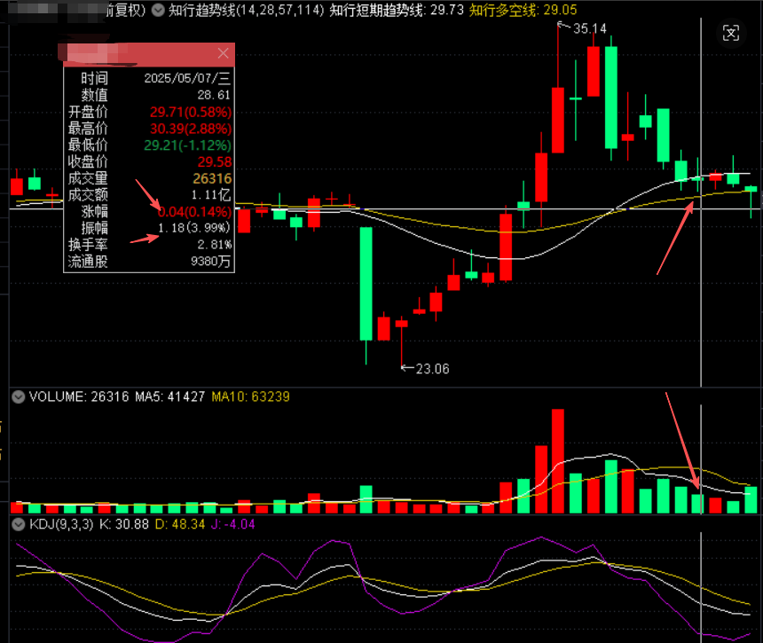

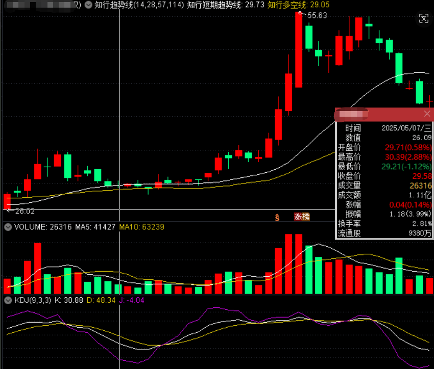

*（图示：建仓波后缩量回调，出现地量小阳线B1点）*

- 解析：建仓后缩量回调，波动极小（涨跌幅在5.7号为0.14%），量能萎缩至“芝麻点”。这种B1点质量极高，伴随最后一次震仓，然后启动。

**案例2：宁波YS**

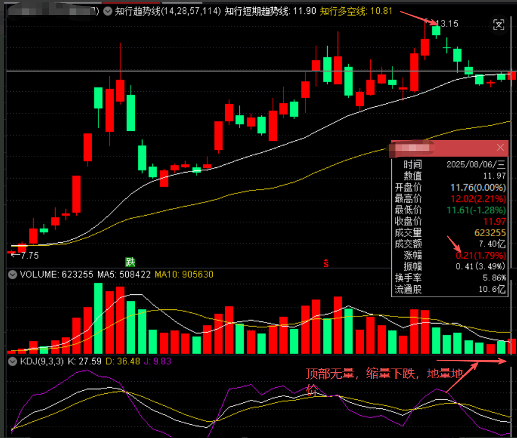

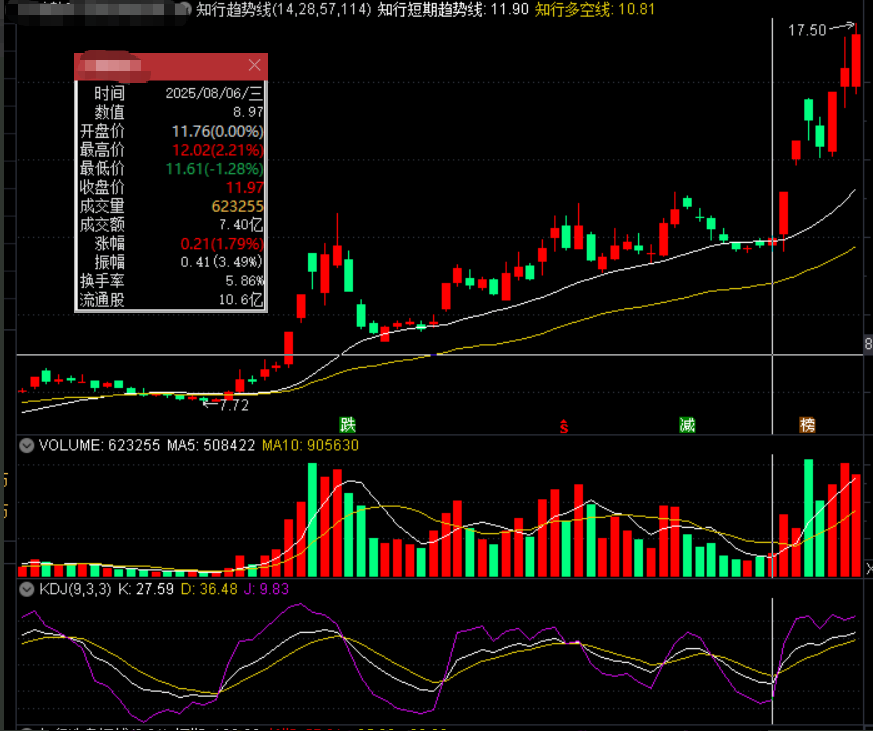

*（图示：两波建仓后，缩量回踩，出现小阳线B1）*

- 解析：主力分两波建仓，图形干净。回调过程缩量明显，B1点为涨幅1.79%的小阳线，是典型的启动信号。

**案例3：微X生物**

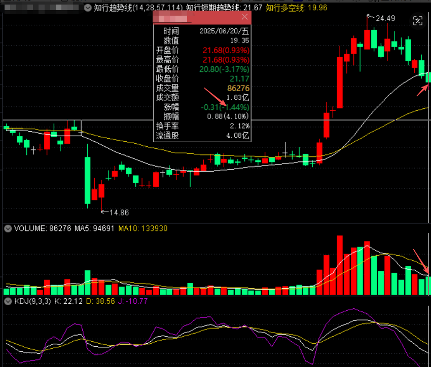

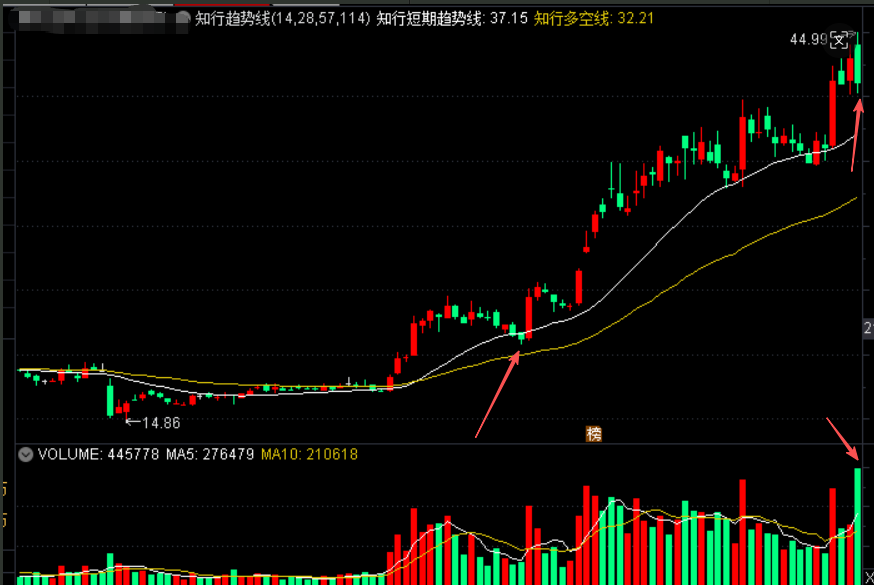

*（图示：放量启动后，缩量下跌至大负值，收小阴线）*

- 解析：即便B1点是一根小阴线（-1.44%），但只要满足“缩量+勾到大负值”，同样是有效的反转信号。

**案例4：方Z科技（乔丹图）**

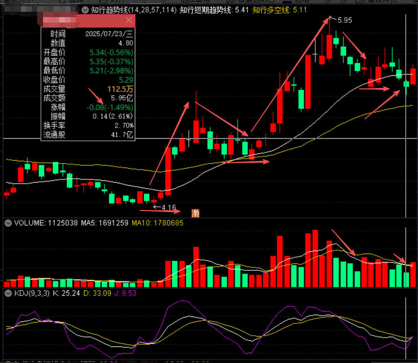

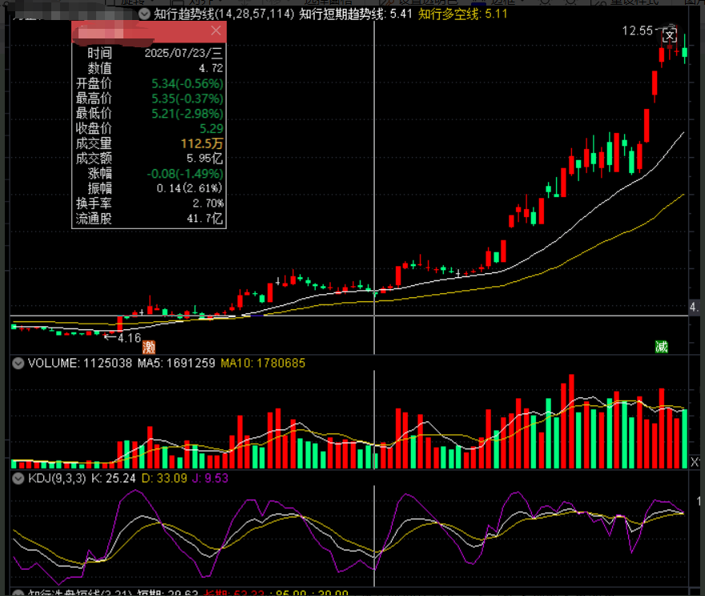

*（图示：长时间建仓后深度缩量回调，出现小阴线B1）*

- 解析：主力建仓周期长，洗盘也较深。B1点出现在深度缩量后，跌幅-1.49%的小阴线。

#### **类型二：“阶梯量”洗盘图 - 以时间换空间，下平台**

**特征**：前期拉升幅度较大，顶部出现**放量阴线或“阶梯量”**（成交量像楼梯一样逐步下降）。随后通过长时间横盘震荡消化套牢盘，最终在平台下沿出现B1信号。这里一般会下平台，从白线平台下到黄线平台出现b1，如果启动的涨幅不多，有可能只洗到白线平台。

> [!caution] Z哥体系批注：阶梯缩量与阶梯放量要区分
> “长平台以时间换空间”与知识库的**变量型B1**一致，但一般规则同时把“连续阶梯量放下来”列为不喜欢的形态。两者并不完全冲突：关键是量能总体是否收敛、顶部是否存在放量出货、累计换手是否失控。若成交量一路递减且末端地量，可理解为洗盘；若高位量能持续放大、股价滞涨，则更接近筹码松动，不能仅凭平台末端的小K线认定B1。

**案例5：澄T伟业**

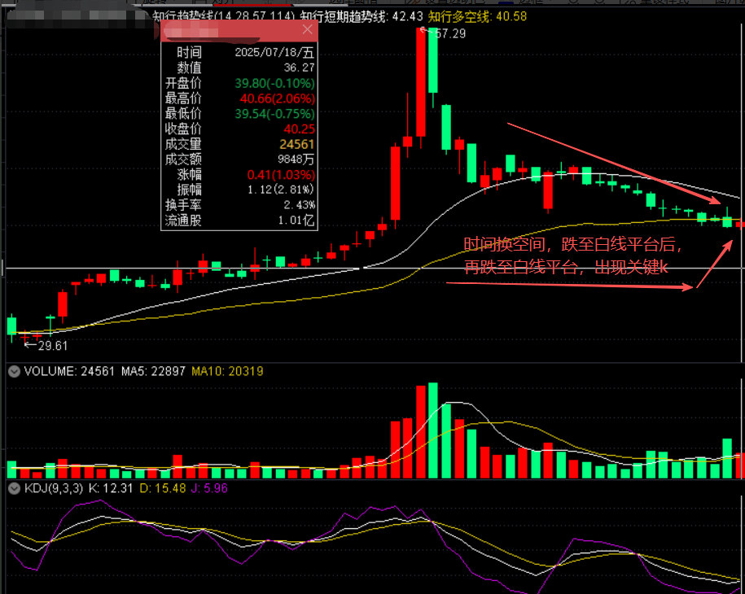

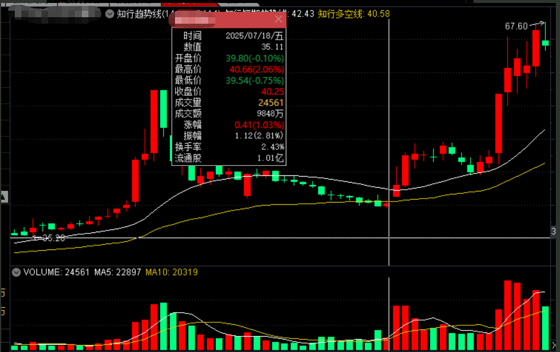

*（图示：一波流拉升后放量，阶梯量缩回调，平台末端出B1）*

- 解析：这不是最“完美”的窄幅震荡图，但更具实战性。高位放量后，通过搭建平台“以时间换空间”，B1点（涨幅1.03%）是平台突破的起跳点。

> [!note] Z哥体系批注：不要混淆B1与B2
> B1更接近缩量调整末端的阶段低点；真正放量突破、确认趋势的阳线更接近B2。把B1称为“平台突破的起跳点”可以理解为事后描述，但实际复盘时应把“缩量企稳”和“放量突破确认”分成两个信号阶段。

**案例6：国X高科**

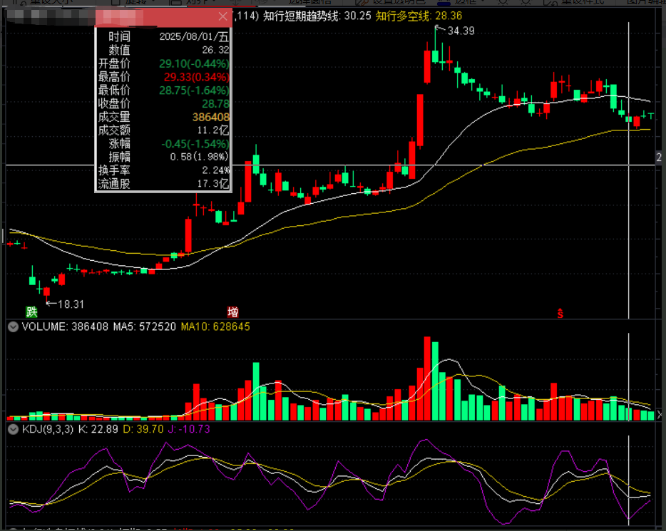

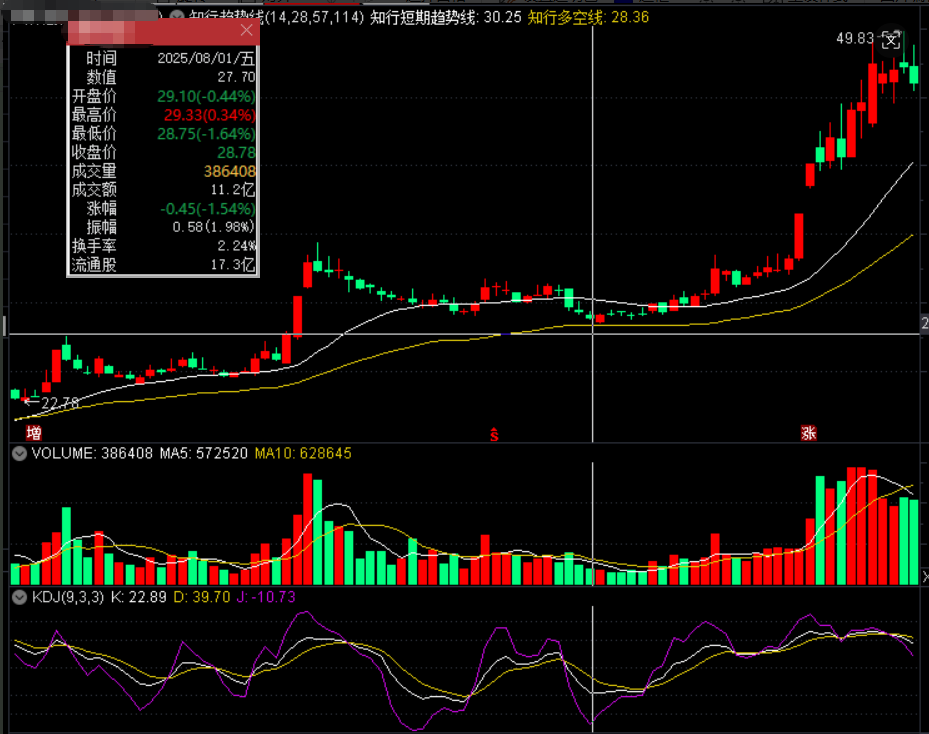

*（图示：类似案例5，放量后长期平台整理，末端出B1）*

- 解析：图形是案例5的“变体”。前期放量更剧烈，平台整理时间更长。B1点出现后，同样迎来主升。**记住：前期浮盈盘越多，洗盘需要的时间或空间就越大。**

**案例7：光D股份**

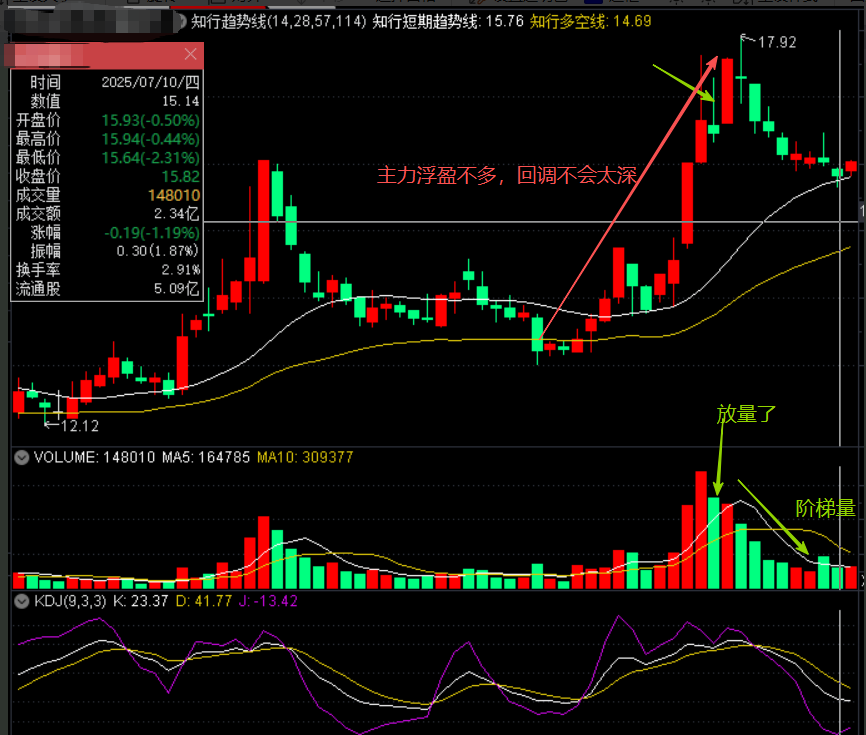

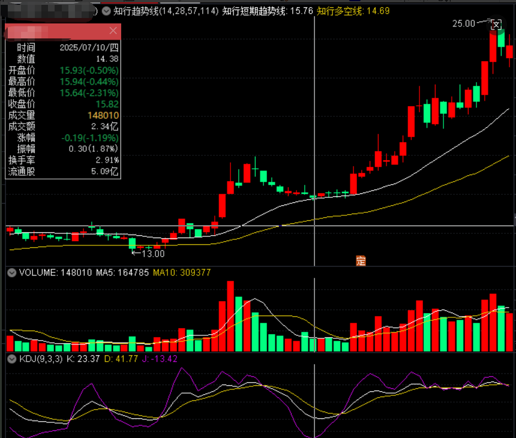

*（图示：阶梯量缩回后，在相对高位横盘，出现小阴线B1）*

- 解析：由于前期拉升幅度不大（约30%），所以洗盘未触及下方黄线，仅在相对高位横盘即出现B1（-1.19%）。说明洗盘深度与前期涨幅成正比。

---

#### **类型三：“横盘突破”图 - 红肥绿瘦，蓄势待发**

**特征**：主力建仓后，股价在一个**狭窄箱体内长时间横盘**，K线呈“红肥绿瘦”（阳线多且实体长，阴线少且实体短）状态。波动极小，量能持续萎缩，直至出现突破性B1。

> [!info] Z哥体系批注：对应横盘压缩型
> 这一类与知识库的“横盘压缩型B1完美图”基本一致。确认重点不是箱体名称，而是：此前已有有效异动，黄线没有转为向下，横盘期间下跌缩量、长影线少，箱体末端出现地量和J值到位。若只是长期无量横盘、前面没有像样的建仓异动，则属于“没呼吸”的图，不能因为形态整齐就自动加分。

**案例8：新H新材**

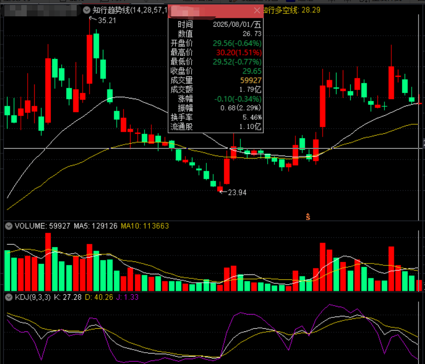

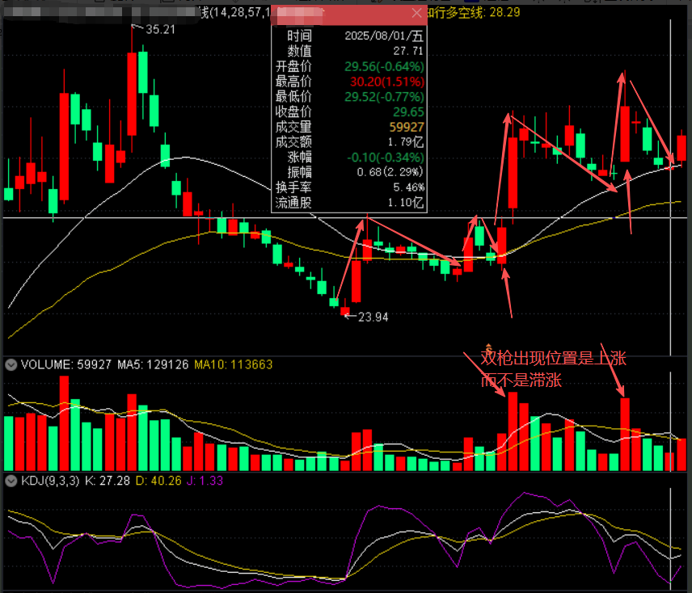

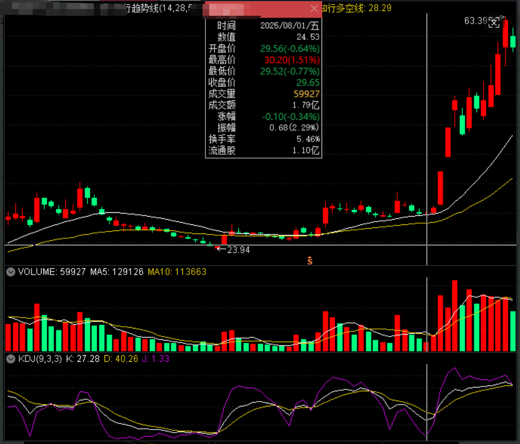

*（图示：建仓后进入箱体横盘，红肥绿瘦，末端缩至地量）*

- 解析：这是将“N型”结构压缩成一个“箱体”。股价被严格控制在箱体内，多空力量在微观层面达成极致平衡。B1点（-0.34%）是平衡打破的起点，且股价配合成交量有双枪结构（上涨放量，下跌缩量）

---

#### **类型四：“强势锁仓”图 - 缩量上涨后的回踩**

**特征**：出现在**强势趋势股**中。股价缩量上涨，主力锁仓明显，未见出货迹象。首次回调至关键均线（通常是白线）时，出现的B1点。**风险较高，但赔率也高。但要控制风险降低仓位使用。**

> [!warning] Z哥体系批注：高控盘激进型不是通用模板
> 这一类对应知识库的“高控盘激进型”，被限定为牛市后期或强趋势环境中的高风险变体。缩量上涨只能作为筹码稳定的间接线索，不能直接证明“主力锁仓”。知识库要求以白线作为清晰失效边界，并强调降低仓位；对新手而言，标准型B1优先级更高。

**案例9：昂L康**

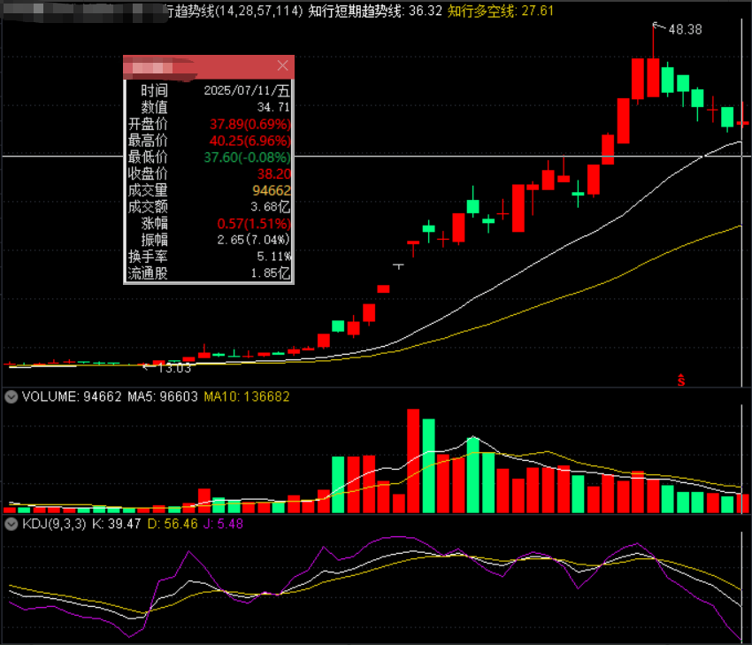

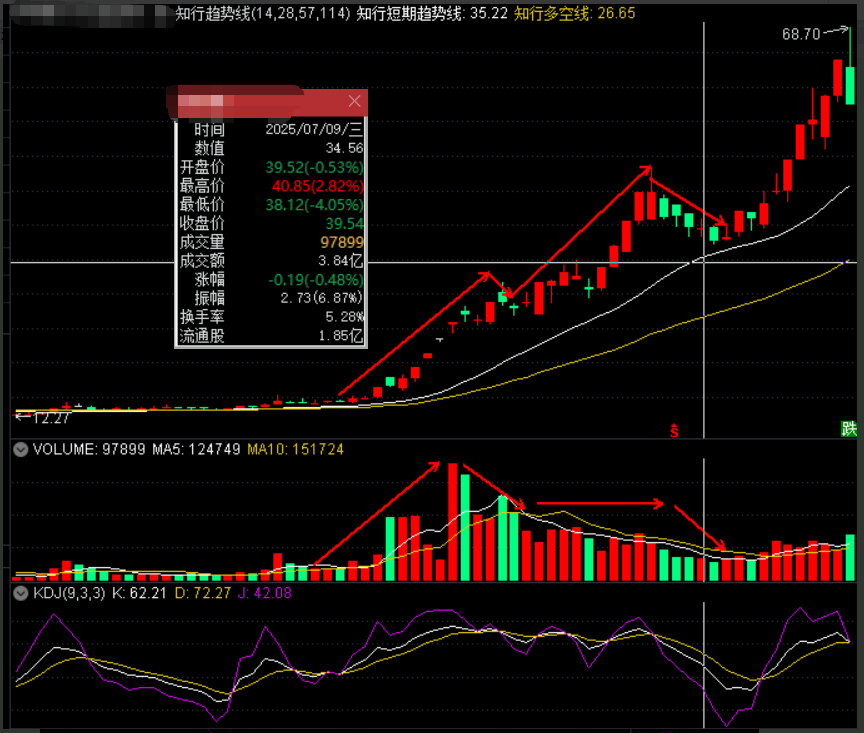

*（图示：缩量强势上涨后，首次回踩白线，出现小阳线B1）*

- 解析：这是典型的“庄股高控盘”图形。上涨途中几乎不放量，说明筹码稳定。第一次回踩白线（1.51%的小阳线）是博弈反弹的节点。**止损位明确：跌破白线即离场。**

**案例10：历史案例（如乐视网早期）**

- 解析：许多大牛股在启动主升浪前，都有类似“昂利康”的形态。核心逻辑是：**主力未出货，则必创新高**。这种图形在行情后期（如指数4500点以上）会越来越常见。

> [!warning] 注释
> 案例10在原文中没有附图，因此“十张图”并不等于当前文章中有十张一一对应的案例主图；现有19张图均属于案例1至案例9。“主力未出货，则必创新高”是确定性过强的表达，单凭公开K线和成交量也无法确认主力是否离场，应把它理解为作者对强势锁仓形态的经验概括，而不是可验证的必然结果。

---

## 三、技术要点与心法总结

1. **位置高于一切**：B1买点必须发生在**上升趋势的调整后**，或**大型横盘平台的末端**。下跌趋势中的任何反弹，都不是B1。
2. **量能是灵魂**：**“地量”是B1点的必要条件**。成交量萎缩到极致，代表卖盘枯竭，稍有买盘就能推动股价上涨。
3. **“一致”优于“分歧”**：宁可买在“地量小K线”的一致点，也不要买在“放量大阳线”的分歧追高点。前者成本低、心态稳。
4. **止损要坚决**：B1买点的止损位通常设在前一个“N型结构”的低点，或关键均线（白线）被有效跌破的位置。做错就要认，保护本金是第一要务。
5. **组合使用**：将“涨幅区间”、“振幅限制”与图形识别结合，能大幅提高选股的成功率。每天从符合条件的股票中，挑选图形最“完美”的1-2只关注即可。

> [!tip] Z哥体系批注：把文章转成执行检查
> - 先判定周期：日线B1还是周线B1；主线票优先等待周线，主题票可能只看日线。
> - 再看结构：N型上涨、黄线方向、左侧异动、顶部量价、右侧缩量，缺一项就降低等级。
> - 再核对数值：J值、当日涨跌幅、振幅、建仓波涨幅和累计换手率，不用单一指标替代整套结构。
> - 预先写失效条件：知识库给出买入K线低点、前N型低点、白线或黄线等不同场景边界；不同页面存在约3%与3%—5%的止损幅度口径，应以具体战法和图形结构为准，不能混用成固定数字。
> - 买入后继续验证：知识库强调3天内应恢复上涨；3天不涨但未大跌，最多再观察1—2天。高分图形不等于必涨，后续走势仍是验证环节。
> - B1不是每日任务：没有满足条件的完美图形时，空缺比勉强凑图更符合体系纪律。

> 守株待兔，只等属于你的那只“兔子”。
心无杂念，知行合一。

---

**免责声明**：本文所有内容仅为对z哥直播内容总结，且均为历史案例，不构成任何投资建议。所提及个股仅为历史案例分析之用，无任何推荐之意。市场有风险，投资需谨慎。请基于自身独立判断做出决策。**

原文链接: [https://mp.weixin.qq.com/s?src=11&timestamp=1792510007&ver=7038&signature=ffXbiYWaubSBYoVrbuepxijsQ4tN4joaZGizIiQn9pLtjOimYNoie6xDaxdw5De-*2VuTzu*xAFeT1FvMZCiC5nMtZEDw0diIY4tYDo2Q0YxZH0d0SdWasfDe*cjLIFZ&new=1](https://mp.weixin.qq.com/s?src=11&timestamp=1792510007&ver=7038&signature=ffXbiYWaubSBYoVrbuepxijsQ4tN4joaZGizIiQn9pLtjOimYNoie6xDaxdw5De-*2VuTzu*xAFeT1FvMZCiC5nMtZEDw0diIY4tYDo2Q0YxZH0d0SdWasfDe*cjLIFZ&new=1)

## 批注依据

- [B1建仓波](/Users/nanan/Documents/ChatGPT/Z哥知识库/references/B1建仓波.md)：B1定义、两个30%原则、最强B1十张图标准模型、持仓和止损纪律。
- [娜娜图](/Users/nanan/Documents/ChatGPT/Z哥知识库/references/娜娜图.md)：娜娜图的严格量价特征。
- [B1完美图](/Users/nanan/Documents/ChatGPT/Z哥知识库/references/B1完美图.md)：N型趋势前提、左右两侧量价结构及四类完美图。

> [!note] 证据边界
> 上述依据来自结构化概念页；页面中的 `sources` 是原始材料路径线索，本次未读取对应 `raw/` 原文。因此批注表示“与当前知识库整理口径是否一致”，不声称核对了Z哥逐字原话，也不构成对这些交易规则有效性的独立验证。
