# B1完美图：十例量价结构与适用边界

## 这组图主要训练什么

这组 B1 图例的共同观察线索是：先有一段上涨或明显异动，再经过回撤或横盘，最后检查小K线、成交量收敛，以及价格与白黄线的位置。**重点是调整末端的结构，而不是看到小阴线、低指标就认定底部成立。**这里是对图例的综合归纳，不是原文逐字定义。

与 [[05-B2经典图形：放量确认、黄线反包与反面案例]] 对照：B1侧重调整末端的低点候选，B2侧重后续阳线与量能的确认。二者观察的是不同阶段。

> [!info] 来源与阅读口径
> - 原文是14页图例集，正文较少，主要信息在截图及图中标注。本笔记区分“原文标注”和“读图归纳”，未补造直播讲解。
> - 原PDF保存在本笔记附件目录：[[04-B1完美图-assets/原文-B1完美图形十张图.pdf|打开完整原PDF]]。下方直接提取原图，保留箭头、框线和指标栏。
> - 多处标题在上一页、图片在下一页；以下按原文顺序对应。日期未统一注明年份，不自行补年。
> - “建仓”“洗盘”“未出货”等是材料采用的解释。K线与成交量不能单独证明特定资金的真实行为；案例后续上涨也不能替代信号当时的验证。

## 十例速查

“当日标注”按原文保留，不用它反推全部筛选条件已经满足。

| 案例 | 原文日期 | 当日标注 | 图文所在PDF页 | 主要观察点 |
|---|---|---|---|---|
| 华纳药厂 | 5月9日 | 娜娜；-1.27 | 1—2 | 拉升后缩量回调 |
| 宁波韵升 | 8月6日 | +1.79 | 2—3 | 多轮上涨后的量能收敛 |
| 微芯生物 | 6月20日 | -1.44 | 3—4 | 明显拉升后的回撤 |
| 方正科技 | 7月23日 | -1.49 | 4—5 | 底部整理、异动与回踩 |
| 澄天伟业 | 7月18日 | +1.03 | 5—6 | 急涨后较长时间调整 |
| 国轩高科 | 8月1日 | -1.54 | 6—7 | 多轮异动后的整理 |
| 野马电池 | 7月31日 | -1.95 | 7—8 | 高点回撤后横向消化 |
| 光电股份 | 7月10日 | -1.19 | 8 | 拉升后平台压缩 |
| 新瀚新材 | 8月1日 | 压缩、箱体震荡、两重重炮 | 8—12 | 横盘结构与两次放量对应 |
| 昂利康 | 7月10日 | 压轴题；白线止损 | 12—13 | 连续上涨后顶部量能与白线 |

第14页另附相似图及不完整的“B1波动总范围”文字，见文末。

## 先看结构，再看最后一根K线

以下为读图步骤，便于复盘，不是对原文未给出的数字补充定义。

1. **圈出前面的上涨或异动。**回调要有前史，不能只截最后几根小K线。
2. **对照上涨与调整的量柱。**区分前期放量、顶部量能和末端缩量，不把任意一天量小都叫“地量”。
3. **确认调整方式。**有的直接回撤，有的在较高位置横盘，有的经过更长时间整理；不要求十例长成同一张图。
4. **看白线、黄线及近期低点。**记录价格位于哪一层、线的方向如何；“接近线”只是位置描述。
5. **最后检查小K与指标。**原图有KDJ等指标，但没有为每例列出完整数值；不要从缩略图估算精确阈值。

通用B1定义、两个30%等已有体系规则见 [[交易理论与应对体系/06-B1入场与建仓波鉴别]]。这些规则来自另一组结构化材料，不冒充本PDF逐条写明的内容。

## 十个案例逐图整理

### 1. 华纳药厂：拉升后缩量回调

**原文标注：**第1页列“华纳药厂 5月9日”，随后写“娜娜”“-1.27”；图片接在第2页。

**读图归纳：**先观察右侧上涨段，再比较高点回撤时的量柱。图右端K线与量能比上涨阶段收敛，白黄线与调整末端的位置是主要观察对象。原文的“娜娜”标签保留，但不从这一个词推出所有严格筛选条件均已核验。

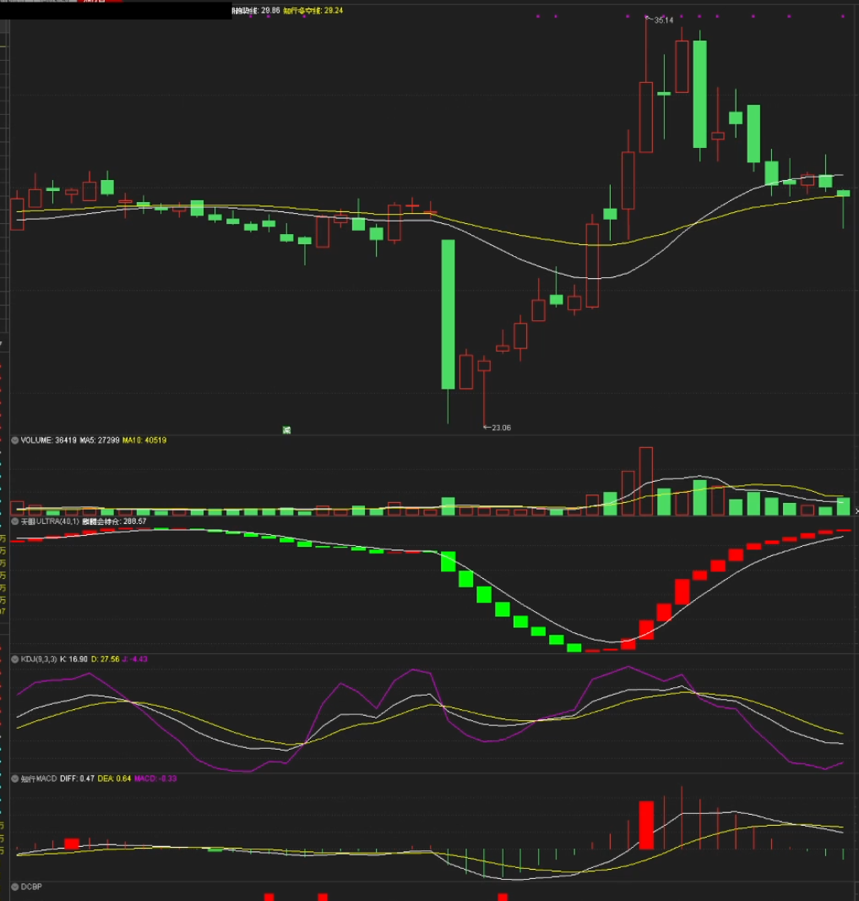

### 2. 宁波韵升：多轮上涨后的收敛

**原文标注：**“宁波韵升”“+1.79”，日期在第1页目录中写为8月6日。标题在第2页，图在第3页。

**读图归纳：**左侧与中段有不同的放量动作，之后形成继续上行与回撤。重点比较最近一轮上涨和右侧整理，不把整段历史累计量能与末端一根量柱直接相比。

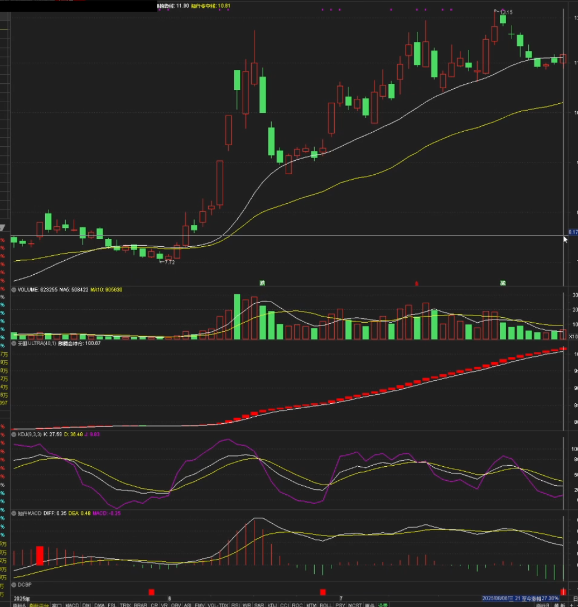

### 3. 微芯生物：拉升后的回撤不必收阳

**原文标注：**“微芯生物”“-1.44”；目录日期为6月20日。图在第4页。

**读图归纳：**较长整理后有明显上涨，随后回到白线附近。-1.44的标注说明，材料没有把“当日必须上涨”当成每一例的共同要求；仍需连同此前结构、量能和位置阅读。

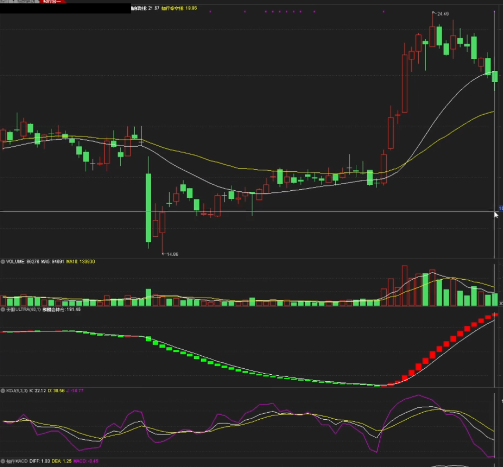

### 4. 方正科技：把底部前史一起看

**原文标注：**“方正科技 7.23 -1.49”。图在第5页。

**读图归纳：**前段有低位整理，随后出现多次向上动作；右端回撤时量柱下降。与上一例相比，左半边的节奏不同，所以识别重点是“上涨—调整”的关系，而不是复制某一根K线外形。

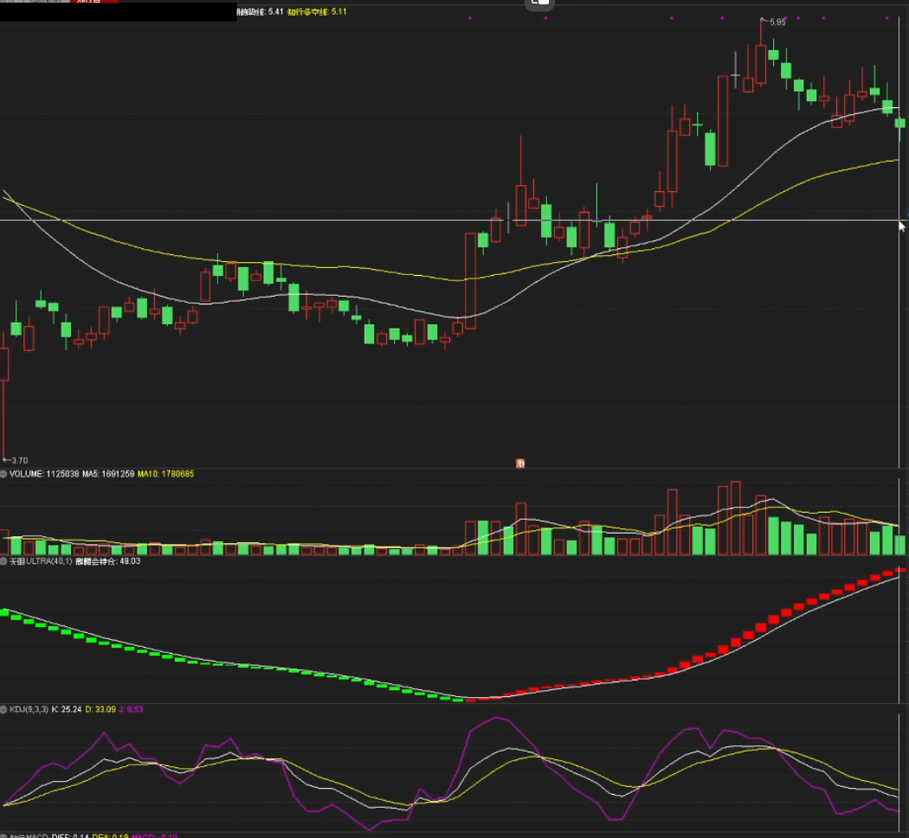

### 5. 澄天伟业：急涨后的时间消化

**原文标注：**“澄天伟业 +1.03”；目录日期为7月18日。图在第6页。

**读图归纳：**上涨较急，高点附近量柱明显增大，之后经过更长整理，白黄线逐渐靠拢。这一例适合练习区分“急涨后立即下跌”与“经过时间消化后的末端收敛”，不能因最终入选图集，就忽略中间的大波动。

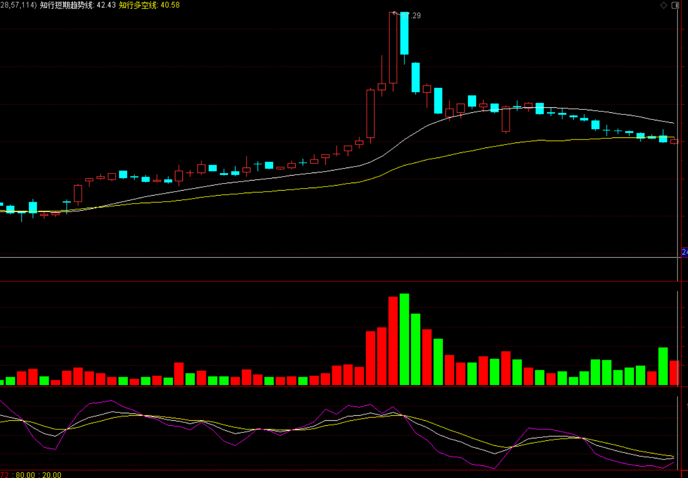

### 6. 国轩高科：多轮异动后的整理

**原文标注：**“国轩高科 -1.54”；目录日期为8月1日。图在第7页。

**读图归纳：**前面有不止一次上行与放量，最近一轮高点之后转入回撤、横向整理，末端量能较前段缩小。不能由截图补算建仓波累计换手率，也不能把复杂整理直接等同于标准窄幅图。

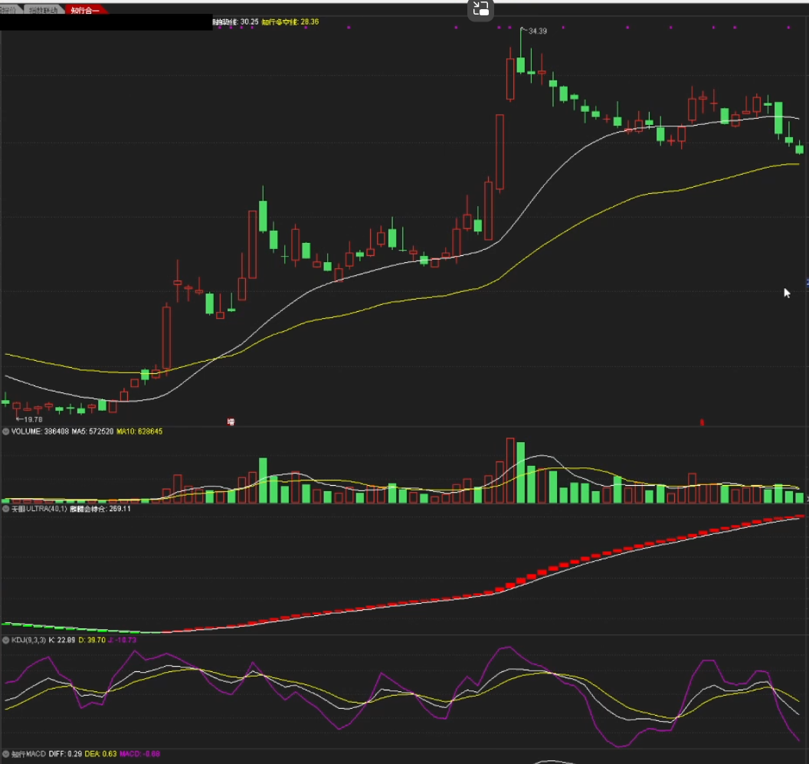

### 7. 野马电池：高点回撤后的横向消化

**原文标注：**“野马电池 -1.95”；目录日期为7月31日。图在第8页上半部。

**读图归纳：**前段放量上涨，随后价格沿白线附近整理，量柱总体收敛。观察重点是上涨前后量能的变化，以及右端整理的位置，而不是单独用-1.95判断信号质量。

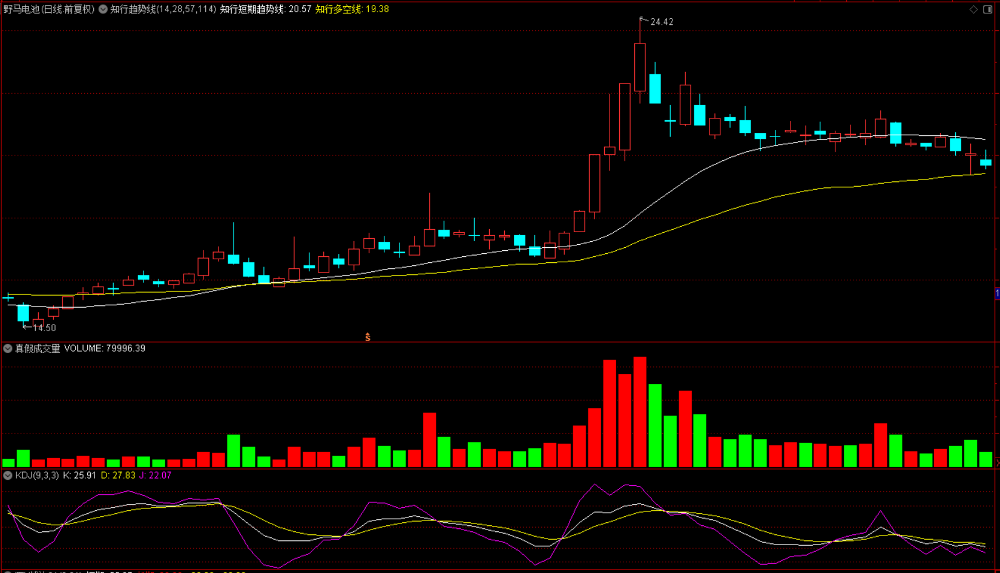

### 8. 光电股份：拉升后平台压缩

**原文标注：**“光电股份 7.10 -1.19”。图在第8页下半部。

**读图归纳：**拉升后没有立刻回到原始底部，而是在较高位置横向整理，量能下降。这个例子提醒：调整也可能主要消耗时间；不能把“每一例都必须深踩黄线”写成该图集的共同条件。

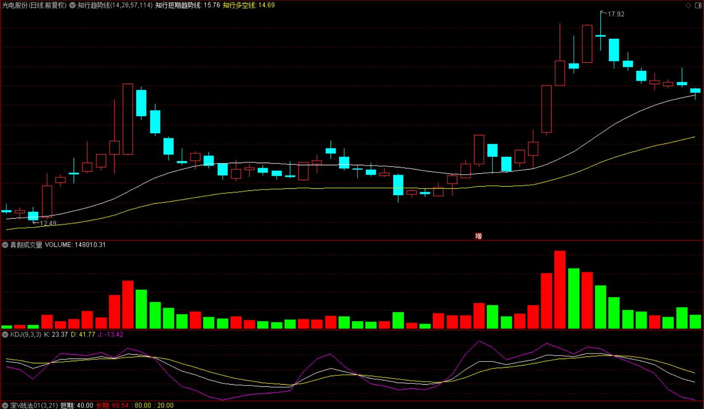

### 9. 新瀚新材：箱体压缩与两重重炮

**原文标注：**“新瀚新材 压缩 箱体震荡 可以理解为顶部压缩 两重重炮”；目录日期为8月1日。文字在第8页底部，连续图在第9—12页。

**读图归纳：**本组图从不同尺度展示前段调整、后续上行和上部整理。第10页用折线表达波段，第11页将两次放量动作框出并标注“放量双枪、缩量滞涨”。复盘时应分别定位两次放量及其间的调整，不把压缩阶段的小K与后续放量阳线当作同一信号。

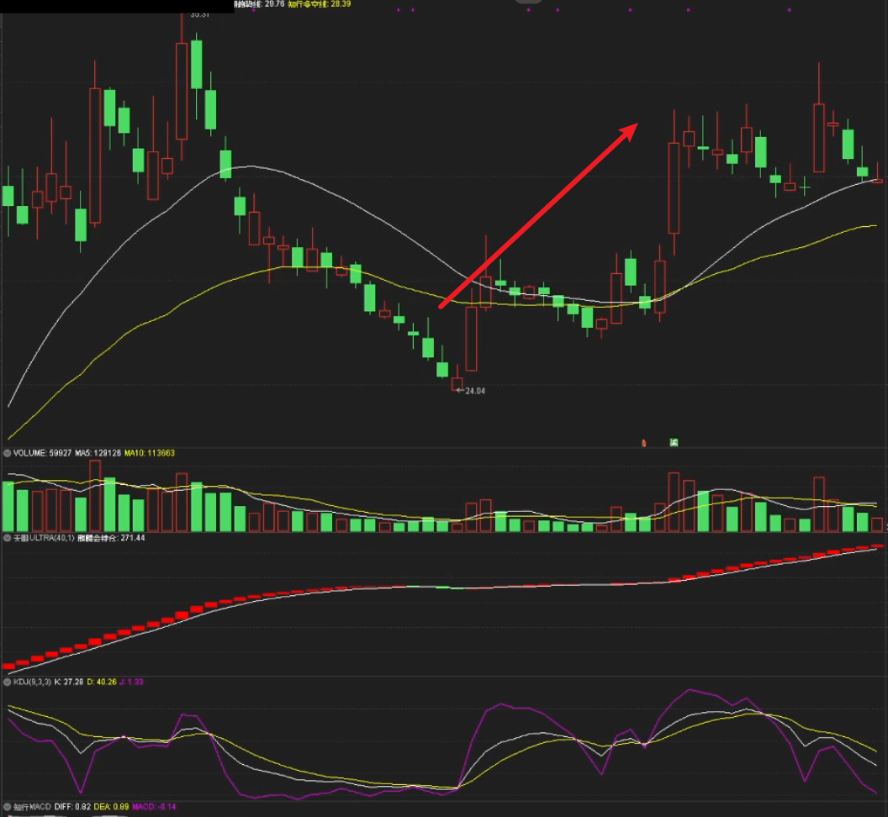

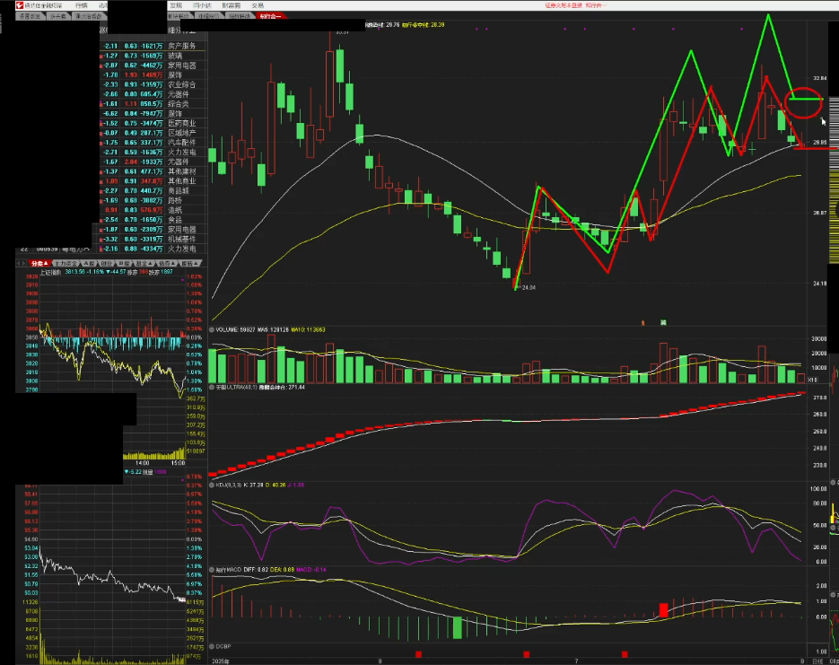

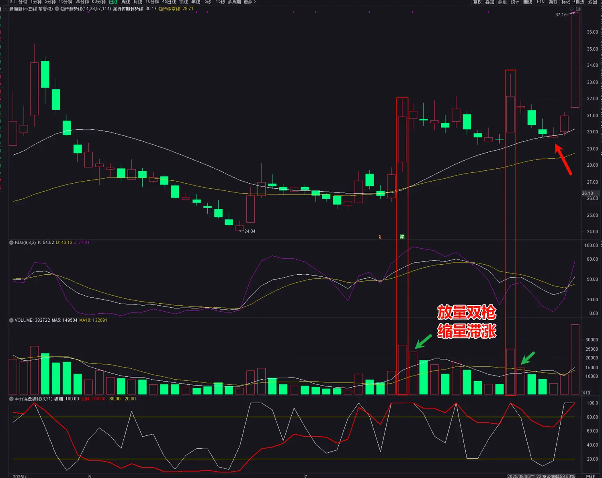

第12页上方另有局部量价图，图内写“庄股放量”。该图位于“昂利康【压轴题】”标题之前，按原文顺序归入前一组补图；图内未显示可核实的股票名，不另作独立命名。

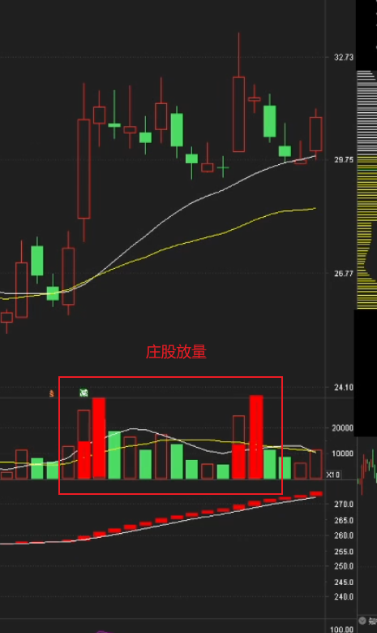

### 10. 昂利康：限定语境下的强势回踩

**原文标注：**“【压轴题】牛市后期 连续上涨 顶部却没有放量 再用这招”；“图中B1干进去 白线止损”。目录日期为7月10日。说明在第12页，图接第13页。

**读图归纳：**图中此前上涨已经明显展开，回撤位置仍较高。这不是低位刚启动的标准样本，原文自己就限定了“牛市后期、连续上涨、顶部没有放量”的语境，并给出白线失效边界。

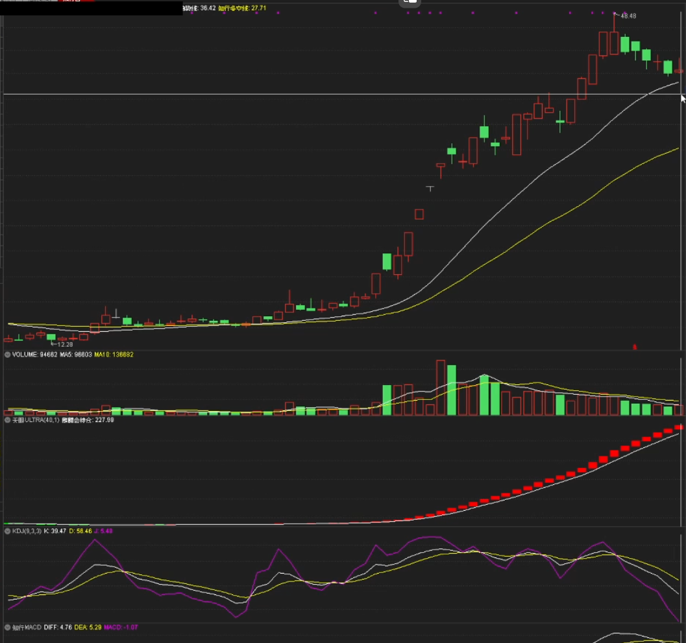

> [!warning] 保留限定，不把预测写成规则
> 原文另写“未来4500点大部分票的B1就会如下图”。这属于材料中的市场情景判断，不能当作当前行情事实，也不能由此推出缩量上涨必然代表锁仓或必然创新高。

## 补图与数值口径

第14页相似图标注“缩量上涨 顶部不放量 主力没出货”，下方只有“B1波动总范围：-2%”。按现有文件，这句话没有完整的双端区间，也没有说明是收盘涨跌幅还是盘中振幅，**不据此补写成统一的±2%、-2%至+1.8%或振幅阈值。**

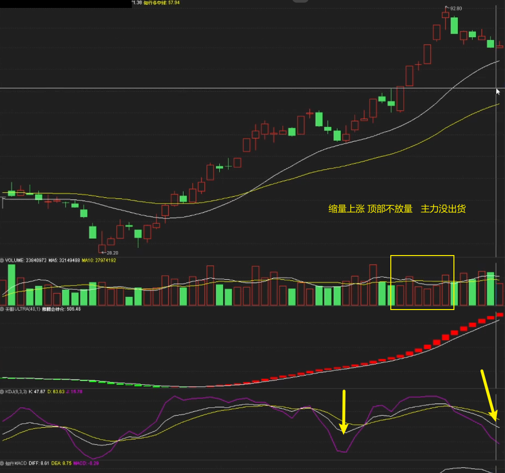

“主力没出货”在这里保留为原图解释，未获得资金持仓或交易数据的独立证明。

## 复盘时怎样使用

- [ ] 先遮住后续走势，只看信号当日以前的图。
- [ ] 标明周期、此前上涨段与最近一次明显异动。
- [ ] 把顶部量柱、调整量柱、末端小K分别圈出来。
- [ ] 记录白黄线方向及价格所处位置。
- [ ] 区分直接回撤、较长整理、箱体压缩、强势回踩，写明最接近哪一例及差异。
- [ ] 缺少J值、换手率或精确成交量时，记“未核验”，不凭图形整齐补齐条件。
- [ ] 预先写清所选规则的失效位置；观察后续是否出现B2确认，不以后来上涨反证当时必然正确。

## 与已有笔记的关系

- [[03-十张经典B1买点图解析]] 是另一篇微信文章的归档与批注；案例列表、数值和图数与本PDF不同，不能互相替代。本篇保留了PDF中的野马电池及末尾补图。
- [[交易理论与应对体系/06-B1入场与建仓波鉴别]] 用于查通用定义、筛选规则与规则冲突。
- [[05-B2经典图形：放量确认、黄线反包与反面案例]] 用于继续观察调整后的确认阳线。
