# B2经典图形：放量确认、黄线反包与反面案例

## B2观察的是调整后的确认

本组图反复展示的顺序是：**前面已有上涨、异动或平台结构，随后缩量调整，再出现有量能配合的阳线、反包或平台突破。**识别重点是确认阳线与此前结构的关系，不能只截取一根放量阳线。

与 [[04-B1完美图：十例量价结构与适用边界]] 对照，B1偏向调整末端的低点候选；B2偏向其后的量价确认。以上是对本组案例的综合归纳。

> [!info] 来源与阅读口径
> - 原文为22页图例集，原PDF已保存：[[05-B2经典图形-assets/原文-260107-B2经典图形.pdf|打开完整原PDF]]。
> - 下方为直接提取的原图。PDF第2—3页跨页使用同一张安德利图片，本笔记合并展示一次。
> - 多处标题排在前一页末尾；以下已按标题顺序与图内名称对应，不按“离图片最近的下方标题”机械配图。
> - “倍量”“小幅放量”“30%”分别保留其场景。材料没有完整列出每例的涨幅、J值及成交量原始数据，不补造精确筛选结果。
> - 文件名中的“260107”保留为来源标识，未据此确认成文日期。历史截图用于学习该方法的判图口径，不代表已经完成回测验证。

## 先区分三种量能口径

| 原文口径 | 对应案例 | 能从材料确认什么 | 不宜扩展成什么 |
|---|---|---|---|
| 倍量、超级倍量 | 潮宏基、德龙激光、国盛证券、国义招标、海天瑞声、路桥信息等 | 作者强调这些案例确认阳线的量能力度；潮宏基明确写“要倍量才算数” | 所有B2都必须使用相同倍量门槛 |
| 小幅放量、微微放量 | 奔朗新材、安德利、三峡水利、太钢不锈 | 某些调整或回踩后的反包，不需要等到超级放量 | 任意位置只要略有放量就成立 |
| 放量30% | 太钢不锈 | 原文限定在“缩量回踩黄线之后的阳线” | 所有形态的统一必要条件，或不看位置的买入条件 |

“较前日放量30%”若以相邻交易日成交量比较，数学上相当于当日成交量为前日的1.3倍；但原文这句话没有明确写出比较基准，复盘时应先记录自己的基准，不能把解释当成原文完整定义。倍量的精确比较基准也应与所用规则核对。

既有体系笔记 [[交易理论与应对体系/07-B2与B3确认及假突破应对]] 还保留了涨幅、J值、放量20%等筛选口径。这些来自其他来源，**与本PDF的案例口径并列阅读，不静默合并，也不自动判定每例都通过另一套规则。**

## 一、缩量后再放量：先识别确认动作

### 安德利：两次击穿，区别在反击时的量

**原文标注：**第一次击穿后的阳线没有放量；第二次击穿后，隔天阳线悄悄放量，作者将其标为B2。标题在第1页，图跨第2—3页。

**观察重点：**对照两次击穿及其后的阳线，关键差异是反击时是否出现量能变化；不是“击穿一次就一定会反包”。

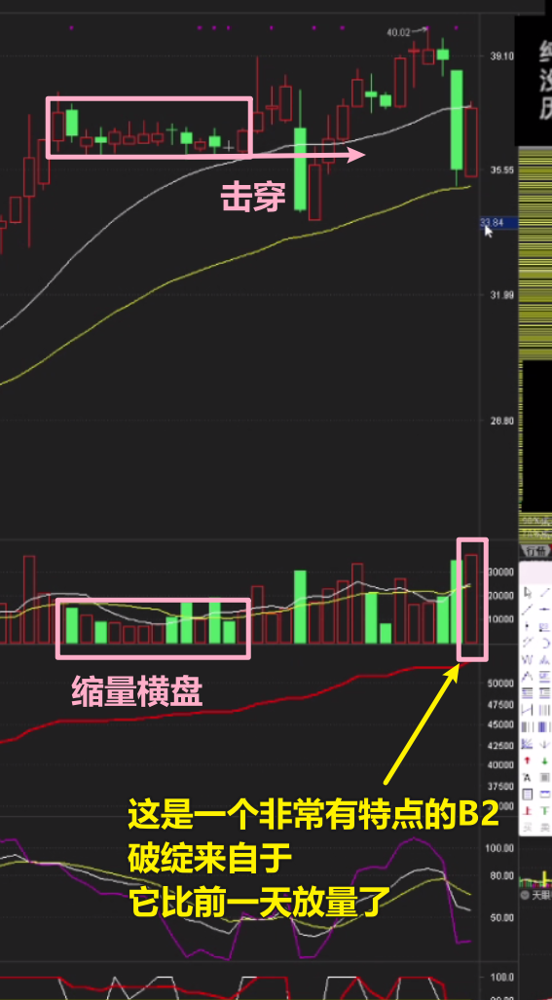

### 奔朗新材：小幅放量也要有缩量前史

**原文标注：**“缩量回调，小幅放量的B2”。图文在第3页。

**观察重点：**图中先圈出一段递减的量柱，再标出“微微放量的B2”。小幅放量的意义来自此前已经缩量调整，不能脱离这段前史。

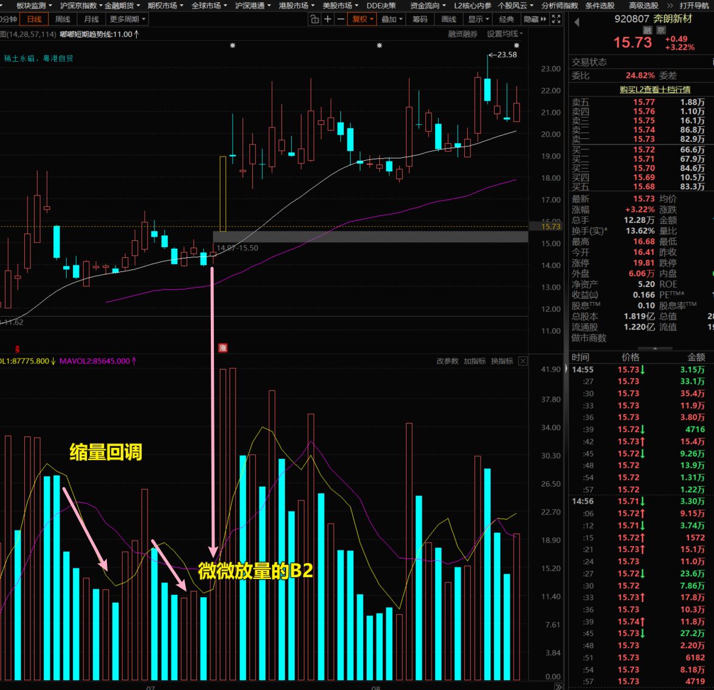

### 财富趋势：多门重炮要看中间的缩量

**原文标注：**“多门重炮的B2买点”；图内写“倍量柱暴力K、缩量回调”“缩量回调后的B2买点”。标题在第3页末，图在第4页。

**观察重点：**先识别前面的放量动作，再看其后调整，以及再次放量的位置；不能把任意几根大阳线组合都命名为重炮。

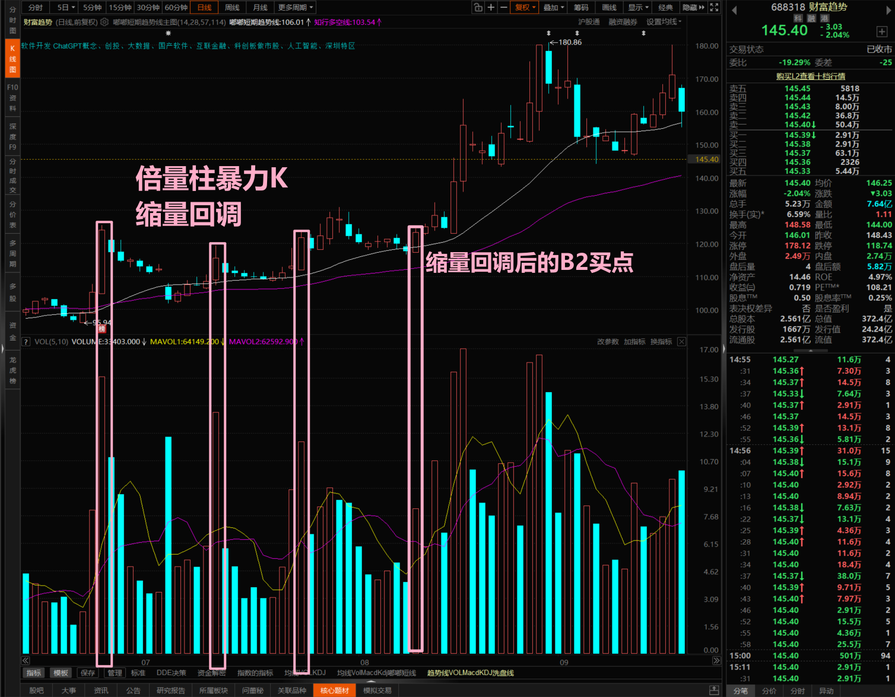

### 晨光生物：横盘踩黄线后的反包

**原文标注：**“B1之后的倍量柱意义极大（跃跃欲试之后的灾后重建）”；图中写“横盘踩黄线”“踩黄线后的放量的反包b2”。标题在第4页，图在第5页。

**观察重点：**先有横盘与回踩，再有向上的放量反包。“灾后重建”在本例有此前上涨与整理的结构，不等于任意下跌后的阳线反弹。

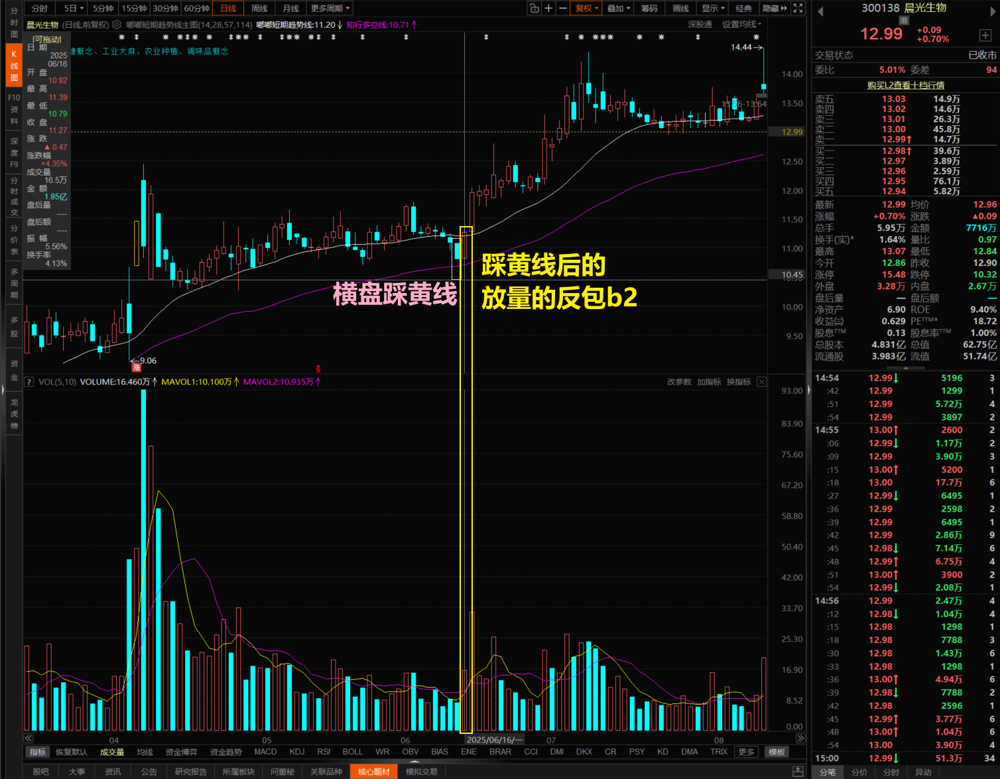

### 潮宏基：同图比较无量反包和倍量阳线

**原文标注：**“0516，B1之后的倍量阳线”“要倍量才算数”；图内同时标出“黄线后的反包，但是没放量”和后面的“B1之后的倍量阳线”。标题在第5页，图在第6页。

**观察重点：**反包外形相似，量能要求却未必满足。这里的“要倍量”应连同本例阅读，不能覆盖太钢不锈的小幅放量例外。

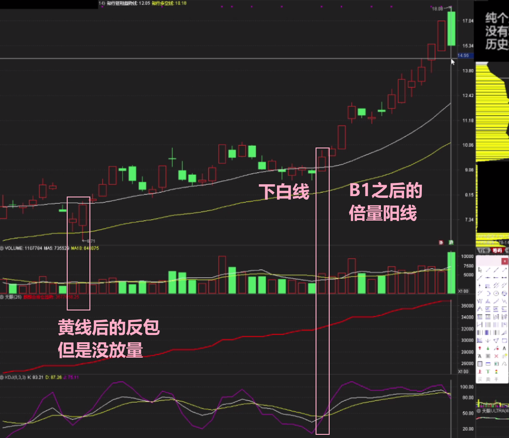

### 德龙激光：B1之后的倍量柱

**原文标注：**“07，缩量回调，B1后的倍量柱B2”。标题在第6页，图在第7页；图内证券名称为德龙激光。

**观察重点：**价格与量柱的框线对齐，先看框线前的缩量下跌，再看确认阳线与其量柱。原文只写“07”，不补成某年某月的完整日期。

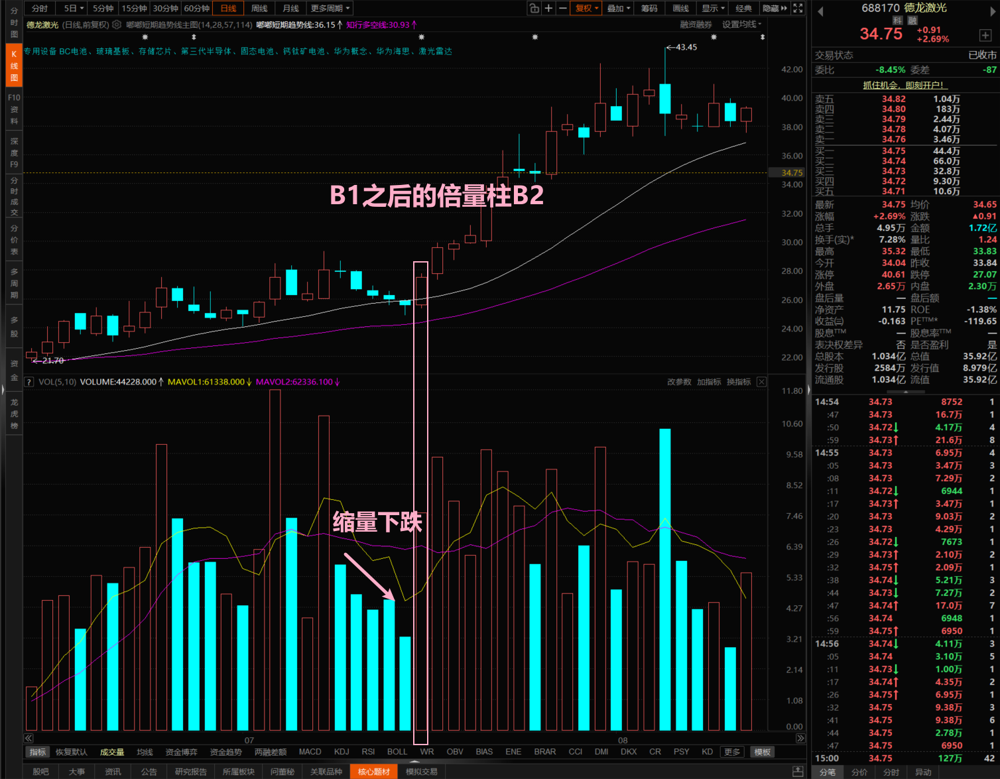

### 国盛证券：缩量下跌后放量反包

**原文标注：**“0922”；图内写“缩量下跌B1 + 放量反包B2”。标题在第7页，图在第8页。

**观察重点：**识别此前调整的终点及反包阳线，不能用图右端后续走势替代框选日的判断。

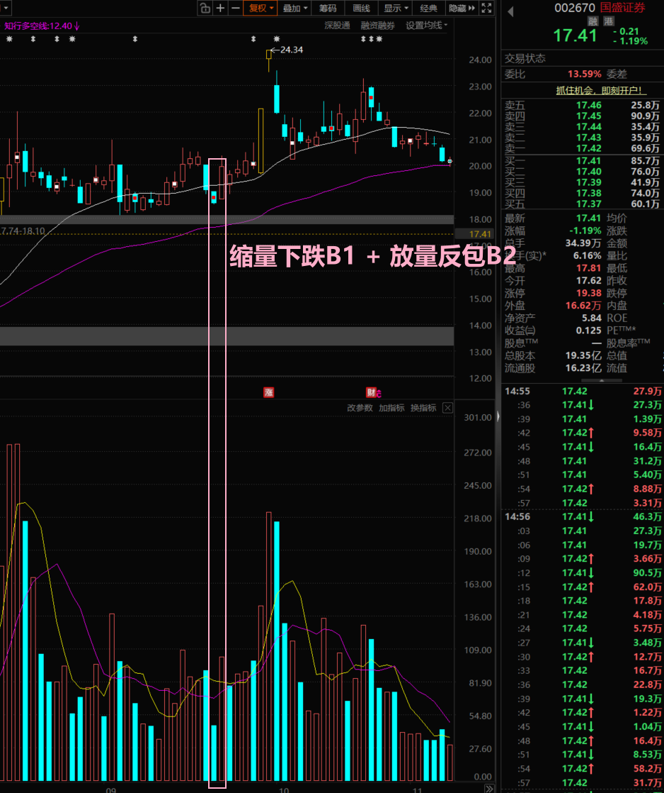

### 国义招标：两门重炮与超级放量

**原文标注：**“缩量下跌后的超级放量B2”；图内另标“两门重炮”。标题在第8页，图在第9页。

**观察重点：**大阳线出现前已有异动与缩量过程。图中带有后续大幅波动，“买入后发财”是原图表述，不作为本笔记的收益判断。

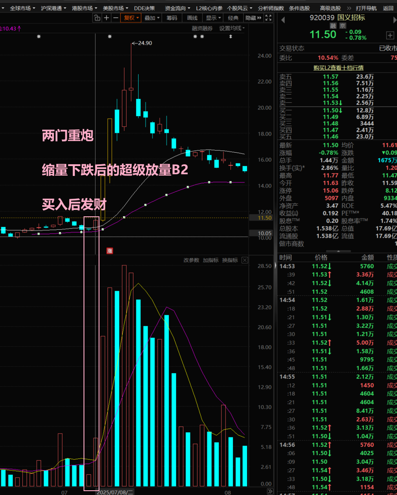

### 海天瑞声：跃跃欲试后的平台启动

**原文标注：**“250708，跃跃欲试，缩量下跌后的倍量柱反包”；图内写“跃跃欲试、倍量柱、平台启动”。标题在第9页，图在第10页。

**观察重点：**观察确认动作发生在前段平台的什么位置，以及此前的量能是否收敛。原文日期标识按原样保留。

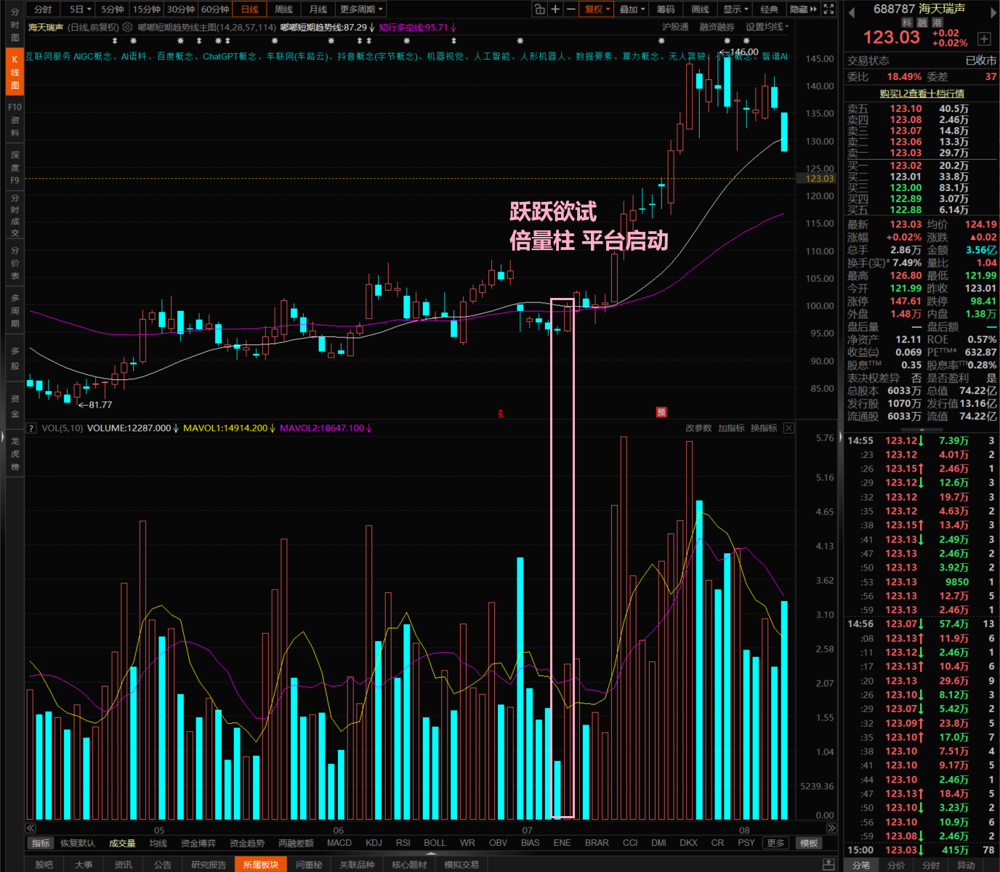

### 京北方：关键K支撑与缩量调整

**原文标注：**“关键K + 缩量下跌 + 倍量B2”；图中标有“两根关键K支撑有效”。标题在第10页，图在第11页。

**观察重点：**先画出前面的关键K位置，再观察其后调整有没有破坏结构，最后定位确认阳线。

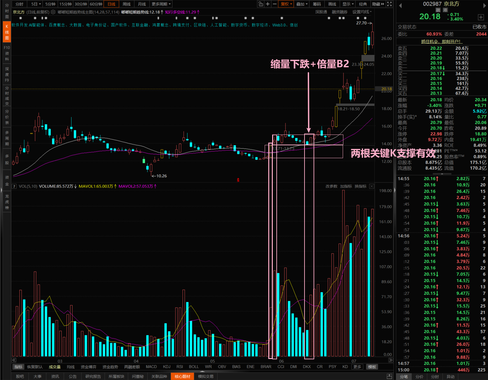

#### 阶梯量：不能只看量柱逐日降低

第11页末提出“判断阶梯量——量能够不够多”，第12页沿用京北方图作说明。图内明确区分：“这算阶梯量吗？不算，缩量缩太多了”；并用下方另一组框线注明“得到这个位置开始缩量下跌才算阶梯量”。

**读图归纳：**原作者没有把所有递减量柱一概判为同一种阶梯量，而是在比较起始位置、此前放量与衰减程度。本PDF未给可计算的统一界限，笔记不补写百分比。

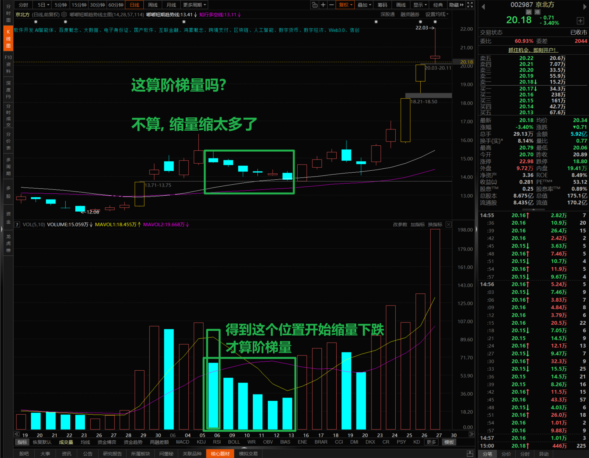

### 晶科科技：先有上行动作，再看顶部与回补

**原文标注：**“顶美、强有力的走势”；图内依次写“一阶段：长阴短柱，强有力的上涨动作”“二阶段：顶部缩量没出货”“缩量击穿”“放量回补，B2买点”。标题在第12页，图在第13页。

**观察重点：**将前段上涨、上部整理、击穿和放量回补连起来读；“顶部没出货”保留为原作者的解释，不能只凭缩量确认真实持仓行为。

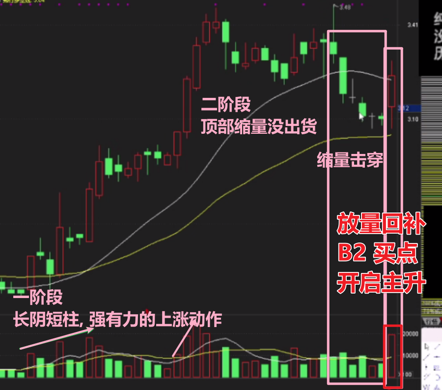

## 二、平台与黄线：位置决定放量如何解释

### 路桥信息：横盘后的超级倍量柱

**原文标注：**“0526，横盘后的一根超级倍量柱”；图中用大框标平台、小框对应启动阳线与量柱。标题在第13页，图在第14页。

**观察重点：**放量前存在一段横盘，确认阳线打破原有整理节奏。原文后面将它与指南针、寒武纪列为相同类型，本笔记不重复贴图。

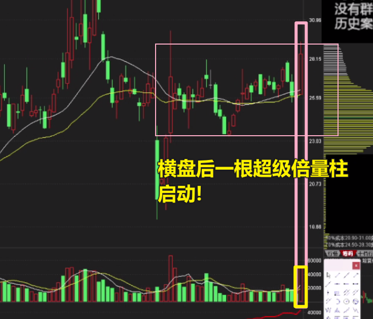

### 美迪西：缩量踩黄线后的倍量反包

**原文标注：**“0623，缩量踩黄线后的倍量反包B2，完美图”；图内还写“没拉涨的阶梯柱不是出货”“黄线位置的B2倍量柱，价值极高”。标题在第14页，图在第15页。

**观察重点：**将前面的横盘与缩量回踩、黄线位置、反包阳线连在一起。“价值极高”是原图评价，不是本次独立检验结果。

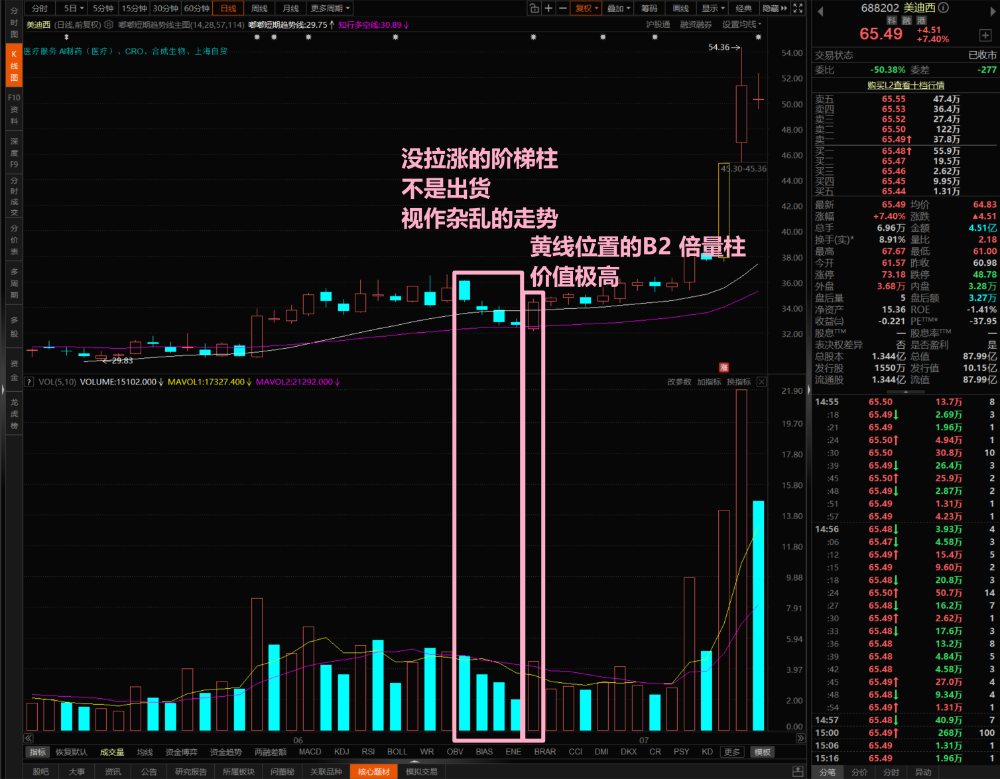

### 未具名案例：接近倍量的黄线反包

**原文标注：**“缩量踩黄线后，接近倍量的B2，完美图”；图内写“红肥绿瘦主升”“和大盘共振踩黄线”“缩量踩黄线的倍量反包B2”。标题在第15页，图在第16页。

**观察重点：**先有上行结构，之后与大盘共振回踩，再看反包。标题用“接近倍量”，图内用“倍量”，两种表述原样区分；证券名在图中被遮挡，不猜测补名。

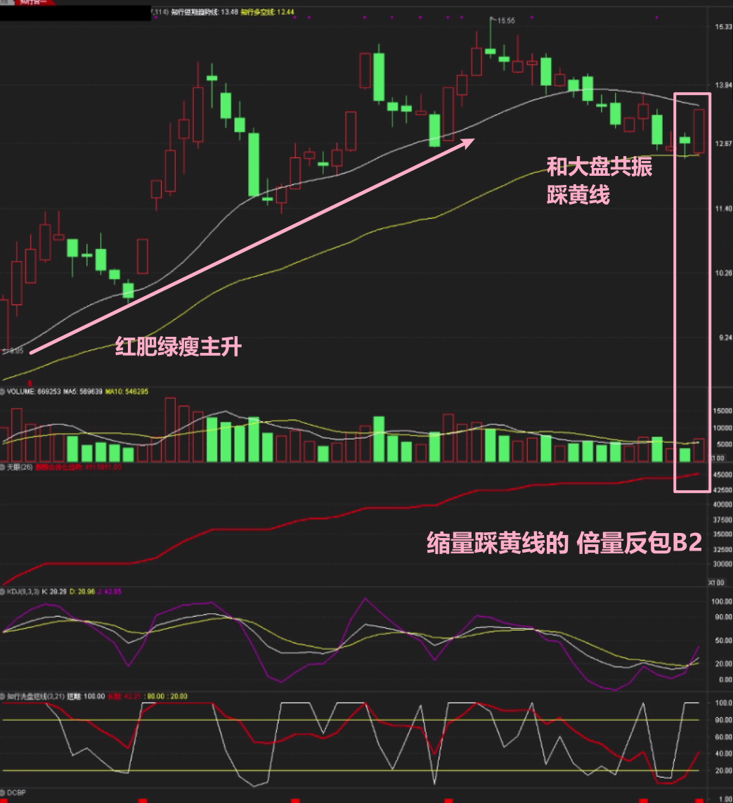

### 三峡水利：黄线反包的三幅对照图

**原文标注：**“2011-01-19，主线票横盘后的踩黄线反包买点”。标题在第17页末，图在第18—19页。

**观察重点：**第18页上图看较长趋势，下图带有“打黄线后，微微放量的反包阳线B2”标注；第19页另图标出2011-01-19的反包与之后的走势。不要将三幅不同尺度、不同截取范围的图强行看成同一天的同一张截图。

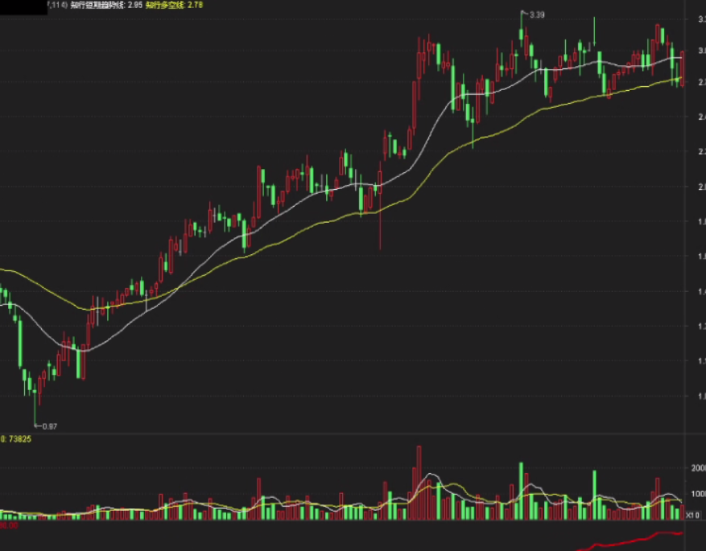

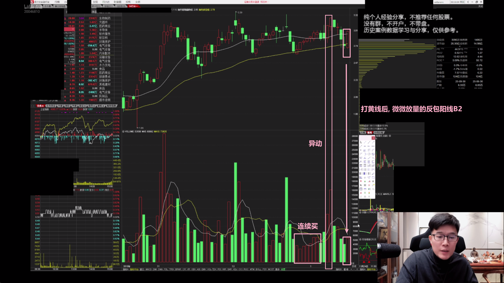

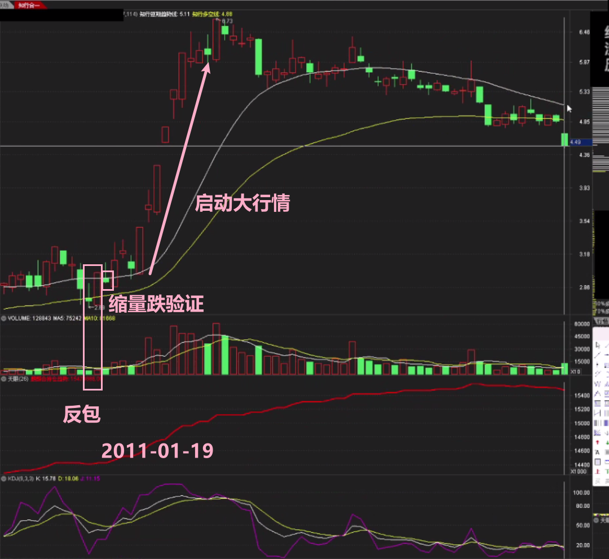

### 太钢不锈：30%是有前提的场景口径

**原文标注：**“横盘 + 缩量踩黄线 + 小幅放量反包”；“缩量回踩黄线之后的阳线，只要放量30%就行”。标题及说明在第19页，图在第20页。

**观察重点：**三个条件应连着看：先横盘、再缩量回踩黄线、再出现放量反包。不能删掉前两个条件，只留下“放量30%”。原文也没有在这里给出独立的J值或涨幅判据。

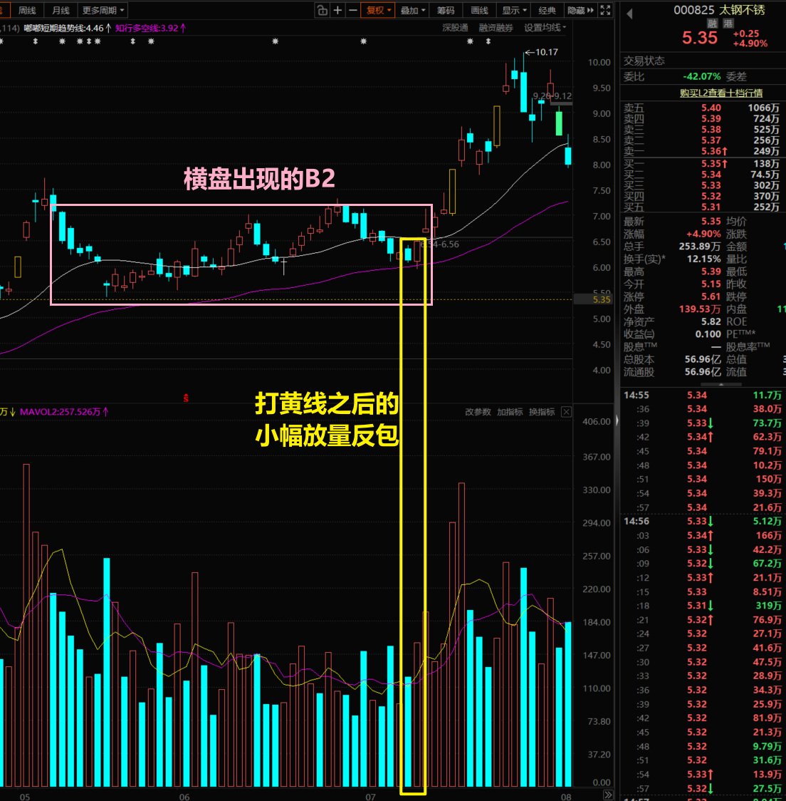

### 指南针与寒武纪：整理后突然改变节奏

**原文标注：**指南针为“横盘 + 红肥绿瘦 + 莫名其妙的超级倍量线”；之后列“相同案例——上文路桥信息”“相同案例——寒武纪”。指南针标题在第20页，图在第21页；寒武纪图在第22页。

**观察重点：**先定位平台与整理期间的量价，再找显著改变节奏的一根确认阳线。“莫名其妙”描述的是图形的突兀感，不能据此判断现实中没有消息或基本面因素。

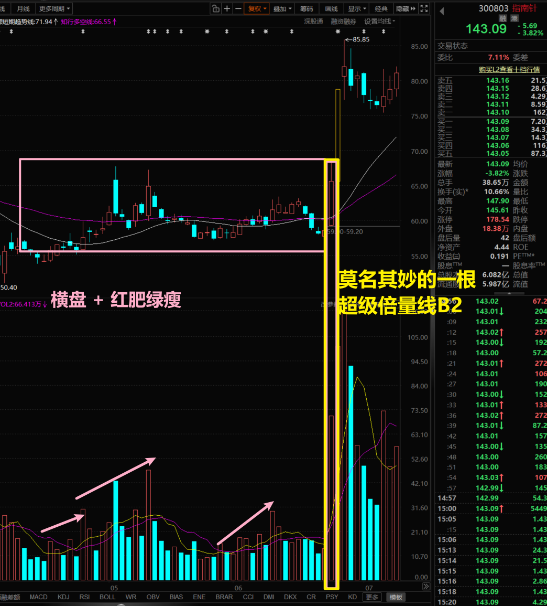

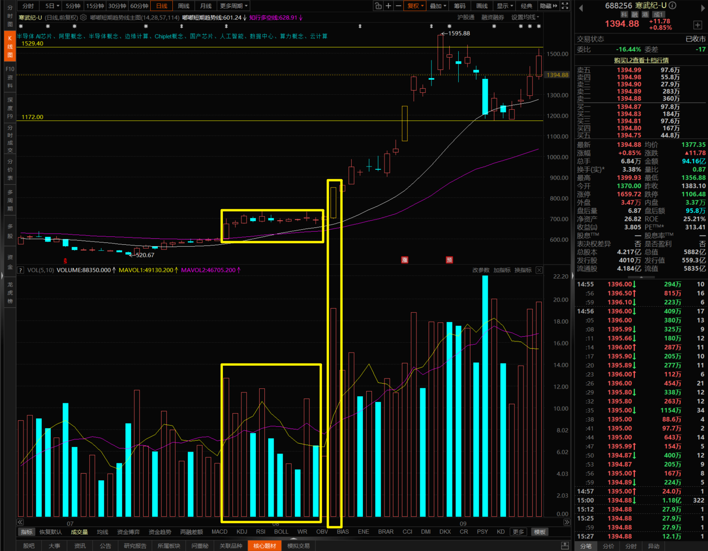

## 三、反面案例：有量也不能跳过K线质量

### 大长下影的放量阳线

**原文标注：**“B2反面案例——大长下影的放量阳线B2”；图内写“反面案例、大长下影、这票就有问题”。标题在第16页，图在第17页。

**观察重点：**原文没有因“阳线 + 放量”就判为好例子，而是把长下影对应的大幅盘中波动列为反面特征。不要把这一例误写成“长上影”案例；原图强调的是下影线。

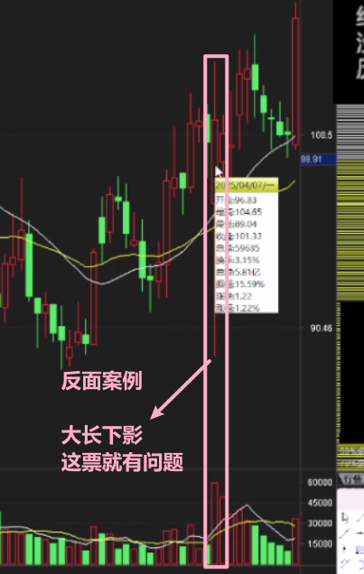

这张图提供的是一个反面样本，未给长下影长度的统一阈值，也未完整解释其失败机制。因此不扩大成“所有带下影线的反包都无效”。

## 复盘检查顺序

1. **前史：**此前是否有上涨、关键K或可辨认的平台；把区域标出来。
2. **调整：**回撤、横盘是否缩量，是否回到材料讨论的白线、黄线或关键K位置。
3. **确认：**反包了哪根K、收复了什么位置，还是突破了哪段平台；不能只写“出阳线”。
4. **量能：**本例采用倍量、小幅放量还是特定30%口径；写清比较基准及数据是否足够。
5. **K线质量：**检查实体、上下影及盘中波动，特别与长下影反面图对照。
6. **规则边界：**在所选策略下预先记录失效位。该PDF没有提供统一止损百分比、持有天数或仓位，不能从案例后续涨幅倒推这些规则。
7. **事后验证：**遮住右侧走势先判图，再展开后续，分别记录判断依据和结果；不能只收集上涨成功样本。

可继续查阅 [[交易理论与应对体系/07-B2与B3确认及假突破应对]] 中的持有、止损及不同口径；查量价工具见 [[交易理论与应对体系/04-趋势结构与量价工具]]。这些属于补充阅读，来源与本PDF分开。
