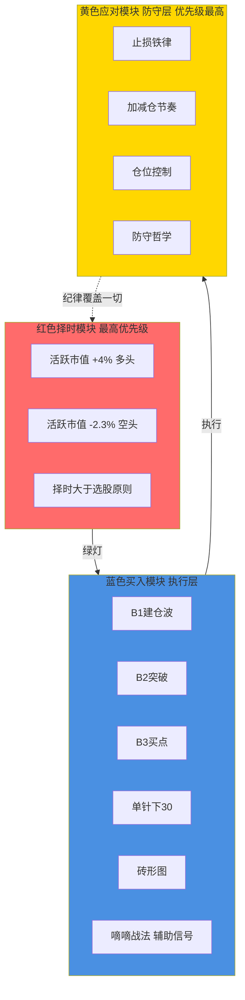
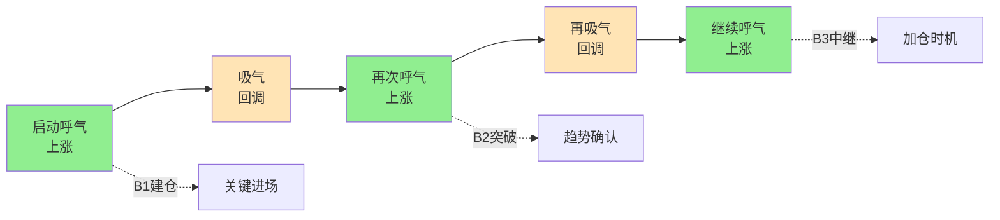
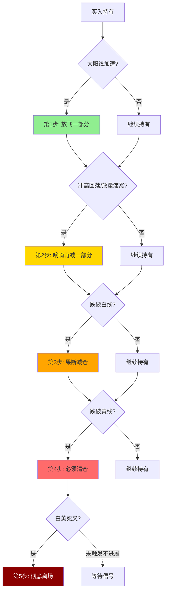

# 交易闭环与策略边界

> [!info] 阅读口径
> 本篇上半部按交易流程综合整理；下半部完整保留归属本篇的原库条目正文，并保留原有数值、例外与冲突。原库表述属于特定方法论；其中收益、胜率、历史案例及市场判断未经本次独立核验。综合编排不是Z哥原话。跨条目冲突统一见 [[19-规则冲突与知识缺口]]。

## 这套体系解决什么问题

Z哥体系把交易拆成三个问题：市场是否允许交易、什么形态值得入场、判断失败或盈利后如何应对。对应红色择时、蓝色买入和黄色应对三个模块。日常顺序是“择时→选股→买入→应对”，但持仓出现风险时，应对纪律覆盖原有买入判断。

选出一只股票只代表进入观察阶段。它仍要通过市场环境、周日线趋势、建仓痕迹、买点、止损空间五项检查；买点出现之前可以一直等待。体系的核心不是把每次走势解释正确，而是提前写清“什么证据支持继续持有，什么变化使原判断作废”。

## 从选股完成到交易结束的闭环

| 阶段 | 要解决的问题 | 应形成的具体结果 | 下一步条件 |
|---|---|---|---|
| 策略归类 | 做超短爆发、趋势波段还是长期底仓 | 交易周期、仓位性质、策略名称 | 不能因为亏损临时改变性质 |
| 环境复核 | 当前市场是否支持这类操作 | 攻、守、看及指标记录 | 择时条件允许 |
| 候选复核 | 上涨结构和异动是否真实存在 | 标注关键K、波段低点、前高、黄线 | 结构清楚、排除禁区 |
| 等待买点 | B1、B2或其他专用信号是否完整 | 信号周期、数值和确认方式 | 条件齐备，不能只看J值 |
| 入场计划 | 什么价格条件使判断失效 | 预设止损位、时间检查点、计划仓位 | 能在下单前写清 |
| 持仓验证 | 市场是否按预期证明判断 | 涨、磨、跌三种状态记录 | 无退出触发且策略仍适用 |
| 放飞与退出 | 风险出现还是趋势继续 | 减仓或离场的条件及余仓规则 | 不用故事覆盖信号 |
| 复盘 | 盈亏来自规则还是偶然 | 记录证据、执行偏差和待验证项 | 下一笔独立重新判断 |

上述表格是基于原库规则的流程综合，不是另一个新增战法。具体检查见 [[03-选股后验证与候选池管理]]、[[10-盘中执行与止损计划]]、[[12-持股评分与洗盘应对]]、[[13-放飞止盈与破位退出]]；情景集中见 [[14-选股后各阶段的情景应对]]。

## 先确定持仓身份，才能解释“不涨就走”和“拿住不动”

超短线买的是短期转折与爆发，未按时间预期上涨就可能失去交易价值。趋势波段买的是上涨N型的延续，只要结构和预设风控允许，就需要容忍正常回调。底仓买的是长期逻辑和大周期趋势，日内噪音不能直接替代长期判断，但长期逻辑破坏或大趋势反转仍有退出边界。

因此，不能在同一笔交易上同时套用“次日9:37前不涨就走”和“拿完整个牛市”。先定策略，再选对应的管理规则；不是看到哪个说法能让自己继续持有就用哪个。

## 五步逃生与七层应对的关系

五步逃生描述盈利后从“加速放飞、滞涨减仓、破白线、破黄线、死叉”逐步退出的路径。七层应对增加“没涨就走、盈转亏必走、预设止损”，把主动防守提前到价格深跌之前。

两者都不是必须依次等完的七道关卡。基于防守优先原则推断：已经触发本策略的退出条件时，就执行该条件；不能以“还有黄线和死叉两层”为理由延迟已确定的止损。

## 原库理论详解

以下按原库概念页保留正文；仅调整标题层级、内部链接和来源展示，不把整理者的结论升级为已验证事实。

### 原库条目：知行交易模块

原概念页：/Users/nanan/Documents/ChatGPT/Z哥知识库/references/知行交易模块.md  
原页更新时间：2026-04-26。来源路径是追溯线索，本Skill未附这些路径对应的原文。

原页标注的来源线索

- raw/01-zettaranc/知行小菜鸟/[202604252223]4.5加餐知行交易模块系统捋一遍.md
- raw/01-zettaranc/知行小菜鸟/[202604160730]450速看交易模块化总复盘.md

#### 定义

> [!abstract] 一句话定义
> 知行交易模块是 Z 哥 2026-04 提出的"散户唯一可执行框架",首次官方定型为**三层架构 — 红色择时模块 / 蓝色买入模块 / 黄色应对模块**。是 4.5 加餐章节的体系总图,也是 [[05-MACD与砖形图共振#原库条目：四块砖交易体系|四块砖交易体系]] 在 AI 控盘时代的升级版。

#### 关键信息

##### 红色择时模块(最高优先级)
- **核心原则**:[[02-择时过滤与市场环境#原库条目：择时大于选股|择时大于选股]] — 大盘不行,选什么股都白搭
- **核心指标**:[[02-择时过滤与市场环境#原库条目：活跃市值|活跃市值]]
  - 多头阈值:**+4%**(可大胆做多)
  - 空头阈值:**-2.3%**(全面防守)
- **作用**:决定"要不要交易"

##### 蓝色买入模块(执行层)
五大买入战法**并列存在**,根据市场状态选择:
1. [[06-B1入场与建仓波鉴别#原库条目：B1建仓波|B1建仓波]] — 阶段性低点建仓
2. [[07-B2与B3确认及假突破应对#原库条目：B2突破|B2突破]] — 拉升确认追入
3. [[07-B2与B3确认及假突破应对#原库条目：B3买点|B3买点]] — 中继加仓
4. [[08-特殊买点与止损后重新入场#原库条目：单针下30|单针下30]] — 急跌反包战法
5. [[05-MACD与砖形图共振#原库条目：砖形图|砖形图]] — 趋势工具

辅助信号:[[10-盘中执行与止损计划#原库条目：嘀嘀战法|嘀嘀战法]] 提供过渡区提示
- **作用**:决定"买什么、什么时候买"

##### 黄色应对模块(防守层)
- **核心哲学**:参 [[17-心理防守与概率认知#原库条目：防守哲学|防守哲学]] — 防守 > 进攻
- **铁律**:
  - 止损铁律:跌穿设定位无条件清仓
  - 加减仓节奏:有序加仓 / 无序立即减仓
  - 仓位控制:重仓只在红色模块绿灯 + 蓝色模块共振时
- **作用**:决定"出错了怎么办"

##### 橙色支撑工具(筛选层)
六大底层工具，不是用来单独交易的，是用来**筛选完美买点**的：
1. [[04-趋势结构与量价工具#原库条目：关键K|关键K]] — 趋势反转/衰竭的标志，大资金进出场信号
2. [[04-趋势结构与量价工具#原库条目：暴力K|暴力K]] — 带倍量柱的关键K，专用于底部
3. [[04-趋势结构与量价工具#原库条目：量价关系四类|量价关系四类]] — 倍量柱异动(当日成交量≥前日2倍)
4. 四分之三阴量线 — 关键K后75%量阴线，暗示突破有假；缩量小阳可能是B3
5. [[16-筹码资金与板块轮动解释#原库条目：筹码三段论|筹码三段论]] — 低位筹码峰集中→主力成本区稳固
6. [[07-B2与B3确认及假突破应对#原库条目：三波理论|三波理论]] — ABC结构(A=资金入场/B=底部过渡/C=趋势确认)

辅助工具:建仓波/拉升波/冲刺波/四块砖/填坑出坑/对称结构

> 同样是B1，有的能涨50%，有的只涨5%。区别就在于有没有叠加这些工具。一个完美B1=ABC结构走完+暴力K+倍量柱异动+筹码集中。

##### 模块顺序铁律
**择时 → 选股 → 买入 → 应对**(顺序不可颠倒)
- 应对模块**优先级最高**(即"防守 > 进攻")
- 任何模块出问题,后续模块全部停止
- 与 [[18-每日复盘与交易记录#原库条目：Z家军每日五步工作流|Z家军每日五步工作流]] 的关系:五步工作流是三模块的日常落地版

##### 历史演进
- **2024 之前**:[[05-MACD与砖形图共振#原库条目：四块砖交易体系|四块砖交易体系]](择时砖、选股砖、买入砖、卖出砖)
- **2026 升级**:知行交易模块,叠加 [[16-筹码资金与板块轮动解释#原库条目：AI控盘指数论|AI控盘指数论]] 时代的防守层
- 主要变化:
  - "四块砖"是平铺关系,"三模块"是层级关系
  - 新增**应对模块**作为最高优先级,适配 1:99 极化分化的市场环境
  - 防守哲学从隐性原则升级为显性模块

#### 三模块层级架构

#### 关联连接
- [[02-择时过滤与市场环境#原库条目：择时大于选股|择时大于选股]] — 红色模块的核心原则
- [[02-择时过滤与市场环境#原库条目：活跃市值|活跃市值]] — 红色模块的核心指标
- [[06-B1入场与建仓波鉴别#原库条目：B1建仓波|B1建仓波]] — 蓝色模块战法之一
- [[07-B2与B3确认及假突破应对#原库条目：B2突破|B2突破]] — 蓝色模块战法之一
- [[07-B2与B3确认及假突破应对#原库条目：B3买点|B3买点]] — 蓝色模块战法之一
- [[05-MACD与砖形图共振#原库条目：砖形图|砖形图]] — 蓝色模块战法之一
- [[08-特殊买点与止损后重新入场#原库条目：单针下30|单针下30]] — 蓝色模块战法之一
- [[10-盘中执行与止损计划#原库条目：嘀嘀战法|嘀嘀战法]] — 蓝色模块辅助信号
- [[17-心理防守与概率认知#原库条目：防守哲学|防守哲学]] — 黄色模块的核心哲学
- [[18-每日复盘与交易记录#原库条目：Z家军每日五步工作流|Z家军每日五步工作流]] — 三模块的日常落地版
- [[05-MACD与砖形图共振#原库条目：四块砖交易体系|四块砖交易体系]] — 知行交易模块的前身
- [[16-筹码资金与板块轮动解释#原库条目：AI控盘指数论|AI控盘指数论]] — 升级动因
- [[20-知识来源与理论适用边界#原库条目：Zettaranc|Zettaranc]] — 体系作者

### 原库条目：框架式交易

原概念页：/Users/nanan/Documents/ChatGPT/Z哥知识库/references/框架式交易.md  
原页更新时间：2026-04-26。来源路径是追溯线索，本Skill未附这些路径对应的原文。

#### 定义

> [!abstract] 一句话定义
> 框架式交易是一种基于趋势的弹性交易方法论,核心是**建立规则、严格执行、不预测市场,只做看得懂的信号**。它与机械的网格交易截然相反——本质是"跟随节奏",而非"预测节奏"。

#### 关键信息

##### 核心思想
- 基于趋势,不猜底不摸顶
- 只在关键点(B1/B2)进场
- 严格止损,走一步看一步
- 高手只做交易纪律,低手总在遗憾

##### 执行规则
1. 白线在黄线之下不碰,等金叉才进场
2. 跌破黄线必须走
3. 只持有白线在黄线之上的票
4. 离白线太远的票该放飞就放飞

##### 与网格交易的区别
- 框架式交易有弹性、基于趋势
- 网格交易是机械的、死板的

##### 节奏与呼吸
- 理解市场的 N 型结构:上涨(呼气)→ 回调(吸气)→ 再上涨(呼气)
- 跟随节奏而非预测节奏
- 结构大于量能:只要 N 型结构保持完美,高位放量也可能是换手

#### N 型呼吸节奏图

> [!tip] 框架式 vs 网格交易
> 框架式 = 跟着趋势走,弹性应对;网格 = 价格机械分仓,死板执行。框架式适合 A 股趋势市场,网格容易在单边市场被反复爆仓。

#### 关联连接
- [[06-B1入场与建仓波鉴别#原库条目：B1建仓波|B1建仓波]] — 框架式交易的进场点
- [[04-趋势结构与量价工具#原库条目：白线黄线系统|白线黄线系统]] — 趋势判断基础
- [[20-知识来源与理论适用边界#原库条目：Zettaranc|Zettaranc]] — 交易体系作者
- [[04-趋势结构与量价工具#原库条目：呼吸结构|呼吸结构]] — 框架式交易的量价节奏

### 原库条目：交易闭环

原概念页：/Users/nanan/Documents/ChatGPT/Z哥知识库/references/交易闭环.md  
原页更新时间：2026-04-26。来源路径是追溯线索，本Skill未附这些路径对应的原文。

#### 定义

> [!abstract] 一句话定义
> 交易闭环是从买入到卖出的完整风控流程,包含 **5 次逃生机会**。核心心法:**赚钱的票绝不能做成亏损的,赢转亏必须走**。

#### 关键信息

##### 五步逃生法
1. **放飞**:大阳线加速上涨阶段,先放飞一部分仓位
2. **滴滴**:冲高回落、放量滞涨时再减一部分
3. **跌破白线**:果断减仓
4. **跌破黄线**:必须清仓
5. **白线黄线死叉**:彻底离场

##### 底线
- 赚钱的票绝不能做成亏损的,赢转亏必须走

#### 五步逃生流程图

> [!danger] 闭环铁律
> **赢转亏必走**——赚钱的票不允许做成亏钱的票,任何一步都不要犹豫。

#### 关联连接
- [[04-趋势结构与量价工具#原库条目：白线黄线系统|白线黄线系统]] — 趋势判断标准
- [[13-放飞止盈与破位退出#原库条目：DSZ战法|DSZ战法]] — 超短版卖出规则
- [[13-放飞止盈与破位退出#原库条目：S1信号|S1信号]] — 卖出预警
