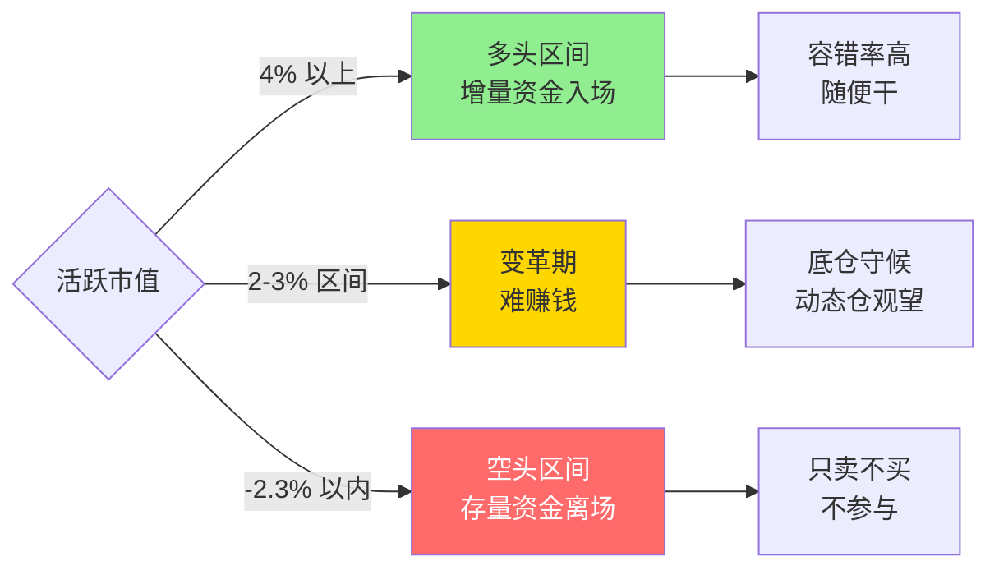
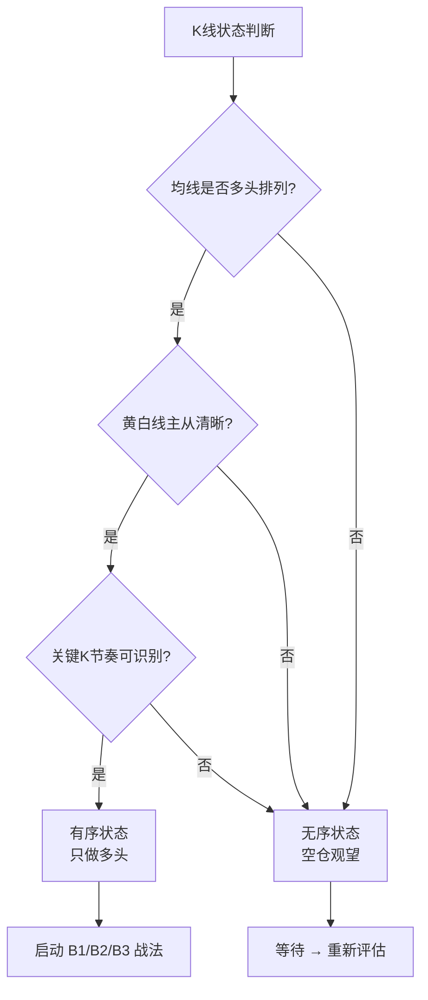
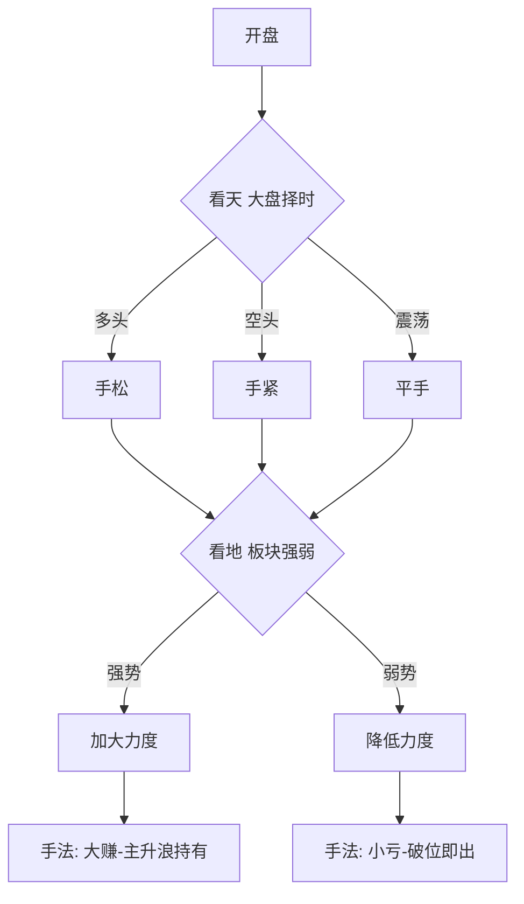

# 择时过滤与市场环境

> [!info] 阅读口径
> 本篇上半部按交易流程综合整理；下半部完整保留归属本篇的原库条目正文，并保留原有数值、例外与冲突。原库表述属于特定方法论；其中收益、胜率、历史案例及市场判断未经本次独立核验。综合编排不是Z哥原话。跨条目冲突统一见 [[19-规则冲突与知识缺口]]。

## 开仓前先判断能否交易

原库以活跃市值为主要择时工具，配合大盘趋势和个股趋势。多头环境提高信号的容错空间，空头环境下完美图形也可能失败。选股之后，第一件事仍然是复核择时，而不是立刻寻找分时买点。

| 环境 | 原库描述 | 对候选股与持仓的处理 |
|---|---|---|
| 活跃市值达到或超过约+4%的多头语境 | 增量资金进入，允许进攻 | 继续检查个股趋势与买点，不把市场绿灯当成买点 |
| 活跃市值跌破约-2.3%的空头语境 | 存量流出，强调只卖不买 | 动态仓收紧，主流程停止新增风险，研究与复盘可以继续 |
| 方向不明、白黄纠缠 | 震荡、上压下托 | 提高图形要求，降低交易冲动，注意假突破 |
| 指数平稳但个股走弱 | 指数和赚钱效应分离 | 逐一检查个股，不能由“指数没跌”推出“持仓安全” |

“达到约+4%”不是本次重新设定的计算标准。原库同时出现单根、累计两三天和波段区间等说法，未提供活跃市值完整公式、数据源统一定义及全部边界区间，因此不能据此自行编造一个可运行指标。等于阈值时如何处理也未统一，见 [[19-规则冲突与知识缺口]]。

## 三层过滤必须同时成立

主题交易的原库过滤是：多头择时→周线白线上方且N型上涨→日线B1及关键K、倍量、筹码等辅助证据；该条目另列盈亏比不低于3:1。三层之间是同时成立的必要检查，不是任选一层。

有序状态强调多周期趋势同向、关键K能解释结构、筹码相对集中；无序状态是均线反复纠缠、结构不清。整理后的操作含义是：看不清就不强行套买点。原库“无序时所有指标失效”属于方法论中的强表述，不代表本次验证了统计规律。

## 环境改变后怎样应对

候选股未买时，多头条件失去就暂停入场，保留候选记录等待下一次条件。已持有动态仓时，先查止损、S1、趋势与时间规则，再决定减仓或退出，不以“等大盘回来”覆盖个股破位。长期底仓要回到大周期和逻辑边界，不能机械套用超短线规则。

“松手”意味着多头环境允许更多有效形态和更大参与度；“紧手”意味着少做、更快否定失败信号。原库给出的80%—100%、0%—50%、空头0%—20%及空仓等口径并不一致，不能取平均值变成通用仓位。空头集中个股、熊市反弹等均作为旁支观点保留，详见 [[19-规则冲突与知识缺口]]。

## 震荡期与空仓期具体做什么

震荡期只跟踪自身仍满足强势条件的标的，对离白线过远的盈利仓考虑原策略的放飞规则；没有确认突破时，不因为消息利好提前押方向。原库“30度斜率”未给图表缩放标准，只能理解为节奏比喻，不能当精确角度阈值。

空仓仍要记录环境、筛候选、标关键位、复查旧错误。空仓的作用是保留本金和下一次选择权；它不是要求预测下一次低点。研究候选与执行买入是不同动作。

## 原库理论详解

以下按原库概念页保留正文；仅调整标题层级、内部链接和来源展示，不把整理者的结论升级为已验证事实。

### 原库条目：活跃市值

原概念页：/Users/nanan/Documents/ChatGPT/Z哥知识库/references/活跃市值.md  
原页更新时间：2026-06-03。来源路径是追溯线索，本Skill未附这些路径对应的原文。

原页标注的来源线索

- raw/01-zettaranc/知行小菜鸟/[202603190728]361你管我叫师傅却一招都不肯听.md
- raw/01-zettaranc/复盘专用z/[202507171330]原来这tm叫顺周期Part2顺周期轮动顺序25年7月13日公域直播.md
- raw/01-zettaranc/大富翁小菜鸟/[202601131911]惊天背离大盘绿它却红.md

#### 定义

> [!abstract] 一句话定义
> 活跃市值是判断市场多空环境的**核心择时指标**,反映增量资金入场程度,是整个交易体系的根基。Z 哥铁律:**择时永远大于选股**。

#### 关键信息

##### 多头区间(4% 以上)
- 场外增量资金疯狂入场
- 容错率极高,随便干
- 买错第二天可能高开回本

##### 空头区间(-2.3 以内)
- 场内存量资金疯狂离场
- 易跌难涨,只卖不买
- 敢拉涨停就有人敢砸

##### 核心原则
- 择时永远大于选股
- 先学会择时,再学选股,再学买卖点
- 活跃市值没有连续 2-3% 的增量资金入场时,很难赚钱(变革期)

#### 多空区间决策图

> [!warning] 择时铁律
> **没有增量资金的市场不要交易** — 活跃市值跌破 -2.3% 即进入空头区间,场内只有存量博弈,任何短线信号都会失效。

#### 关联连接
- [[01-交易闭环与策略边界#原库条目：框架式交易|框架式交易]] — 择时是框架的前提
- [[11-仓位分工与组合轮动#原库条目：底仓与动态仓|底仓与动态仓]] — 空头区间动态仓只卖不买
- [[16-筹码资金与板块轮动解释#原库条目：顺周期轮动|顺周期轮动]] — 增量资金入场是轮动的前提
- [[10-盘中执行与止损计划#原库条目：少妇战法|少妇战法]] — 择时是少妇战法第一步

### 原库条目：择时大于选股

原概念页：/Users/nanan/Documents/ChatGPT/Z哥知识库/references/择时大于选股.md  
原页更新时间：2026-04-18。来源路径是追溯线索，本Skill未附这些路径对应的原文。

#### 定义

> [!abstract] 一句话定义
> 择时大于选股是 Z 哥交易体系的**最高原则**——先判断市场环境(多空区间),再决定是否选股开仓。**空头区间里再完美的 B1 也会失败**。

#### 关键信息

##### 核心论点
- 择时永远大于选股
- 空头区间里再完美的B1也会失败
- 先学会择时，再学选股，再学买卖点，再学仓位管理

##### 实操意义
- 多头区间：满仓轮动，有信号就干
- 空头区间：只卖不买，原则上不做交易
- 手痒非要做：仓位降到最低

#### 关联连接
- [[02-择时过滤与市场环境#原库条目：活跃市值|活跃市值]] — 择时的核心指标
- [[01-交易闭环与策略边界#原库条目：框架式交易|框架式交易]] — 择时是框架的前提

### 原库条目：有序与无序

原概念页：/Users/nanan/Documents/ChatGPT/Z哥知识库/references/有序与无序.md  
原页更新时间：2026-04-26。来源路径是追溯线索，本Skill未附这些路径对应的原文。

原页标注的来源线索

- raw/01-zettaranc/知行小菜鸟/[202602151220]万字长文K线里的秩序与混沌.md
- raw/01-zettaranc/知行小菜鸟/[202602200733]从无序到有序穿越牛熊的三悟.md
- raw/01-zettaranc/大富翁小菜鸟/[202602151149]深度均线系统的终极奥义有序与无序.md

#### 定义

> [!abstract] 一句话定义
> 有序与无序是 Z 哥独创的 K 线二元状态元理论:**有序 = 主力控盘 + 均线生效 + 关键 K 主导**;**无序 = 筹码松散 + 均线全废 + 散户互砍**。技术分析第一性原理是:**只做有序多头**,无序状态下所有指标失效,必须回避。

#### 关键信息

##### 有序状态特征
- **多周期多头排列**:周线、日线、小时线均线同向向上
- **[[04-趋势结构与量价工具#原库条目：白线黄线系统|白线黄线系统]] 主从清晰**:黄线(主力线)与白线(散户线)关系明确,黄上白下或黄白共振
- **[[04-趋势结构与量价工具#原库条目：关键K|关键K]] 节奏可识别**:有明确的 K 线信号(B1/B2/B3、单针下、砖形图等)主导走势
- **筹码集中**:[[16-筹码资金与板块轮动解释#原库条目：筹码战争|筹码战争]] 中筹码峰收敛,主力锁仓痕迹清晰
- **均线生效**:5/10/20/60 日线作为支撑或压力清晰可辨

##### 无序状态特征
- **均线纠缠**:多周期均线粘合、反复穿越,无明确多空方向
- **筹码发散**:[[16-筹码资金与板块轮动解释#原库条目：筹码战争|筹码战争]] 筹码峰扁平化,无主力痕迹
- **K 线毫无逻辑**:阴阳线随机分布,纯散户互砍
- **指标全废**:KDJ、MACD、量价等所有技术指标在无序中完全失灵

##### 三悟:从无序到有序穿越牛熊
1. **识别有序入场**:多周期共振 + 关键 K 出现 → 重仓买入
2. **识别有序退出**:均线开始走平 + 关键 K 失效 → 兑现离场
3. **识别无序回避**:均线纠缠 + 筹码松散 → 空仓观望

##### 核心元规则
- "均线系统的终极奥义" = **有序时一切有效,无序时一切无效**
- 所有战法(B1/B2/B3、嘀嘀、砖形图、单针下)都建立在"有序"前提上
- 散户最大错误:**在无序状态用有序时代的指标**
- 与 [[04-趋势结构与量价工具#原库条目：N型结构|N型结构]] 的关系:N 型是"有序"的具体形态;无序状态下没有 N 型可言

##### AI 控盘时代延伸
- [[16-筹码资金与板块轮动解释#原库条目：AI控盘指数论|AI控盘指数论]] 让"有序"被极致放大:控盘股极致有序,非控盘股极致无序
- 1:99 分化使无序股完全废纸化,只能在 1% 控盘股里找有序
- 这反过来强化了"只做有序多头"的元规则

#### 有序/无序识别流程

#### 关联连接
- [[04-趋势结构与量价工具#原库条目：N型结构|N型结构]] — 有序状态的具体形态
- [[04-趋势结构与量价工具#原库条目：白线黄线系统|白线黄线系统]] — 有序判断的核心工具
- [[04-趋势结构与量价工具#原库条目：关键K|关键K]] — 有序状态下主导节奏的 K 线信号
- [[16-筹码资金与板块轮动解释#原库条目：筹码战争|筹码战争]] — 有序/无序的筹码侧表征
- [[16-筹码资金与板块轮动解释#原库条目：AI控盘指数论|AI控盘指数论]] — AI 时代有序/无序的极化放大
- [[06-B1入场与建仓波鉴别#原库条目：B1建仓波|B1建仓波]] — 有序状态下的核心买点
- [[20-知识来源与理论适用边界#原库条目：Zettaranc|Zettaranc]] — 元理论作者

### 原库条目：主题交易的三层防火墙

原概念页：/Users/nanan/Documents/ChatGPT/Z哥知识库/references/主题交易的三层防火墙.md  
原页更新时间：2026-04-26。来源路径是追溯线索，本Skill未附这些路径对应的原文。

#### 定义

> [!abstract] 一句话定义
> 主题交易的三层防火墙是Z哥在2026年4月提出的主题/题材交易风控体系——通过三道过滤网层层筛选，确保只在确定性最高的时机介入主题交易。

#### 三层防火墙

##### 第一层：择时过滤（能不能做？）

- 必须处于**活跃市值多头区间**（+4%以上）才能做主题交易
- 空头区间（-2.3%以下）一律不做主题，只拿1万块钱练手
- 这是第一道也是最核心的防火墙——没有择时，一切交易都是垃圾

##### 第二层：趋势过滤（该不该做？）

- 主题标的必须**周线白线之上**，且走出N型上涨结构
- 均线多头排列，趋势已经确认，不做超跌反弹的"荆轲刺秦"
- **图形走在消息之前**：周线趋势确立后才介入，不追故事、不追概念

##### 第三层：买点过滤（怎么进场？）

- 在周线趋势确认的前提下，通过**日B1买点**精准入场
- 买点必须叠加底层工具（关键K/倍量柱/筹码集中等）确认
- 盈亏比低于3:1的单子不做

#### 核心心法

- **消息是主力画完图后给你的饼**：所有你能在公开渠道看到的概念、故事、利好，都是主力资金想让你看到的。航天发展拉了5个涨停后，市场才开始炒"商业航天"概念
- **周线选股，不要看板块和概念**：趋势龙头会自己带着板块走，不是板块带着龙头走
- **强者恒强，因为涨所以涨**：一只票能走出多头趋势，背后有业绩/逻辑/资金支撑，不是凭空涨起来的
- **不要做超跌反弹**：这是Z哥"自己从来不碰"的最难模式

#### 关联连接

- [[02-择时过滤与市场环境#原库条目：择时大于选股|择时大于选股]] — 第一层防火墙的核心
- [[04-趋势结构与量价工具#原库条目：N型结构|N型结构]] — 第二层趋势判断的基础
- [[03-选股后验证与候选池管理#原库条目：绝对主线|图形走在消息之前]] — 第三层选股的底层逻辑
- [[10-盘中执行与止损计划#原库条目：少妇战法|少妇战法]] — 主题交易的SOP执行框架
- [[17-心理防守与概率认知#原库条目：交易心理|交易心理]] — 克服追高追概念的心理误区
- [[18-每日复盘与交易记录#原库条目：Z家军每日五步工作流|Z家军每日五步工作流]] — 主题交易的筛选流程

### 原库条目：交易松紧手

原概念页：/Users/nanan/Documents/ChatGPT/Z哥知识库/references/交易松紧手.md  
原页更新时间：2026-04-26。来源路径是追溯线索，本Skill未附这些路径对应的原文。

#### 定义

> [!abstract] 一句话定义
> 交易松紧手是 Z 哥借自德州扑克的仓位 / 选股纪律比喻 — **多头趋势"手松"(B1B2B3 补票全开、80-100 仓);空头趋势"手紧"(只 B1、0-50 仓、扥起就卖)**,核心是用择时调节激进度。

#### 关键信息

##### 三看维度

- **看天**(大盘择时):多头手松 / 空头手紧 / 震荡平手。
- **看地**(板块 / 个股):热点强势手松 / 弱势手紧。
- **手法**:大赚=手松+主升浪持有;小亏=手紧+破位即出。

##### 松手 vs 紧手对照

| 维度 | 手松(多头) | 手紧(空头) |
|---|---|---|
| 仓位 | 80-100% | 0-50% |
| 战法 | B1+B2+B3+补票全开 | 只做 B1 |
| 持仓周期 | 主升浪持有 | 扥起就卖 |
| 心态 | 容忍小回调 | 见风就跑 |

##### 知行小菜鸟版本的硬指标（2026-01）

###### 手紧判断信号
- **大盘在黄线之下**：存量博弈/内部充分博弈，没有增量
- **活跃市值在 -2.3% 波段之内**：单根跌幅 > 2.3% 或连续下跌进入该区间

###### 手松判断信号
- **大盘在白线之上**：顺势而为
- **活跃市值在 +4% 波段之内**：单根红柱 > 4% 或两三天累计涨幅 > 4%

###### 手紧五原则
1. **市场没有证明你是对的，就说明你错了**：买入没涨（哪怕没跌）也是错的
2. **不涨就拍**：第二天开盘不是直接上攻就卖
3. **弹起就卖**：空头趋势中反弹是逃命机会
4. **盈转亏的点必须卖**：绝对不能让赚钱的票变成亏钱的票
5. **感觉不好也卖**：盘感/玄学，但很有用

##### 与体系的耦合

- 与 [[02-择时过滤与市场环境#原库条目：择时大于选股|择时大于选股]] 的关系:松紧手是择时的执行细节 — 择时给方向,松紧手给力度。
- 与 [[06-B1入场与建仓波鉴别#原库条目：B1建仓波|B1建仓波]] / [[07-B2与B3确认及假突破应对#原库条目：B2突破|B2突破]] / [[07-B2与B3确认及假突破应对#原库条目：B3买点|B3买点]] 的关系:松手时三波都做,紧手时只做 B1(最安全的建仓波)。
- 与 [[15-长线底仓与牛市ETF管理#原库条目：牛市策略|牛市策略]] 的关系:牛市永远手松,熊市永远手紧,不要混淆。

##### 决策流程

> [!tip] 德州扑克的智慧
> Z 哥强调:好牌(多头)就 all-in,烂牌(空头)就弃牌 — 不要拿烂牌跟人梭哈,这是散户最大的死法。

#### 关联连接

- [[02-择时过滤与市场环境#原库条目：择时大于选股|择时大于选股]] — 松紧手是择时的执行细节
- [[06-B1入场与建仓波鉴别#原库条目：B1建仓波|B1建仓波]] — 紧手时唯一允许的战法
- [[07-B2与B3确认及假突破应对#原库条目：B2突破|B2突破]] — 松手时才做的进攻波
- [[07-B2与B3确认及假突破应对#原库条目：B3买点|B3买点]] — 松手时才做的延续波
- [[02-择时过滤与市场环境#原库条目：活跃市值|活跃市值]] — 看天的核心工具
- [[15-长线底仓与牛市ETF管理#原库条目：牛市策略|牛市策略]] — 牛市永远手松
- [[20-知识来源与理论适用边界#原库条目：Zettaranc|Zettaranc]] — 比喻的提出者

### 原库条目：空仓策略

原概念页：/Users/nanan/Documents/ChatGPT/Z哥知识库/references/空仓策略.md  
原页更新时间：2026-05-01。来源路径是追溯线索，本Skill未附这些路径对应的原文。

原页标注的来源线索

- raw/01-zettaranc/大富翁小菜鸟/[202602040730]细细品味止损的最高境界是空仓一种被低估的进攻性策略.md
- raw/01-zettaranc/知行小菜鸟/[202604300759]490别把送分题做成送命题.md

#### 定义

空仓不是"没做交易"，而是一种**主动的战术选择**——仓位从0到100，0也是一种交易决策。空仓是一个策略，和"满仓"同等重要。

> [!abstract] 核心认知
> 100是满仓（交易）、50是半仓（交易）、**0也是交易**。这个"0"是大脑经过精密计算、复盘、推演之后做出的"买卖决策"。

#### 为什么空仓是进攻性策略

##### 追高的致命习惯
- "追"是一种习惯，养成追高习惯后从概率学来讲亏钱概率绝对大于赚钱概率
- **习惯比运气更重要**：运气赢一时，坏习惯输一世

##### 顺大势逆小势的"捡钱"逻辑
- 看好强势股 → 不在分时冲高时接盘 → 等它往下砸1.5%-3%时建仓
- 跌了：成本比别人低3%，抗风险能力强
- 涨了：享受日内反转利润+日线趋势利润，比别人赚得多
- 这叫用**"准空仓"的状态换取更有利的进攻位置**

#### 破解FOMO（错失恐惧症）

##### "踏空"是伪命题
- 如果你的钱今天没亏或没被套住，就不是真的"错过"
- **"踏空"翻译过来就是"这把肯定不亏"**

##### "百美图"隐喻
- 市场上有100个绝世美女（机会），兜里只有10万块钱（本金）
- 今天没追上不会死，但为了追造没了本金就熬到死局
- 美女永远有，本金只有一份

#### 空仓的高维视角

> [!info] 市场奖励勇敢的人，但留下的是懂防守的人
> "什么都不做两三年，可能已经跑赢了 70%-80% 的散户。"大部分人亏钱不是因为机会少，而是因为操作太多。空仓赚的是"你本来会亏掉的钱"。
> 出处:490别把送分题做成送命题（原库未附独立条目）、散户不死牛市不止（原库未附独立条目）

| 视角 | 散户思维 | 高手思维 |
|------|---------|---------|
| 空仓 | "我就是怂，没做交易" | "我保住了本金，做了一次成功的防御性交易" |
| 没买到涨停 | "我真傻，怎么没买那个" | "怎么不想想为什么没买到那个跌的" |
| 零操作 | "今天什么都没干" | "零伤亡的特种作战，活着下次再打" |

#### 执行铁律

1. **空仓写入交易系统**：把它当成和"满仓"同等重要的战术动作
2. **不买也是一种"做"**：你交易的是"空仓"，不是"没做"
3. **市场永远在**：后天还开盘，活着入场比什么都重要
4. **空仓是蓄力**：精神放松、视野全局，下一次出击才会像猎豹一样致命

#### 关联连接

- [[17-心理防守与概率认知#原库条目：防守哲学|防守哲学]] — 空仓是防守的最高境界
- [[02-择时过滤与市场环境#原库条目：择时大于选股|择时大于选股]] — 空头区间空仓是择时的直接体现
- [[17-心理防守与概率认知#原库条目：交易心理|交易心理]] — 克服FOMO和踏空焦虑的核心心法
- [[17-心理防守与概率认知#原库条目：四不原则|四不原则]] — "不动"与空仓策略高度一致
- [[17-心理防守与概率认知#原库条目：交易免疫系统|交易免疫系统]] — 空仓是免疫系统的"零攻击"防御状态

### 原库条目：穿越火线

原概念页：/Users/nanan/Documents/ChatGPT/Z哥知识库/references/穿越火线.md  
原页更新时间：2026-04-18。来源路径是追溯线索，本Skill未附这些路径对应的原文。

#### 定义

> [!abstract] 一句话定义
> 穿越火线是大盘"**上压下托**"震荡阶段——方向不明,消息面多空交织,**投资者最容易犯错的市场阶段**。核心策略:**只持有白线在黄线之上的票 + 与大盘共振 + 三十度斜率波段**。

#### 关键信息

##### 特征
- 大盘呈现上有压力位、下有支撑位的震荡格局
- 各种消息利多利空交织，像"枪林弹雨中穿行"
- 市场不会轻易突破，也不会轻易跌破

##### 操作原则
1. 只持有白线在黄线之上、股价在黄线之上的票
2. 与大盘保持共振（右侧交易必须共振）
3. 离白线太远的票该放飞就放飞
4. 不要对大盘过于乐观

##### 慢牛应对
- 慢牛是针对指数的，不是针对板块的
- 关注大盘斜率：30度斜率的波段是被认可的
- 爆发减仓，回调接回，保持三十度斜率的波段操作

#### 关联连接
- [[01-交易闭环与策略边界#原库条目：框架式交易|框架式交易]] — 穿越火线的应对策略
- [[04-趋势结构与量价工具#原库条目：白线黄线系统|白线黄线系统]] — 选股标准
- [[12-持股评分与洗盘应对#原库条目：去弱留强|去弱留强]] — 持仓管理原则
- [[17-心理防守与概率认知#原库条目：周期与人性|周期与人性]] — 慢牛也是周期的一种表现
