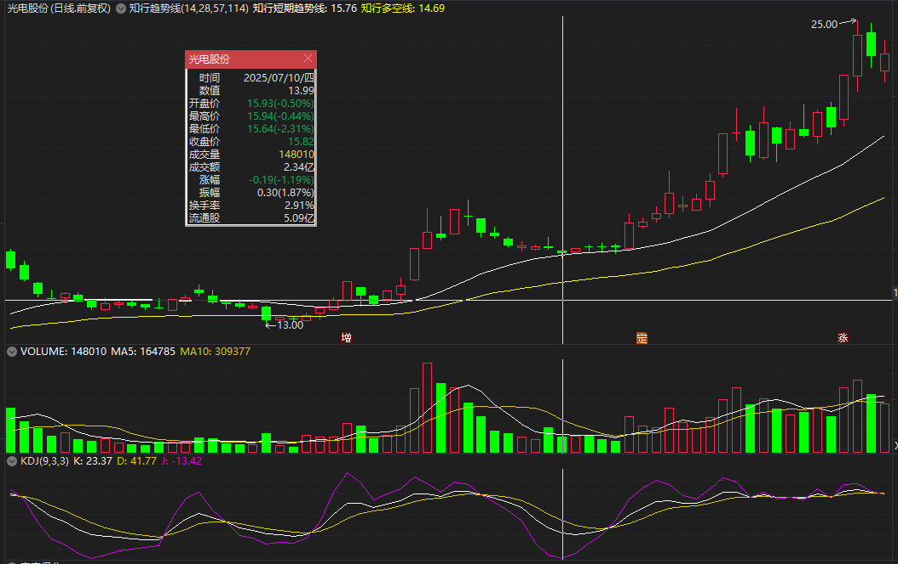

# 选股后验证与候选池管理

> [!info] 阅读口径
> 本篇上半部按交易流程综合整理；下半部完整保留归属本篇的原库条目正文，并保留原有数值、例外与冲突。原库表述属于特定方法论；其中收益、胜率、历史案例及市场判断未经本次独立核验。综合编排不是Z哥原话。跨条目冲突统一见 [[19-规则冲突与知识缺口]]。

## 一只股票选出来后，先把“为什么入池”写清

候选池是需要等待验证的集合。原库短线手册给出5—10只的规模示例，重点是宁缺毋滥。先有符合结构的池子，再用盘中量比比较强弱，不能把全市场量比排名直接当成选股结果。

## 候选复核的顺序

1. 看周线和日线的位置：是否属于高低点抬高的上涨N型，周线是否空头发散，当前位置离历史高点和累计涨幅有多远。
2. 找最早有分量的异动：从60日均线下方或附近放量上来，价格跟随成交量上升，最好有连续动作，而非孤零零一根长阳。
3. 检查上冲和回撤：异动之后是否有缩量、有节奏的回调，关键低点是否守住；高位放量滞涨不能解释为正常吸筹。
4. 标注支持买点的关键K、平台、前高、前低、黄线，以及失效价位。
5. 标明采用B1、B2还是其他专用策略，主线与主题的周期要求是否明确。
6. 检查剩余空间与止损距离；赔率不足或止损难以界定，就继续观察或剔除。

## 为什么先有异动，再谈地量

异动选股法的链条是“放量价升留下资金痕迹→回调洗浮筹→量能收缩→再度启动”。地量的意义依赖前面的上涨与建仓痕迹。一路下跌、长期无量或没有前期异动的缩量，并不自动等于可参与的低点。

60日线在该战法中被用作市场平均成本的观察线：从附近放量上来，之后缩量回踩不破，是候选路径；跌破该策略设定的失效位置，就取消原判断。它不能被解释为均线在所有情况下都保证支撑。

<!-- web-images-2026-10-20-候选异动-start -->
## 对应形态的历史图例

> [!note] 网络图例的阅读范围
> 以下图片来自[笔记在线：《Z哥_需要反复背诵的十张完美图形》](https://www.noteol.com/xuexi/ZG_wanmeituxing.html)，页面署名“管理员”，属于二级学习整理；截图的原始制作者未独立核实。图片按原文件本地保存，下载日期为2026-10-20。图中带有后续走势，只用于辨认结构；不据事后上涨确认信号必胜，也不以图文中的宽松口径覆盖本笔记规则。

### 异动之后再看整理：光电股份

观察左侧量能放大与价格抬升，再看中部整理及较小量柱。练习时先遮住右侧后续涨势，判断当时是否已经具备入池理由；“后来涨了”不是买前证据。

[查看原图](https://s21.ax1x.com/2025/10/15/pVqYb0s.png)。

<!-- web-images-2026-10-20-候选异动-end -->

## 三最原则如何落到三个时间点

| 时间 | 原库原则 | 可检查的证据 |
|---|---|---|
| 买前 | 只选最美 | 清楚的上涨结构、位置合适、异动有力度、回撤有秩序 |
| 盘中 | 只买最强 | 已选池内的资金与价格表现确认，不因为昨夜最喜欢就忽视实际走弱 |
| 买后 | 只拿最硬 | 按自己的策略验证趋势、收盘强度和止损，剔除失败形态 |

## 哪些候选先排除

长期下跌后无明确反转的横盘“大爷图”、高位放量长上影、跳空后直接追入、建仓阶段累计涨幅过高、放量却不涨、买点附近没有清晰退出依据，都是原库反复出现的禁区。

原库“主线票等周B1、主题票看日B1”与主题交易要求周线趋势过滤可以分层理解：不必等待周线B1，不等于可以省略周线趋势。若周线本身下跌而只有日线看似便宜，不把它放入多头控盘的主流程。

## 主线改变与候选切换

绝对主线在原库中由价格结构与资金延续性观察，不由新闻标题单独决定。候选变弱可以移出；原来非龙头的候选若守住关键位、出现新的确认，也可重新排序。“去弱留强”不要求每天必须换股，替代候选仍须重新通过全部过滤。

## 原库理论详解

以下按原库概念页保留正文；仅调整标题层级、内部链接和来源展示，不把整理者的结论升级为已验证事实。

### 原库条目：异动选股法

原概念页：/Users/nanan/Documents/ChatGPT/Z哥知识库/references/异动选股法.md  
原页更新时间：2026-04-26。来源路径是追溯线索，本Skill未附这些路径对应的原文。

原页标注的来源线索

- raw/01-zettaranc/知行小菜鸟/[202601192259]351异动的本源选出强壮宝宝的底层暴力美学与交易哲学.md
- raw/01-zettaranc/大富翁小菜鸟/[202509060645]异动A股选股的核心逻辑与实战指南建议收藏反复看.md

#### 定义

**异动**是指成交量突然放大，同时价随量升。这是选牛股最核心的逻辑，是一切战法（B1、B2等）的底层心法。

> [!abstract] 异动的三个关键词
> 1. **突然（Sudden）**：好端端的票，没利好没新闻，突然放量——"莫名其妙"
> 2. **价随量升（Price follows Volume）**：价格跟着量上去，不能放量滞涨（那是出货）
> 3. **位置（Location）**：必须从60日均线（市场平均成本线）下方或附近起来

#### 底层逻辑：恋爱心理学

追姑娘不会直接说"结婚吧"，得先有前戏和蛛丝马迹。庄家要搞事情必然留下痕迹——**这个痕迹就是异动**。异动不等于马上能涨，它只是告诉你：**大哥来了**。

#### 识别"建仓波"：真龙与草鸡

##### 60日线的秘密

- 60日线是市场生命线，庄家从60日线下方/附近**放量突破**上来 = 建仓波
- 60日线代表过去两个月平均成本，套牢盘割肉离场筹码分散，庄家在此收集筹码

##### NBA选秀理论：找"最强壮的宝宝"

| 级别 | 特征 | 后续空间 |
|------|------|---------|
| **詹姆斯级** | 建仓波大开大合，放巨量、假阴真阳反包、阳线密集堆积 | 一波主升浪谁也挡不住，甚至带飞整个板块 |
| **徐杰级** | 就一根孤零零放量阳线，量没堆起来，稀稀拉拉 | 能涨10%-15%然后熄火，独木难支 |

**核心策略**：只找最强壮的宝宝，找"一览众山小"的异动。异动量能连前面高点都没盖过的"弱B1"没意思。

#### 真正的"地量地价"

> [!danger] 市面上"地量地价"的误区
> 下跌趋势或横盘中的缩量不是地量地价——缩量只代表多空暂时平衡，可能直接崩盘。

**真正的"地量地价"只有一个前提**：**必须在"异动"之后的上升趋势波段内**。

逻辑推演：
1. 异动确立 → 庄家已进场（放量建仓）
2. 洗盘 → 庄家把跟风散户洗出去
3. 地量出现 → 想卖的卖光了，不想卖的锁仓，浮筹洗干净了
4. 此时的"低量"才是大概率的"波段低价"

#### 实操兵法

| 环节 | 要点 |
|------|------|
| **进场时机** | 异动后的缩量阴线/假阴真阳，回调时进（不在拉升时追） |
| **形态** | "勾"（指标）在大负值处，股价回调，量能萎缩 |
| **止损** | 买入当天最低价或前一根关键K线低点，破了就走 |
| **资金效率** | 买入三天不涨可以走，换"刚洗完澡"的票 |

#### 建仓波 vs 一波流：识别主力真动作

| 维度 | 建仓波（真） | 一波流（假） |
|------|------------|------------|
| **量能特征** | 连续、温和放大，一波比一波强 | 单根巨量，后续无持续量能 |
| **价格走势** | 稳步上涨，有张有弛 | 暴力涨停后直接跌回 |
| **60日线关系** | 从60日线附近起来，回踩不破 | 远离60日线的高位放量 |
| **后续表现** | 缩量洗盘后再放量拉升 | 拉完就跑，没有持续性 |

> [!tip] 60日线是建仓波的"生命线"
> 回踩60日线不破 = 安全买点；跌破60日线 = 主力建仓失败，别碰

##### 连续异动信号

单根放量可能是偶然，**连续两三天异动才是真信号**：
- 第一天放量涨3% → 第二天缩量跌1% → 第三天又放量涨5% = 连续异动，主力在持续动作
- 单根放量涨5%后没动静 = 大概率游资一日游，别碰

#### 异动后的最佳买点："回踩60日线低吸"

1. 异动出现 → 不急着买，先标记
2. 等它洗盘缩量 → 量能到阶段最低（地量）
3. 价格回踩60日线且不破 → **B1信号，进场**
4. 止损设在地量当天最低价 → 破了就走

#### 高阶心法：杂毛可能变龙头

板块中现在的龙头回调时，杂毛如果没跌破"地量地价"止损位（抗住了），等大盘下一波反弹时**龙头很可能切换**——曾经的杂毛变成新的"强壮宝宝"。所以要盯着**形态没有破位**的票。

#### 注意事项

> [!danger] 三大禁区
> 1. **高位异动别碰**：远离60日线、涨幅超50%的放量大概率是主力出货
> 2. **止损是生命线**：跌破地量当天最低价或60日线必须立刻走
> 3. **异动策略只适合A股股票**：期货是多空零和博弈，放量不等于主力建仓

#### 每日选美作业

每天翻1000张图，找"**莫名其妙突然放量，且从60日线下方起来，一览众山小**"的图存下来，等它缩量回调那一天出手。

#### 关联连接

- [[06-B1入场与建仓波鉴别#原库条目：B1建仓波|B1建仓波]] — 异动后的缩量回调就是B1买点的最佳进场位
- [[04-趋势结构与量价工具#原库条目：关键K|关键K]] — 异动的标志性K线就是"关键K"
- [[04-趋势结构与量价工具#原库条目：量价关系四类|量价关系四类]] — 异动本质是放量+价随量升的量价配合
- [[13-放飞止盈与破位退出#原库条目：主力出货五种经典方式|主力出货五种经典方式]] — 异动反向：放量滞涨=出货信号
- [[04-趋势结构与量价工具#原库条目：暴力K|暴力K]] — 异动的高阶表现，底部突兀+倍量的破坏性长阳

### 原库条目：三最原则

原概念页：/Users/nanan/Documents/ChatGPT/Z哥知识库/references/三最原则.md  
原页更新时间：2026-04-18。来源路径是追溯线索，本Skill未附这些路径对应的原文。

#### 定义

> [!abstract] 一句话定义
> 三最原则是穿越牛熊的绝对交易心法：只选最美（选股）、只买最强（盘中）、只拿最硬（持仓），用极端标准过滤市场噪音。

#### 关键信息

> [!tip] 选股要点
> - **只选最美**（买前）：用审视艺术品的眼光挑剔图形，宁缺毋滥。不要挖掘"沧海遗珠"，只要那个无懈可击的"古力娜扎"。警惕"小鹿过载"——想太多做得太少
> - **只买最强**（盘中）：用赛马赌徒的直觉跟随资金，谁强跟谁。开盘量比是识别最强的关键工具，市场永远是对的
> - **只拿最硬**（买后）：用渣男的心态管理持仓，物来则应。股票不是爱情，不涨就换。好股票不套人，好姑娘不矫情
> - **权重分配**：交易纪律占50%，顺势而为占30%，选股逻辑只占20%
> - **先有完美图形再有盘中爆量**：在全市场按量比排序会看到一堆垃圾股，前提是先选出最美池子

#### 关联连接
- [[10-盘中执行与止损计划#原库条目：量比战法|量比战法]] — 只买最强的执行工具
- [[17-心理防守与概率认知#原库条目：交易心理|交易心理]] — 克服贪婪恐惧的心理修行
- [[12-持股评分与洗盘应对#原库条目：去弱留强|去弱留强]] — 只留强势股的核心原则
- [[17-心理防守与概率认知#原库条目：盈亏比与胜率|盈亏比与胜率]] — 概率思维的体现

### 原库条目：绝对主线

原概念页：/Users/nanan/Documents/ChatGPT/Z哥知识库/references/绝对主线.md  
原页更新时间：2026-04-18。来源路径是追溯线索，本Skill未附这些路径对应的原文。

#### 定义

> [!abstract] 一句话定义
> 绝对主线是市场中**最确定、有持续性的主线方向**——是资金共识的体现。**钱往哪流,哪就是主线**(天狼五零资金流向数据是最客观判断依据),**图形永远走在消息前面**。

#### 关键信息
- 绝对主线不是消息驱动，是图形和资金驱动
- 图形永远走在消息前面
- 只做绝对主线，避开边缘题材
- **钱往哪流，哪就是主线** — 天狼五零资金流向数据是最客观的判断依据

##### 2026-04 实战案例：AI硬件绝对主线

**近三日资金流向**：
- **4月8日（启动日）**：半导体流入 221 亿，计算机/通信/电子制造紧随
- **4月9日（调整日）**：活跃市值仅跌 0.33%，半导体流出 60 亿（对比 221 亿流入=九牛一毛）
- **4月10日**：AI硬件继续领涨

**主线结构**：
- **绝对主线**：AI硬件（半导体/算力芯片/存储/光模块/电子制造）
- **主线支线**：有色（AI上游原材料）、新能源（储能/锂电）
- **小支线**：军工（商业航天）
- **过渡品种**：创新药（主线调整时才动，不要当主线重仓）

##### 出货的唯一判断标准

**底部筹码峰消失 + 转移到顶部 + 股东户数大幅增加 = 主力出货完成**

案例：光模块某龙头，6月30日股东 9.8 万户 → 9月30日 15.53 万户（+6 万散户），底部机构筹码已全倒给散户。

> [!danger] 七根砖不追
> 砖型图数到七根砖之后，就不要再追了。主力获利已丰厚，风险远大于收益。

##### 核心操作原则

1. **买跌不买涨**：No rain, no rainbow，下跌才有好买点
2. **严格止损，不带情绪**：交易是概率游戏，看错了就走
3. **分批建仓，不一把满仓**：行情慢慢展开，越跌越买
4. **只做看得懂的**：不符合战法就不碰，宁愿错过不做错

##### 行情节奏

- 最好的走势是"磨"：磨 4-5 根 K 线，活跃市值来回震荡
- 直接大阳线拉上去反而不好，容易冲高回落
- **行情永远是慢慢展开的，不可能一根 K 线走完**

#### 关联连接
- [[16-筹码资金与板块轮动解释#原库条目：筹码战争|筹码战争]] — 主线的筹码集中体现
- [[05-MACD与砖形图共振#原库条目：三个黄金定式|三个黄金定式]] — 主线识别的技术工具
