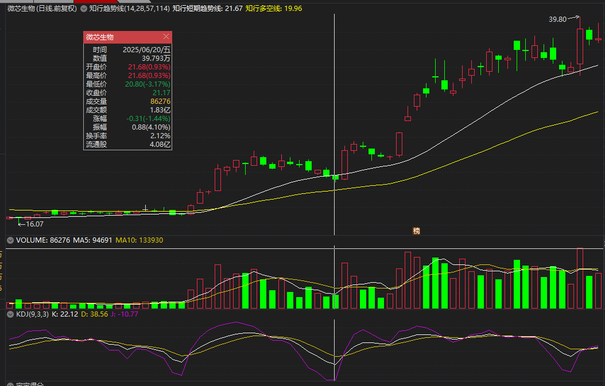
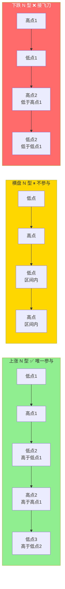
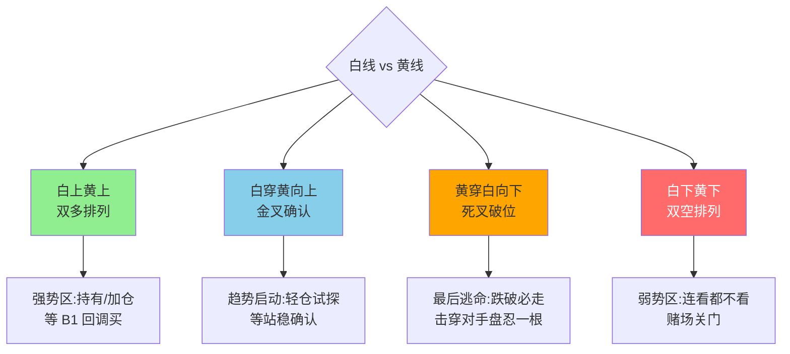
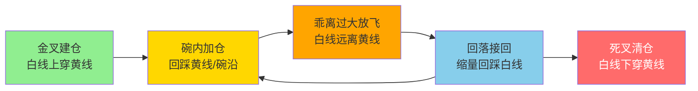
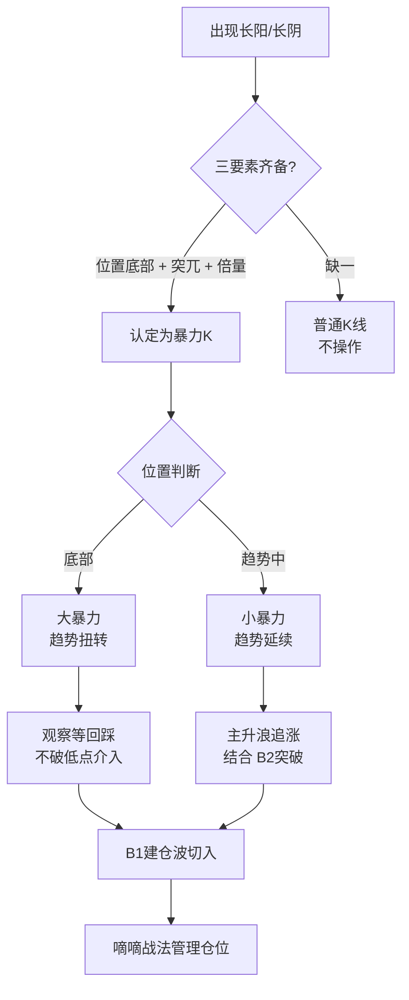

# 趋势结构与量价工具

> [!info] 阅读口径
> 本篇上半部按交易流程综合整理；下半部完整保留归属本篇的原库条目正文，并保留原有数值、例外与冲突。原库表述属于特定方法论；其中收益、胜率、历史案例及市场判断未经本次独立核验。综合编排不是Z哥原话。跨条目冲突统一见 [[19-规则冲突与知识缺口]]。

## 先看结构，再解释指标

N型上涨要求连续波段的高点与低点共同抬高。上涨会有回调，单根阴线不等于结构破坏；但跌破事先选择的关键低点，就不能再用“正常呼吸”无条件解释。

呼吸结构描述放量涨、缩量调、再放量涨。前一段上涨提供建仓背景，缩量回调说明抛压变化，下一次上涨才提供延续验证。价格不断创新低时，不能照搬上涨结构的缩量回调解释。

## 白线和黄线先分清所属图表

| 出现场景 | 白线/黄线的含义 | 能用于什么判断 |
|---|---|---|
| 双线战法、知行趋势线 | 白线为BBI或短期趋势线；黄线为大哥线/多空分界 | 价格趋势、回踩、破位和余仓跟踪 |
| MACD副图 | DIF与DEA | 零轴、动能与交叉，不能直接当股价价格线 |
| 补票战法资金副图 | 白线为散户浮筹，红线为机构控盘 | 特定副图的阈值配合，不能套BBI |
| 原库白黄线页中的指数解释 | 大盘股与中小盘股走势 | 与个股趋势双线存在混用，不能直接等同 |

个股趋势双线的主体口径是白线在黄线上、价格在黄线上；强势回调在“黄金碗”区域观察，不代表掉进去就无条件买。黄线走平或上翘、回撤缩量、结构未破及具体买点仍要检查。

## 关键K与暴力K

关键K要求位置关键、量能匹配、较大实体同时出现。平台突破、前高前低、趋势反转或衰竭处的K线更值得标注；普通波动不必每根都解释。其低点经常成为多头判断的失效依据。

暴力K是在此基础上强调低位、突兀、倍量或天量。原库一处按前期均量两倍，一处按前一天两倍，比较基准不能混用。底部暴力K侧重观察回踩确认，趋势中“小暴力”又有允许追入的旁支；本篇不把二者拼成一条“见大阳就买”的规则。

<!-- web-images-2026-10-20-趋势与量价-start -->
## 对应形态的历史图例

> [!note] 网络图例的阅读范围
> 以下图片来自[笔记在线：《Z哥_需要反复背诵的十张完美图形》](https://www.noteol.com/xuexi/ZG_wanmeituxing.html)，页面署名“管理员”，属于二级学习整理；截图的原始制作者未独立核实。图片按原文件本地保存，下载日期为2026-10-20。图中带有后续走势，只用于辨认结构；不据事后上涨确认信号必胜，也不以图文中的宽松口径覆盖本笔记规则。

### 价格双线与量能分开看：微芯生物

上方为价格和趋势双线，中间为成交量，底部为KDJ。白黄价格线与KDJ副图的线不能混同；此图没有MACD和砖形图，不能据它核验这两种信号。

[查看原图](https://s21.ax1x.com/2025/10/15/pVqYo6g.png)。

<!-- web-images-2026-10-20-趋势与量价-end -->

## 量价必须带着位置读

| 组合 | 原库常见解释 | 还要检查的边界 |
|---|---|---|
| 底部异动放量上涨 | 建仓或试盘痕迹 | 是否靠近关键位置、是否持续、是否已经高位 |
| 异动后缩量回调 | 洗盘或抛压枯竭候选 | N型与止损是否仍有效 |
| 低位建仓后缩量创新高 | 娜娜图式锁筹候选 | 不能忽略另一种“买力衰减”解释 |
| 高位巨量且滞涨 | S1或派发预警 | 依退出策略处理，不等故事证明主力身份 |
| 长阴短柱 | 可能是恐慌或洗盘 | 缩量不构成免止损条件，原库另有“下跌不看量”口径 |
| 连续阶梯量 | 上涨量递减或下跌量递增两种语境 | 区分量能方向、价格阶段，不能只看“阶梯”两字 |

量比>1.5、<0.7及0.7—1.5是量价四态条目的分类；开盘量比10、20是另一条执行规则；倍量柱又是日成交量的比较。三类数值不互换。

## 均线扭转与结构破坏

“扭一扭”关注低位纠缠转为多头排列，尤其周线结构已经改善；高位多头发散可能是过热。均线是成本与趋势的观察工具，原库没有给出黄线完整公式，不能任意用某条普通均线替代。

当结构模糊、线定义不清或信号与价格单位混杂时，先停止该项判断，见 [[19-规则冲突与知识缺口]]；详细入场见 [[06-B1入场与建仓波鉴别]]、[[07-B2与B3确认及假突破应对]]，退出见 [[13-放飞止盈与破位退出]]。

## 原库理论详解

以下按原库概念页保留正文；仅调整标题层级、内部链接和来源展示，不把整理者的结论升级为已验证事实。

### 原库条目：N型结构

原概念页：/Users/nanan/Documents/ChatGPT/Z哥知识库/references/N型结构.md  
原页更新时间：2026-04-19。来源路径是追溯线索，本Skill未附这些路径对应的原文。

原页标注的来源线索

- raw/01-zettaranc/知行小菜鸟/[202602201204]新春特辑从建仓到止盈全流程拆解新手也能直接落地的实战指南.md
- raw/01-zettaranc/知行课代表/[202510061457]基础篇一K线N型结构趋势均线.md

#### 定义

> [!abstract] 一句话定义
> N 型结构是 Z 哥交易体系的**底层基石** — 市场里任何品种的走势本质上都是 N 型结构,没有例外。它是判断趋势、持股、止损的最基础框架。

#### 关键信息

##### 三种趋势形态
- **上涨趋势**:连续的波段中,高点比前一个高点高,低点也比前一个低点高
- **下跌趋势**:高点不断降低,低点也不断降低
- **横盘趋势**:高点和低点在固定区间内震荡,没有明确方向

##### 核心铁律
- **一律只做上涨趋势的票**,只做高点和低点不断抬高的 N 型结构
- 横盘趋势不要参与,没有任何赚钱效应
- 下跌趋势更不要碰,抄底就是接飞刀,A 股 90% 散户亏损来自于在下跌趋势里盲目抄底

##### 持股心法
- 再牛的股票也不可能一根直线拉上天,一定是涨一波、回调一波、再涨一波的 N 型结构
- 上涨波段买入后,只要 N 型上涨结构没被破坏、没跌破止损位,就安心拿着
- 不要被盘中短期波动吓破胆,交易的核心是赚趋势的钱,不是赚分时波动的钱

##### 散户常见错误(SB 战法)
- 上涨波段买入,回调时没到止损位就慌张卖出
- 一卖就拉升,涨起来又追高买回,刚好买在回调起点
- 陷入"高买低卖"的死循环

#### 三种 N 型结构对比图

> [!danger] 唯一参与铁律
> 只做**高点低点双双抬高**的上涨 N 型,横盘观望、下跌远离 — 90% 的散户亏损都来自在下跌 N 型里"抄底"。

#### 关联连接
- [[01-交易闭环与策略边界#原库条目：框架式交易|框架式交易]] — N型结构是框架式交易的底层判断依据
- [[10-盘中执行与止损计划#原库条目：少妇战法|少妇战法]] — 等B1就是等N型结构中的回调低点
- [[06-B1入场与建仓波鉴别#原库条目：B1建仓波|B1建仓波]] — B1信号出现在N型结构的回调末端
- [[17-心理防守与概率认知#原库条目：交易心理|交易心理]] — 理解N型结构才能克服回调恐惧
- [[17-心理防守与概率认知#原库条目：四不原则|止损]] — N型结构被破坏即触发止损

### 原库条目：白线黄线系统

原概念页：/Users/nanan/Documents/ChatGPT/Z哥知识库/references/白线黄线系统.md  
原页更新时间：2026-04-26。来源路径是追溯线索，本Skill未附这些路径对应的原文。

#### 定义

> [!abstract] 一句话定义
> 白线黄线系统是一套基于白线和黄线相对位置判断趋势强弱的技术分析方法，是整个交易体系的基础工具。白线代表大盘股走势（短期趋势），黄线代表中小盘股走势（中期趋势和真实赚钱效应）。

#### 关键信息

##### 白线与黄线的本质
- **白线**：代表大盘股走势，反映短期趋势。在双线战法中白线是BBI线（牵牛绳）
- **黄线**：代表中小盘股走势，反映中期趋势和真实赚钱效应。在双线战法中黄线是"大哥线"（多空分界线）
- 两者相对位置反映市场整体风格和主力资金偏好
- **白线在黄线之下**：赌场关门，大哥不玩了
- **白线站上黄线**：赌场开门，大哥发微信说"新到了水果，大家来玩"

##### 核心使用规则
1. **强势股标准**：白线在黄线之上，且股价在黄线之上
2. **弱势股标准**：白线在黄线之下——连看都不看
3. **买入条件**：只在白线在黄线之上时进场
4. **止损条件**：跌破黄线必须走
5. **金叉**：白线金叉黄线 = 上涨趋势确立的概率大
6. **死叉**：白线死叉黄线 = 主力弃盘，最后离场时机（走错也要走）

##### 去弱留强
- 手中持仓必须全部是白线在黄线之上的票
- 跌破黄线的票坚决换掉，不要抱有侥幸心理
- 右侧交易必须与大盘共振

> [!warning] 使用注意事项
> - **白线在黄线之下 = 赌场关门**：此时大哥不玩了，散户不应逆势操作
> - **白线站上黄线 = 赌场开门**：大哥发微信说"新到了水果，大家来玩"，此时才是参与时机
> - **金叉不是买入信号，是确认信号**：不要在白线即将金叉时提前埋伏，等确认站上再行动
> - **死叉是最后离场时机**：白线死叉黄线 = 主力弃盘，走错也要走，不要抱有侥幸心理
> - **必须结合个股白黄线**：大盘白线在黄线之上只是前提，个股自身也必须满足白线在黄线之上才算强势股

#### 金叉死叉的诱导属性(2026-04 知行小菜鸟 4.7.2 章升级)

> [!danger] 金叉空 / 死叉多 是主力陷阱
> Z 哥 2026 年明确将金叉/死叉重新定义为**诱导信号**,而非交易信号:
> - **金叉空**:金叉次日马上死叉的诱多 K 线结构 — 主力最恶毒的陷阱
> - **死叉多**:死叉次日反包的诱空 K 线结构 — 主力假摔
> 详细识别与应对见 [[05-MACD与砖形图共振#原库条目：顶底背离体系|顶底背离体系]] 与 [[05-MACD与砖形图共振#原库条目：MACD三大用法|MACD三大用法]]。

#### 与顶底背离的耦合
白线高危区 ↔ MACD 顶背离;黄线机会区 ↔ MACD 底背离 — 见 [[05-MACD与砖形图共振#原库条目：顶底背离体系|顶底背离体系]]。

#### 关联连接
- [[12-持股评分与洗盘应对#原库条目：去弱留强|去弱留强]] — 白线黄线系统的操作延伸
- [[13-放飞止盈与破位退出#原库条目：S1信号|S1信号]] — 配合黄线判断卖出时机
- [[01-交易闭环与策略边界#原库条目：框架式交易|框架式交易]] — 白线黄线是框架式交易的基础
- [[05-MACD与砖形图共振#原库条目：顶底背离体系|顶底背离体系]] — 白黄线 + MACD 背离的体系耦合
- [[05-MACD与砖形图共振#原库条目：MACD三大用法|MACD三大用法]] — 金叉空/死叉多的工具版

### 原库条目：知行趋势线

原概念页：/Users/nanan/Documents/ChatGPT/Z哥知识库/references/知行趋势线.md  
原页更新时间：2026-04-18。来源路径是追溯线索，本Skill未附这些路径对应的原文。

#### 定义

> [!abstract] 一句话定义
> 知行趋势线是对少妇战法中 BBI 的**重大升级** — 通过白线/黄线两条趋势线的配合使用,在右侧行情中更好地把握波段机会,为买入点和止损点提供更强的现实依据。

#### 关键信息
- **本质**:双线战法的趋势线系统,是少妇战法 BBI 的重大升级
- **核心**:白线(短期趋势/牵牛绳)+ 黄线(多空分界/大哥线)
- **代码原理**:两条线各有特定的计算逻辑和代码含义
- **四种情形**:白上黄上、白下黄下、白穿黄、黄穿白(不同情形对应不同操作)
- **终极 B1 选股**:将趋势线与 B1 信号结合形成终极选股代码
- **止损依据**:黄线是最终止损线,跌破且收不回必须离场

#### 四种情形决策图

> [!tip] 终极 B1 选股口诀
> **白上黄上 + B1 信号 = 终极买点**;白下黄下连看都不看,等金叉再说。黄线是最后底线 — 跌破且收不回必走,不要心存侥幸。

#### 关联连接
- [[04-趋势结构与量价工具#原库条目：双线战法|双线战法]] — 知行趋势线的实战应用
- [[04-趋势结构与量价工具#原库条目：白线黄线系统|白线黄线系统]] — 趋势线的技术基础
- [[10-盘中执行与止损计划#原库条目：少妇战法|少妇战法]] — 趋势线升级了其中的BBI指标
- [[01-交易闭环与策略边界#原库条目：框架式交易|框架式交易]] — 基于趋势规则严格执行

### 原库条目：双线战法

原概念页：/Users/nanan/Documents/ChatGPT/Z哥知识库/references/双线战法.md  
原页更新时间：2026-04-18。来源路径是追溯线索，本Skill未附这些路径对应的原文。

#### 定义

> [!abstract] 一句话定义
> 双线战法是少妇战法的 **Pro 版升级** — 通过白线(短期趋势线/BBI)和黄线(多空分界线/大哥线)的配合使用,在强趋势行情中把握完整波段。**铁律:只做白线在黄线之上的票**。

#### 关键信息
- **白线(牵牛绳)**:原 BBI 线,负责跟踪短期情绪,流畅波段中一般不会被跌破
- **黄线(大哥线)**:多空分界线,是主力入场标志和极限洗盘位
- **铁律**:只做白线在黄线之上的票,黄线之下的上涨都是耍流氓
- **金叉**:白线金叉黄线 = 上涨趋势确立,可买入(概率大,非 100%)
- **死叉**:白线死叉黄线 = 主力弃盘,最后离场时机
- **"黄金碗"**:白线与黄线之间的区域,N 型上涨中掉进碗里就可以买
- **极致买点**:放量金叉后缩量回踩黄线,往往是连续拉升前的最后震仓
- **循环操作**:金叉建仓→碗内加仓→乖离过大放飞→回落接回→死叉清仓

#### 双线循环操作图

> [!tip] 黄金碗心法
> 白线和黄线之间形成的"碗"是最佳加仓区 — 掉进碗里就买,出了碗(死叉)就走。**循环操作的核心:乖离过大要放飞,回落接回再加仓。**

#### 关联连接
- [[04-趋势结构与量价工具#原库条目：知行趋势线|知行趋势线]] — 双线战法的趋势线体系
- [[04-趋势结构与量价工具#原库条目：白线黄线系统|白线黄线系统]] — 技术工具层面的双线指标
- [[10-盘中执行与止损计划#原库条目：少妇战法|少妇战法]] — 双线战法是在此基础上的升级
- [[06-B1入场与建仓波鉴别#原库条目：B1建仓波|B1建仓波]] — 碗内的具体买点
- [[13-放飞止盈与破位退出#原库条目：半仓放飞策略|半仓放飞策略]] — 乖离过大时的减仓策略

### 原库条目：呼吸结构

原概念页：/Users/nanan/Documents/ChatGPT/Z哥知识库/references/呼吸结构.md  
原页更新时间：2026-04-18。来源路径是追溯线索，本Skill未附这些路径对应的原文。

#### 定义

> [!abstract] 一句话定义
> 呼吸结构是股价在 N 型上涨过程中的**量价节奏** — 放量上涨(呼气)→ 缩量回调(吸气)→ 再放量上涨(呼气)。这是主力资金运作的自然呼吸,也是"麒麟会"换手抬高跟风盘成本的密码。

#### 关键信息
- **本质**:麒麟会通过呼吸式拉升,让外盘交换筹码,不断抬高跟风盘的成本价
- **运作机制**:
  1. 第一波拉升吸引跟风盘
  2. 回调洗盘让获利盘出局
  3. 新资金换手提高市场平均成本
  4. 收集足够筹码后开启主升浪
- **缩量难作假**:放量可以对倒作假,缩量意味着多空平衡,无法人为制造
- **N 型上涨找缩量**:缩量代表卖盘枯竭,稍微有人买就涨
- **N 型下跌找放量**:下跌缩量意味着买盘枯竭,不能碰
- **结构大于量能**:只要 N 型结构保持完美(底高顶高),高位放量也可能是换手

#### 呼吸节奏图

> [!tip] 呼吸结构核心心法
> **N 型上涨找缩量,N 型下跌找放量** — 缩量难作假,是判断主力意图的金标准。结构 > 量能:N 型完美的高位放量也可能是换手不是出货。

#### 关联连接
- [[08-特殊买点与止损后重新入场#原库条目：超级B1|超级B1]] — 极致洗盘后的买点
- [[06-B1入场与建仓波鉴别#原库条目：B1建仓波|B1建仓波]] — 呼吸结构中的低吸点
- [[05-MACD与砖形图共振#原库条目：四块砖交易体系|四块砖交易体系]] — 4天情绪循环的呼吸节奏
- [[04-趋势结构与量价工具#原库条目：N型结构|N型结构]] — 技术分析的基础形态

### 原库条目：扭一扭

原概念页：/Users/nanan/Documents/ChatGPT/Z哥知识库/references/扭一扭.md  
原页更新时间：2026-04-18。来源路径是追溯线索，本Skill未附这些路径对应的原文。

#### 定义

> [!abstract] 一句话定义
> 扭一扭是均线**从纠缠状态扭转为多头排列**的过程 — 是趋势启动的前置信号。核心铁律:**只看低位多头排列,高位多头排列没价值**。

#### 关键信息

##### 核心要点
- 低位多头排列 vs 高位多头排列:完全不同
- 均线不是支撑,是市场成本线
- 周线级别扭好后更可靠

##### 周线北伐战法
- 突破长期压制后的两种走法:生拉硬拽法 / 时间换空间法
- 核心是解决"短差长"问题

> [!warning] 位置决定一切
> 同样是均线扭一扭多头排列,**低位**(从地量启动)是建仓信号,**高位**(连涨数月)是出货陷阱。看技术图形必须先看绝对位置 — 没有位置感的图形分析等于盲赌。

#### 关联连接
- [[04-趋势结构与量价工具#原库条目：白线黄线系统|白线黄线系统]] — 均线系统的另一种表达
- [[13-放飞止盈与破位退出#原库条目：S1信号|S1信号]] — 高位放量预警

### 原库条目：量价关系四类

原概念页：/Users/nanan/Documents/ChatGPT/Z哥知识库/references/量价关系四类.md  
原页更新时间：2026-04-26。来源路径是追溯线索，本Skill未附这些路径对应的原文。

#### 定义

> [!abstract] 一句话定义
> 量价关系四类是 Z 哥总结的量价四态识别 — **放量 / 缩量 / 平量 / 地量**,核心关注"异动后的回调缩量",并包含 [[04-趋势结构与量价工具#原库条目：量价关系四类|倍量柱]] 与 [[04-趋势结构与量价工具#原库条目：量价关系四类|天量柱]] 的子定义。

#### 关键信息

##### 四态对比表

| 状态 | 量比区间 | 含义 | 操作 |
|---|---|---|---|
| **放量** | > 1.5 | 主力介入或离场标志 | 看方向,放量上=买,放量下=卖 |
| **缩量** | < 0.7 | 无主力或洗盘 | 异动后缩量回调 = 加仓机会 |
| **平量** | 0.7 - 1.5 | 无方向,观望 | 不操作,等异动 |
| **地量** | 极致缩量 | 多日量缩到底,常见底部前夜 | 警惕底部反转,关注 B1 信号 |

##### 子概念:倍量柱 vs 天量柱

- **倍量柱(底部起)**:第一根放量超 2 倍量,套不死,是 [[06-B1入场与建仓波鉴别#原库条目：B1建仓波|B1建仓波]] 信号。
- **天量柱**:倍量后再倍量(达 4-5 倍以上),应放飞(参 [[13-放飞止盈与破位退出#原库条目：半仓放飞策略|半仓放飞策略]])。

##### 核心关注点:异动后的回调缩量

> [!tip] 量价关系最赚钱的信号
> 不是放量本身,而是**放量异动后第二天的回调缩量** — 这是主力洗盘的标志性结构,也是 B1 加仓的最佳时机。
> - 放量(主力建仓) → 回调缩量(散户割肉,主力不卖) → 二次放量(主升浪启动)

##### 倍量柱与天量柱的底层逻辑

> [!tip] 为什么是"2倍"？
> 倍量柱的判断标准是**当日成交量是前一日2倍以上**。2倍不是随意定的——在正常交易环境下，2倍放量意味着有非常规资金介入，散户的随机买卖不会产生如此整齐的量能放大。

- **倍量柱(底部起)**:第一根放量超 2 倍量,套不死,是 [[06-B1入场与建仓波鉴别#原库条目：B1建仓波|B1建仓波]] 信号。
- **天量柱**:倍量后再倍量(达 4-5 倍以上),应放飞(参 [[13-放飞止盈与破位退出#原库条目：半仓放飞策略|半仓放飞策略]])。
- **天量的底层逻辑**：天量 = 全员参与 = 分歧最大化 = 短期没人接得住了。主力也卖、散户也卖、机构也卖，所有人都在这天达成"卖"的共识，次日必然没人接盘。

##### 铁蝴蝶操盘法：量比 = 主力力度

> [!tip] 铁蝴蝶的江湖暗号
> 通过**量比**数值判断主力介入程度：
> - 量比 1.5~2.5：温和介入，主力在悄悄吸筹
> - 量比 3~5：明显介入，主力在发力
> - 量比 > 5：极端介入，可能是消息面驱动或主力对倒
>
> **核心纪律**：只看"异动后的回调缩量"——放量本身不赚钱，赚钱的是放量后缩量回调的二次买点。

##### 长阴短柱：下跌中的量价陷阱

- **定义**：下跌幅度很大（长阴），但成交量并不大（短柱）
- **含义**：主力没有大规模出货，下跌主要是散户恐慌性抛售或技术性洗盘
- **应对**：不急于割肉，观察后续是否放量——如果持续缩量下跌，反而可能是"假摔"
- **与出货的区别**：出货 = 放量下跌（主力在卖）；长阴短柱 = 缩量下跌（主力没跑）

##### 下跌不看量

> [!warning] 重要纪律
> **下跌过程中不要看量能做判断**。下跌放量 = 有人在卖（但不确定是谁）；下跌缩量 = 没人买（但不代表主力没锁仓）。量能的有效信号主要在**底部异动**和**顶部出货**两个位置，中间下跌段的量能参考价值有限。

##### 与其他体系的耦合

- 与 [[04-趋势结构与量价工具#原库条目：关键K|关键K]] 的关系:放量 + 关键位 = 关键 K(可入场);放量 + 突兀位 = [[04-趋势结构与量价工具#原库条目：暴力K|暴力K]](需警惕)。
- 与 [[06-B1入场与建仓波鉴别#原库条目：B1建仓波|B1建仓波]] 的关系:倍量柱在底部出现 = B1 信号确认。
- 与 [[10-盘中执行与止损计划#原库条目：嘀嘀战法|嘀嘀战法]] 的关系:14:55 出现天量柱 → 嘀嘀触发减仓。

#### 关联连接

- [[04-趋势结构与量价工具#原库条目：关键K|关键K]] — 放量 + 关键位 = 关键 K
- [[04-趋势结构与量价工具#原库条目：暴力K|暴力K]] — 放量 + 突兀位 = 暴力 K
- [[06-B1入场与建仓波鉴别#原库条目：B1建仓波|B1建仓波]] — 倍量柱是 B1 的量能信号
- [[13-放飞止盈与破位退出#原库条目：半仓放飞策略|半仓放飞策略]] — 天量柱触发放飞
- [[10-盘中执行与止损计划#原库条目：嘀嘀战法|嘀嘀战法]] — 天量柱叠加嘀嘀触发减仓
- [[20-知识来源与理论适用边界#原库条目：Zettaranc|Zettaranc]] — 分类的提出者

### 原库条目：关键K

原概念页：/Users/nanan/Documents/ChatGPT/Z哥知识库/references/关键K.md  
原页更新时间：2026-04-26。来源路径是追溯线索，本Skill未附这些路径对应的原文。

#### 定义

> [!abstract] 一句话核心定义
> 关键K 是 Z 哥独创的 K 线哲学元理论:全图 90% 的 K 线是噪音垃圾,真正决定走势的只是少数几根**位置关键 + 量能匹配**的 K 线;它们是主力意图的真实落点,负责解决两个核心问题——**趋势反转**与**走势衰竭**。

#### 关键信息

##### 战略锚点三要素
一根 K 线被认定为"关键 K",必须同时满足:
1. **位置关键**:位于平台突破位、跌破位、前高/前低、压力支撑交汇处
2. **放量**:量能显著高于前序均量(放量是主力出手的指纹)
3. **长阳/长阴**:实体足够大,反映买卖双方决断而非犹豫

少了任何一条,都只是"普通 K 线",不构成关键 K。

> [!tip] 实操要点
> - 关键 K 不是事后命名,是**事中识别**:位置 + 量能 + 实体三要素现场齐备
> - 关键 K 之后的回踩不破其低点,是 [[06-B1入场与建仓波鉴别#原库条目：B1建仓波|B1建仓波]] / [[07-B2与B3确认及假突破应对#原库条目：B2突破|B2突破]] 的最佳介入位
> - 全图绝大多数 K 线服从 2-3 根关键 K 的管理——这是知行小菜鸟实战心法的核心

##### 两类核心作用:反转 + 衰竭
- **趋势反转**:在底部或顶部出现的关键 K,标志着多空力量的根本性扭转
- **走势衰竭**:在趋势末端出现的关键 K,标志着原有走势的能量耗尽

> [!info] 一根关键 K 同时承担两个角色:既是旧趋势的墓碑,也是新趋势的奠基石。

##### 6 种典型排列(TANGOO 版本)
TANGOO 笔记从形态学角度归纳出 6 种关键 K 排列:
1. **V 型反转** —— 单针深探后强势收复
2. **紧急刹车** —— 趋势中突现长阴急停
3. **平地惊雷** —— 横盘平台中突兀放量长阳(常对应 [[04-趋势结构与量价工具#原库条目：暴力K|暴力K]])
4. **丢盔弃甲** —— 高位放量长阴,主力撤退
5. **A 杀反转** —— 顶部 A 字型急跌反转
6. **一拍拍死** —— 重要位置一根放量阴线终结趋势

##### 实战心法:2-3 根决定全图
知行小菜鸟反复强调:看盘不要看 100 根 K 线,要找出那 2-3 根**真正在指挥走势**的关键 K——其余都是它们的注脚。这一心法把 K 线分析从"看图找形态"升级为"找指挥官"。

> [!danger] 风控铁律
> 关键 K 的低点(对多头而言)是不可击穿的生命线。一旦跌破,原有判断作废,立即按 [[10-盘中执行与止损计划#原库条目：嘀嘀战法|嘀嘀战法]] / [[08-特殊买点与止损后重新入场#原库条目：SB1假摔战法|SB1假摔战法]] 离场,不许补仓摊薄。

#### 关联连接
- [[04-趋势结构与量价工具#原库条目：暴力K|暴力K]]
- [[10-盘中执行与止损计划#原库条目：嘀嘀战法|嘀嘀战法]]
- [[06-B1入场与建仓波鉴别#原库条目：B1建仓波|B1建仓波]]
- [[07-B2与B3确认及假突破应对#原库条目：B2突破|B2突破]]
- [[04-趋势结构与量价工具#原库条目：N型结构|N型结构]]
- [[08-特殊买点与止损后重新入场#原库条目：SB1假摔战法|SB1假摔战法]]
- [[20-知识来源与理论适用边界#原库条目：Zettaranc|Zettaranc]]

### 原库条目：暴力K

原概念页：/Users/nanan/Documents/ChatGPT/Z哥知识库/references/暴力K.md  
原页更新时间：2026-04-26。来源路径是追溯线索，本Skill未附这些路径对应的原文。

#### 定义

> [!abstract] 一句话核心定义
> 暴力 K 是 [[04-趋势结构与量价工具#原库条目：关键K|关键K]] 的高阶形态——出现在**底部、突兀、伴随倍量/天量**的破坏性长阳或长阴,是趋势扭转或主升浪启动的"战术冲锋"信号,等同于主力在 K 线图上摔出的明牌。

#### 关键信息

##### 必要条件三件套
一根 K 线被定性为"暴力 K",必须同时具备:
1. **位置在底部**:相对前期累计跌幅充分(顶部破坏性长阴另算)
2. **突兀**:打破前期 K 线节奏,与前几根明显不同步
3. **倍量 / 天量**:量能至少是前期均量 2 倍以上,极端可达天量(详见 [[04-趋势结构与量价工具#原库条目：量价关系四类|倍量柱]])

> [!tip] 实操要点
> - 三要素缺一不可,缺位置就是普通放量 K,缺倍量就是普通长阳
> - 暴力 K 当日不追,等回踩不破其 50% 位置或低点再出手
> - 配合 [[06-B1入场与建仓波鉴别#原库条目：B1建仓波|B1建仓波]] / [[07-B2与B3确认及假突破应对#原库条目：B2突破|B2突破]] 节点效果最佳

##### 大暴力 vs 小暴力
| 维度 | 大暴力 | 小暴力 |
|---|---|---|
| 位置 | 底部、长期下跌后 | 趋势中、回踩后 |
| 量能 | 倍量到天量 | 倍量为主 |
| 含义 | **趋势扭转**(从空头转多头) | **趋势延续**(主升浪加速) |
| 操作 | 观察等回踩,不追 | 可直接追,主升浪追涨 |

##### 价值三阶
Z 哥从战略价值层面把暴力 K 划分为三阶:
1. **趋势扭转**:在底部出现,从根本上改变方向(对应大暴力)
2. **趋势改变**:在中继位置出现,改变运行节奏(从震荡转单边)
3. **趋势延续**:在主升浪中出现,加速既有方向(对应小暴力)

> [!info] 一根暴力 K 的"暴力"程度,不取决于阳线长度,而取决于它打破了多大尺度的旧节奏。

##### 迈为案例:6 阶段完整样本
TANGOO 笔记给出迈为科技作为典型样本,完整呈现底部暴力 K → 回踩 → 二次确认 → 主升 → 中继暴力 → 加速六个阶段,是研究暴力 K 实战的最佳教科书案例(详见 sources)。

> [!danger] 风控铁律
> - **不追当天**:暴力 K 当日已被市场充分识别,追入即站岗;Z 哥铁律是等回踩
> - **跌破暴力 K 低点 = 战法作废**:无条件按 [[10-盘中执行与止损计划#原库条目：嘀嘀战法|嘀嘀战法]] 离场
> - **没有倍量的"长阳"不是暴力 K**:量能是暴力 K 的唯一身份证

##### 核心心法："莫名其妙"的突兀感（知行小菜鸟 2026-01）
- 最好的暴力K线，往往没有明确利好消息配合
- 越土越好，越看不懂越好
- **让你感到害怕的位置，才是安全的位置**——当所有人都恐慌割肉时，盘面最轻，主力只需花很少钱就能拉出大阳线
- 主力不是在反人性，主力是在看盘面

##### 选股四要素（极简执行清单）
1. **位置**：必须是底部（绝对底部或相对底部），绝不在高位使用
2. **力度**：倍量柱是标配，量能越大越好，"平地惊雷"
3. **形态**：阳线实体越大越好，最好光头光脚涨停板
4. **心理**：莫名其妙——出现的时间点和位置让你感到意外

##### 警惕"阶梯量"
- 股价上涨但成交量像下台阶一样一根比一根低
- 意味着主力边拉边撤或买盘动能不足
- 应对：底部买入的看到阶梯量可减仓；做B1突破看到前几根阶梯量下来，B1可能要失败

##### 黄线铁律
- 股价在黄线之下，暴力K也定义为"反弹"或"建仓"，不重仓参与
- 只有白线稳稳站上黄线且黄线走平或上翘，才是趋势延续的黄金击球点

##### 空谷幽兰：完美图形的稀缺性
- 完美的暴力K图形（低位+倍量+无长上影+板块共振）如"空谷幽兰"般稀缺
- 每天复盘能找到一两个就不错了
- 找不到就休息，千万别在"烂图"里找机会

#### Mermaid 流程图

#### 知识冲突

> [!caution] 与 [[04-趋势结构与量价工具#原库条目：关键K|关键K]] 的差异
> 所有暴力 K 都是关键 K,但不是所有关键 K 都是暴力 K。关键 K 强调"位置 + 量能 + 实体"三要素的**临界状态**,暴力 K 在此基础上额外要求**底部 + 突兀 + 倍量**的"破坏性强度"。可以把暴力 K 理解为关键 K 的"满配版"。

#### 关联连接
- [[04-趋势结构与量价工具#原库条目：关键K|关键K]]
- [[04-趋势结构与量价工具#原库条目：量价关系四类|倍量柱]]
- [[06-B1入场与建仓波鉴别#原库条目：B1建仓波|B1建仓波]]
- [[07-B2与B3确认及假突破应对#原库条目：B2突破|B2突破]]
- [[10-盘中执行与止损计划#原库条目：嘀嘀战法|嘀嘀战法]]
- [[20-知识来源与理论适用边界#原库条目：Zettaranc|Zettaranc]]
