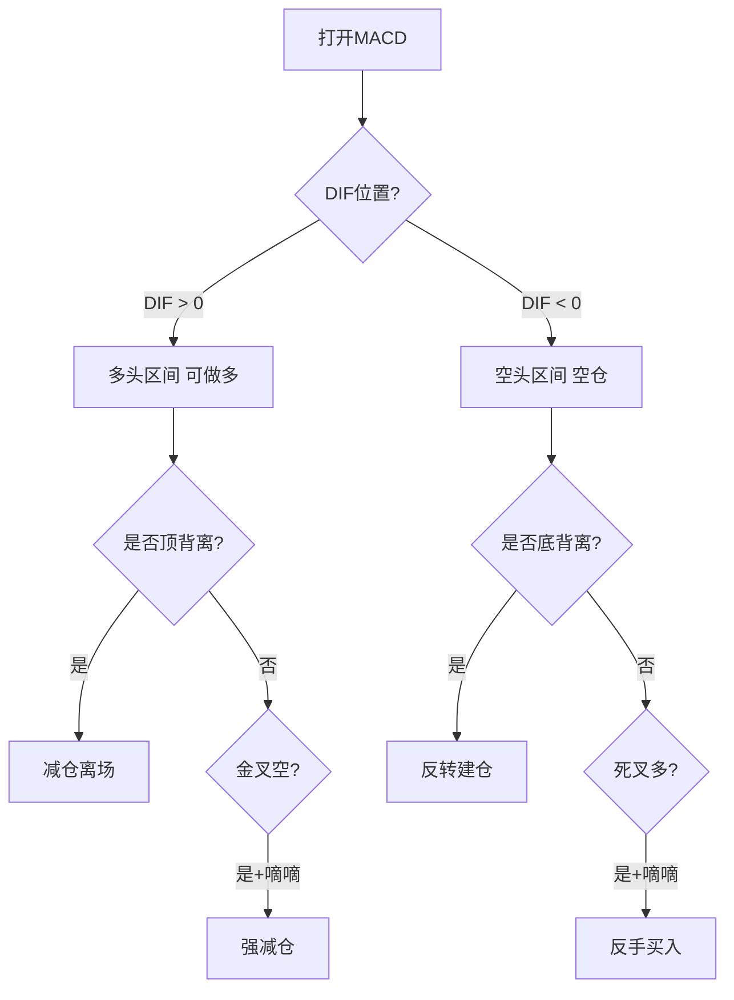
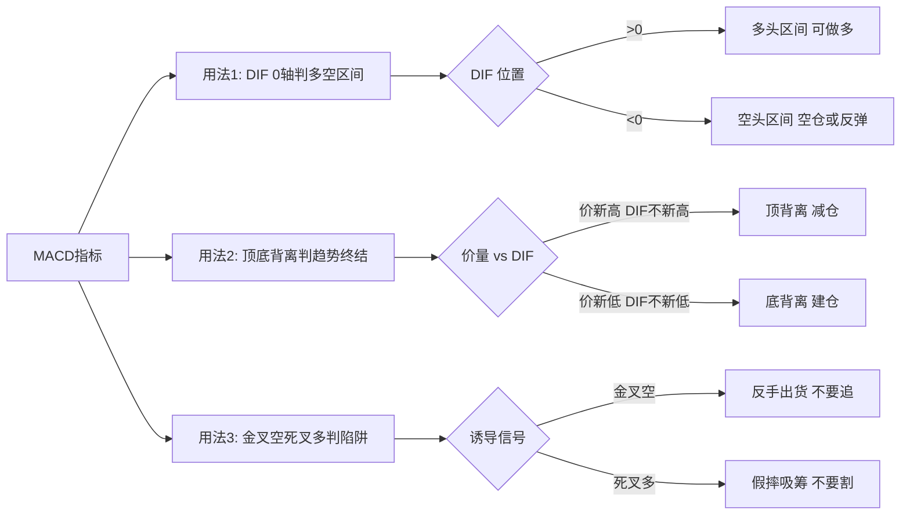

# MACD与砖形图共振

> [!info] 阅读口径
> 本篇上半部按交易流程综合整理；下半部完整保留归属本篇的原库条目正文，并保留原有数值、例外与冲突。原库表述属于特定方法论；其中收益、胜率、历史案例及市场判断未经本次独立核验。综合编排不是Z哥原话。跨条目冲突统一见 [[19-规则冲突与知识缺口]]。

## 两个工具各自回答什么

MACD用于观察多空与动能，砖形图用于压缩噪音、观察转折与持仓节奏。共振的意思是多个条件支持同一判断，不是两个指标同色就保证上涨。

## MACD的三层检查

1. 先看DIF相对零轴的位置。原库把DIF>0当作多头区域，DIF<0当作空头区域；顺周期优先于不断猜背离。
2. 再看价格与DIF是否同向。价格创新高但DIF未创新高是顶背离候选；价格创新低但DIF未创新低是底背离候选。
3. 最后看交叉是否获得后续确认。金叉次日立即死叉称“金叉空”，死叉次日快速反包或重新金叉称“死叉多”。

原库采用默认参数12、26、9，并提出MACD否决权与大盘周线跌破零轴离场。它又把部分顶背离解释成锁筹，不能一律用“有背离=立刻交易”简化。背离是否对应可交易反转，还需位置、K线与既定风控确认。

## 砖形图的持仓节奏

原库参数记为4和6，要求数砖而非数普通日K。红砖从第一块起数，第四块至少减半；绿砖不抄底；红翻绿是专用退出触发。砖数与自然日数不能直接等同，原库未附完整构造算法，也未附回测数据。

三个黄金定式分别是：N型起跳后等待第二块红砖确认；横盘起跳且横盘期间没有S1；上涨中每次回调最多一根绿砖并很快翻红。第三个定式与“红翻绿立刻走”存在适用口径差异，应在入场前选定版本，不能持仓后再选更宽松的说法。

## 共振筛选及失效

| 看到的情况 | 原库框架下的判断 | 本次整理的边界 |
|---|---|---|
| MACD多头、红柱、砖形图红砖 | 共振候选 | 仍需择时、结构、买点与止损 |
| MACD绿柱但DIF仍在DEA上方 | 共振减弱，原库说能不做就不做 | 不能由红砖单独推定有效 |
| 金叉后马上死叉 | 诱多风险 | 已触及止损则执行，不无限等再次金叉 |
| 死叉后快速收复 | 诱空候选 | 只允许在未破硬止损或旧交易结束后重新确认 |
| 出现S1 | 风险信号覆盖共振 | 不能因MACD仍红而忽视出货预警 |

“多等一天”是识别交叉陷阱的观察办法，不能覆盖已经触发的价格止损。超短线、波段、底仓分别用哪个周期，应在计划中写清。

## 工具并不提供已经核验的胜率

原库含“最高胜率”“反转精确度70%+”“只提高3%胜率”等强表述，没有配套样本、成本、执行方式和复现实验。本次完整保留这些原库文字，但不将其当作已验证绩效。尤其“股价回到DIF/DEA线”的表述混合价格与动量指标，不能生成实际价格点位，见 [[19-规则冲突与知识缺口]]。

## 原库理论详解

以下按原库概念页保留正文；仅调整标题层级、内部链接和来源展示，不把整理者的结论升级为已验证事实。

### 原库条目：MACD三大用法

原概念页：/Users/nanan/Documents/ChatGPT/Z哥知识库/references/MACD三大用法.md  
原页更新时间：2026-04-26。来源路径是追溯线索，本Skill未附这些路径对应的原文。

#### 定义

> [!abstract] 一句话定义
> MACD 三大用法是 Z 哥总结的 MACD 三种核心用法 — **DIF 0 轴判多空区间 / 顶底背离判顶底 / 金叉空+死叉多判陷阱**,是 [[05-MACD与砖形图共振#原库条目：顶底背离体系|顶底背离体系]] 的工具版。

#### 关键信息

##### 用法 1:DIF 上下穿 0 轴 — 判多空区间

- **DIF > 0**:多头区间,可做多,顺势持有。
- **DIF < 0**:空头区间,只能空仓或反弹做(不要逆势做多)。
- 0 轴是多空分界,比金叉死叉更可靠。

##### 用法 2:顶 / 底背离 — 判趋势终结

- 价格新高但 DIF 不创新高 → 顶背离,见顶减仓。
- 价格新低但 DIF 不创新低 → 底背离,反转建仓。
- 详细见 [[05-MACD与砖形图共振#原库条目：顶底背离体系|顶底背离体系]]。

##### 用法 3:金叉空 + 死叉多 — 判陷阱(与 [[10-盘中执行与止损计划#原库条目：嘀嘀战法|嘀嘀战法]] 叠加)

- **嘀嘀触发 + MACD 金叉空** = 强减仓信号(双重确认主力出货)。
- **嘀嘀触发 + MACD 死叉多** = 假摔反手买信号(主力假摔吸筹)。
- 单独看金叉死叉容易被骗,叠加嘀嘀战法才是正解。

##### 三大用法决策流程

##### 一票否决权

MACD 是交易体系里的**最后一道防线**：其他所有战法都支持买入，但 MACD 说"不能买"→ **绝对不买**。
- 好比三家顶级医院会诊都说得了绝症，虽然也可能有误诊，但不能把全部身家押在医学奇迹上
- 守住这道防线，就不会亏大钱

##### 不要改参数！默认值(12,26,9)就是最好的

- MACD 的默认参数是经过几十年市场验证的，最符合一个完整波段运行规律
- 对应市场中短期资金的平均持仓周期
- 改参数 = 缩短交易周期 → 操作越频繁 → 越容易被噪音干扰
- 唯一加的标记：白线 DIFF 上穿 0 轴标红点，下穿 0 轴标绿点

##### 滞后性的真相：恰恰是 MACD 的灵魂

- 新手追求"实时"，高手追求"确定性"
- MACD 的"慢"过滤掉 90% 市场噪音
- **所谓的滞后性，只有最后一次才是真的**——一波上涨中间可能有十次死叉，只有最后一次是趋势反转

##### 背离背后的资金逻辑

- **顺周期上涨 = 大资金建仓波**：真金白银买出来的，量价同步
- **顶背离 = 建仓结束，筹码锁定**：主力不需要再花钱就能拉升，量缩价涨
- **左侧双底 vs 右侧双底**：大资金买左侧（恐慌中进场），散户买右侧（趋势确认后追入）

##### 周线 MACD 破 0 轴 = 清仓信号

当大盘的**周线 MACD 跌破 0 轴**时，不管多看好这个市场，都请清仓离场。大顶一定对应大趋势的结束。

- 与 [[05-MACD与砖形图共振#原库条目：顶底背离体系|顶底背离体系]] 的关系:三大用法是该体系的工具实现版。
- 与 [[04-趋势结构与量价工具#原库条目：白线黄线系统|白线黄线系统]] 的关系:MACD 是更短周期的趋势判断,白黄是中周期,两者形成多周期共振。
- 与 [[04-趋势结构与量价工具#原库条目：关键K|关键K]] 的关系:MACD 信号需要 K 线确认才能触发交易(指标只是辅助)。

#### 关联连接

- [[05-MACD与砖形图共振#原库条目：顶底背离体系|顶底背离体系]] — MACD 三大用法的体系版
- [[10-盘中执行与止损计划#原库条目：嘀嘀战法|嘀嘀战法]] — 用法 3 的叠加伙伴
- [[04-趋势结构与量价工具#原库条目：白线黄线系统|白线黄线系统]] — 中周期趋势判断的搭档
- [[04-趋势结构与量价工具#原库条目：关键K|关键K]] — MACD 信号需关键 K 确认
- [[20-知识来源与理论适用边界#原库条目：Zettaranc|Zettaranc]] — 用法的总结者

### 原库条目：顶底背离体系

原概念页：/Users/nanan/Documents/ChatGPT/Z哥知识库/references/顶底背离体系.md  
原页更新时间：2026-04-26。来源路径是追溯线索，本Skill未附这些路径对应的原文。

#### 定义

> [!abstract] 一句话定义
> 顶底背离体系是 Z 哥 2026-04 在 4.7.2 章提出的 MACD 完整方法论 — **90% 行情是顺周期(MACD 顺向),背离仅判异常**,配合"金叉空 / 死叉多"的诱导信号识别主力陷阱。

#### 关键信息

##### MACD 顺周期主战场(占 90% 行情)

- **DIF 上 0 轴 + 红柱放大** = 主升浪进行中,持有不动。
- **DIF 下 0 轴 + 绿柱放大** = 主跌浪进行中,空仓或反弹做。
- 顺周期下盲目找背离 = 自找麻烦。

##### 顶背离 / 底背离(占 10% 行情,判异常)

- **顶背离**:价格新高但 DIF 不创新高 → 趋势衰竭,见顶减仓。
- **底背离**:价格新低但 DIF 不创新低 → 反转在即,底部建仓。

##### 金叉空 / 死叉多 — 主力最恶毒的陷阱

> [!danger] 金叉空 / 死叉多 不是入场信号,是主力陷阱
> - **金叉空**:金叉次日马上死叉的诱多 K 线结构 — 散户冲进去就被套,主力反手出货。
> - **死叉多**:死叉次日反包的诱空 K 线结构 — 散户割肉,主力假摔吸筹。
> 见到这两种结构,**反向操作**才是正解。

##### 白线高危区 vs 黄线机会区

- **白线之上是高危区**:对应 MACD 顺周期顶部,临近顶背离。
- **黄线附近是机会区**:对应 MACD 底背离,反转启动点。

##### 与其他体系的耦合

- 与 [[04-趋势结构与量价工具#原库条目：白线黄线系统|白线黄线系统]] 的强耦合:顶底背离 + 黄线战法是同一体系的两个角度(指标 vs 均线)。
- 与 [[10-盘中执行与止损计划#原库条目：嘀嘀战法|嘀嘀战法]] 的叠加用法:嘀嘀触发时若 MACD 同时金叉空 → 强减仓信号(双重确认)。

##### MACD 三大用法流程

#### 关联连接

- [[04-趋势结构与量价工具#原库条目：白线黄线系统|白线黄线系统]] — 顶底背离 + 黄线战法是同一体系两个角度
- [[05-MACD与砖形图共振#原库条目：MACD三大用法|MACD三大用法]] — 顶底背离体系的工具版
- [[10-盘中执行与止损计划#原库条目：嘀嘀战法|嘀嘀战法]] — 与金叉空叠加形成强减仓信号
- [[04-趋势结构与量价工具#原库条目：关键K|关键K]] — 背离需关键 K 线确认才能触发
- [[04-趋势结构与量价工具#原库条目：N型结构|N型结构]] — 背离常出现在 N 型结构的转折点
- [[13-放飞止盈与破位退出#原库条目：主力出货五种经典方式|主力出货五种经典方式]] — 金叉空是其中之一
- [[20-知识来源与理论适用边界#原库条目：Zettaranc|Zettaranc]] — 体系的提出者

### 原库条目：砖形图

原概念页：/Users/nanan/Documents/ChatGPT/Z哥知识库/references/砖形图.md  
原页更新时间：2026-04-18。来源路径是追溯线索，本Skill未附这些路径对应的原文。

#### 定义

> [!abstract] 一句话定义
> 砖形图是基于 **A 股 4 天情绪循环**的 K 线压缩图表工具,参数 4 和 6,将 K 线压缩为红砖(上涨)和绿砖(下跌),用于判断变盘点。Z 哥超短战法的底层视觉密码。

#### 关键信息

##### 底层逻辑
- 源自威尔斯·威尔德的 **三角洲战法(Delta)**,基于潮汐/天体循环规律
- A 股每 **4 天** 完成一次短期情绪循环,是变盘点
- 砖形图参数 4 和 6 经 A 股历史数据回测得出

##### 四块砖交易体系
- **红砖上涨**:从第一块红砖开始数,数满 4 块必须减仓(至少卖一半)
- **绿砖下跌**:绝不抄底,先数 4 块再说
- 4 块砖后可能出现 4+4 趋势延续,但不作为常态预期
- 超短规则:3 天不涨就走,最多拿 4 天

##### 铁律
1. 不数 K 线,只数砖
2. 红砖翻绿立刻止损
3. 股价跌破黄线立刻止损
4. 买入当天被套,次日 9:33/9:37 止损
5. 买入后 3 天不涨立刻止损

##### 避坑指南
- 锤子图(长下影线)绝对不做
- 缩量涨停的庄股绝对不做
- 开盘 30 秒冲高 5 个点绝对不追
- 高开 4 个点以上不打底仓

#### 四块砖循环图

> [!danger] 砖形图三大铁律
> 1. **不数 K 线,只数砖** — 砖形已过滤噪音,K 线是干扰
> 2. **红砖翻绿立刻止损** — 不要寄希望"再等一下"
> 3. **3 天不涨就走** — 占用资金的机会成本就是最大风险

#### 关联连接
- [[13-放飞止盈与破位退出#原库条目：DSZ战法|DSZ战法]] — 基于砖形图的超短卖出战法
- [[06-B1入场与建仓波鉴别#原库条目：B1建仓波|B1建仓波]] — 与砖形图共振时是最佳买点
- [[04-趋势结构与量价工具#原库条目：白线黄线系统|白线黄线系统]] — 配合使用

### 原库条目：四块砖交易体系

原概念页：/Users/nanan/Documents/ChatGPT/Z哥知识库/references/四块砖交易体系.md  
原页更新时间：2026-04-18。来源路径是追溯线索，本Skill未附这些路径对应的原文。

#### 定义

> [!abstract] 一句话定义
> 四块砖交易体系是基于 **A 股 4 天情绪循环**的完整交易体系 — 用红砖/绿砖判断变盘点,覆盖买入、持有、卖出全流程。**模糊的正确 > 精确的错误**。

#### 关键信息

##### 底层逻辑
- 源自威尔斯·威尔德三角洲战法
- A 股每 4 天完成一次情绪循环
- 砖形图参数 4 和 6 经 A 股回测验证

##### 操作规则
- 红砖:数满 4 块减仓至少一半
- 绿砖:绝不抄底,先数 4 块
- 模糊的正确 > 精确的错误
- 反转精确度 70%+,用仓位管理应对不确定性

##### 与 B3 的关系
- B3 战法也遵循情绪循环规律
- B3 是上涨趋势中的中继确认,与砖形图的 4 天循环配合使用

> [!tip] 体系 vs 工具
> 四块砖**交易体系**是完整流程,[[05-MACD与砖形图共振#原库条目：砖形图|砖形图]] 是它的底层视觉工具 — 体系给出操作规则(数砖/减仓/不抄底),工具给出判断信号(红砖/绿砖/4 块)。详细砖序循环图见 [[05-MACD与砖形图共振#原库条目：砖形图|砖形图]]。

#### 关联连接
- [[05-MACD与砖形图共振#原库条目：砖形图|砖形图]] — 底层工具
- [[13-放飞止盈与破位退出#原库条目：DSZ战法|DSZ战法]] — 超短版应用
- [[07-B2与B3确认及假突破应对#原库条目：B3买点|B3买点]] — 趋势中继确认点
- [[20-知识来源与理论适用边界#原库条目：Zettaranc|Zettaranc]] — 交易体系作者

### 原库条目：三个黄金定式

原概念页：/Users/nanan/Documents/ChatGPT/Z哥知识库/references/三个黄金定式.md  
原页更新时间：2026-04-18。来源路径是追溯线索，本Skill未附这些路径对应的原文。

#### 定义

> [!abstract] 一句话定义
> 三个黄金定式是砖形图体系下**胜率最高的三种进场形态** — N 型起跳、横盘起跳、上升波段延续。三种定式覆盖建仓、突破、中继三大典型场景。

#### 关键信息

##### 定式一：N型起跳
- 价格先跌→反弹→回调到前低附近→一根大红砖拉起
- 等第二块红砖确认再进

##### 定式二：横盘起跳
- 横盘时间越长，主力吸筹越充分
- 横盘期间不能有S1出货信号

##### 定式三：上升波段延续
- 每次回调最多一根绿砖，马上翻红继续涨
- 只要不连续翻绿就一直拿

#### 关联连接
- [[05-MACD与砖形图共振#原库条目：砖形图|砖形图]] — 底层工具
- [[13-放飞止盈与破位退出#原库条目：S1信号|S1信号]] — 横盘期间排除假突破

### 原库条目：MACD共振战法

原概念页：/Users/nanan/Documents/ChatGPT/Z哥知识库/references/MACD共振战法.md  
原页更新时间：2026-04-26。来源路径是追溯线索，本Skill未附这些路径对应的原文。

#### 定义

> [!abstract] 一句话定义
> **砖形图与 MACD 形成共振** = A 股胜率最高的战法。单独看砖形图容易被诱多，单独看 MACD 容易被背离骗，两者共振 = 双保险确认。

#### 核心铁律

##### 铁律一：砖形图只能在多头区间用

- MACD 白线在黄线之上、零轴之上 → 多头区间 → 可以用砖形图
- 空头区间任何砖型图都是**诱多**，进去就是跌停
- **第一步先看 MACD 是不是红的，绿的直接跳过**

##### 铁律二：红柱找红砖，绿柱要谨慎

| 区域 | 特征 | 胜率 | 策略 |
|------|------|------|------|
| **红柱区间** | MACD 柱体红色 + 砖形图红砖 | 最高 | 正常仓位参与 |
| **绿柱区间** | MACD 柱体绿色但白线仍在黄线上 | 低 | 能不做就不做，最多 1/10 仓位试错 |

绿柱区间的涨停板，第二天直接低开跌停——这是典型的**诱多**，专门骗只看砖形图不看 MACD 的人。

##### 铁律三：死叉多 vs 金叉空——多等一天避开 90% 的坑

- **死叉多**：MACD 刚死叉，第二天马上金叉往上 → **最强多头信号之一**，空中加油
- **金叉空**：MACD 刚金叉，第二天马上死叉往下 → **最弱信号**，A 股最恶毒的诱多手法
- **操作**：看到金叉不要马上冲，多等一天看会不会变金叉空；看到死叉不要马上割，多等一天看会不会变死叉多

#### 白线位置 vs 黄线位置

> [!danger] 白线位置不可靠
> 高位白线位置的第一个 B1 **绝对不做**。白线是 MACD 红柱转绿柱的临界点，一根放量阴线就能形成死叉。

| 位置 | 特征 | 盈亏比 | 策略 |
|------|------|--------|------|
| **白线位置** | 股价回调到 DIF 线 | 极差（赌不跌） | 绝对不做高位白线 B1 |
| **黄线位置** | 股价回调到 DEA 线/零轴附近 | 极高 | 黄金买点，止损小利润大 |

**黄线位置的 B1** = MACD 已充分调整到位，绿柱缩短到极致，一根放量阳线就能重新金叉。止损设在黄线下方一点点（最多亏 3-4%），涨上去就是几十个点甚至翻倍。

#### S1 信号——优先级最高的保命信号

- **S1 优先级高于一切**：比 MACD、比砖形图、比任何东西都高
- **定义**：放量大跌的阴线，不管假阴真阳，只要**成交量是绿的、放量了**，就是 S1
- **操作**：一个字——**走**，不要抱任何幻想
- S1 就是用来保命的，先活下来再谈赚钱

#### 交易的概率本质

- 所有战法只能把胜率从 **53% 提高到 56%**，这就是顶尖水平
- 我们赚的只是 **3% 的胜率差**，长期复利的力量惊人
- **没有完美的交易，只有完美的应对**：从集合竞价那一刻起，应对就开始了
- 允许一切发生：允许市场涨/跌，允许自己犯错，允许自己赚不到最多的钱

#### 与体系的关系

- 与 [[05-MACD与砖形图共振#原库条目：砖形图|砖形图]] 的关系：共振 = 砖形图 + MACD 双保险
- 与 [[05-MACD与砖形图共振#原库条目：MACD三大用法|MACD三大用法]] 的关系：共振战法是 MACD 与砖形图的具体联动方式
- 与 [[05-MACD与砖形图共振#原库条目：顶底背离体系|顶底背离体系]] 的关系：共振战法的选股基础来自顺周期与背离判断
- 与 [[13-放飞止盈与破位退出#原库条目：S1信号|S1信号]] 的关系：S1 是最高优先级保命信号，覆盖一切战法

#### 关联连接

- [[05-MACD与砖形图共振#原库条目：砖形图|砖形图]] — 共振的一方
- [[05-MACD与砖形图共振#原库条目：MACD三大用法|MACD三大用法]] — 共振的另一方
- [[05-MACD与砖形图共振#原库条目：顶底背离体系|顶底背离体系]] — 共振的选股基础
- [[13-放飞止盈与破位退出#原库条目：S1信号|S1信号]] — 最高优先级保命信号
- [[05-MACD与砖形图共振#原库条目：四块砖交易体系|四块砖交易体系]] — 砖形图的完整交易框架
- [[20-知识来源与理论适用边界#原库条目：Zettaranc|Zettaranc]] — 体系作者
