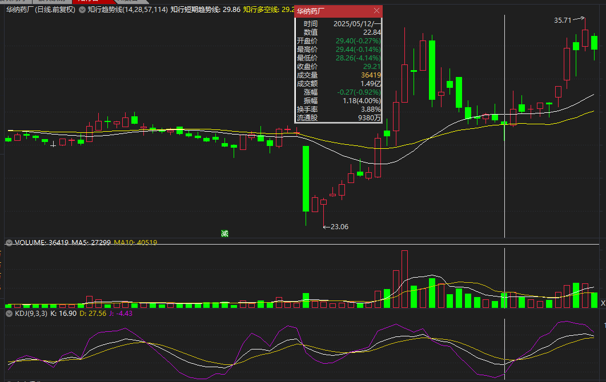
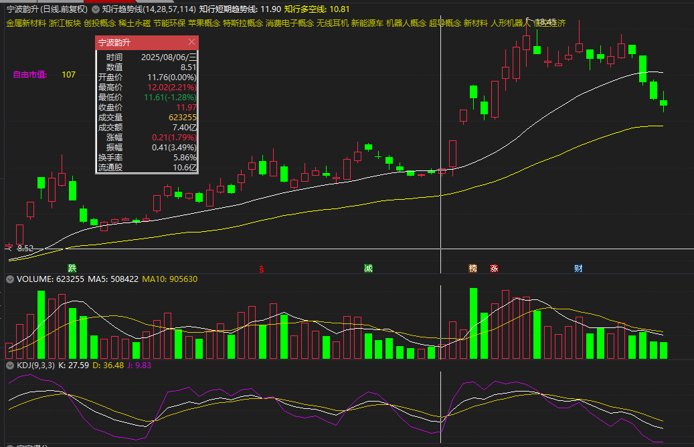
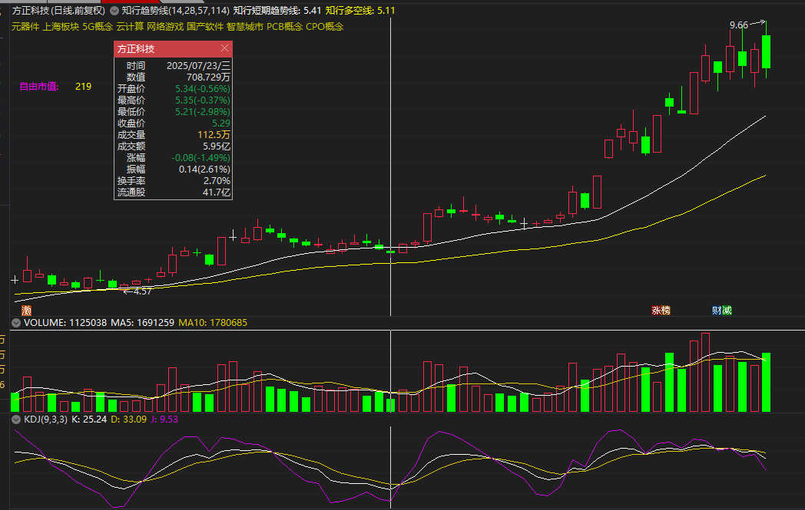
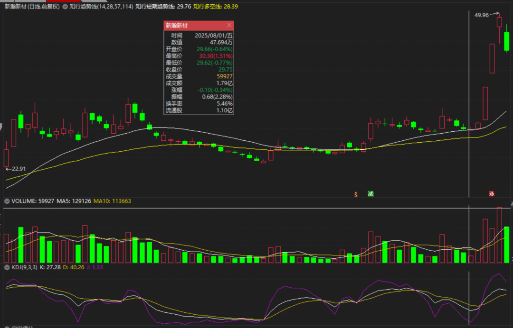
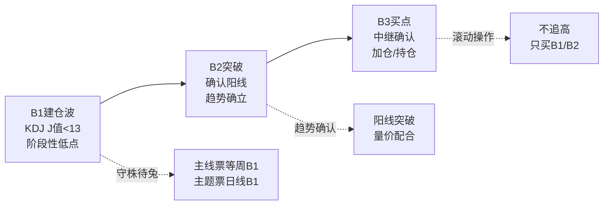
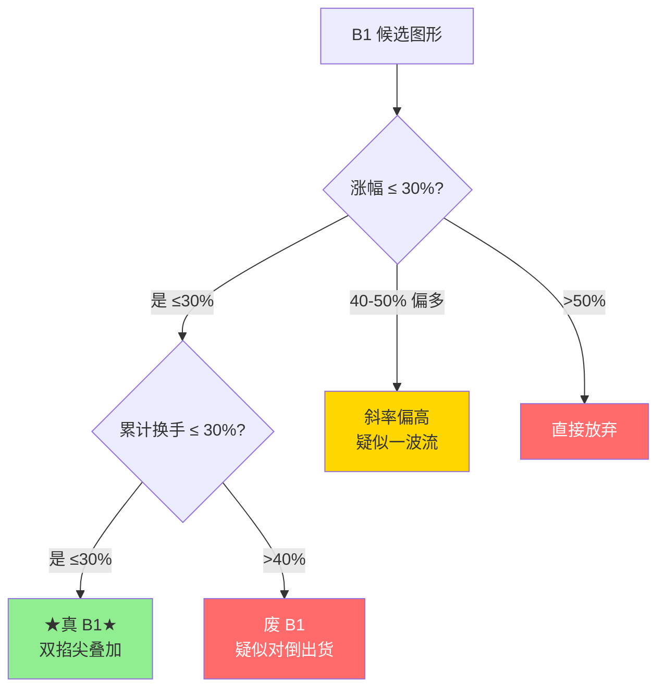

# B1入场与建仓波鉴别

> [!info] 阅读口径
> 本篇上半部按交易流程综合整理；下半部完整保留归属本篇的原库条目正文，并保留原有数值、例外与冲突。原库表述属于特定方法论；其中收益、胜率、历史案例及市场判断未经本次独立核验。综合编排不是Z哥原话。跨条目冲突统一见 [[19-规则冲突与知识缺口]]。

## B1是阶段性低点候选，不是绝对底

通用B1的指标条件是对应周期KDJ的J<13。少妇战法采用更严格的J<-10，并要求回踩关键位置。数值只是条件之一：前面没有上涨结构与建仓异动，J再低也不能自动叫可参与的B1。

## 识别一张有交易价值的B1

| 检查层 | 具体要求 | 不满足时 |
|---|---|---|
| 环境 | 择时允许当前策略 | 不开仓 |
| 大结构 | 上涨N型，黄线走平或向上 | 下跌反弹和无序震荡剔除 |
| 左侧上涨 | 低位出现有力度的异动与量能堆积 | “没呼吸”的平淡图形不凑合 |
| 顶部表现 | 无明显巨量派发，最好有惜售迹象 | 高位长上影、滞涨警惕 |
| 右侧回撤 | 缩量、小阴小阳、回踩关键位置 | 大幅无序杀跌不能只因J低就买 |
| 买点 | 周期、J值、位置一起达到所选标准 | 等待，不提前猜 |
| 交易价值 | 失效位明确，向上空间与风险相称 | 止损过远或赔率不足则放弃 |

原库最强B1模型另给当日涨跌幅-2%到+1.8%、振幅<4%；完美图条目写小K波动约±2%。这是特定筛选模型，不应将其升级为所有B1唯一精确定义。

## 两个30%怎么核对

第一个30%是建仓波涨幅大致在30%左右；40%以上偏高，独立条目写50%以上直接放弃。第二个30%是相关中大阳线累计换手率不超过30%，不是单根日换手；超过40%作为废B1处理。

原库文字“30%左右”与流程图“≤30%”并不完全一致，30%—40%换手区间也没有统一完整判法。这些条件用于过滤风险，不足以独立证明“真主力已建仓”。计数区间必须先圈定，不能事后挑几根满足条件的阳线。

## 四种B1图形与娜娜图

标准型是建仓有力、顶部惜售、圆弧缩量回踩；变量型容许更长时间整理与部分放量阴线；横盘压缩型回撤浅、红肥绿瘦；高控盘激进型依赖强趋势，白线约束更紧。后面三类并不意味着新手遇到瑕疵就能随意归入“变种”。

娜娜图强调底部有量、上方量减、股价创新高时阳线和次高点阴线缩量。它是特定结构下锁筹的解释；原库也承认价升量缩可能是买力衰减，因此仍需关键K和择时判断。

<!-- web-images-2026-10-20-B1四种结构-start -->
## 对应形态的历史图例

> [!note] 网络图例的阅读范围
> 以下图片来自[笔记在线：《Z哥_需要反复背诵的十张完美图形》](https://www.noteol.com/xuexi/ZG_wanmeituxing.html)，页面署名“管理员”，属于二级学习整理；截图的原始制作者未独立核实。图片按原文件本地保存，下载日期为2026-10-20。图中带有后续走势，只用于辨认结构；不据事后上涨确认信号必胜，也不以图文中的宽松口径覆盖本笔记规则。

### 标准回调的观察顺序：华纳药厂

先看前期放量，再看回调及小K线附近的缩量。KDJ栏可见J=-4.43：满足通用J<13，但不满足少妇战法严格J<-10，不能把同一张图标成两种严格标准都通过。

[查看原图](https://s21.ax1x.com/2025/10/15/pVqY5p8.png)。

### 缩量企稳的对照：宁波韵升

将回调量柱与此前上冲量柱比较，并观察价格和白黄线的相对位置。仅凭截图不补算建仓波累计换手，也不直接宣布两个30%全部通过。

[查看原图](https://s21.ax1x.com/2025/10/15/pVqYI1S.png)。

### 多轮异动与回撤：方正科技

沿时间方向先找放量动作，再检查其后的价格回撤。图例用于练习辨认前史，不能只盯最后的小阴小阳而忽略此前结构。

[查看原图](https://s21.ax1x.com/2025/10/15/pVqYOkq.png)。

### 横盘压缩型对照：新瀚新材

中部窄幅整理与右侧再次放量可分开观察。局部整理属于结构的一部分，不能由这张图推出所有长期横盘股都符合上涨N型。

[查看原图](https://s21.ax1x.com/2025/10/15/pVqtEh6.png)。

<!-- web-images-2026-10-20-B1四种结构-end -->

## B1买入后遇到三种情况

立即上涨：检查是否脱离成本区，按预设嘀嘀与放飞规则跟踪，不能因为涨了就取消止损。

横盘不涨：一般B1条目要求3天恢复上涨，个别口径允许再看1—2天；七层应对更严格地要求没涨就走。需事先选定版本。超短DSZ的次日9:37不能拿来与B1三天规则混成随意等待。

继续下跌：触及买入K低点、所选3—5价位缓冲或N型低点等预设失效位就执行。原库有3%以内、3%—5%等不同风险描述，并不保证实际成交亏损恰好被锁定在该数值。超级B1属于止损后的新判断，见 [[08-特殊买点与止损后重新入场]]。

## 原库理论详解

以下按原库概念页保留正文；仅调整标题层级、内部链接和来源展示，不把整理者的结论升级为已验证事实。

### 原库条目：B1建仓波

原概念页：/Users/nanan/Documents/ChatGPT/Z哥知识库/references/B1建仓波.md  
原页更新时间：2026-05-01。来源路径是追溯线索，本Skill未附这些路径对应的原文。

#### 定义

> [!abstract] 一句话定义
> B1建仓波是识别主力建仓痕迹的核心买入信号，用于发现潜在的牛股启动点。判断标准是KDJ指标的J值（勾）必须打到13以下，不同周期的J<13对应不同级别的B1（日线/周线）。

#### 关键信息

##### B1的本质定义
- **B1不是"绝对底"**，是某个周期内的"阶段性低点"
- **核心指标**：KDJ的J值（勾）<13，数值越低越好（-10、-14都算）
- **周期越大信号越稳**：周线B1 > 日线B1
- **主线票**：优先等周B1，日线+周线共振最完美
- **主题票**：日线B1就够了，不要看周线（一波流过了就没了）

> [!tip] 两个30%原则（真假B1筛选）
> 1. **涨幅原则**：建仓波涨幅一般在 **30%左右**（正态分布的高概率区间）。40%以上偏多，斜率过高疑似一波流出货。
> 2. **换手率原则**：中阳线、大阳线的 **累计换手率不超过30%**（几根阳线加起来，非单根）。高于40%一律视为废B1。
>
> **背后逻辑**：建仓是主力收集筹码（筹码集中），而非对倒出货（筹码发散）。换手率过高说明筹码已多次交换，主力可能已离场。

##### 建仓图形态识别
- **完美建仓图**：底部堆大量，上方量能递减；股价创新高反而缩量（筹码锁定好）
- **娜娜图**：极品建仓形态——股价创新高但阳线缩量、次高点阴线也突然缩量，说明主力还在里面没卖
- **不喜欢的形态**：
  - 跳空建仓（跳空是进攻信号，不是建仓信号）
  - 连续堆量但股价滞涨（智障无功图/蜈蚣图）
  - 高位放量上影线
  - 建仓波位置太高（底部起来已75%+）
  - 连续阶梯量放下来

> [!danger] B1后持仓纪律
> - **3天内必须恢复上涨**：低位不涨必有妖，主力不会让低位筹码停留太久
> - **3天不涨但没大跌**：最多再看1-2天，不行就减仓
> - **跌穿止损**：直接全卖，别犹豫

##### B1止损方法
1. 买入K线最低点
2. 向下3-5个价位
3. 前N型结构低点
核心：幅度控制在3%以内，适合"开超市"撒网

##### B1标准模型（最强B1十张图体系）

> [!tip] 从分歧到一致的信号
> 知行小菜鸟在2026年提炼出"最强B1"的标准量化模型，来源于"十张图"体系对主力建仓与洗盘的终极解构。

- **当日涨跌幅**：-2% 到 +1.8% 之间（不夸张，不引人注目）
- **当日振幅**：< 4%（窄幅震荡，主力不想暴露）
- **核心特征**：从分歧走向一致——建仓初期市场有分歧（有卖有买），但随着主力持续吸筹，卖盘越来越少，量能递减
- **标准模型**：
  1. 底部出现异动放量（主力试探性介入）
  2. 随后缩量回调（洗盘，但主力不大量卖出）
  3. 再次放量突破（主升浪启动）

##### B1执行铁律

> [!danger] B1不是每日任务
> B1不是每天必须扒拉出来的任务。有瑕疵就不干，5000+票不需要自我说服。不是为了做B1而做B1，是为了赚钱而做B1。
> 出处:490别把送分题做成送命题（原库未附独立条目）

##### "没呼吸"的B1不能干
- 一只票要有短期爆发力，前面得有异动：大量、中量、像样的试盘，然后缩下来，最后B1出来
- 如果一路缩量往上再缩量下来，平平淡淡像没醒一样，不是优中选优
- 交易不是问"它有没有可能涨"，而是问"我做十次这种图，能不能赚六次"

##### 评分纪律
- 60分以下先减少操作甚至回炉重学
- 知字不及格天天行，最后就是熄火
- 高分不等于赚钱，高分只说明开始有资格谈执行

#### 进场点位
- B1是关键进场点之一，与 **[[07-B2与B3确认及假突破应对#原库条目：B2突破|B2突破]]** 同为"守株待兔"的核心买点
- 除B1/B2外，其他位置追高均无依据
- B1第二天开盘使用 [[10-盘中执行与止损计划#原库条目：量比战法|量比战法]] 精细化建仓

#### B1→B2→B3买点递进关系

#### 知识冲突

> [!caution] 冲突点：J值阈值标准
> - **精水流深（202603）**：J值 < 13，数值越低越好（-10、-14都算）
> - **空谷幽兰（202601）**：在少妇战法语境下，要求J值大幅负值（-10以下）
> - **差异原因**：精水流深讲B1的通用标准（<13），空谷幽兰在少妇战法中对B1做了更严格的筛选，要求-10以下以确保更高的安全边际
> - **采用方案**：通用场景采用精水流深的 <13 标准；少妇战法/补票场景可采用 <-10 的严格标准。两者不矛盾，是不同风险偏好下的细化

#### 牛市语境别名(2026 年知行小菜鸟版)

> [!info] 挖掘牛 = B1
> 在 [[15-长线底仓与牛市ETF管理#原库条目：牛市策略|牛市策略]] 叙事下,B1 等同于"挖掘牛阶段" — 主力静悄悄吸筹,媒体/散户尚未察觉,是牛市第一阶段的最佳建仓窗口。配合 [[17-心理防守与概率认知#原库条目：斗牛士三属性|斗牛士三属性]] 的"勇气"。
> 出处:[[07-B2与B3确认及假突破应对#原库条目：三波理论|三波理论]]、4.1.0 磨底不死。

#### 关联连接
- [[07-B2与B3确认及假突破应对#原库条目：B2突破|B2突破]] — B1的确认阳线
- [[07-B2与B3确认及假突破应对#原库条目：B3买点|B3买点]] — B2后的中继确认
- [[08-特殊买点与止损后重新入场#原库条目：超级B1|超级B1]] — B1的高级形态
- [[13-放飞止盈与破位退出#原库条目：S1信号|S1信号]] — 卖出信号，与B1构成买卖闭环
- [[05-MACD与砖形图共振#原库条目：砖形图|砖形图]] — 配合B1使用
- [[01-交易闭环与策略边界#原库条目：框架式交易|框架式交易]] — B1是框架式交易的关键进场点
- [[06-B1入场与建仓波鉴别#原库条目：两个30%原则|两个30%原则]] — B1筛选的核心量化标准
- [[06-B1入场与建仓波鉴别#原库条目：娜娜图|娜娜图]] — 完美建仓图形态
- [[10-盘中执行与止损计划#原库条目：量比战法|量比战法]] — B1后第二天的精细化买法
- [[07-B2与B3确认及假突破应对#原库条目：三波理论|三波理论]] — B1 在三波框架中即"建仓波/挖掘牛"
- [[17-心理防守与概率认知#原库条目：斗牛士三属性|斗牛士三属性]] — B1 对应"勇气"
- [[20-知识来源与理论适用边界#原库条目：Zettaranc|Zettaranc]] — 交易体系作者

### 原库条目：两个30%原则

原概念页：/Users/nanan/Documents/ChatGPT/Z哥知识库/references/两个30%原则.md  
原页更新时间：2026-04-18。来源路径是追溯线索，本Skill未附这些路径对应的原文。

#### 定义

> [!abstract] 一句话定义
> 两个 30% 原则是筛选真假 B1 建仓波的**两个量化标准**,基于正态分布规律得出 — 涨幅 30% + 累计换手率 30%,双掐尖叠加确认。

#### 关键信息

##### 涨幅30%
- 建仓波涨幅一般在 30% 左右(正态分布大概率区间)
- 40% 以上偏多,斜率高疑似一波流
- 50% 以上直接放弃

##### 换手率30%
- 中阳线、大阳线的累计换手率不超过 30%(几根加起来)
- 高于 40% 视为废 B1
- 背后逻辑:建仓是收集筹码,不是对倒出货

##### 双掐尖效应
- 两个条件同时满足,成功概率叠加

#### 双掐尖筛选图

> [!tip] 双掐尖逻辑
> 30% 涨幅 + 30% 换手 = 主力收筹但未对倒。任何一个超标都说明结构变质,优先放弃。

#### 关联连接
- [[06-B1入场与建仓波鉴别#原库条目：B1建仓波|B1建仓波]] — 应用对象
- [[06-B1入场与建仓波鉴别#原库条目：娜娜图|娜娜图]] — 完美建仓形态
- [[20-知识来源与理论适用边界#原库条目：Zettaranc|Zettaranc]] — 交易体系作者

### 原库条目：B1完美图

原概念页：/Users/nanan/Documents/ChatGPT/Z哥知识库/references/B1完美图.md  
原页更新时间：2026-04-26。来源路径是追溯线索，本Skill未附这些路径对应的原文。

原页标注的来源线索

- raw/01-zettaranc/大富翁小菜鸟/[202601171742]重磅干货大道至简交易体系之B1完美图深度拆解推荐收藏.md
- raw/01-zettaranc/知行小菜鸟/[202601171916]重磅干货大道至简交易体系之B1完美图深度拆解推荐收藏单篇付费版.md

#### 定义

> [!abstract] 一句话定义
> B1 完美图是一套关于**趋势、量价、结构与人性**的高胜率识别系统。灵魂一句话:**从"多空分歧"到"缩量一致"的质变** — B1 买点就是"静默期"被打破前夜的临界点。

#### 完美B1五大铁律(缺一不可)

##### 1. 完美的前提：必须是N型结构
- **只做上涨趋势中的回调**——回调之前必须有一段清晰的上涨波段
- 黄线（大哥成本线）必须走平或向上
- 在下跌通道或无序震荡里找B1 = 根源性错误

##### 2. 完美的左半边：这一拳要打得有力量
- **异动**：底部出现放量涨停或连续温和放量中长阳——主力真金白银进场
- **顶部惜售**：拉升到高点时不能放量出货，最好缩量或无量见顶——主力志在长远
- **留下"碗"**：大阳线的实体部分就是未来的强支撑

##### 3. 完美的右半边：洗盘要"干净"
- **量能是灵魂**：成交量阶梯式或圆弧形萎缩，直到出现"地量"（"水母呼吸"/"娜娜图"特征）
- **形态要稳**：小阴小阳，单日波动±2%以内，不要上蹿下跳的长影线
- **指标到位**：股价回踩黄线或"碗沿"获支撑；KDJ的J值打到13以下（大负值）

##### 4. 完美的交易价值：赔率优先
- **止损极小**：止损位清晰（跌破碗/跌破黄线），亏损控制在-3%到-5%
- **空间极大**：往上看是前高甚至更远的星辰大海
- 哪怕止损了，也是一笔正确的交易

##### 5. 纪律：什么不是B1？
- 下跌趋势里的反弹 → **不做**
- "A杀"直线下跌后的第一个企稳 → **不做**
- K线杂乱无章、长上下影线乱飞 → **不做**
- **只做完美图形，不要凑合**

#### 四大经典门类

| 类型 | 特征 | 案例 | 适合 |
|------|------|------|------|
| **标准型** | 建仓强、顶部无量、圆弧缩量回调、踩线精准 | 华纳药厂 | 新手首选 |
| **变量型** | 洗盘不极致，中间夹杂放量阴线，长时间横盘"时间换空间" | 国轩高科 | 有耐心的交易者 |
| **横盘压缩型** | 极度强势，回调不深，高位箱体震荡"红肥绿瘦" | 新瀚新材 | 追求爆发力 |
| **高控盘激进型** | 牛市后期产物，主力锁仓缩量上涨 | 昂利康 | 激进型，严格以白线为止损 |

#### 关联连接

- [[06-B1入场与建仓波鉴别#原库条目：B1建仓波|B1建仓波]] — B1完美图是B1选股的高阶标准
- [[04-趋势结构与量价工具#原库条目：N型结构|N型结构]] — 完美B1的前提：必须处于N型上涨结构
- [[03-选股后验证与候选池管理#原库条目：异动选股法|异动选股法]] — 完美左半边的核心是异动建仓
- [[06-B1入场与建仓波鉴别#原库条目：两个30%原则|两个30%原则]] — B1筛选的辅助量化标准
- [[06-B1入场与建仓波鉴别#原库条目：娜娜图|娜娜图]] — 完美右半边的典型缩量形态
- [[04-趋势结构与量价工具#原库条目：关键K|关键K]] — 大阳线实体的"碗"就是关键K

### 原库条目：娜娜图

原概念页：/Users/nanan/Documents/ChatGPT/Z哥知识库/references/娜娜图.md  
原页更新时间：2026-04-18。来源路径是追溯线索，本Skill未附这些路径对应的原文。

#### 定义

> [!abstract] 一句话定义
> 娜娜图是**最完美的建仓图形态**,可遇不可求的极品信号 — 股价创新高但阳线缩量,次高点阴线也突然缩量,底部堆大量、上方量能递减。

#### 关键信息

##### 特征
- 股价创新高但阳线缩量
- 次高点阴线也突然缩量
- 底部堆大量,上方量能递减

##### 原理
- 股价越高如果不放量,说明主力没卖,筹码锁定好
- 如果是主力出货,高位一定放大量

> [!tip] 娜娜图心法
> **创新高 + 缩量 = 主力没卖** — 这是 B1 的极品形态。可遇不可求,看到了就别犹豫;看不到就老实等标准 B1。

#### 关联连接
- [[06-B1入场与建仓波鉴别#原库条目：B1建仓波|B1建仓波]] — 娜娜图是B1的极品形态
- [[06-B1入场与建仓波鉴别#原库条目：两个30%原则|两个30%原则]] — 娜娜图同时满足此原则
