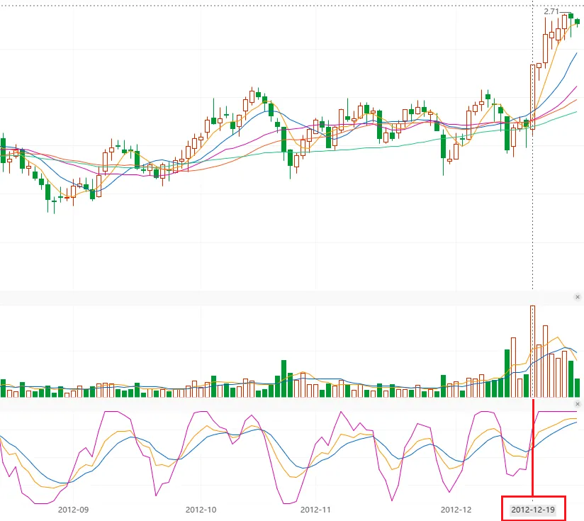
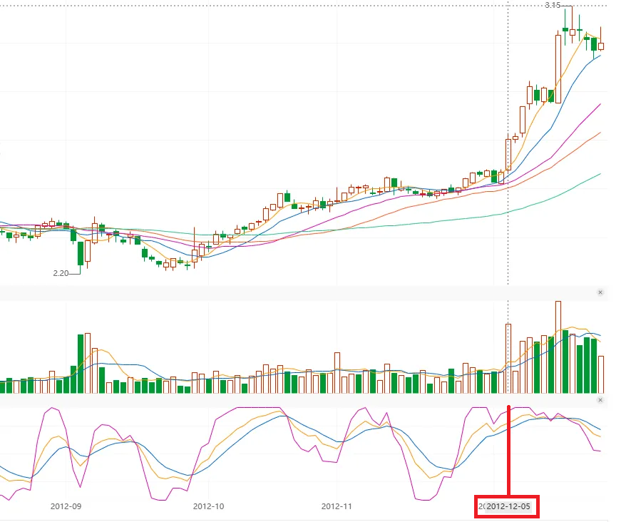
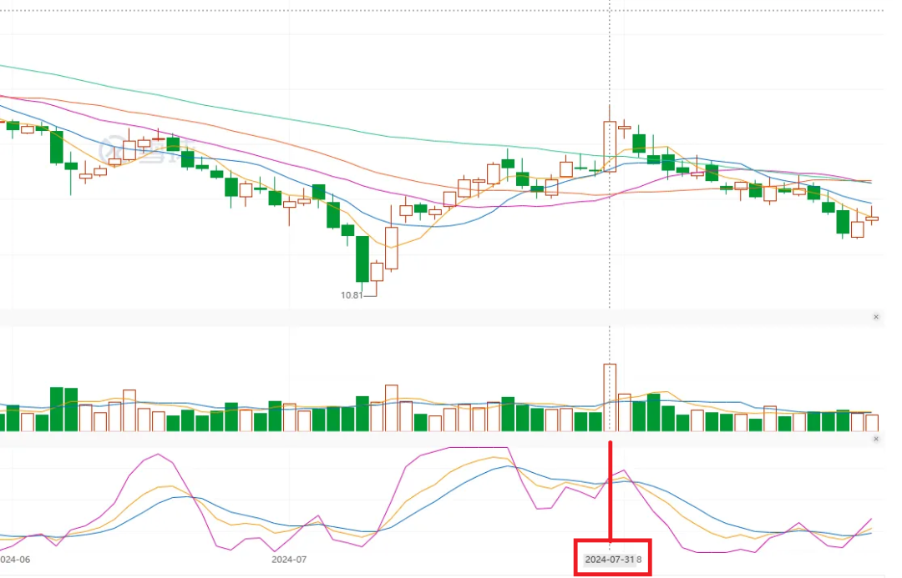
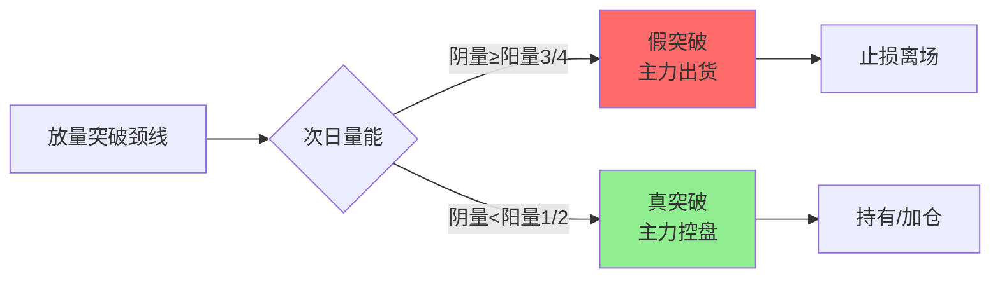
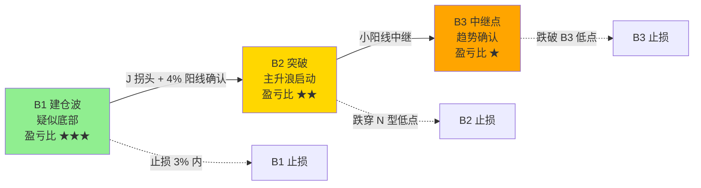
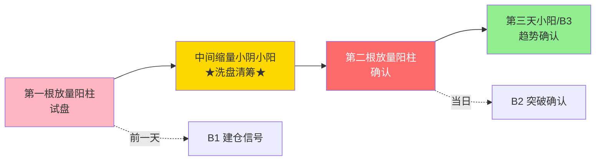
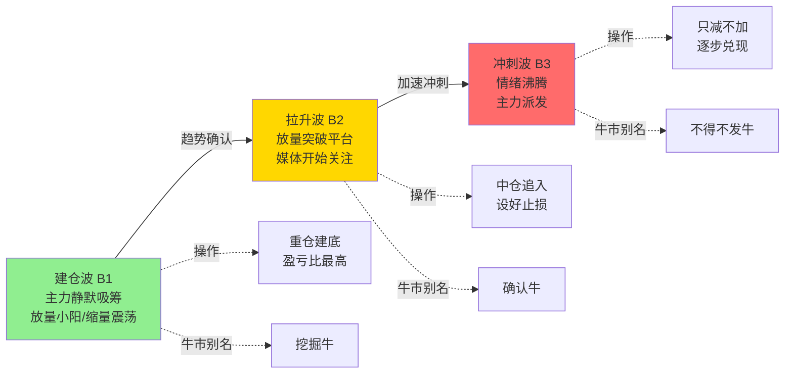

# B2与B3确认及假突破应对

> [!info] 阅读口径
> 本篇上半部按交易流程综合整理；下半部完整保留归属本篇的原库条目正文，并保留原有数值、例外与冲突。原库表述属于特定方法论；其中收益、胜率、历史案例及市场判断未经本次独立核验。综合编排不是Z哥原话。跨条目冲突统一见 [[19-规则冲突与知识缺口]]。

## B2和B3是确认关系，不能把任意长阳叫B2

B1是 低点候选，B2用放量阳线确认B1，B3是B2之后的小阳中继确认。确认越多，入场成本通常越高，所以原库把B1列为赔率最高、B3列为确认程度最高；这不是已经验证的胜率排序。

## B2五项检查

必须先有B1且J拐头；当日涨幅≥4%；成交量比前日增加；J<55；最好没有长上影。关于成交量，“B2突破”页写较前日增加20%以上，“B2战法”页只要求大于前日，两个口径并列保留。无长上影是优选表述，其他数值条件有明确门槛，不能混成一句模糊的“放量就行”。

三种经典形态是双枪/平行重炮、灾后重建、跃跃欲试。双枪是前一根放量试盘、中间缩量、第二根放量确认；灾后重建要求原来上涨，回撤至黄线后止跌再拉起，而非任意暴跌15%—20%都能抄；跃跃欲试看整理期间红肥绿瘦与后续突破。

## B2买后不涨与跌破

原库B2专页：买入当天算第一天，两天内应出现明显拉升；两天没涨先卖50%，第三天不涨全清；跌穿前N型低点直接退出。

B2专页强调止损设此前N型低点，可能约5%，而非机械设在B2阳线低点；短线综合手册另写假突破时B2中值退出。两者是原库真实差异，入场前必须确定采用哪种，不在亏损时把止损从中值移到更低的N型低点。

## 突破后第二天收阴，如何处理

四分之三阴量法比较突破阳线与次日阴线的成交量。原库将阴量接近阳量3/4列为假突破预警，小于1/2列为缩量洗盘候选；相关条目还写过1/2—3/4为假突破范围，边界并不统一。

具体顺序是先确认突破位置及阳线、再观察次日价格与成交量、标注阴线低点及原失效位，最后执行所选版本。阴量缩小只能提供一种解释，不能证明必然是真突破；即使阴量<1/2，价格若已经触发硬止损，也不能继续用量缩来豁免。

<!-- web-images-2026-10-20-突破次日量能-start -->
## 对应形态的历史图例

> [!note] 网络图例的阅读范围
> 以下图片来自[笔记在线：《Z哥_四分之三阴量法》](https://www.noteol.com/xuexi/ZG_sifenzhisan.html)，页面署名“管理员”，属于二级学习整理；截图的原始制作者未独立核实。图片按原文件本地保存，下载日期为2026-10-20。图中带有后续走势，只用于辨认结构；不据事后上涨确认信号必胜，也不以图文中的宽松口径覆盖本笔记规则。

### 突破阳线和下一根量柱：长安历史图

红框标出2012-12-19，重点比较突破当日与次日的量柱。此图支持观察相对缩量，不提供精确量比计算所需的原始成交量。

[查看原图](https://s21.ax1x.com/2025/11/03/pZSiNh4.png)。

### 另一组突破后的量能对照：民生历史图

红框标出2012-12-05。先确定突破位置，再看次日量能，而不是把上涨途中任意两根量柱拿来比较。

[查看原图](https://s21.ax1x.com/2025/11/03/pZSid39.png)。

### 失败突破的反面对照：2024年7月历史图

红框附近出现放量上冲，随后价格回落。对照前两图检查次日阴量和颈线；仅凭像素不精算3/4比例，规则边界仍按本篇与冲突章节阅读。

[查看原图](https://s21.ax1x.com/2025/11/03/pZSirB6.png)。

<!-- web-images-2026-10-20-突破次日量能-end -->

## B3的持仓规则与同名冲突

买点页将B3定义为B2后继续上涨的小阳线，保守止损为B3低点，另一口径为B2阳线中值；不破所选失效位则跟踪。

但“三波理论”和牛市别名又把B3称为冲刺派发阶段，要求只减不加。这不能简单说成完全一致。基于上述规则推断：使用时要明确是“B2后单根中继确认”还是“整段行情第三波末端”，缺乏阶段区分时不据B3名称单独下决策。

“B1→B2→B3必须依次出现”与“三波不是必经、可跳过B2”同样存在原库冲突。完整记录见 [[19-规则冲突与知识缺口]]。

## 原库理论详解

以下按原库概念页保留正文；仅调整标题层级、内部链接和来源展示，不把整理者的结论升级为已验证事实。

### 原库条目：B2突破

原概念页：/Users/nanan/Documents/ChatGPT/Z哥知识库/references/B2突破.md  
原页更新时间：2026-04-26。来源路径是追溯线索，本Skill未附这些路径对应的原文。

#### 定义

> [!abstract] 一句话定义
> B2 突破是接在 B1 后面的**确认阳线**,用来确认 B1 有效性的核心买入信号 — B2 不是独立存在的,必须跟在 B1 后面。配合**五大筛选 + 三大暴力图形**才能精准捕捉主升浪。

#### 关键信息

##### B2五大筛选条件
1. **必须在B1之后**：先有一波下跌出B1，再出B2，不能是随便一根长阳
2. **中长阳涨幅≥4%**：4%是主力力度的"坎"，3.96%都不行
3. **比前一日放量**：不用倍量，比前一天多20%以上即可
4. **勾（KDJ）<55**：核心条件，55是真金白银试出来的分界线（<55盘子洗干净，>55抛压大）
5. **无长上影最好**：光头阳线最好，有长上影说明主力有分歧

##### B2持仓纪律
- **2个交易日内必须大幅拉升**：买入当天算第1天，第2天必须涨
- **两天都没涨**：先卖50%，第3天不涨全清
- **跌穿N型低点**：直接全卖

##### B2止损
- 设前N型结构的低点（不是B2阳线最低点，容易被洗出去）
- 幅度可能达5%左右，需要"大碗"心态

##### 与B1的关系
- B1是建仓信号，B2是突破确认信号
- B2确认B1，B3确认B2，三件套缺一不可
- B2按盈亏比排第二（约2:1），按确定性排第二

#### B2三大暴力图形

##### 平行重炮（双枪战法）
- **形态**：两根大阳线在相对平行位置放量起爆
- **主力逻辑**：主力不愿给散户低位吸筹机会，"时不我待"
- **变种**：底部双枪（阶段性低点+底部放量涨停）= 极品形态

##### 灾后重建
- **形态**：连续上涨后缩量长阴快速下杀15%-20%，精准打到**黄线（主力成本线）**后止跌，迅速拉放量中长阳
- **逻辑**：黄线确认了主力对成本线的有效防守，连续拉升前最后的**极限买点**

##### 跃跃欲试（红肥绿瘦）
- **形态**：横盘期间阳线多实体长、阴线少实体短，上涨放量下跌缩量
- **逻辑**："事不过三"，第三次或第四次放量突破往往是真实启动信号

#### 牛市语境别名(2026 年知行小菜鸟版)

> [!info] 确认牛 = B2
> 在 [[15-长线底仓与牛市ETF管理#原库条目：牛市策略|牛市策略]] 叙事下,B2 等同于"确认牛阶段" — 主力放量突破前期平台,媒体开始关注,需追入但仓位克制。配合 [[17-心理防守与概率认知#原库条目：斗牛士三属性|斗牛士三属性]] 的"技巧"。
> 出处:[[07-B2与B3确认及假突破应对#原库条目：三波理论|三波理论]]、4.7.2 顶底背离。

#### 关联连接
- [[06-B1入场与建仓波鉴别#原库条目：B1建仓波|B1建仓波]] — 并列的核心买入点
- [[07-B2与B3确认及假突破应对#原库条目：B2战法|B2战法]] — B2确认的五大铁律+三大暴力图形完整体系
- [[01-交易闭环与策略边界#原库条目：框架式交易|框架式交易]] — B2是框架式交易的进场点
- [[07-B2与B3确认及假突破应对#原库条目：三波理论|三波理论]] — B2 在三波框架中即"拉升波/确认牛"
- [[17-心理防守与概率认知#原库条目：斗牛士三属性|斗牛士三属性]] — B2 对应"技巧"
- [[04-趋势结构与量价工具#原库条目：暴力K|暴力K]] — B2中的中长阳就是暴力K的典型表现
- [[07-B2与B3确认及假突破应对#原库条目：双枪战法|双枪战法]] — 平行重炮的另一种叫法

### 原库条目：B2战法

原概念页：/Users/nanan/Documents/ChatGPT/Z哥知识库/references/B2战法.md  
原页更新时间：2026-06-03。来源路径是追溯线索，本Skill未附这些路径对应的原文。

原页标注的来源线索

- raw/01-zettaranc/知行小菜鸟/[202601080056]151还没搞懂B2买点一文讲透B1B2B3核心逻辑.md
- raw/01-zettaranc/知行小菜鸟/[202601100122]152B2战法实战体系三大暴力图形与五条铁律.md
- raw/01-zettaranc/大富翁小菜鸟/[202508240730]全网最详细Z哥四分之三阴量ampB2战法上核心逻辑与基础框架构建.md

#### 定义

> [!abstract] 一句话定义
> B2 是接在 B1 后面、用来**确认 B1 有效性**的阳线 — B1 只是"疑似低点",只有 B2 出现才能给 B1"盖章"。配合**五条铁律 + 三大暴力图形**才算完整 B2 战法。

#### B2五条铁律(缺一不可)

| 铁律 | 标准 | 逻辑 |
|------|------|------|
| 1. 必须在B1之后 | KDJ的J值已拐头向上 | B2是B1的确认信号，无根之涨不可靠 |
| 2. 涨幅≥4% | 中长阳，差0.04%也不行 | 4%是主力力度的"坎"，低于4%说明主力意愿不强 |
| 3. 比前一日放量 | 今日量 > 昨日量（不必倍量） | 资金进场的证明，缩量说明主力没进场 |
| 4. J值 < 55 | 核心中的核心 | J>55说明拉升消耗过多动能，上方抛压重 |
| 5. 无上影线最好 | 光头阳线最佳 | 代表主力从早买到晚的决绝与自信 |

#### 三大暴力图形

##### 平行重炮（双枪战法）
- **形态**：两根（或多根）大阳线在**相对平行位置**放量起爆
- **主力逻辑**：主力不愿给散户低位吸筹机会，直接在平行位置再次拉放量长阳——"时不我待"
- **变种**：底部双枪（出现在阶段性低点+底部放量涨停）= 极品形态

##### 灾后重建
- **形态**：连续上涨后缩量长阴短柱快速下杀15%-20%，精准打到**黄线（主力成本线）**后止跌，迅速拉放量中长阳
- **逻辑**：黄线确认了主力对成本线的有效防守，是连续拉升前最后的**极限买点**

##### 跃跃欲试（红肥绿瘦）
- **形态**：横盘期间阳线多且实体长、阴线少且实体短，上涨放量下跌缩量
- **逻辑**："事不过三"，第三次或第四次放量突破往往是真实启动信号

#### B1/B2/B3三件套对比

| 维度 | B1 | B2 | B3 |
|------|----|----|-----|
| **盈亏比** | 最高（底部，止损3%空间翻倍） | 次之（约2:1） | 不确定（看大盘板块） |
| **确定性** | 最低（没经过确认可能是半山腰） | 次之（真金白银买出来） | **最稳**（经过两层筛选） |
| **止损幅度** | 最小（3%以内） | 最大（前N型低点，约5%） | 看承受力（保守设最低点/激进设B2中值） |
| **持有纪律** | 3天内必须恢复上涨 | 2天内必须大幅拉升 | 不破止损就一直拿 |

> [!tip] B2止损特别提醒
> 别设B2阳线最低点（容易被洗出去），要设**之前N型结构的低点**。N型低点一旦跌穿说明底部逻辑不存在。

#### B2持有纪律

- **2个交易日内必须大幅拉升**！买入当天算第1天，第2天必须涨
- 两天都没涨 → 先卖50%，第3天不涨全清
- 跌穿N型低点 → 直接全卖

#### 四分之三阴量假突破识别法

> [!danger] 追突破站岗是散户最常见的死法
> 牛市突破五五开，熊市/震荡市十次突破九次假。四分之三阴量是判断突破真假的核心工具，回溯验证成功率90%+。

##### 定义

突破颈线位的**放量阳线**次日，收阴线且阴量约为前一天阳量的 **1/2 ~ 3/4** → 大概率**假突破**。

##### 判断四步法

1. **识别有效突破**：放量阳线站上颈线位，成交量比近期均量大50%+
2. **观察次日走势**：重点看K线形态和成交量
3. **量能对比下结论**：
   - 阴量 ≈ 阳量的3/4 → **假突破**，立刻设止损
   - 阴量 < 阳量的1/2 → **真洗盘**，可持有甚至加仓
4. **止损执行**：止损位设在次日阴线最低点，跌破即走

##### 底层逻辑

- **真突破**：主力控盘 → 洗盘必缩量（散户筹码少，卖不出大成交量）→ 阴量应远小于阳量
- **假突破**：主力诱多 → 次日趁接盘出货 → 阴量不缩（主力在卖）→ 四分之三阴量

##### 不同市场环境

| 环境 | 真突破概率 | 策略 |
|------|-----------|------|
| 牛市 | 较高（~50%） | 出现四分之三阴量先离场，确认真突破再回来 |
| 熊市/震荡市 | 极低（~10%） | 宁错过不做错，出现即止损，不追高 |

#### 关联连接

- [[06-B1入场与建仓波鉴别#原库条目：B1建仓波|B1建仓波]] — B2是B1的确认信号，必须先有B1
- [[07-B2与B3确认及假突破应对#原库条目：B3买点|B3买点]] — B3是B2之后的中继接力点
- [[07-B2与B3确认及假突破应对#原库条目：三波理论|三波理论]] — B1/B2/B3是建仓波→拉升波→冲刺波的叙事框架
- [[07-B2与B3确认及假突破应对#原库条目：双枪战法|双枪战法]] — 平行重炮的另一种叫法
- [[04-趋势结构与量价工具#原库条目：暴力K|暴力K]] — B2中涨幅≥4%中长阳的典型表现
- [[10-盘中执行与止损计划#原库条目：量比战法|量比战法]] — B2确认日的量比辅助判断
- [[04-趋势结构与量价工具#原库条目：白线黄线系统|白线黄线系统]] — 真假突破的辅助判断工具
- [[06-B1入场与建仓波鉴别#原库条目：两个30%原则|两个30%原则]] — B1筛选标准，与B2确认形成完整链条

### 原库条目：B3买点

原概念页：/Users/nanan/Documents/ChatGPT/Z哥知识库/references/B3买点.md  
原页更新时间：2026-04-26。来源路径是追溯线索，本Skill未附这些路径对应的原文。

#### 定义

> [!abstract] 一句话定义
> B3 是 B2 之后的**趋势中继确认点**,代表上涨趋势没有被破坏 — B1→B2→B3 三件套的最后一环。**确定性最高,但盈亏比最低**(成本最高)。

#### 关键信息
- **定义**:B2 放量中长阳确认后,再出现一根小阳线(不管缩量放量,只要保持上涨)即为 B3
- **三件套铁律**:B1→B2→B3 必须依次出现,一个确认一个,缺一不可
- **按确定性排名**:B3 > B2 > B1(经过两层筛选,主力控盘强)
- **按盈亏比排名**:B1 > B2 > B3(B3 成本最高,盈亏比不确定)
- **持仓纪律**:不破 B3 最低点(或 B2 大阳线中值)就一直拿,要有钝感力
- **止损**:保守派设 B3 阳线最低点,激进派设 B2 大阳线中间值
- **建仓**:2w 一个仓位,当天不能高开太多,平开最佳(说明多头守住趋势)

#### B1B2B3 三件套信号链

> [!tip] B1/B2/B3 选谁
> **小资金高弹性 → B1**(盈亏比高,止损浅);**稳健资金 → B2**(确认后再上车);**追涨型资金 → B3**(确定性最高,但需要钝感力)。

#### 牛市语境别名(2026 年知行小菜鸟版)

> [!info] 不得不发牛 = B3
> 在 [[15-长线底仓与牛市ETF管理#原库条目：牛市策略|牛市策略]] 叙事下,B3 等同于"不得不发牛阶段" — 加速拉升,情绪沸腾,主力开始派发。是 [[17-心理防守与概率认知#原库条目：斗牛士三属性|斗牛士三属性]] "决心"的考验:决心减仓而非加仓。
> 出处:[[07-B2与B3确认及假突破应对#原库条目：三波理论|三波理论]]、431 挥杆与持仓。

#### 关联连接
- [[06-B1入场与建仓波鉴别#原库条目：B1建仓波|B1建仓波]] — 三件套的起点
- [[07-B2与B3确认及假突破应对#原库条目：B2突破|B2突破]] — B3的前置确认
- [[07-B2与B3确认及假突破应对#原库条目：双枪战法|双枪战法]] — B2后的小十字星即B3
- [[07-B2与B3确认及假突破应对#原库条目：三波理论|三波理论]] — B3 在三波框架中即"冲刺波/不得不发牛"
- [[17-心理防守与概率认知#原库条目：斗牛士三属性|斗牛士三属性]] — B3 对应"决心"(决心减仓)

### 原库条目：双枪战法

原概念页：/Users/nanan/Documents/ChatGPT/Z哥知识库/references/双枪战法.md  
原页更新时间：2026-04-18。来源路径是追溯线索，本Skill未附这些路径对应的原文。

#### 定义

> [!abstract] 一句话定义
> 双枪战法是**两根放量阳柱中间夹一堆缩量阴线**的图形形态,本质是主力建仓的确认信号 — 第一根试盘、中间洗盘、第二根确认。

#### 关键信息
- **图形特征**:两根放量阳柱,中间夹大量缩量小阴小阳
- **核心逻辑**:第一根放量是试盘,中间缩量是洗盘,第二根放量是确认
- **与 B1B2B3 的关系**:第二根放量阳柱前一天是 B1,紧接着 B2 确认,最强的是第三天小阳线/B3 确认
- **确定性排序**:阳线 B3 > 阴线 B3(阳线确认性更高)
- **止损**:完美图形设白线为止损,大盘暴跌允许被误杀下来但第二天直接反包
- **完美案例**:世运(标准双枪 + 完整 B1B2B3 确认)

#### 双枪图形结构

> [!tip] 双枪 = B2 的别名
> 双枪战法本质是 [[07-B2与B3确认及假突破应对#原库条目：B2突破|B2突破]] 的"平行重炮"形态 — 两根阳柱在相对平行位置放量起爆,主力"时不我待"。

#### 关联连接
- [[06-B1入场与建仓波鉴别#原库条目：B1建仓波|B1建仓波]] — 双枪图形中的第一次买点
- [[07-B2与B3确认及假突破应对#原库条目：B2突破|B2突破]] — 双枪图形的确认阳线
- [[07-B2与B3确认及假突破应对#原库条目：B3买点|B3买点]] — 双枪图形的中继确认
- [[04-趋势结构与量价工具#原库条目：呼吸结构|呼吸结构]] — 中间缩量的洗盘节奏

### 原库条目：三波理论

原概念页：/Users/nanan/Documents/ChatGPT/Z哥知识库/references/三波理论.md  
原页更新时间：2026-04-26。来源路径是追溯线索，本Skill未附这些路径对应的原文。

原页标注的来源线索

- raw/01-zettaranc/大富翁小菜鸟/[202509271739]从零开始学习Z哥交易体系的路径规划.md
- raw/01-zettaranc/大富翁小菜鸟/[202510311]温故知新理论精编详解B1B2B3交易逻辑.md

#### 定义

> [!abstract] 一句话定义
> 三波理论是 Z 哥对 [[06-B1入场与建仓波鉴别#原库条目：B1建仓波|B1建仓波]]/[[07-B2与B3确认及假突破应对#原库条目：B2突破|B2突破]]/[[07-B2与B3确认及假突破应对#原库条目：B3买点|B3买点]] 的叙事化总框架:**建仓波(最安全) → 拉升波(谨慎追) → 冲刺波(别碰)**。是大富翁小菜鸟"路径规划第二阶段"的核心知识点,也是 B1B2B3 信号体系的高阶语义层。

#### 关键信息

##### 三波递进结构
- **建仓波 = B1**(最佳建仓)
  - 主力安静吸筹,放量小阳/缩量震荡
  - 散户最佳入场点,盈亏比最高
  - 操作纪律:重仓建底
- **拉升波 = B2**(谨慎追入)
  - 主力开始拉升,放量突破前期平台
  - 可追入但需仓位控制
  - 操作纪律:中等仓位,设好止损
- **冲刺波 = B3**(只减不加)
  - 加速拉升后段,情绪过热
  - 主力开始派发,散户最容易追高被套
  - 操作纪律:**只减不加**,逐步兑现

##### 三波不做的铁律

> [!danger] 三波不做(490章)
> 不是说三波之后一定不涨，一定有票能走第五浪。但"三波不做"是因为吃过太多亏。如果真有第五浪，它不会在这个位置磨蹭，应该直接45度往上走。如果买完第二天横盘、第三天也没东西出来，就危险了。**宁可看着它上去，也不愿把自己送到高位博命局里。**

##### 关键说明
- 三波之间**不是必经关系**:可能 B1 直接到 B3,跳过 B2
- 也可能反复出现 B1(主力多次洗盘),需结合 [[04-趋势结构与量价工具#原库条目：N型结构|N型结构]] 判断
- 三波理论 ≠ 艾略特波浪(澄清):
  - **三波理论**:主力行为驱动(吸筹→拉升→派发)
  - **艾略特波浪**:心理周期驱动(5 浪上 + 3 浪下)
  - 二者维度不同,不可混用

##### 牛市叙事化别名
三波理论与 [[15-长线底仓与牛市ETF管理#原库条目：牛市策略|牛市策略]] 的牛市三阶段是**同一信号体系**的不同语境表达:
- **挖掘牛 = B1 = 建仓波**
- **确认牛 = B2 = 拉升波**
- **不得不发牛 = B3 = 冲刺波**

##### 与其他体系的关系
- 与 [[04-趋势结构与量价工具#原库条目：N型结构|N型结构]]:N 型上涨段对应 B2/B3,横盘段对应 B1
- 与 [[10-盘中执行与止损计划#原库条目：嘀嘀战法|嘀嘀战法]]:嘀嘀信号常出现在 B1→B2 的过渡区
- 与 [[17-心理防守与概率认知#原库条目：斗牛士三属性|斗牛士三属性]]:勇气(建仓)、技巧(拉升)、决心(冲刺减仓)三层心法对应

#### 三波递进与操作纪律

#### 关联连接
- [[06-B1入场与建仓波鉴别#原库条目：B1建仓波|B1建仓波]] — 建仓波 / 挖掘牛
- [[07-B2与B3确认及假突破应对#原库条目：B2突破|B2突破]] — 拉升波 / 确认牛
- [[07-B2与B3确认及假突破应对#原库条目：B3买点|B3买点]] — 冲刺波 / 不得不发牛
- [[04-趋势结构与量价工具#原库条目：N型结构|N型结构]] — 三波在 N 型中的具体定位
- [[10-盘中执行与止损计划#原库条目：嘀嘀战法|嘀嘀战法]] — 配合三波使用的过渡信号
- [[15-长线底仓与牛市ETF管理#原库条目：牛市策略|牛市策略]] — 三波在牛市叙事中的别名版本
- [[17-心理防守与概率认知#原库条目：斗牛士三属性|斗牛士三属性]] — 三波对应的心法三层
- [[20-知识来源与理论适用边界#原库条目：Zettaranc|Zettaranc]] — 三波理论提出者
