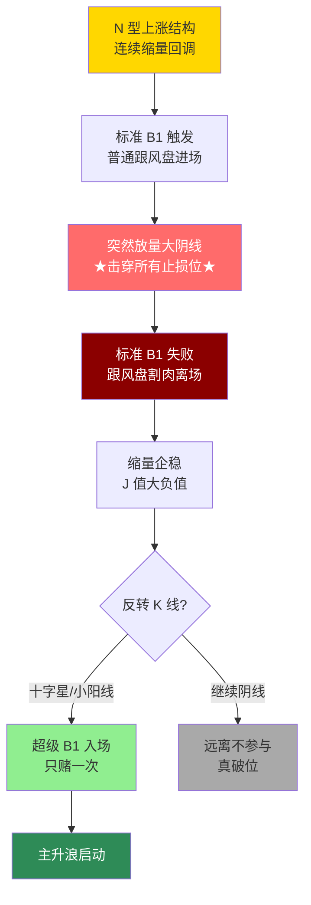

# 特殊买点与止损后重新入场

> [!info] 阅读口径
> 本篇上半部按交易流程综合整理；下半部完整保留归属本篇的原库条目正文，并保留原有数值、例外与冲突。原库表述属于特定方法论；其中收益、胜率、历史案例及市场判断未经本次独立核验。综合编排不是Z哥原话。跨条目冲突统一见 [[19-规则冲突与知识缺口]]。

## 这些战法属于主流程的条件分支

错过B1、B1止损或强势股剧烈洗盘，不意味着一定要追回。特殊买点仍须满足环境、趋势、确认和新的失效位；旧交易失败后，重新入场是新的一笔交易。

| 分支 | 原库前提 | 确认方式 | 失败应对 |
|---|---|---|---|
| 超级B1 | 原先N型上涨，极致缩量后放量破位，再次缩量企稳 | J大负值，等待反转K或小十字星 | 只尝试一次，破新设低点退出 |
| SB1假摔 | 先有B1，后有破位诱空 | 跌破前低后次日强势放量反包，三项同时满足 | 关键K低点破位退出，不补仓摊薄 |
| 补票/深V | 连续上涨的强势股，中途洗盘 | 副图机构高、散户低，并已出现收回确认 | 不按期爆发退出，原库约-2%为止损口径 |
| 单针下20 | 强趋势而非长期下跌 | 红线>80、白线<20，深V/双V等 | 次日无预期爆发离场 |
| 单针下30 | 单针20迭代语境 | 红线>85、白线<30 | 一击不中按超短纪律退出 |
| 对称VA | 前期关键K附近存在可识别对称 | 与B1或专用副图重合更受重视 | 对称结构破坏则止损 |

## 止损后的重新入场顺序

先完成旧策略要求的止损，记录旧低点和失败原因。随后观察是否形成新企稳、强势收复和放量反包；出现新确认时重新评估择时、空间与风险，再决定是否形成新的计划。只有下跌、没有收回，不构成假摔确认。

超级B1原库明确“先服从纪律止损，才有资格再上车”。不能事先断定所有破位都会变成超级B1，也不能为了等它出现而跳过标准B1的退出。

## SB1的冲突必须单独处理

SB1页同时要求“破关键K低点立刻止损”和“止损位只下移不上移”，并试图用等待假摔与持仓阶段不同解释；七层应对则建议直接放弃SB1。这些文字不能无条件整合成稳定、统一的执行办法。

本次保留SB1全部原库正文，但流程综合不将“下移止损”设为默认动作。基于防守优先与先止损后重入的规则推断：旧持仓的硬止损不因怀疑洗盘而放宽；若研究SB1，应将其作为另行定义和验证的独立分支。原库没有提供下移幅度、次数及持仓约束的完整规则。

## 补票的指标不能混用

补票的红线/白线是资金副图，不是价格趋势白线/黄线，也不是MACD的DIF/DEA。没有对应指标定义和数据，就只能理解形态逻辑，不能声称数值达标。

补票原库给过胜率约40%、风险收益约1:3、盈利3%以上减半、余仓参考BBI；这些都是该策略的原库口径，本次未进行回测。它要求极强趋势的短暂停顿，不能推广为下跌股长下影线通用买入法。

## 转折点与能力边界

转折点心法强调只赚从回撤到爆发的一段，先设离场点，不能超短被套后改成长期投资。它和“每周最多两枪”的低频纪律并非统一交易频率；应明确自己研究的具体策略，不把“高频止损换低频大赚”误读为必须频繁下单。

## 原库理论详解

以下按原库概念页保留正文；仅调整标题层级、内部链接和来源展示，不把整理者的结论升级为已验证事实。

### 原库条目：超级B1

原概念页：/Users/nanan/Documents/ChatGPT/Z哥知识库/references/超级B1.md  
原页更新时间：2026-04-18。来源路径是追溯线索，本Skill未附这些路径对应的原文。

#### 定义

> [!abstract] 一句话定义
> 超级 B1 是 B1 战法的**高级形态** — N 型上涨中缩量回调到极致后,突然放量下跌击穿所有止损位,再继续缩量企稳且 J 值大负值。这是**主升浪启动前的终极洗盘**。

#### 关键信息
- **核心逻辑**:通过空间和时间双重折磨,逼迫所有跟风盘离场,清空不坚定筹码
- **形态特征**:
  1. N 型上涨结构中连续缩量回调
  2. 突然出现放量破位大阴线(击穿止损位)
  3. 继续缩量企稳,J 值出现大负值
  4. 可能伴随反转小十字星确认
- **只赌一次**:不可重复博弈,以放量下跌 K 线最低点或更前 N 型低点为止损
- **破位阴线不急着进**:等反转 K 线(小十字星)确认 N 型底部
- **止损必须坚决**:越是"超级"的 B1,越考验严格止损能力
- **心理层面**:让所有按标准 B1 买入的投资者怀疑人生,只有理解主力意图的资金才能坚持

#### 超级 B1 极致洗盘流程图

> [!danger] 超级 B1 心理铁律
> 超级 B1 = **让所有按标准 B1 买入的人怀疑人生** — 主力故意击穿止损位制造恐慌。如果你拿不住前一波的标准 B1 止损,就别想吃到超级 B1 这口肉。**先服从纪律止损,才有资格再上车。**

#### 关联连接
- [[06-B1入场与建仓波鉴别#原库条目：B1建仓波|B1建仓波]] — 超级B1的基础形态
- [[04-趋势结构与量价工具#原库条目：呼吸结构|呼吸结构]] — 超级B1的量价前提
- [[17-心理防守与概率认知#原库条目：交易心理|交易心理]] — 极致洗盘的心理博弈
- [[16-筹码资金与板块轮动解释#原库条目：筹码战争|筹码战争]] — 收集筹码的终极手段

### 原库条目：SB1假摔战法

原概念页：/Users/nanan/Documents/ChatGPT/Z哥知识库/references/SB1假摔战法.md  
原页更新时间：2026-04-26。来源路径是追溯线索，本Skill未附这些路径对应的原文。

#### 定义

> [!abstract] 一句话核心定义
> SB1 假摔战法是 [[06-B1入场与建仓波鉴别#原库条目：B1建仓波|B1建仓波]] 的反向博弈版——核心逻辑是"主力诱空假摔后反手买入",由 Z 哥在 5.1 章节首讲;战法骨架是**止损三铁律 + 假摔识别 + 反手买点**三件套。

#### 关键信息

##### B1 vs SB1 的反向关系
- **B1 建仓波**:看突破 / 看拐点,正向博弈,买的是"主力开始建仓"的信号
- **SB1 假摔**:看假摔 / 看诱空,反向博弈,买的是"主力洗盘洗完了"的信号

两者共用同一套关键 K 识别框架,但出手的逻辑完全镜像。

> [!tip] 实操要点
> - SB1 不抄底:它要求**先有 B1 形态、再有假摔、最后才反手**,绝非看到深跌就抄
> - 假摔后的反包必须放量,缩量反包大概率是反弹而非反转
> - 重入仓位上限不超过原 B1 计划仓位

##### 止损三铁律(战法核心)

> [!danger] 风控铁律(本战法心脏)
> 1. **跌破关键 K 低点立即止损**——无条件、无理由、不许找借口
> 2. **不补仓不摊薄**——补仓是赌徒思维,SB1 战法严禁
> 3. **止损位只下移不上移**——这条与 [[10-盘中执行与止损计划#原库条目：嘀嘀战法|嘀嘀战法]] 反向!目的是**防被假摔骗下车**

注意第 3 条与嘀嘀战法的方向**相反**:嘀嘀战法止损位只上移(锁利),SB1 止损位只下移(防洗)。这是因为 SB1 在博弈"假摔"本身,必须给主力留出充分的洗盘空间。

##### 假摔识别
判定一次下跌是"假摔"而非"真破"的关键信号:
1. **跌破前低**:先有标准的破位动作(诱空)
2. **次日强势反包**:K 线收复前低、阳包阴
3. **反包伴随放量**:量能放大,确认主力承接而非散户抢反弹

三条同时成立,才能进入反手买点判断。

##### 反手买点
确认假摔后,在**反包关键 K 高点附近**重入,而非追当日大阳。重入后的仓位管理切换到 [[10-盘中执行与止损计划#原库条目：嘀嘀战法|嘀嘀战法]] 标准流程——以反包关键 K 低点为新止损位滚动管理。

> [!info] SB1 是一次"高级别 B1":主力洗完盘后的二次启动,胜率显著高于第一次 B1。

#### 知识冲突

> [!caution] 与 [[10-盘中执行与止损计划#原库条目：嘀嘀战法|嘀嘀战法]] 的差异
> 嘀嘀战法的止损位**只上移**(锁利,防回撤),SB1 战法止损位**只下移**(防洗,等假摔走完)。两者方向反向是有意为之——嘀嘀管的是"持仓阶段",SB1 管的是"等假摔阶段",阶段不同,规则相反。混用会导致被洗下车或拒绝止损双重灾难。

#### 关联连接
- [[06-B1入场与建仓波鉴别#原库条目：B1建仓波|B1建仓波]]
- [[04-趋势结构与量价工具#原库条目：关键K|关键K]]
- [[10-盘中执行与止损计划#原库条目：嘀嘀战法|嘀嘀战法]]
- [[04-趋势结构与量价工具#原库条目：白线黄线系统|白线黄线系统]]
- [[13-放飞止盈与破位退出#原库条目：半仓放飞策略|半仓放飞策略]]
- [[20-知识来源与理论适用边界#原库条目：Zettaranc|Zettaranc]]

### 原库条目：补票战法

原概念页：/Users/nanan/Documents/ChatGPT/Z哥知识库/references/补票战法.md  
原页更新时间：2026-04-26。来源路径是追溯线索，本Skill未附这些路径对应的原文。

原页标注的来源线索

- raw/01-zettaranc/知行小菜鸟/[202601060042]12错过起涨点只能踏空聊聊如何在趋势中途安全补票.md

#### 定义

> [!abstract] 一句话定义
> 补票战法(俗称**深 V 战法**)是专门针对**强势股中途洗盘**的超短线策略 — 利用机构与散户的资金分歧,在"列车"短暂减速时安全上车。**低胜率(40%)、高赔率(1:3)** 的典型代表。

> [!warning] 胜率提醒
> 补票战法的胜率不高（约40%），但盈亏比高达1:3甚至更高，是典型的"低胜率、高赔率"策略。

#### 核心逻辑：资金行为学博弈

强势股上涨途中，主力为了减轻拉升阻力必然进行**洗盘**——把意志不坚定的获利盘清洗出去，同时吸纳新筹码抬高市场平均成本。

盘面表现为**股价剧烈波动**（单日大跌、深V反转），但资金面呈现**极度背离**：
- **机构（红线）**：岿然不动，控盘度维持在高位（>80）
- **散户（白线）**：极度恐慌，持仓意愿降至冰点（<20）

这种"红线不掉，白线暴跌"的背离形态就是完美的"机构洗盘、散户割肉"。

#### 实操拆解

##### 选股标准
1. **趋势向上**：N型结构连续上升通道，或BBI趋势线明确向上
2. **资金背离**：机构资金线 > 60（最好 > 80），散户线 < 20
3. **形态特征**：K线图长下影线、单日急跌后快速收回（深V），或连续两日下探回升（双V/W底）

##### 入场时机
- **前夜功课**：复盘选出"机构高控盘(>80)但散户情绪冰点(<20)"且形态收回的票
- **次日出击**：第二天早盘集合竞价或开盘时果断买入
- **不在下跌途中徒手接飞刀**，最稳健的入场点是**确认洗盘结束的时间**

##### 卖出策略（"一日游"心态）
- **不涨即错**：买入后当天或次日必须上涨，没有预期拉升甚至低开低走 → 立即离场
- **止损**：-2%左右，博弈洗盘后的拉升不应再给深跌空间
- **止盈**：脱离成本线3%以上可减仓一半，剩下一半参考BBI趋势线持有

#### 数学基础

| 输的时候 | 赢的时候 |
|---------|---------|
| 超短线 + 严格止损，微亏1%-2% | 主升浪加速段，6%-10%甚至涨停 |
| 高频周转，本周止损三次 | 抓到一个"深V"大涨净值曲线依然向上 |

#### 心法

- **对趋势的信仰**：相信机构既然重仓控盘（红线高企），就不会轻易让趋势终结
- **对人性的收割**：利用散户恐慌（白线触底），在他们交出带血筹码的那一刻从容进场
- **渣男心态**：既然是"补票"说明已错过最佳VIP座位，不要谈恋爱，保持超短线心态

#### 关联连接

- [[10-盘中执行与止损计划#原库条目：少妇战法|少妇战法]] — 少妇战法是基础框架，补票战法是趋势中途的上车工具
- [[08-特殊买点与止损后重新入场#原库条目：单针下20|单针下20]] — 补票战法的核心信号触发条件（红线>80白线<20）
- [[08-特殊买点与止损后重新入场#原库条目：单针下30|单针下30]] — 补票战法升级版，适配量化资金（红线>85白线<30）
- [[17-心理防守与概率认知#原库条目：盈亏比与胜率|盈亏比与胜率]] — 补票战法低胜率(40%)高赔率(1:3)的数学基础
- [[04-趋势结构与量价工具#原库条目：N型结构|N型结构]] — 选股标准：必须处于N型连续上升通道

### 原库条目：单针下20

原概念页：/Users/nanan/Documents/ChatGPT/Z哥知识库/references/单针下20.md  
原页更新时间：2026-04-18。来源路径是追溯线索，本Skill未附这些路径对应的原文。

#### 定义

> [!abstract] 一句话定义
> 单针下 20 是专门解决错过 B1 后**重新上车问题**的超短线策略(补票战法) — 通过红线(主力控盘)>80 + 白线(散户浮筹)<20 监控主力洗盘状态。心法:**散户不走,机构绝壁不拉**。

#### 关键信息
- **核心逻辑**：捕捉主力洗盘后的短期反弹机会，"散户不走，机构绝壁不拉"
- **信号标准**：红线（主力）>80，白线（散户）<20
- **经典形态**：
  - 深V形态（单针）：1-2天快速下跌后迅速收回，下跌缩量、收回放量
  - 双V形态（W形态）：两次洗盘，更彻底清洗散户筹码
  - 多叉戟形态：多次洗盘
- **适用场景**：只适用于连续上涨的强势股，是典型的右侧交易
- **执行**：激进派尾盘确认信号介入，稳健派次日早盘观察
- **预期管理**：短线重仓策略，买入后第二天没有预期爆发必须离场
- **迭代**：因量化资金介入，标准已迭代为"单针下30"（红线>85，白线<30）

#### 关联连接
- [[08-特殊买点与止损后重新入场#原库条目：单针下30|单针下30]] — 单针策略的迭代版
- [[06-B1入场与建仓波鉴别#原库条目：B1建仓波|B1建仓波]] — 主要买点的补票替代方案
- [[04-趋势结构与量价工具#原库条目：呼吸结构|呼吸结构]] — 洗盘的量价节奏
- [[12-持股评分与洗盘应对#原库条目：去弱留强|去弱留强]] — 不涨就走人的纪律

### 原库条目：单针下30

原概念页：/Users/nanan/Documents/ChatGPT/Z哥知识库/references/单针下30.md  
原页更新时间：2026-04-18。来源路径是追溯线索，本Skill未附这些路径对应的原文。

#### 定义

> [!abstract] 一句话定义
> 单针下 30 是单针下 20 的**实战迭代版** — 因量化资金广泛介入导致市场微观结构变化,将阈值上移(红线>85,白线<30)以适应新时代的流动性填充。**舍弃部分低位空间,换取更高确定性**。

#### 关键信息
- **新版标准**：红线（主力控盘）>85，白线（散户浮筹）<30
- **调整原因**：
  1. 约8000亿量化资金每天提供流动性，股价难出现极端"真空状态"
  2. 内卷导致抢跑资金在指标达成前介入，抬高底部阈值
- **策略定位**："舍弃部分低位空间，换取更高确定性与入场频次"
- **适用**：极强趋势中的短暂停歇，给已启动列车"补票"上车
- **纪律**：要么大肉要么走人，一击不中全身而退

#### 关联连接
- [[08-特殊买点与止损后重新入场#原库条目：单针下20|单针下20]] — 单针策略的原始版
- [[10-盘中执行与止损计划#原库条目：量比战法|量比战法]] — 盘中动态识别资金
- [[04-趋势结构与量价工具#原库条目：呼吸结构|呼吸结构]] — 主升浪中的洗盘节奏

### 原库条目：对称VA战法

原概念页：/Users/nanan/Documents/ChatGPT/Z哥知识库/references/对称VA战法.md  
原页更新时间：2026-04-26。来源路径是追溯线索，本Skill未附这些路径对应的原文。

#### 定义

> [!abstract] 一句话定义
> 对称 VA 战法是基于价格图形的**对称性原理**判断买卖点的技术分析方法 — 通过识别历史图形中的对称结构来预测未来的价格走向,与 B1 信号重合时确定性最高。

#### 关键信息
- **核心原理**：市场走势在关键K线附近往往呈现对称形态
- **应用场景**：通过前期关键K的对称位置预判支撑/压力位
- **与B1结合**：对称位置与B1信号重合时确定性更高
- **风控**：对称结构被打破时必须止损

#### 知识冲突:与"进阶对称战法纯理论"的差异

> [!caution] 纯理论版 vs 实战版(VA)
> Z 哥在 2025-11-19 文章中区分了两种对称战法:
> - **纯理论版**(进阶对称战法):受杨振宁"对称性支配相互作用"启发的抽象理论模型,作为"抛砖引玉"的思想实验
> - **实战版**(本页面 VA 战法):以单针下20/单针下30 为基础的可执行交易模型
> 老粉学 VA 即可,进阶者可阅读纯理论版作为思想拓展。两者不矛盾,适用场景不同。
> 出处:[202511190036]进阶对称战法纯理论

#### 关联连接
- [[06-B1入场与建仓波鉴别#原库条目：B1建仓波|B1建仓波]] — 对称位置与B1重合增强确定性
- [[01-交易闭环与策略边界#原库条目：框架式交易|框架式交易]] — 基于对称图形的规则执行
- [[16-筹码资金与板块轮动解释#原库条目：筹码战争|筹码战争]] — 对称位置是筹码博弈的关键区

### 原库条目：转折点战法

原概念页：/Users/nanan/Documents/ChatGPT/Z哥知识库/references/转折点战法.md  
原页更新时间：2026-04-26。来源路径是追溯线索，本Skill未附这些路径对应的原文。

#### 定义

> [!abstract] 一句话定义
> 转折点战法是 Z 哥 2026 新春特辑提出的**超短线核心心法**——只赚趋势转折点的钱，用爆发力吃掉最肥的一段。目标是让小资金（2-10 万）做到 100 万。

#### 六大散户致命误区

| 误区 | 表现 | 正确做法 |
|------|------|---------|
| **1. 周期模糊** | 天天说"短线"但不定义 | 只有**波段**和**超短线**，不存在模糊的短线 |
| **2. 无依据入场** | 凭感觉/消息/追涨停买 | 必须有明确的入场信号(B1/B2/砖形图) |
| **3. 不预设离场点** | 买了才想什么时候走 | 买入时止损位同时确定 |
| **4. 迷信强者恒强** | 追高涨停板 | 十次追高九次崩 |
| **5. 永远满仓** | 一把梭哈无风控 | 配置！永远不满仓一只票 |
| **6. 套住装死** | 短线做成长线 | 错了就走，绝不扛单 |

#### 超短线 vs 波段的铁律定义

- **波段**：只做对应级别 N 型结构上涨的波段，市场给多少吃多少
- **超短线**：快进快出，**市场没有证明你是对的，你就是错的，立刻认错离场**

#### 核心心法：只赚转折点的钱

- 不追已经涨起来的票，只等在**转折点**爆发的那一刻介入
- 转折点的本质：从下跌/横盘→爆发的切换瞬间
- 用爆发力赚钱，用纪律守命
- 小资金做大的唯一路径：**高频止损换低频大赚**

#### 与体系的关系

- 与 [[06-B1入场与建仓波鉴别#原库条目：B1建仓波|B1建仓波]] 的关系：B1 就是转折点的一种具体形态
- 与 [[05-MACD与砖形图共振#原库条目：四块砖交易体系|四块砖交易体系]] 的关系：转折点战法用砖形图确认转折后的爆发力
- 与 超短线交易（原库未附独立条目） 的关系：转折点是超短线的选股框架
- 与 [[17-心理防守与概率认知#原库条目：交易心理|交易心理]] 的关系：克服追高心理，等转折点耐心

#### 关联连接

- [[06-B1入场与建仓波鉴别#原库条目：B1建仓波|B1建仓波]] — 转折点的具体形态之一
- [[05-MACD与砖形图共振#原库条目：四块砖交易体系|四块砖交易体系]] — 转折后的持股与止盈框架
- [[17-心理防守与概率认知#原库条目：交易心理|交易心理]] — 克服追高/扛单的心理误区
- [[04-趋势结构与量价工具#原库条目：N型结构|N型结构]] — 转折点的结构基础
- [[10-盘中执行与止损计划#原库条目：少妇战法|少妇战法]] — 超短线的 SOP 执行框架
- [[20-知识来源与理论适用边界#原库条目：Zettaranc|Zettaranc]] — 体系作者
