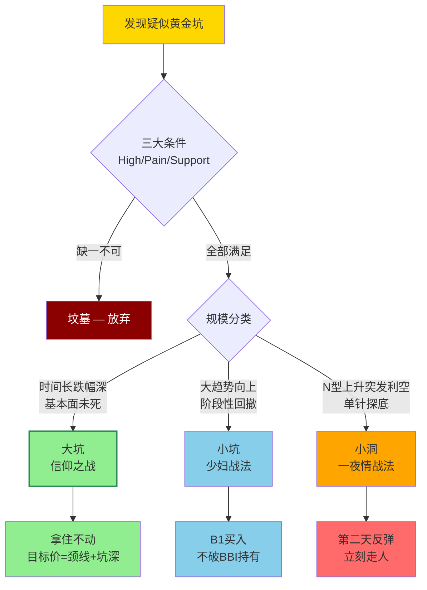

# 坑口结构与目标价边界

> [!info] 阅读口径
> 本篇上半部按交易流程综合整理；下半部完整保留归属本篇的原库条目正文，并保留原有数值、例外与冲突。原库表述属于特定方法论；其中收益、胜率、历史案例及市场判断未经本次独立核验。综合编排不是Z哥原话。跨条目冲突统一见 [[19-规则冲突与知识缺口]]。

## 黄金坑首先要求已出现企稳和填坑证据

原库把黄金坑理解为筹码换手过程，要求有历史高点、有充分回撤、有企稳迹象。只因跌得多、价格低，不构成黄金坑。高低点仍不断降低、基本面看不懂、不在当前有持续性的方向，属于原库反复排除的假坑。

| 类型 | 结构与前提 | 原库方法 | 持有边界 |
|---|---|---|---|
| 大坑 | 历史回撤长且深，长期逻辑未破，已开始填坑 | 突破颈线后观察分批布局 | 不能仅凭“信仰”否认逻辑破坏 |
| 小坑 | 大趋势向上，阶段性回调，不破关键低点 | 等B1、观察BBI与前高 | 波段边界适用，破线或到位按策略处理 |
| 小洞 | 上涨N型中突发冲击，单针深探后收回 | 原库定位一根K线的超短博弈 | 次日反弹即处理，不改成长线 |

## 可研究的三种进场结构

大坑套中坑，已先填完中坑，回撤不破前低；填大坑过程中持续底高顶高，每次回踩保持N型；突破坑沿后缩量回踩确认，叠加B1或假摔后快速收回。三种都要求先有“填”的动作，不是在无底洞里不断补仓。

横盘企稳强调不再创新低、等突破或B1；爬山坡企稳强调高低点已抬高、再等回调。局部盘整可以是上涨结构中的压缩，不能与整个品种长期无序横盘混同。

## 目标价公式怎么使用

原库第一目标价为“坑沿＋坑深”，即（坑沿－坑底）＋坑沿。第二目标价在极强走势下再加一个坑深。

例如坑沿100、坑底20，坑深80，则第一目标180。这是原库方法示例，不是价格一定会到180的推导。目标价不覆盖止损，不能为了等目标价而无视S1、关键低点失守或长期逻辑变化。

原库写过目标附近约5%的弹性、到目标后强势可再观察、弱势或背离则处理；也写过出坑回踩90%等经验比例。未附样本，这些数值只能作为原库叙述，不能当核验过的到达概率或保证。

## 遇到回踩跌破坑沿

先区分仅跌破坑沿与触及本策略硬止损；观察量能、能否迅速收回、原N型低点和趋势是否仍在。原库允许部分假摔回踩，但没有授权所有持仓对所有破位无限忍耐。破关键支撑即按原计划处理；重入按 [[08-特殊买点与止损后重新入场]] 重新确认。

“大坑拿住”与“小洞次日就走”不能混用，坑的类型必须在入场前定义。

## 原库理论详解

以下按原库概念页保留正文；仅调整标题层级、内部链接和来源展示，不把整理者的结论升级为已验证事实。

### 原库条目：坑口战法

原概念页：/Users/nanan/Documents/ChatGPT/Z哥知识库/references/坑口战法.md  
原页更新时间：2026-04-18。来源路径是追溯线索，本Skill未附这些路径对应的原文。

#### 定义

> [!abstract] 一句话定义
> 坑口战法是基于"**挖坑-填坑**"过程的波段交易方法 — 核心是识别真正的黄金坑,避免假坑(坟墓),并通过公式 **(颈线-坑底)+颈线 = 目标价** 计算主力拉升空间。**选对坑比努力填坑更重要**。

#### 关键信息
- **三种假坑不能做**：
  1. 没有开始"填坑"的无底洞（高点低点都在降低）
  2. 基本面完全不了解的盲盒
  3. 不属于当前主线题材的"孤魂野鬼"
- **三种完美进场模式**：
  1. 大坑套中坑，已填完中型坑，回调不破前低
  2. 填大坑过程中N型结构完美，每次回踩不破前低
  3. 机构共识主线，突破坑沿后的回踩确认（经典B1买点）
- **主力目标价计算公式**：(颈线位价格 - 坑底价格) + 颈线位价格 = 目标价
- **破位与假摔**：看似恐怖的破位往往是最后上车机会，关键看缩量和位置
- **交易审美**：选对坑比努力填坑更重要，线之内随机漫步，线之外雷霆一击

#### 关联连接
- [[06-B1入场与建仓波鉴别#原库条目：B1建仓波|B1建仓波]] — 坑口回踩确认的经典买点
- [[10-盘中执行与止损计划#原库条目：少妇战法|少妇战法]] — 永不套牢的基础心法
- [[16-筹码资金与板块轮动解释#原库条目：筹码战争|筹码战争]] — 坑底是筹码收集区
- [[06-B1入场与建仓波鉴别#原库条目：娜娜图|娜娜图]] — 极品建仓形态之一

### 原库条目：黄金坑三大分类

原概念页：/Users/nanan/Documents/ChatGPT/Z哥知识库/references/黄金坑三大分类.md  
原页更新时间：2026-06-03。来源路径是追溯线索，本Skill未附这些路径对应的原文。

原页标注的来源线索

- raw/01-zettaranc/知行小菜鸟/[202601062247]131如何在遍地哀嚎的黄金坑里挖出翻倍的财富.md
- raw/01-zettaranc/知行小菜鸟/[202601062315]132深度解析坑口战法与主力目标价计算公式.md
- raw/01-zettaranc/大富翁小菜鸟/[202510110709]温故知新目标价咋算就靠这祖宗之法.md
- raw/01-zettaranc/大富翁小菜鸟/[202511012358]温故知新聊聊填坑出坑那点事儿从赚小钱到赚大钱的底层逻辑.md

#### 定义

> [!abstract] 一句话定义
> 黄金坑不是单纯下跌,而是**筹码彻底换手的过程**。真正的黄金坑必须满足**三大条件**:有前史(High) + 有惨烈(Pain) + 有企稳(Support)。按规模分为**大坑(信仰之战) / 小坑(少妇战法) / 小洞(一夜情战法)** 三类。

黄金坑不是单纯的下跌，而是筹码彻底换手的过程。**真正的黄金坑必须满足三个条件**：
1. **有前史（High）**：曾经辉煌过，有明确的历史高点
2. **有惨烈（Pain）**：经历长时间大幅下跌，到让人"屁滚尿流"绝望离场的程度
3. **有企稳（Support）**：不再创新低，开始横盘或温和走势

> [!caution] 哪些"坑"是万丈深渊
> 不是所有低位都叫"坑"，有的叫"坟墓"。三类绝对不能碰：
> 1. 没有填完"中型坑"的（一路下跌连像样反弹都没有）
> 2. 看不懂基本面的盲盒（不知道靠什么翻身）
> 3. 不属于当前主线题材的"孤魂野鬼"

#### 第一类：大坑 —— 信仰之战，赚大钱

| 维度 | 描述 |
|------|------|
| **形态特征** | 时间跨度极长（如当年的白酒、李宁），跌幅巨大（腰斩再腰斩），基本面逻辑未死 |
| **策略** | **拿住不动** |
| **核心逻辑** | 确认主力开始填坑（突破关键颈线位）后，把自己当成"傻瓜"，中间震荡洗盘假破位统统不看 |
| **目标价计算** | **第一目标价 = (坑沿价格 - 坑底最低价) + 坑沿价格** |

> [!tip] 目标价计算公式（"祖宗之法"）
> 坑沿 = 颈线位/起跌点/长期盘整箱体顶部
> 坑底 = 坑里被砸出来的最低价
> 
> 案例：坑沿100元，坑底20元 → 第一目标价 = (100-20)+100 = **180元**
> 
> 逻辑：主力费了几年时间收集筹码，不做出一倍左右空间覆盖不了资金成本和时间成本

#### 第二类：小坑 —— 少妇战法，赚波段

| 维度 | 描述 |
|------|------|
| **形态特征** | 大趋势向上过程中的阶段性回撤，有阶段高点，回调后企稳，不破前期关键低点 |
| **策略** | **填坑战法**（少妇战法） |
| **买入** | 等KDJ大负值出现B1买点（第一根确立的阳线）时进场 |
| **持有** | 不跌破BBI线就一直拿着 |
| **卖出** | 填满小坑（到达前高）或跌破趋势线时果断减仓/清仓 |

#### 第三类：小洞 —— 虎口夺食，赚"碎银子"

| 维度 | 描述 |
|------|------|
| **形态特征** | **黑天鹅下的"单针探底"**——连续N型上升途中突发利空直线下杀收长下影线 |
| **底层逻辑** | 主力正在拉升途中被突发利空措手不及，主力也被套在里面了，为了自救会有报复性反弹 |
| **策略** | **一夜情战法（只做一根）** |
| **买入** | 看到"单针"果断进场，蹭主力自救的车 |
| **卖出** | 第二天反弹或冲高**立刻走人**，不要产生感情 |

#### 目标价计算实战（祖宗之法详解）

> [!tip] 核心公式
> **第一目标价 = 坑沿 - 坑底 + 坑沿**
> **第二目标价 = 第一目标价 + 坑深**（盘面极强时参考）

##### 实战案例

| 标的 | 坑沿 | 坑底 | 坑深 | 第一目标价 | 实际走势 | 类型 |
|------|------|------|------|-----------|---------|------|
| 米儿 | 36 | 8.28 | 27.72 | 63.72 | 涨到59.45 | 大坑 |
| 新前锋 | 26 | 15 | 11 | 37 | 涨到37.2 | 小坑 |
| 李宁 | 30 | 2.79 | 27.21 | 57.21 | 涨到27（10倍） | 大坑 |

> [!danger] 注意事项
> - 目标价是"第一目标"不是"唯一目标"，差5%以内都正常（艺术成分）
> - 到目标价后盘面还强（放量冲高、不破BBI）可多拿两天冲第二目标
> - 到目标价就缩量/背离 → 直接卖，别贪

#### 企稳信号：横盘 vs 爬山坡

没企稳的坑不是坑，是"万丈深渊"。企稳的两种形态：

1. **横盘企稳**：跌下来后不再创新低，低点逐步抬高，在区间内震荡 → 等突破横盘区间或出B1再动手
2. **爬山坡企稳**：跌下来后慢慢反弹，高点逐步抬高、低点也逐步抬高 → 等爬一段后回调出B1再进，别追在半山腰

> [!tip] 口诀
> "太阳出来我爬山坡，爬到山坡再唱歌" — 主力建仓需要时间，别跟主力抢筹码

#### 回踩的独家思考

出坑后90%的情况会回踩甚至跌破颈线位。这是**最完美的买点**——主力回踩确认30%-50%幅度的跟风盘是否已洗干净。

- 回踩缩量 + 不破关键支撑 = **"千金难买回马枪"**
- **补票机会**：突破坑沿后回调踩坑沿不破 → 最后上车机会（如米儿突破36后回踩36.05）

#### 分类打法总结

| 坑类型 | 仓位策略 | 持仓周期 | 核心依赖 |
|--------|---------|---------|---------|
| 大坑 | 分批建仓（20%→20%→20%=60%） | 3-5年 | 信仰+基本面 |
| 小坑 | 少妇战法（10%-20%仓位） | 1-2月 | 纪律+技术面 |
| 小洞 | 快进快出（一根K线） | 1天 | 盘感+手速 |

#### 三种完美进场图形

1. **大坑套中坑，且已填完中型坑**：填完坑后回调不破前低，第三次向下破位时往往是诱空绝佳买点
2. **填大坑过程中N型结构完美**：每次回踩低点不破前一波低点，中间波动都是噪音
3. **机构共识主线出坑后的"回踩确认"**：突破颈线位后回踩不破或假摔迅速收回+量能极度萎缩 = B1买点

#### 三类坑分流决策

#### 关联连接

- [[09-坑口结构与目标价边界#原库条目：坑口战法|坑口战法]] — 坑口战法是黄金坑体系的实战应用，含目标价精确计算
- [[16-筹码资金与板块轮动解释#原库条目：筹码战争|筹码战争]] — 黄金坑的本质是筹码彻底换手的过程
- [[10-盘中执行与止损计划#原库条目：少妇战法|少妇战法]] — 小坑（波段）的核心操作框架
- [[08-特殊买点与止损后重新入场#原库条目：补票战法|补票战法]] — 出坑后回踩坑沿的补票机会
- [[15-长线底仓与牛市ETF管理#原库条目：牛市策略|牛市策略]] — 大坑信仰之战需要牛市环境和持仓耐心
- [[17-心理防守与概率认知#原库条目：周期与人性|周期与人性]] — 坑的本质就是周期的底部区域
- [[04-趋势结构与量价工具#原库条目：N型结构|N型结构]] — 小坑判断的核心技术形态
- [[06-B1入场与建仓波鉴别#原库条目：B1建仓波|B1建仓波]] — 坑底企稳后的进场信号
