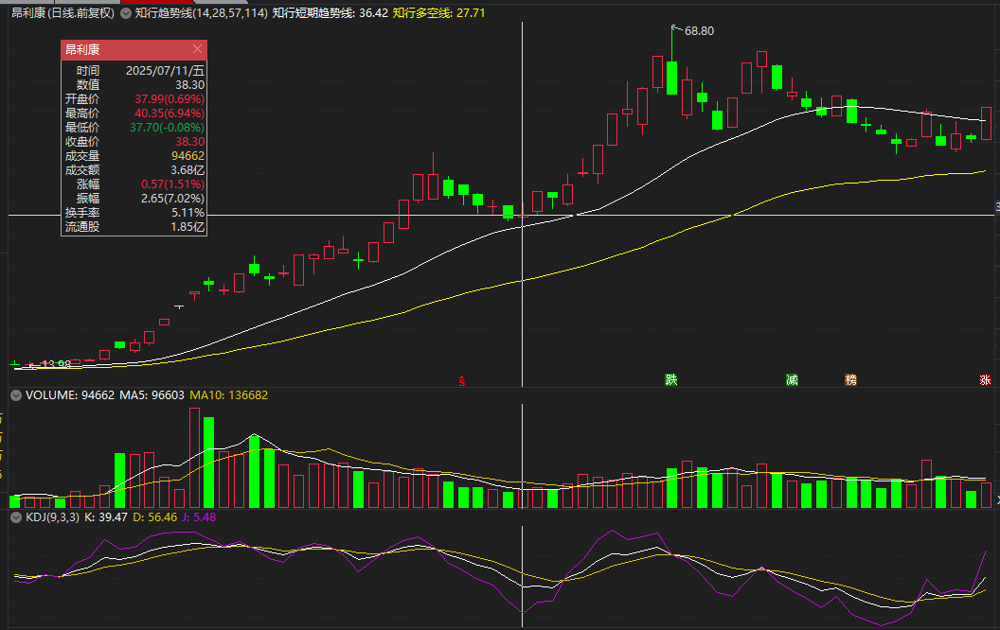
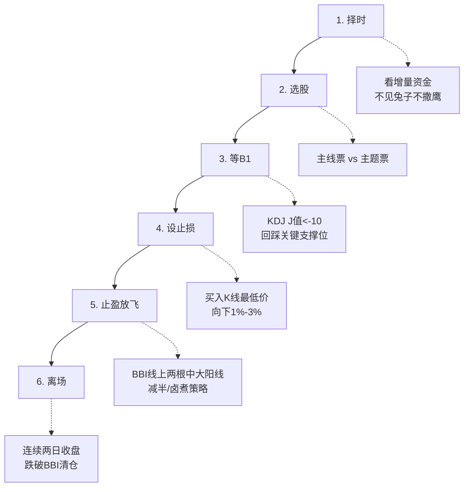
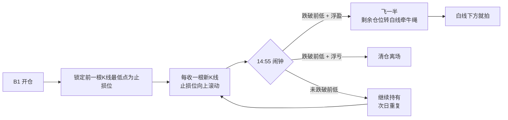

# 盘中执行与止损计划

> [!info] 阅读口径
> 本篇上半部按交易流程综合整理；下半部完整保留归属本篇的原库条目正文，并保留原有数值、例外与冲突。原库表述属于特定方法论；其中收益、胜率、历史案例及市场判断未经本次独立核验。综合编排不是Z哥原话。跨条目冲突统一见 [[19-规则冲突与知识缺口]]。

## 下单前形成一张完整的交易计划

至少写清：环境及指标周期、候选入池理由、当前信号及版本、触发入场的条件、失效价格、时间验证点、计划仓位、盈利后的放飞条件、余仓跟踪规则。任何一项不能说明，说明计划还未完成。

这张计划是对原库规则的综合整理，没有新增固定仓位或收益目标。价格止损、时间止损与减仓条件是不同约束，不能只写一个亏损百分比。

## 少妇战法六步

择时看增量资金；选股分主线和主题；等严格B1（J<-10并回踩关键位置）；设买入K线低点下1%—3%的止损口径；BBI上两根中大阳后减半；连续两日收盘跌破BBI离场。

“连续两日收盘破BBI”是这套波段退出条件，不代表入场时的价格硬止损也必须等两天。时间纪律“每周最多两枪”同样属于该策略，不能与超短轮动频率随意互换。

## 量比战法只用于已选好的池子

| 开盘状态 | 原库应对口径 | 本次整理保留的边界 |
|---|---|---|
| 量比<10 | 等回调，当天不抱爆发期待 | 不是仅因量比小就证明图形失败 |
| 量比>20且高开或红盘 | 认为资金急迫，优先关注 | 不能覆盖高开过多不追、位置过高等禁区 |
| 量比>10且小幅低开，原文写低开>-2% | 择机观察 | 原文“可能熄火”含义不清，不据此自动买入 |
| 量比10—20 | 稳一手，贴均线或等分时确认 | 等待确认不等于必须成交 |
| 量比快速上升 | 原库强调及时识别 | 仍不能跳过趋势、价格和风险条件 |

量比是时点敏感指标，原库未统一观测分钟和全部计算细节。开盘量比阈值不能与全天放量1.5、倍量2等混为一谈；缺对应数据时只能形成条件式计划。

## 嘀嘀动态止损怎么滚动

原库将B1持有期的前一根K线低点作为滚动参考，止损只上移、不下移。基于这条规则推断，若新一根K的低点更低，就保留旧止损，不能机械跟着降低。14:55闹钟版本在尾盘检查：跌破参考位且浮盈则减半，浮亏则退出；未破则继续。

爆发后减半，余仓转白线跟踪。这是管理阶段改变：从刚建仓的短线验证转入已有利润垫的趋势跟踪。必须记录切换，不在亏损时临时声称已经进入“拿住趋势”阶段。

<!-- web-images-2026-10-20-白线止损计划-start -->
## 对应形态的历史图例

> [!note] 网络图例的阅读范围
> 以下图片来自[笔记在线：《Z哥_需要反复背诵的十张完美图形》](https://www.noteol.com/xuexi/ZG_wanmeituxing.html)，页面署名“管理员”，属于二级学习整理；截图的原始制作者未独立核实。图片按原文件本地保存，下载日期为2026-10-20。图中带有后续走势，只用于辨认结构；不据事后上涨确认信号必胜，也不以图文中的宽松口径覆盖本笔记规则。

### 把白线跟踪条件写在买前：昂利康

原图同时保留上涨与后续回落。可练习区分买点、加速和余仓跟踪阶段；白线的具体公式应核对所用指标，不能因后来上涨而临时放宽原止损。

[查看原图](https://s21.ax1x.com/2025/10/15/pVqtAtx.png)。

<!-- web-images-2026-10-20-白线止损计划-end -->

## 执行冲突的处理

即时破位执行、14:55检查、收盘前三分钟和次日9:33/9:37分别来自不同条目。选择策略时必须一并选择观察窗口。不能把所有卖点都拖到14:55，也不能把所有波段股强制按9:37卖出。

原库“只输一根K”“回撤锁死”等是策略意图，并未覆盖跳空、无法成交、成交价偏离等执行情形。本次不将预设止损价表述为实际亏损上限；知识缺口见 [[19-规则冲突与知识缺口]]。

## 原库理论详解

以下按原库概念页保留正文；仅调整标题层级、内部链接和来源展示，不把整理者的结论升级为已验证事实。

### 原库条目：少妇战法

原概念页：/Users/nanan/Documents/ChatGPT/Z哥知识库/references/少妇战法.md  
原页更新时间：2026-05-01。来源路径是追溯线索，本Skill未附这些路径对应的原文。

#### 定义

> [!abstract] 一句话定义
> 少妇战法是Z哥开发的一套系统性交易策略，核心是"极度风险厌恶、落袋为安、顺势而为"。通过六步标准动作（SOP）实现"永不套牢"的目标，适合资金量100万以下的中小投资者。

#### 关键信息
- **六步通关秘籍**：
  1. **择时**：看增量资金，不见兔子不撒鹰
  2. **选股**：主线票（中长线配置）vs 主题票（短线博弈）
  3. **等B1**：KDJ的J值大幅负值（-10以下），回踩关键支撑位
  4. **设止损**：买入K线最低价向下1%-3%，只输一根K线
  5. **止盈放飞**：BBI线上两根中大阳线减半（卤煮策略）
  6. **离场**：连续两日收盘跌破BBI线清仓
> [!danger] 三大铁律
> - 不要频繁交易（一周最多两枪）
> - 只做主线和主题投资
> - Z哥走了就不看了
- **底层逻辑**：顺大势逆小势，买在缩量抛压枯竭点，止损空间小（2-3%），向上空间大（20%+），盈亏比10:1
- **大爷图陷阱**：长期下跌趋势中的横盘震荡是下跌中继，不是底部

##### B1最佳时机(490章补充)
- **行情刚起来的前两天**：一波流时最早出来的B1基本就是那一轮的B1
- **大盘调整后的切换苗头**：主力想切换也要看市场跟不跟，需要试
- **不能把B1当死按钮**：B1选一轮→B2选一轮→砖型图选一轮→单针选一轮，每轮半小时，养盘感

#### 知识冲突

> [!caution] 冲突点：B1信号J值阈值的语境差异
> - **空谷幽兰（202601）**：少妇战法第三步"等B1"要求J值大幅负值（-10以下），回踩关键支撑位
> - **精水流深（202603）**：通用B1标准仅为J值 < 13，-10、-14都算有效B1
> - **差异原因**：少妇战法面向100万以下中小投资者，极度风险厌恶，因此对B1筛选更严格；精水流深是通用体系输出，标准更宽松以覆盖更多场景
> - **采用方案**：执行少妇战法六步SOP时，以-10以下为B1筛选标准；通用场景或资金量较大时，可采用 <13 的标准。两种标准不矛盾，是同一概念在不同风险偏好下的应用

#### 六步SOP流程图

#### 关联连接
- [[06-B1入场与建仓波鉴别#原库条目：B1建仓波|B1建仓波]] — 少妇战法的核心进场信号
- [[12-持股评分与洗盘应对#原库条目：少妇战法1.3每日持股检查手册|少妇战法1.3 每日持股检查手册]] — 少妇战法的持股心法补丁，专治主升浪卖飞
- [[04-趋势结构与量价工具#原库条目：知行趋势线|知行趋势线]] — 少妇战法的BBI线升级
- [[08-特殊买点与止损后重新入场#原库条目：超级B1|超级B1]] — 少妇战法的高级形态
- [[12-持股评分与洗盘应对#原库条目：五分制持仓评分系统|五分制持仓评分系统]] — 1.3版每日持股检查的核心打分工具
- [[17-心理防守与概率认知#原库条目：交易心理|交易心理]] — 克服贪婪恐惧，做到知行合一
- [[17-心理防守与概率认知#原库条目：不可能三角|不可能三角]] — 高胜率、高盈亏比、高频率不可兼得
- [[17-心理防守与概率认知#原库条目：防守哲学|防守哲学]] — 穿越牛熊的核心是防守

### 原库条目：嘀嘀战法

原概念页：/Users/nanan/Documents/ChatGPT/Z哥知识库/references/嘀嘀战法.md  
原页更新时间：2026-04-26。来源路径是追溯线索，本Skill未附这些路径对应的原文。

#### 定义

> [!abstract] 一句话核心定义
> 嘀嘀战法是 Z 哥独创的 [[06-B1入场与建仓波鉴别#原库条目：B1建仓波|B1建仓波]] 执行层动态止损战法,核心是"嘀=止损 / 嘀=止盈"的双信号机制——以 B1 开仓后前一根 K 线最低点作为动态滚动止损位,爆发减仓后剩余仓位用 [[04-趋势结构与量价工具#原库条目：白线黄线系统|白线]] 牵牛绳,把"何时下车"这件事彻底机械化。

#### 关键信息

##### 拼写正名
Z 哥原文统一使用"**嘀嘀**"(双"嘀")作为标准拼写,粉丝群里常见的"滴滴"是俗写。本 Wiki 沿用 Z 哥原版拼写。

##### 动态止损位:前一根 K 线最低点
B1 开仓后,把止损位锚定在**前一根 K 线的最低点**,每收一根新 K 线,止损位就向上滚动一次(只上移、不下移)。这一规则把"主观恐慌"压缩成一根 K 线幅度的客观信号。

> [!tip] 实操要点
> - 止损位只滚动上移,绝不下移(防"被假摔骗下车"则参考 [[08-特殊买点与止损后重新入场#原库条目：SB1假摔战法|SB1假摔战法]] 三铁律)
> - 最大回撤被锁死在"前一根 K 线幅度"以内
> - 适用于 B1 开仓后的持有阶段,不适用于追高接力

##### 14:55 闹钟纪律(TANGOO 版本)
TANGOO 笔记给出的执行版:**尾盘 14:55 设闹钟**,统一在收盘前 5 分钟做判断:
- **跌破前低**:浮盈飞一半(锁定利润),浮亏直接清仓
- **未跌破**:继续持有到次日

这一条把"嘀嘀"从理论降维成可执行的闹钟程序。

##### 爆发减仓后的白线牵牛绳
当 B1 兑现"爆发"后,先按 [[13-放飞止盈与破位退出#原库条目：半仓放飞策略|半仓放飞策略]] 减半,**剩余仓位改用 [[04-趋势结构与量价工具#原库条目：白线黄线系统|白线]] 作为止损依据**——白线下方就拍。这一步把"嘀嘀"从短线动态止损平滑切换到趋势级跟踪。

##### 盈亏同源心法
Z 哥反复强调:嘀嘀战法的盈和亏来自同一个机制——**靠系统赚钱,也会因违背系统亏钱**。最大单次损失被严格框死在"前一根 K 线幅度"内,这是战法能长期跑赢的数学基础。

> [!danger] 风控铁律
> - 止损位只能上移,不能下移
> - 14:55 闹钟到点必须执行,不许"再看一眼"
> - 违背系统的盈利是负债,迟早连本带利还回去

#### Mermaid 流程图

#### 关联连接
- [[06-B1入场与建仓波鉴别#原库条目：B1建仓波|B1建仓波]]
- [[04-趋势结构与量价工具#原库条目：白线黄线系统|白线黄线系统]]
- [[13-放飞止盈与破位退出#原库条目：半仓放飞策略|半仓放飞策略]]
- [[04-趋势结构与量价工具#原库条目：关键K|关键K]]
- [[17-心理防守与概率认知#原库条目：盈亏比与胜率|盈亏比与胜率]]
- [[08-特殊买点与止损后重新入场#原库条目：SB1假摔战法|SB1假摔战法]]
- [[20-知识来源与理论适用边界#原库条目：Zettaranc|Zettaranc]]

### 原库条目：量比战法

原概念页：/Users/nanan/Documents/ChatGPT/Z哥知识库/references/量比战法.md  
原页更新时间：2026-04-18。来源路径是追溯线索，本Skill未附这些路径对应的原文。

#### 定义

> [!abstract] 一句话定义
> 量比战法是通过**开盘量比**(当前成交量与过去 5 天平均成交量的比值)判断主力资金意图和急迫程度的日内交易策略 — 用于 B1 后的精细化建仓。**前提:先有完美图形,再有盘中爆量**。

#### 关键信息
- **五种情况**：
  1. 量比<10：等回调，当天不抱期待
  2. 量比>20+高开：高概率上攻，直接干
  3. 量比>10，低开>-2%：可能熄火，择机买入
  4. 量比10-20：稳一手，贴均线买或等分时KDJ金叉
  5. 量比直线上升：拼手速，建仓日不能踏空
- **核心逻辑**：选股只占20%，盘中纪律和动态识别占50%
- **量比>20+股价红盘**：当天的"真命天子"，不要管是不是昨晚最看好的，市场选了它你就选它
- **量比<10**：无量即无势，千万别急着满仓追高
- **止损纪律**：赚钱的票有过上涨行为后马上回落到成本价，必须砍掉或减半
- **前提**：先有完美图形（B1/B2点），再有盘中爆量

#### 关联连接
- [[06-B1入场与建仓波鉴别#原库条目：B1建仓波|B1建仓波]] — 量比战法的前提信号
- [[03-选股后验证与候选池管理#原库条目：三最原则|三最原则]] — 只买最强的执行工具
- [[01-交易闭环与策略边界#原库条目：交易闭环|交易闭环]] — 从买入到卖出的风控流程
- [[12-持股评分与洗盘应对#原库条目：去弱留强|去弱留强]] — 不强势就放弃
