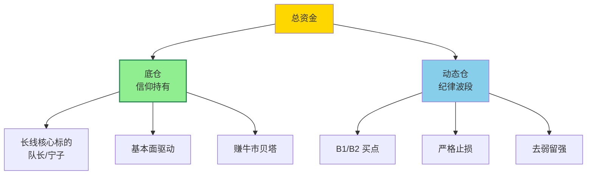
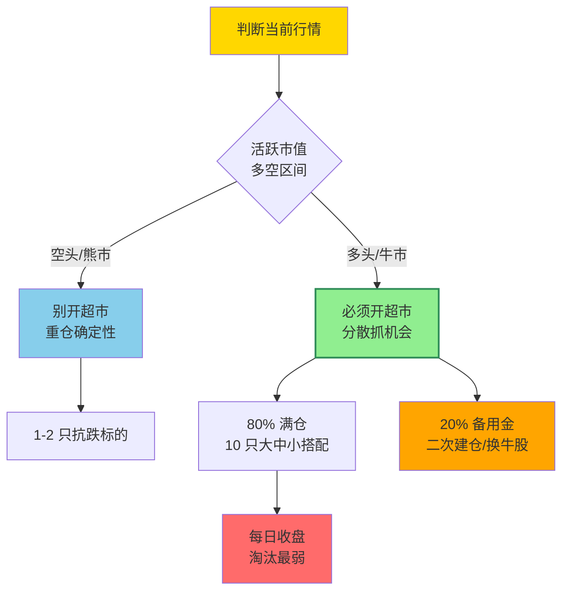
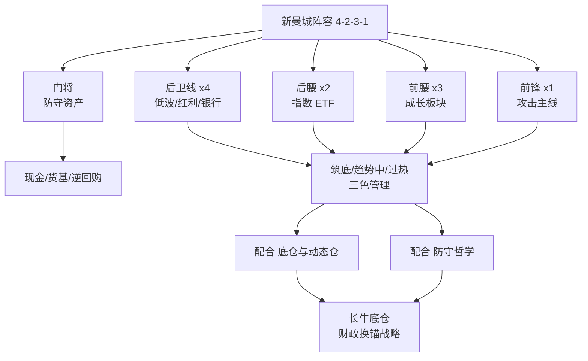
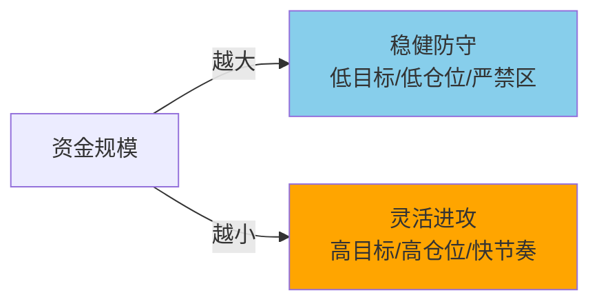

# 仓位分工与组合轮动

> [!info] 阅读口径
> 本篇上半部按交易流程综合整理；下半部完整保留归属本篇的原库条目正文，并保留原有数值、例外与冲突。原库表述属于特定方法论；其中收益、胜率、历史案例及市场判断未经本次独立核验。综合编排不是Z哥原话。跨条目冲突统一见 [[19-规则冲突与知识缺口]]。

## 仓位先分职责，再谈比例

底仓用于长期逻辑与牛市大周期，动态仓用于波段和短期强弱切换，备用资金用于防守与已计划的新机会。仓位身份决定管理规则，不能亏损后把动态仓改名为底仓。

原库底仓页强调长期逻辑，长线手册补充基本面恶化、大趋势反转以及熊市减仓等退出边界。因此“底仓不动”是有条件持有，不是永不退出。

## 三种组合组织方式

| 方法 | 解决的问题 | 原库明确规则 | 容易误用的地方 |
|---|---|---|---|
| 底仓＋动态仓 | 长期与短期各有分工 | 长线手册有6:4或7:3的示例 | 不能当所有资金规模统一比例 |
| 三换三 | 分散单票风险、保持候选与持仓活性 | 100万示例为8—10票、3—5板块，强者留、弱者换 | 不是每天固定换三个，也不为换而换 |
| 开超市 | 牛市轮动时分散抓机会 | 80%作为满仓口径、留20%备用金，大中小搭配 | 不是看什么涨就追加，也不是自动分散有效 |

多个同板块持仓仍可能是同一种风险暴露。原库强调板块分散，但未提供相关性和组合回撤的计算方法，不能据股票数量推定组合已安全。

## 新曼城阵容如何理解

4231是职责比喻，不是4:2:3:1的资金百分比：门将对应防守资产，后卫对应低波/红利，后腰为宽基指数，前腰为成长方向，前锋为当期攻击主线。新版本由固定个股转向板块和主题，减少对单一公司的依赖。

其条目给出门将不低于总仓10%、前锋不超过总仓20%，每个位置标注筑底、趋势中、过热。它与“主题仓不超过总资金5%”来自不同策略，不能把20%自动当作所有主题交易的上限。前锋一个位置也不等于整个账户只能有一只股票。

## 加仓与摊薄怎样区分

基于原库“有序加仓、越跌越补禁止、确认后增加目标仓位”的规则推断：计划中的加仓要有新的结构确认、仍有效的风险边界和剩余资金；因为浮亏而追加入金、下移止损以求回本，不属于同一逻辑。

ETF条目又要求在B1一次性买足已计划的单个仓位，不做倒金字塔。一次买足一份计划仓位并不等于全账户满仓。原库“存款搬家、当天加当天还”未给完整资金和成交约束，不能直接推广为融资操作步骤。

## 资金规模表的阅读边界

资金规模条目列出10万以下、50—100万、100—300万、300—500万、500—1000万和5000万以上等档位，既有底仓配比也有年化目标。表中缺少10—50万、1000—5000万的完整覆盖，标题写“五档”正文实际六档。

这些档位反映原库“资金越大越重视容量与防守”的思路；高年化数字只是原库目标，不是能力证明或收益承诺。短线手册还出现10万以下全仓单票，与转折点战法“永远不满仓一只票”冲突。本次不替这些口径选一个统一比例，完整保留并在 [[19-规则冲突与知识缺口]] 对照。

## 原库理论详解

以下按原库概念页保留正文；仅调整标题层级、内部链接和来源展示，不把整理者的结论升级为已验证事实。

### 原库条目：底仓与动态仓

原概念页：/Users/nanan/Documents/ChatGPT/Z哥知识库/references/底仓与动态仓.md  
原页更新时间：2026-04-18。来源路径是追溯线索，本Skill未附这些路径对应的原文。

#### 定义

> [!abstract] 一句话定义
> 底仓与动态仓是 Z 哥的**二维仓位管理体系**——**底仓靠信仰长期持有**(赚整个牛市的贝塔),**动态仓靠纪律做波段**(赚市场波动的钱)。类似穆里尼奥 4231 阵型,分工明确。

#### 关键信息

##### 底仓
- 看好行业/公司的长期价值，准备拿完整个牛市周期
- 除非基本面根本性变化，否则不管短期涨跌都不动
- 赚的是整个牛市的贝塔收益
- 示例：队长、宁子等核心标的

##### 动态仓
- 用来做波段、做短线，赚市场波动的钱
- 必须严格遵守交易纪律，走坏了立刻拍掉
- 不能跟票有感情

##### 资产配置
- 类似穆里尼奥4231阵型，分工明确
- 长线底仓 + 动态仓短线轮动
- 牛市配置：主线票（科技、半导体等进攻型）+ 防守票（白酒、银行等）
- 熊市配置：像泽连斯基一样在夹缝中求生存，严格选股

##### 持仓结构
- 类似穆里尼奥4231阵型，分工明确
- 长线底仓 + 动态仓短线轮动
- 空头区间：动态仓只卖不买

#### 二维仓位结构

> [!tip] 4231 阵型
> 底仓 = 后防线(不破不动) + 动态仓 = 中前场(快速轮转)。**牛市看底仓,熊市看动态**。

#### 关联连接
- [[12-持股评分与洗盘应对#原库条目：去弱留强|去弱留强]] — 动态仓的管理原则
- [[02-择时过滤与市场环境#原库条目：活跃市值|活跃市值]] — 判断多空区间的依据
- [[04-趋势结构与量价工具#原库条目：双线战法|双线战法]] — 动态仓在双线区间内操作
- [[20-知识来源与理论适用边界#原库条目：Zettaranc|Zettaranc]] — 交易体系作者

### 原库条目：三换三

原概念页：/Users/nanan/Documents/ChatGPT/Z哥知识库/references/三换三.md  
原页更新时间：2026-05-01。来源路径是追溯线索，本Skill未附这些路径对应的原文。

原页标注的来源线索

- raw/01-zettaranc/知行小菜鸟/[202604270725]482散户不死牛市不止.md
- raw/01-zettaranc/知行小菜鸟/[202604280812]481从025到07真正拉开差距的不是代码.md

#### 定义

> [!abstract] 一句话定义
> 三换三是最高效的超短线玩法——在框架内用持仓和候选池之间的滚动切换，最大限度防止踏空，同时磨平单点暴毙的损失。不是每天三个票全换掉，而是每天根据强弱把持仓里的一部分换到更强的方向。

#### 关键信息

##### 核心逻辑
- **本质**：让组合保持活性，又不至于因单点暴毙把账户打穿
- **类比**：踢球打四-四-二，进攻不极致但防守不失位，踏空概率变小，踩雷伤害摊薄
- **操作**：每天选票形成候选池 → 第二天根据强弱 → 持仓里一部分换到更强方向
- **不是**：为了换而换，强的票留着，看好的留着

##### 分仓配置铁律

> [!danger] 100 万 = 8~10 票，分散 3~5 板块
> 分 5 个还是 10 个，进攻上区别不大，防守上区别很大。

| 配置方式 | 防守表现 |
|----------|---------|
| 5 票里 3 票同板块 | 大盘跌时攻击变脆弱，一起熄火 |
| 10 票分 5 板块 | 大盘跌时对冲从容，心态稳定 |

- 怕踏空只是不赚钱，跌得比大盘多是实打实亏钱
- 进攻靠命，防守靠体系

##### 理想状态
- 有五到十个可操作的尺度
- 主线、支线、防守方向都配上，再配几个低估值的东西
- 三换三里有一个崩了，对整体影响不会太大

#### 关联连接

- [[11-仓位分工与组合轮动#原库条目：开超市策略|开超市策略]] — 三换三是开超市的具体执行方式
- [[12-持股评分与洗盘应对#原库条目：去弱留强|去弱留强]] — 滚动切换的本质
- [[17-心理防守与概率认知#原库条目：防守哲学|防守哲学]] — 进攻靠命，防守靠体系
- [[11-仓位分工与组合轮动#原库条目：底仓与动态仓|底仓与动态仓]] — 组合配置的底层框架
- [[20-知识来源与理论适用边界#原库条目：Zettaranc|Zettaranc]] — 交易体系作者

### 原库条目：开超市策略

原概念页：/Users/nanan/Documents/ChatGPT/Z哥知识库/references/开超市策略.md  
原页更新时间：2026-05-01。来源路径是追溯线索，本Skill未附这些路径对应的原文。

原页标注的来源线索

- raw/01-zettaranc/大富翁小菜鸟/[202509260702]炒股开超市策略全攻略熊市不慌牛市不踏还能稳稳拿住牛股.md
- raw/01-zettaranc/知行小菜鸟/[202604270725]482散户不死牛市不止.md
- raw/01-zettaranc/知行小菜鸟/[202604280812]481从025到07真正拉开差距的不是代码.md

#### 定义

> [!abstract] 一句话定义
> 开超市策略是牛市中的**分散持仓管理法**——核心原则"**熊市重仓稳的,牛市分散赚的**",通过合理分散降低波动、抓住轮动机会。**满仓只算 80%,留 20% 备用金应对二次建仓**。

> [!warning] 不是乱买
> "开超市"不是随便买十几只股瞎折腾，而是**根据市场行情调整持仓**。

#### 核心逻辑：分行情

| 行情 | 策略 | 原因 |
|------|------|------|
| **熊市** | 别开超市，重仓"确定性" | 市场整体下跌，大部分标的扛不住，集中仓位在少数抗跌标的上 |
| **牛市** | 必须开超市，分散"抓机会" | 个股轮动快，只盯一只容易错过其他牛股 |

#### 行情 → 仓位结构决策

#### 仓位管理

##### 备用金制度
- 满仓只算80%，留20%备用金
- **两个核心作用**：
  1. 应对"二次建仓机会"——出现第二次好买点时有钱加仓
  2. 给"完美标的"留仓位——遇到牛股不用卖现有持仓换仓
- 100万资金建议8-10票，分散3-5板块（出处:[[11-仓位分工与组合轮动#原库条目：三换三|三换三]]）

##### 存款搬家规矩
- 当天加、当天还，只加"一个仓位"的钱
- 绝不能搞"倒金字塔加仓"
- 收盘前卖掉最弱的一只，把借的钱还回去

#### 标的选择

##### 熟悉板块："大中小"搭配
- 大盘股：做"业绩基石"，基本面稳、抗跌性强
- 中盘/小盘股：赚"弹性收益"，行情来了涨得快

##### 不熟悉板块：ETF是"安全牌"
- 看不懂板块逻辑 → 直接买对应ETF
- 10个标的都不熟悉 → 买1只宽基ETF，效率更高

##### 特殊板块
- 券商等ETF成分股就是头部个股的 → ETF和个股走势差别不大，看习惯选

#### 牛股持有：放飞策略

- **放飞时机**：脱离白线10%-20%就减仓降成本
- 资金量大：一次减1/10
- 资金量小：一次减1/3
- 不赌第二天走势，提前做好应对方案

#### 出货信号（5种）

1. **加速后放量大阴线**：连续加速后突然放量大阴，量比主力建仓阳线还大 → 减半或全卖
2. **次高点放量大阴线**：没创新高就莫名大跌 → 主力出货
3. **天量出货**：历史最高成交量，不管阳阴都警惕
4. **一字断头**：锁仓拉升后一字跌停，第一时间挂单卖
5. **顶部平量阴跌**：不涨不跌每天缩量阴跌 → 主力"慢慢出货"

#### 关联连接

- [[11-仓位分工与组合轮动#原库条目：底仓与动态仓|底仓与动态仓]] — 开超市是动态仓的具体执行方式
- [[12-持股评分与洗盘应对#原库条目：去弱留强|去弱留强]] — 超市中收盘淘汰最弱的，保留最强的
- [[15-长线底仓与牛市ETF管理#原库条目：牛市策略|牛市策略]] — 开超市策略主要应用于牛市环境
- [[13-放飞止盈与破位退出#原库条目：半仓放飞策略|半仓放飞策略]] — 牛股脱离白线10%-20%时的减仓方法
- [[17-心理防守与概率认知#原库条目：防守哲学|防守哲学]] — 备用金制度和分散持仓都是防守思维

### 原库条目：新曼城阵容

原概念页：/Users/nanan/Documents/ChatGPT/Z哥知识库/references/新曼城阵容.md  
原页更新时间：2026-04-26。来源路径是追溯线索，本Skill未附这些路径对应的原文。

#### 定义

> [!abstract] 一句话核心定义
> 新曼城阵容是 Z 哥的核心长期组合配置体系,模仿英超 4231 阵容把持仓拟人化为足球队员;2025Q4 由"老曼城"升级为"新曼城",最大变化是**标的从个股升级为板块/主题**,与 [[11-仓位分工与组合轮动#原库条目：底仓与动态仓|底仓与动态仓]]、[[17-心理防守与概率认知#原库条目：防守哲学|防守哲学]] 共同构成完整配置闭环。

#### 关键信息

##### 4231 配置思路
| 位置 | 角色 | 仓位职能 |
|---|---|---|
| 门将 | 防守资产 | 现金 / 货币基金 / 国债逆回购 |
| 4 后卫 | 低波红利 / 银行 / 高股息 | 防御底仓,提供股息现金流 |
| 2 后腰 | 指数 ETF | 沪深 300 / 中证 A50 等宽基锚 |
| 3 前腰 | 成长板块 | AI / 算力 / 创新药等趋势中板块 |
| 1 前锋 | 攻击性主题 | 当期最强主线 / [[03-选股后验证与候选池管理#原库条目：绝对主线\|绝对主线]] |

> [!tip] 实操要点
> - 阵容是**仓位结构**,不是选股清单——每个位置随市场轮动换"球员"
> - 门将永远在场上(防御不可弃)
> - 前锋只设 1 个,集中度防止"火力分散"

##### 老曼城 vs 新曼城
| 维度 | 老曼城(2025前) | 新曼城(2025Q4 起) |
|---|---|---|
| 标的层级 | **个股**(米儿/迪迪/台子/低波红利/赵姨/德德等) | **板块/主题** |
| 选股压力 | 高,需要持续跟踪个股基本面 | 低,板块/ETF 自带分散 |
| 容错率 | 个股黑天鹅一击致命 | 板块平滑了个股波动 |
| 适配资金量 | 中小资金 | 中大资金 / 长期账户 |

升级核心动机:**从"押对个股"升级为"押对方向"**,把策略边际从选股能力转移到周期判断。

##### 三色分类(仓位状态管理)
- 🟢 **筑底**:伏击仓,小仓位试探,等待右侧
- 🟡 **趋势中**:持有仓,主仓位持有,纪律执行
- 🔴 **过热**:减仓信号,大仓位逐步兑现

每个位置(后卫/后腰/前腰/前锋)单独打三色标签,组合状态一目了然。

##### 财政换锚战略背景
新曼城阵容的宏观锚点是 Z 哥反复强调的"**财政换锚**":
- 楼市作为旧蓄水池被战略放弃(土地财政退场)
- 股市顶上做新蓄水池(慢牛护航产业升级)
- 居民资产从房产向权益迁移,长牛底仓需求爆发

新曼城阵容正是**为这一长周期资产再配置量身定制的工具**——把"长期持有"这件事从口号变成可执行的 4231 结构。

> [!danger] 风控铁律
> - 门将仓位不允许低于总仓 10%(任何时候)
> - 前锋仓位不允许超过总仓 20%(单一主题集中度上限)
> - 三色全红时强制启动 [[13-放飞止盈与破位退出#原库条目：半仓放飞策略|半仓放飞策略]] / [[17-心理防守与概率认知#原库条目：防守哲学|防守哲学]] 减仓预案

#### Mermaid 流程图

#### 关联连接
- [[11-仓位分工与组合轮动#原库条目：底仓与动态仓|底仓与动态仓]]
- [[17-心理防守与概率认知#原库条目：防守哲学|防守哲学]]
- [[15-长线底仓与牛市ETF管理#原库条目：牛市策略|牛市策略]]
- [[03-选股后验证与候选池管理#原库条目：绝对主线|绝对主线]]
- [[13-放飞止盈与破位退出#原库条目：半仓放飞策略|半仓放飞策略]]
- [[20-知识来源与理论适用边界#原库条目：Zettaranc|Zettaranc]]

### 原库条目：不同资金规模交易节奏

原概念页：/Users/nanan/Documents/ChatGPT/Z哥知识库/references/不同资金规模交易节奏.md  
原页更新时间：2026-06-03。来源路径是追溯线索，本Skill未附这些路径对应的原文。

原页标注的来源线索

- raw/01-zettaranc/大富翁小菜鸟/[202512190959]不同资金规模交易节奏执行清单建议收藏.md

#### 定义

> [!abstract] 一句话定义
> 资金规模越小，盈利目标越高、操作越灵活进攻；资金规模越大，盈利目标越稳健、侧重风险防控。不同资金量有不同的仓位配比、止损标准和禁区。

#### 五档资金规模执行清单

##### 第一档：5000万+（机构级）

| 维度 | 标准 |
|------|------|
| **盈利目标** | 大于无风险收益率(1.8%)，超额由市场决定 |
| **仓位策略** | 长线满仓+分批建仓/止盈，优先指数增强型ETF+低波动蓝筹 |
| **单票上限** | ≤20% |
| **止盈线** | 年化20%-30%主动止盈 |
| **禁区** | 禁追涨停板/高波动小票/杠杆/紧缩周期重仓 |

##### 第二档：500-1000万（中大型）

| 维度 | 标准 |
|------|------|
| **盈利目标** | 年化10-20% |
| **仓位策略** | 底仓60-70%(低波动核心资产) + 动态仓30-40%(主线波段) |
| **止损** | 单票最大亏损≤5%，买入K线低点下3-5价位 |
| **禁区** | 禁日换手率>50%小票/盲目抄底高位破位/单一板块>40%/杠杆 |

##### 第三档：300-500万（中型）

| 维度 | 标准 |
|------|------|
| **盈利目标** | 年化20-30% |
| **仓位策略** | 底仓50%(港股大科技+A股券商) + 动态仓50%(A股波段) |
| **执行要点** | 宽松周期不空仓，紧缩周期降仓至20%以下；动态仓参与券商/有色周线B1 |
| **禁区** | 禁满仓短线/无基本面题材/股权质押率>50%/忽视季度复盘 |

##### 第四档：100-300万（中小型）

| 维度 | 标准 |
|------|------|
| **盈利目标** | 年化30-50% |
| **仓位策略** | 底仓40-50%(宁子/队长等) + 动态仓50-60%(分2-3份轮动) |
| **执行要点** | 上涨满仓/横盘低吸高抛/下跌空仓；盈利达30%提取本金用利润操作 |
| **禁区** | 禁短线做成长线/重仓单一小票(≤动态仓50%)/忽视止损/追热门题材 |

##### 第五档：50-100万（小型）

| 维度 | 标准 |
|------|------|
| **盈利目标** | 年化50-70% |
| **仓位策略** | 底仓50%(台子/宁子等) + 动态仓50%(波段) |
| **执行要点** | 聚焦确定性强的板块机会 |

##### 第六档：10万以下（微型）

| 维度 | 标准 |
|------|------|
| **盈利目标** | 年化70-100% |
| **仓位策略** | 可满仓动态，灵活进攻 |
| **执行要点** | 专注1-2个最熟悉的板块，快进快出 |

#### 核心规律

- **底仓比例**：资金越大底仓越重(60-70%)，资金越小底仓越轻(40-50%)
- **止损严格度**：所有规模都必须止损，但大资金止损幅度更窄
- **禁区扩展**：资金越大禁区越多（杠杆/小票/追高），资金越小越灵活

#### 关联连接
- [[11-仓位分工与组合轮动#原库条目：底仓与动态仓|底仓与动态仓]] — 底仓+动态仓是所有资金规模的通用框架
- [[11-仓位分工与组合轮动#原库条目：开超市策略|开超市策略]] — 中大型资金的分散配置方法
- [[02-择时过滤与市场环境#原库条目：交易松紧手|交易松紧手]] — 多头手松/空头手紧的仓位纪律
- [[02-择时过滤与市场环境#原库条目：空仓策略|空仓策略]] — 下跌阶段的核心防守动作
- [[17-心理防守与概率认知#原库条目：防守哲学|防守哲学]] — 所有资金规模的底层哲学
- [[11-仓位分工与组合轮动#原库条目：新曼城阵容|新曼城阵容]] — 核心资产配置的参考模型
