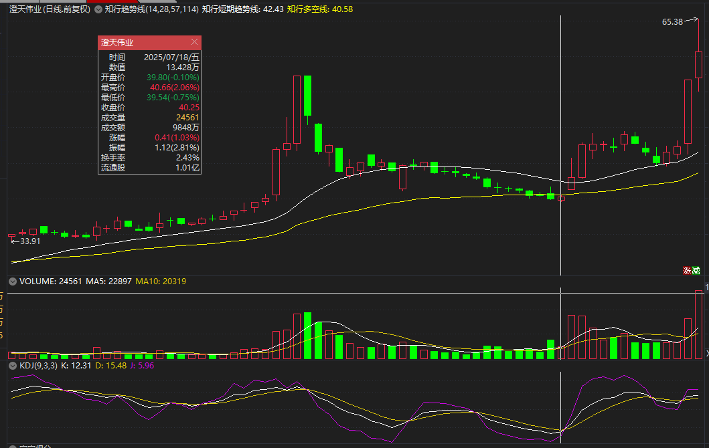
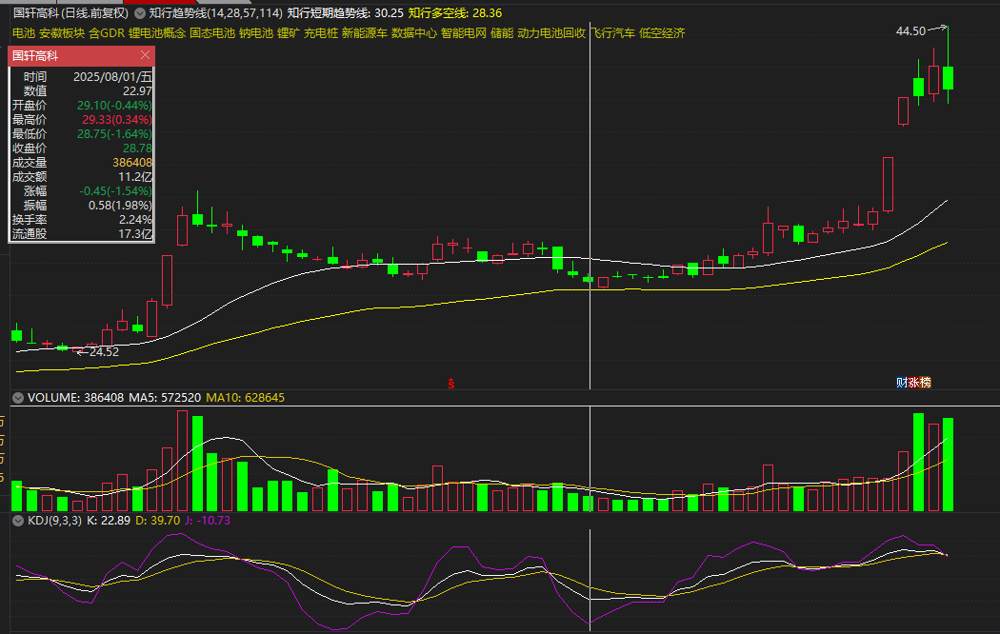
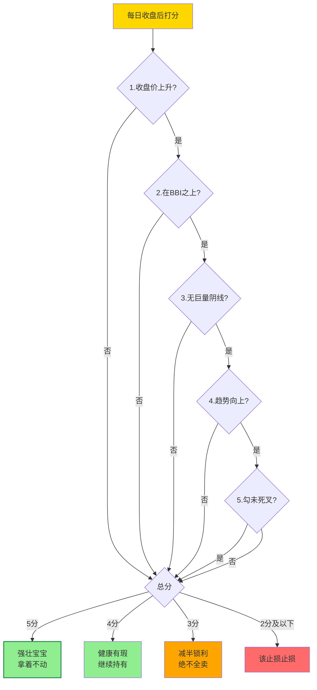

# 持股评分与洗盘应对

> [!info] 阅读口径
> 本篇上半部按交易流程综合整理；下半部完整保留归属本篇的原库条目正文，并保留原有数值、例外与冲突。原库表述属于特定方法论；其中收益、胜率、历史案例及市场判断未经本次独立核验。综合编排不是Z哥原话。跨条目冲突统一见 [[19-规则冲突与知识缺口]]。

## 买入后先判断：是在正常波动，还是原判断失效

先查预设止损、S1、关键低点和大周期趋势；没有触发退出条件，再检查收盘强度、BBI、缩量回调与评分。原库“别在急杀中慌卖”始终有“不破既定止损”的边界，不能反过来豁免真正破位。

## 五分制必须五项分别计算

| 维度 | 得1分的条件 | 需要避免的误读 |
|---|---|---|
| 收盘价 | 今日收盘高于昨日 | 不能只看K线红绿或开收盘关系 |
| BBI | 股价在BBI之上 | 不替代买入前的独立止损线 |
| 巨量阴线 | 缩量调整或正常阳量，没有巨量阴线 | 巨量口径未完整量化 |
| 趋势 | N型向上、低点抬高、高点突破 | 单日上涨不自动恢复结构 |
| 勾 | 金叉或张口向上 | 具体指标与判定周期须明确 |

五项各自0或1，最后求和，而不是前一项不合格就停止评分。原库对应5分拿住、4分持有、3分可减半、≤2分离场。评分是主升浪持仓补丁，不是让4分覆盖已触发的硬止损。

## 正常洗盘的候选证据

原趋势仍是上涨N型；回调没有打破预设失效位；量能相对缩小；尾盘明显收回或次日企稳反包；个股相对大盘更强。多项证据共同支持观察，而非某一项足以证明主力洗盘。

少妇1.3强调只看收盘价抬升、不破BBI，减少分时冲高回落带来的卖飞。它的“所有冲高回落都是演戏”等绝对表述，不能用于否认顶部出货；在放量长阴、S1、关键位破坏等情况下，要回到退出规则。

## “忍一根”到底忍什么

忍的是多头结构里尚未触及预设止损的难受波动，不补仓、不因恐慌改计划，观察下一根关键K是否修复。周线空头发散、历史高位跳空破黄线、明确S1后继续走弱，都不是通用的忍耐场景。

黄线破后是否允许一根收回，原库有不同版本；若计划采用允许一根的版本，也不是每跌一根都把观察期重新开始。原库明确第二根仍收黄线下必须退出。价格硬止损如已经触发，不以“忍一根”拖延。

## 去弱留强和频繁切换的区别

去弱留强用事前标准判定失败：趋势破坏、时间验证失败、关键位置丢失；随后替代候选仍须有效。频繁切换常常只因别的票当日涨得多，就卖掉原本未破趋势的持仓。前者维护规则，后者被短期涨跌牵动。

科技、消费、红利等在原库“分歧与一致”中有不同节奏；可以用来理解持有预期，但不把历史板块标签当永远固定的波动速度。

<!-- web-images-2026-10-20-持仓整理-start -->
## 对应形态的历史图例

> [!note] 网络图例的阅读范围
> 以下图片来自[笔记在线：《Z哥_需要反复背诵的十张完美图形》](https://www.noteol.com/xuexi/ZG_wanmeituxing.html)，页面署名“管理员”，属于二级学习整理；截图的原始制作者未独立核实。图片按原文件本地保存，下载日期为2026-10-20。图中带有后续走势，只用于辨认结构；不据事后上涨确认信号必胜，也不以图文中的宽松口径覆盖本笔记规则。

### 整理是否仍在原结构中：澄天伟业

用中部整理段检查趋势线和预设失效位。缩量可作为观察线索，不能单凭它证明洗盘，更不能用右侧再启动豁免当时已经触发的止损。

[查看原图](https://s21.ax1x.com/2025/10/15/pVqYq7n.png)。

### 时间换空间的观察：国轩高科

观察较长整理与白黄线变化。此图不授权把超短线“不涨就走”的期限无限延长；是否容忍整理取决于买前选择的策略。

[查看原图](https://s21.ax1x.com/2025/10/15/pVqYHmj.png)。

<!-- web-images-2026-10-20-持仓整理-end -->

## 假阴真阳与换手率不能一概而论

少妇1.3用“收盘比昨日高”的视角支持持有，逃顶条目却强调废除假阴真阳概念、放量阴线要防守。这是原库冲突。整理后的边界是：K线颜色和相对昨收涨跌都要记录；低位建仓、主升持股和高位派发分别检查，不能用其中一个指标直接否决全部风险。

持仓评分认为趋势强时高换手可能是活跃接力，两个30%原则限制建仓阶段相关阳线累计换手。阶段和统计口径不同，不能用“换手高都好”覆盖建仓筛选。

## 原库理论详解

以下按原库概念页保留正文；仅调整标题层级、内部链接和来源展示，不把整理者的结论升级为已验证事实。

### 原库条目：五分制持仓评分系统

原概念页：/Users/nanan/Documents/ChatGPT/Z哥知识库/references/五分制持仓评分系统.md  
原页更新时间：2026-04-26。来源路径是追溯线索，本Skill未附这些路径对应的原文。

原页标注的来源线索

- raw/01-zettaranc/知行小菜鸟/[202602030001]522赢在起跑线之外一套对抗A股杀猪盘的五维持仓心法.md
- raw/01-zettaranc/知行小菜鸟/[202602020223]521猎杀主升浪少妇战法13威力加强版与每日持股的生死查杀令.md

#### 定义

> [!abstract] 一句话定义
> 五分制持仓评分系统是在充满欺骗的 A 股中**判断个股强弱的客观标尺**——每天收盘前对**收盘价/BBI/巨量阴线/趋势/勾**五维度打分,**用评分代替情绪做决策**,5 分死拿 / 4 分持有 / 3 分减半 / ≤2 分离场。

#### 五个评分维度

| 序号 | 评分项 | 判定标准 |
|------|--------|---------|
| 1 | 收盘价是否上升 | 今天收盘价 > 昨天收盘价 → 1分 |
| 2 | 有没有跌破BBI线 | 股价在BBI之上 → 1分 |
| 3 | 有没有巨量阴线 | 缩量调整或阳量 → 1分；巨量阴线 → 0分 |
| 4 | 趋势是否向上 | N型结构，低点抬高、高点突破 → 1分 |
| 5 | "勾"是否死叉 | 金叉或张口向上 → 1分；死叉向下 → 0分 |

#### 评分执行手册

| 评分 | 等级 | 操作 |
|------|------|------|
| **5分** | 强壮的宝宝 | **拿住不动**，盘中再难看也不动 |
| **4分** | 健康但有瑕疵 | **继续持有**，只有一项不达标，卖出没有依据 |
| **3分** | 及格线/奄奄一息 | 可以减半仓锁利润，但**绝对不能全卖**（防止踏空） |
| **2分及以下** | 病危 | 该止损止损，该离场离场 |

#### 三条铁律（打印贴显示器）

1. **忽略盘中冲高回落**
2. **观察尾盘是否快速收回，或第二天是否反包**
3. **绝对不要在下杀中恐慌卖出**

#### "假阴真阳"的误读

绿色K线不代表下跌——如果收盘价比昨天高、在BBI线上、趋势向上、勾没死叉，这就是**5分的票**。主力用"假动作"洗不坚定的筹码。

#### 换手率的真相

换手率高是正常的——主力自己会对倒，获利盘离场、新散户进场。只要评分5分，换手率高说明市场活跃有人接力。主力把意志不坚定的洗出去换一批看好的人进来，车才能开得更远。

#### A股vs美股的文化差异

- **美股逻辑（第一性原理）**：要跌就直接低开低走，要涨就直接拉上去——"看山是山"
- **A股逻辑（博弈论）**：要跌先高开5%诱惑你进来再慢慢杀；要涨先低开杀跌吓出去再拉涨停——"3000个心眼"

因为处在一个充满欺骗的市场，所以必须建立自己的规则体系。五分制就是充满谎言的A股里唯一的**真理**。

#### 关联连接

- [[12-持股评分与洗盘应对#原库条目：去弱留强|去弱留强]] — 评分2分及以下就是"弱"，该淘汰的拖油瓶
- [[17-心理防守与概率认知#原库条目：交易心理|交易心理]] — 克服盘中恐慌和利润回撤恐惧的心理工具
- [[12-持股评分与洗盘应对#原库条目：少妇战法1.3每日持股检查手册|少妇战法1.3 每日持股检查手册]] — 五分制是该手册的核心打分工具
- [[04-趋势结构与量价工具#原库条目：N型结构|N型结构]] — 评分维度4：趋势判断依据
- [[04-趋势结构与量价工具#原库条目：白线黄线系统|白线黄线系统]] — BBI线与评分维度2/5密切相关

### 原库条目：少妇战法1.3每日持股检查手册

原概念页：/Users/nanan/Documents/ChatGPT/Z哥知识库/references/少妇战法1.3每日持股检查手册.md  
原页更新时间：2026-04-26。来源路径是追溯线索，本Skill未附这些路径对应的原文。

原页标注的来源线索

- raw/01-zettaranc/知行小菜鸟/[202602020223]521猎杀主升浪少妇战法13威力加强版与每日持股的生死查杀令.md

#### 定义

> [!abstract] 一句话定义
> 少妇战法 1.3 是少妇战法 1.0 的"补丁包"——专治**主升浪中卖飞**。核心产出物是**每日持股检查手册** + **五分制评分系统**:收盘后给持仓打分,**4-5 分死拿 / 3 分减半锁利 / ≤2 分离场**。**只看收盘价抬升 + 不破 BBI = 神**。

#### 卖飞的四种心理病灶

1. **利润回撤恐惧症**：赚了20%连2%回撤都受不了，盘中盯着分时图恐慌
2. **日内波动惊吓症**：冲高回落时产生"要崩盘"的幻觉，在最低点交筹码
3. **仓位强迫症**：手里只剩少量仓位觉得"无所谓了"，草率清仓后主升浪启动
4. **完美主义洁癖**：因高开买入成本不完美，后续随意卖出

#### 每日持股检查手册（六条铁律）

##### 第一条：无视盘中冲高回落（特别是冲刺阶段）
- 主升浪中主力不想让太多人上车，手段是**盘中大幅拉高后快速下杀洗盘**
- 连续缩量小阴线是"空中加油"，不是见顶信号
- **所有冲高回落都是主力在演戏**，哪怕是真的顶也只有一个，不可能每次都碰到

##### 第二条：验证尾盘的"黄金修复力"
- 当天下杀不要紧，关键看怎么收场
- 盘中杀到-8%尾盘收回-2% → 强壮，主力在低位接回筹码
- 次日企稳（十字星）或反包一半 → 继续拿
- 次日继续大幅下杀不回头 → 该止损止损

##### 第三条：严禁在"无厘头急杀"中交出筹码
- 没有利空、不在高位连板见顶、突然1-5分钟砸跌停 → **不要在急杀中卖出**
- 换手率正常（如昨天13%今天8%），主力出不去货，就是吓你
- 心态："有本事你打穿我的止损线，没打穿我就拿着"

##### 第四条：大盘下杀时的"相对强度论"
- 大盘不行时个股还能逆势往上走 → 主力原本想做多，后来被动跟随下跌
- **比大盘强的票，至少多看一天**
- 大盘微跌它跌停的"垃圾"除外

##### 第五条：缩量小阴线，默认"再等一天"
- 涨了40%后歇口气跌1.5%缩量阴线 → 合理的"礼貌性回调"
- 不破BBI线 + 缩量阴线 → 接着持有

##### 第六条：不要主观臆断，不破BBI线就是神
- 收起预测能力，**只要股价还在BBI线之上就拿着**
- 完美形态的票不要因为"觉得害怕"去卖

#### 终极奥义：只看收盘价抬升

在主升浪和趋势形成后，把K线形态、成交量、MACD指标统统忘掉，回归第一性原理：

- **唯一指标：今天的收盘价 > 昨天的收盘价**
- 哪怕是一根"假阴真阳"线（高开低走绿色K线），只要收盘价高于昨天，主力就在做多
- **只要收盘价在提高，就死死拿住**，甚至不用看盘中波动，收盘看一眼即可

这就是**"空位三分"**的核心：像库里有了空位三分一样，姿势不完美没关系，只要球能进（价格在涨）就出手。

#### 五分制持仓评分系统

每天收盘后给持仓打分（满分5分）：

| 评分项 | 判定标准 |
|--------|---------|
| 1. 收盘价是否上升 | 今天收盘价 > 昨天收盘价 → 1分 |
| 2. 有没有跌破BBI线 | 股价在BBI之上 → 1分 |
| 3. 有没有巨量阴线 | 缩量调整或阳量 → 1分；巨量阴线 → 0分 |
| 4. 趋势是否向上 | N型结构，低点抬高、高点突破 → 1分 |
| 5. "勾"是否死叉 | 金叉或张口向上 → 1分；死叉向下 → 0分 |

**评分执行手册**：
- **5分**：强壮的宝宝，拿着不动
- **4分**：健康但有瑕疵，继续持有
- **3分**：及格线，可以减半仓锁利润但**绝对不能全卖**（防止踏空）
- **2分及以下**：该止损止损，该离场离场

#### 五分制评分决策流程

> [!tip] 终极口诀
> **只要收盘价在提高,就死死拿住** —— 把 K 线、量、MACD 全忘掉,回归第一性原理。

#### 金叉死叉的真相

传统MACD/KDJ金叉买死叉卖是Windows 95时代产物，在A股已被主力玩坏：
- 金叉往往是诱多，死叉往往是诱空
- 看"勾"是否死叉的意义不是让你死叉卖，而是预判**明天早盘会有散户恐慌抛压**，提前做好心理准备应对洗盘

#### 关联连接

- [[10-盘中执行与止损计划#原库条目：少妇战法|少妇战法]] — 少妇战法1.3是在1.0六步SOP基础上的持股心法补丁
- [[12-持股评分与洗盘应对#原库条目：五分制持仓评分系统|五分制持仓评分系统]] — 每日持股检查的核心打分工具
- [[17-心理防守与概率认知#原库条目：交易心理|交易心理]] — 卖飞的四心理病灶与克服方法
- [[12-持股评分与洗盘应对#原库条目：去弱留强|去弱留强]] — 五分制评分后的去弱留强执行
- [[17-心理防守与概率认知#原库条目：防守哲学|防守哲学]] — 不预测只应对的防守思维

### 原库条目：去弱留强

原概念页：/Users/nanan/Documents/ChatGPT/Z哥知识库/references/去弱留强.md  
原页更新时间：2026-04-18。来源路径是追溯线索，本Skill未附这些路径对应的原文。

#### 定义

> [!abstract] 一句话定义
> 去弱留强是持仓管理核心原则——**留下趋势强势的股票,剔除走弱的股票**,让持仓永远只保留最强的标的。**股票不是爱情,不涨就换**,可以撒娇(震荡)不能离家出走(破位)。

#### 关键信息

##### 判断标准
- **强势**：白线在黄线之上，股价在黄线之上
- **弱势**：白线在黄线之下——一律不看

##### 执行方法
1. 确认大盘黄线有交易价值
2. 手中持仓必须全部是强势股
3. 跌破黄线的票坚决换掉
4. 反弹时强势股先创新高，弱势股反弹无延续

##### 与三最原则的结合
- "只拿最硬"：持仓中不是最硬的（不涨的、走势弱的）直接换掉
- 股票不是爱情，不涨就换
- 好股票不套人，好姑娘不矫情——可以震荡（撒娇），不能破位（离家出走）

##### 常见错误
- 卖强势股、补弱势股（摊薄成本）
- 持仓越来越弱，想翻身难

#### 关联连接
- [[04-趋势结构与量价工具#原库条目：白线黄线系统|白线黄线系统]] — 强弱的判断标准
- [[01-交易闭环与策略边界#原库条目：框架式交易|框架式交易]] — 持仓管理规则
- [[11-仓位分工与组合轮动#原库条目：底仓与动态仓|底仓与动态仓]] — 不同类型的去弱留强策略
- [[03-选股后验证与候选池管理#原库条目：三最原则|三最原则]] — 只拿最硬的持仓哲学

### 原库条目：分歧与一致

原概念页：/Users/nanan/Documents/ChatGPT/Z哥知识库/references/分歧与一致.md  
原页更新时间：2026-06-03。来源路径是追溯线索，本Skill未附这些路径对应的原文。

原页标注的来源线索

- raw/01-zettaranc/大富翁小菜鸟/[202509140801]分歧与一致搞懂这节奏别在行情里瞎冲.md

#### 定义

> [!abstract] 一句话定义
> 健康的趋势是**"分歧→一致→分歧"的循环**，如同人的呼吸。分歧是喘气歇脚（洗浮筹），一致是接着跑（续涨）。搞懂这个节奏，就赢了一半散户。

#### 核心框架

##### 分歧与一致不是"非黑即白"

- **分歧** ≠ 跌：有人想落袋、有人觉得还能涨 → 多空博弈
- **一致** ≠ 涨：想卖的人卖完了，大家都觉得能涨 → 方向统一
- **没有一致的趋势**：天天小阴小阳晃悠没方向 → 没主力进场，走不远

##### 上涨趋势中的分歧与一致

| 阶段 | 表现 | 操作 |
|------|------|------|
| **分歧** | 涨一段后有人获利了结，股价震荡 | **不怕**，是上车/拿住的机会 |
| **一致** | 想卖的卖完，共识形成，继续拉升 | **别贪**，该减仓就减仓 |

> [!tip] 上涨中的分歧不可怕
> 分歧是主力在"洗浮筹"——你越慌着卖，越中主力的计。只要两根趋势线没破，拿住就完了。

##### 下跌趋势中的分歧与一致

| 阶段 | 表现 | 操作 |
|------|------|------|
| **分歧** | 跌一段后有人抄底，股价反弹 | **别急**，可能是假反弹 |
| **一致** | 没出反转信号，很快一致看空续跌 | **别碰**，没缩量小K线就是接飞刀 |

#### 板块一致速度差异

> [!caution] 别拿白酒的节奏套科技
> 不同板块属性不同，一致的速度天差地别。

| 板块类型 | 一致速度 | 驱动力 | 操作节奏 |
|---------|---------|--------|---------|
| **科技股**（AI/固态） | 快 | 资金驱动，炒未来想象力 | 分歧敢进，一致别贪 |
| **消费/白酒** | 慢 | 业绩驱动，等机构慢慢建仓 | 等分歧到缩量回踩黄线 |
| **煤炭/红利** | 最慢 | 分红驱动，稳定器功能 | 长期配置，不追一致 |

#### 主力的分歧与一致心理战

##### 没出货时：用分歧磨你耐心

主力没出完货 → 天天分歧晃悠 → 不让散户拿低价筹码 → 等你没耐心卖掉 → 主力接过来 → 一致时拉涨

> 例：寒武纪横盘十天不涨 = 分歧磨筹码，等白线跟上来

##### 要出货时：用一致让你接盘

主力想出货 → 制造"一致看涨"氛围 → 拉涨停+放利好 → 散户追进去 → 主力趁机抛筹码

> [!danger] 警惕信号
> 连续涨停、所有人都说"还能涨"的时候 → 主力可能在找接盘侠

#### 实操要点

##### 两个致命误区

1. **分歧没结束就进场**：还在中阴线杀跌就急着干 → 套牢。要等缩量小阳小阴（分歧快结束）+ 反转K线
2. **一致后追高**：翻倍了所有人都说还能涨 → 接在一致尾巴上

##### 正确买点："分歧后的一致信号"

三个判断标准：
1. **看K线**：出现缩量小阴/小阳 → 想卖的人少了，分歧快结束
2. **看位置**：回踩白线或黄线（趋势线）→ B1买点
3. **看板块**：白酒等回踩黄线，煤炭等机构建仓后缩量，科技等回踩白线后放量

> [!tip] 终极口诀
> **别天天盯着日内分时看**，收盘看一眼K线、看一眼两根趋势线就够了。没破线、没出出货信号，等着就完了。

#### 心法总结

- 遇到**分歧别慌**：趋势没破 → 分歧是上车/拿住的机会
- 遇到**一致别贪**：涨多了 → 该减仓就减仓，别等"还能再涨一点"
- **知道自己赚什么钱**：赚快钱盯科技的分歧一致切换，赚慢钱陪白酒煤炭等一致

#### 关联连接
- [[17-心理防守与概率认知#原库条目：交易心理|交易心理]] — 分歧时恐慌、一致时贪婪的心理克服
- [[02-择时过滤与市场环境#原库条目：择时大于选股|择时大于选股]] — 判断分歧一致的前提是先判断多空环境
- [[04-趋势结构与量价工具#原库条目：白线黄线系统|白线黄线系统]] — 回踩白线/黄线是分歧结束的关键信号
- [[17-心理防守与概率认知#原库条目：防守哲学|防守哲学]] — 分歧时拿住、一致时减仓都是防守纪律
- [[04-趋势结构与量价工具#原库条目：N型结构|N型结构]] — 分歧一致的循环形成N型走势
- [[03-选股后验证与候选池管理#原库条目：异动选股法|异动选股法]] — 异动后的缩量洗盘 = 分歧阶段
- [[06-B1入场与建仓波鉴别#原库条目：B1建仓波|B1建仓波]] — 分歧结束的一致起点 = B1买点

### 原库条目：击穿对手盘

原概念页：/Users/nanan/Documents/ChatGPT/Z哥知识库/references/击穿对手盘.md  
原页更新时间：2026-04-26。来源路径是追溯线索，本Skill未附这些路径对应的原文。

#### 定义

> [!abstract] 一句话核心定义
> 「击穿对手盘」是 Z 哥心法核心：买入或持仓中挺过最难受的一段反向冲击，完成情绪洗刷。其精髓是「忍一根」—— 在最难受的缩量大阴线处忍住，度过买入后最令人作呕的那根 K 线。

#### 关键信息

##### 买入后的三种剧本
- **即涨（顺风局）**：买完就拉升，对手盘当日缴械，最舒服但最少见。
- **即套（逆风局）**：买完即套牢，需立即评估是否触发止损位。
- **即磨（消耗战）**：横盘震荡缩量阴跌，最考验心法 —— 这正是「击穿对手盘」的主战场。

##### 「忍一根」心法
> [!tip] 实操要点
> 在难受的缩量大阴线出现时，**不止损、不补仓**，只观察下一根 [[04-趋势结构与量价工具#原库条目：关键K|关键K]]。情绪洗刷完成后往往迎来反包，这是主力洗盘的标准节奏。

##### 适用场景
- [[06-B1入场与建仓波鉴别#原库条目：B1建仓波|B1建仓波]] 买入后的第一次反向考验
- 磨底末段的最后一跌
- 主力洗盘期的恶意砸盘

##### 失败标志（边界）
> [!danger] 警示
> 「忍一根」**不等于「硬扛破止损位」**。一旦跌破预设止损位仍然硬扛 → 「套瓷实」，违背 [[10-盘中执行与止损计划#原库条目：嘀嘀战法|嘀嘀战法]] 的盈亏同源原则。忍耐必须有边界。

##### 「2025 年最难的一课」
2025 整年策略反复打脸，本心法是 Z 哥从中浓缩出的心理建设核心 —— 在最逆风的一年里，活下来比赚钱更重要。

#### 关联连接
- [[10-盘中执行与止损计划#原库条目：嘀嘀战法|嘀嘀战法]]
- [[17-心理防守与概率认知#原库条目：四不原则|四不原则]]
- [[06-B1入场与建仓波鉴别#原库条目：B1建仓波|B1建仓波]]
- [[04-趋势结构与量价工具#原库条目：关键K|关键K]]
- [[17-心理防守与概率认知#原库条目：防守哲学|防守哲学]]
- [[17-心理防守与概率认知#原库条目：交易心理|交易心理]]
- [[20-知识来源与理论适用边界#原库条目：Zettaranc|Zettaranc]]
