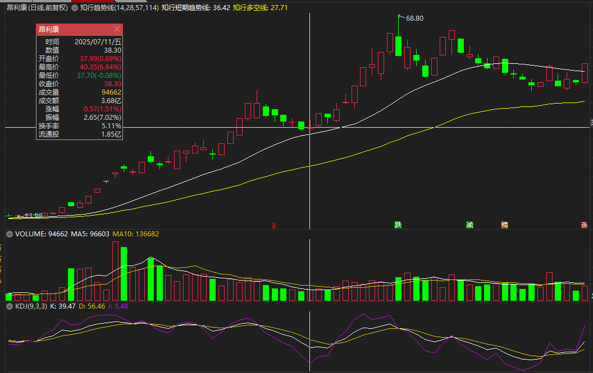
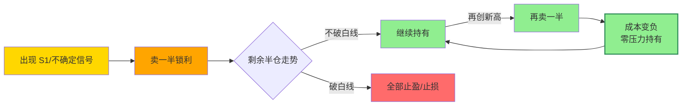
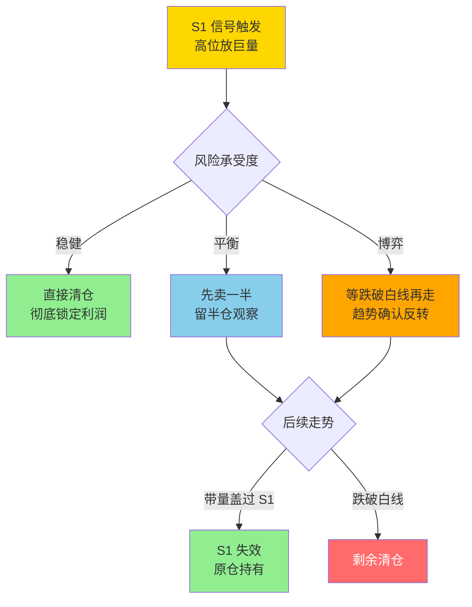
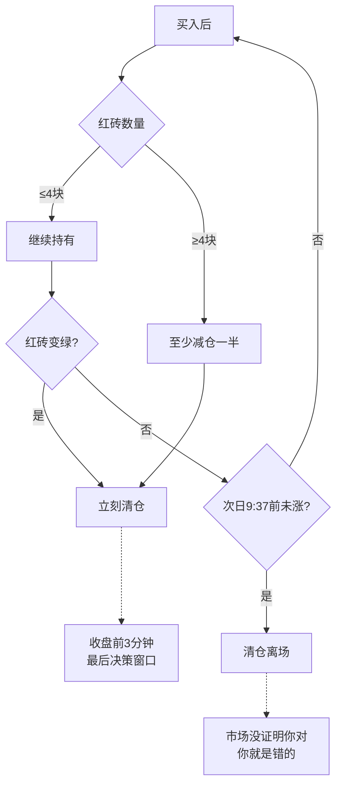
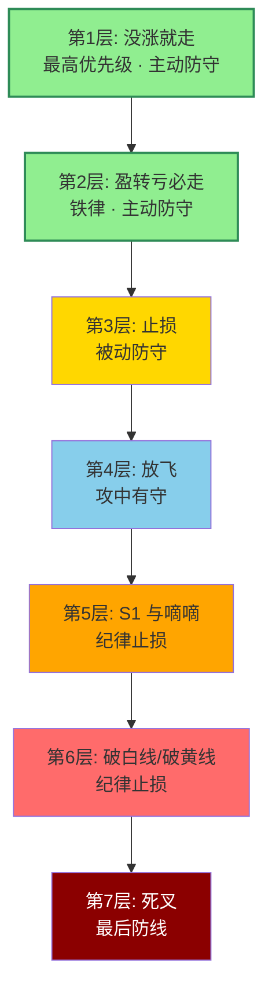
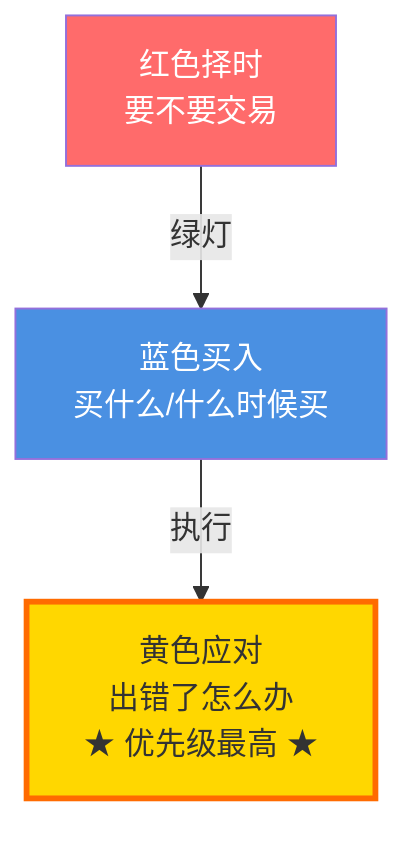

# 放飞止盈与破位退出

> [!info] 阅读口径
> 本篇上半部按交易流程综合整理；下半部完整保留归属本篇的原库条目正文，并保留原有数值、例外与冲突。原库表述属于特定方法论；其中收益、胜率、历史案例及市场判断未经本次独立核验。综合编排不是Z哥原话。跨条目冲突统一见 [[19-规则冲突与知识缺口]]。

## 退出有三种理由，不必等到亏损

价格止损处理判断失效；时间止损处理未按策略验证；盈利放飞处理加速、乖离或顶部风险。盈利仓也有风险，半仓放飞不等于剩余仓位免费。

## 七层应对如何落到动作

| 原库层次 | 触发情形 | 处理含义 | 使用边界 |
|---|---|---|---|
| 没涨就走 | 超短或所选策略未在规定时间证明判断 | 主动退出或按版本减仓 | 不套在全部长线底仓上 |
| 盈转亏必走 | 浮盈后跌回成本以下 | 不把盈利拖成亏损 | 原库也有减半口径，先确定版本 |
| 预设止损 | 失效价位被触发 | 执行退出，不补弱摊薄 | 不因等收盘而拖过即时止损 |
| 放飞 | 中阳加速、第四红砖或明显乖离 | 分批兑现 | 分批比例按具体战法 |
| S1与嘀嘀 | 出货预警或动态参考位破坏 | 按预设策略减仓或清仓 | S1存在严格全退和先减半两版 |
| 破白/黄线 | 波段或多空结构失去 | 白线减仓、黄线最终退出 | 有无一根修复期须预设 |
| 死叉 | 原趋势进一步反转 | 最后防线 | 不是前面触发后还要等的理由 |

原库把没涨和盈转亏排在止损前，意为提前主动防守；不表示硬止损已经破掉还要先等待“不涨观察期”。本表的先后解释是基于防守原则的综合。

## 放飞的几个具体版本

少妇战法是BBI上两根中大阳后减半；砖形图是第四块红砖至少减半；七层应对提到4%以上中阳启动分批放飞；开超市条目写离白线10%—20%时降仓，大资金每次1/10、小资金1/3；半仓策略是遇不确定先减半，余仓转白线。

这些不是必须同时达到的条件，也不是可以随意挑选的宽松选项。入场前选定具体策略和管理阶段，盈利后执行相应规则。

“再涨再减半就成本为负”只是原库心理比喻。减半是否收回本金取决于具体价格、数量与费用，不是只要卖一半就必然没有风险。

## S1以及S1—S5顶部图谱

| 图谱 | 观察特征 | 原库应对 |
|---|---|---|
| S1 | 连续加速后单日天量大阴，量超过建仓阳线 | 至少减半；严格版直接退出 |
| S2 | 次高点未创新高，却巨量长阴 | 不当作二次启动，撤退 |
| S3 | 新高后阶梯式放量下跌 | 第一阶开始防守，不逐阶补仓 |
| S4 | 双头均放巨量阴线，颈线失守 | 按顶部确认退出 |
| S5 | 高位绿肥红瘦，阳量小阴量大 | 识别后减仓，不必等暴跌 |

广义S1页也包含高位巨量阳线、滞涨，MACD共振页又强调放量大跌阴线。S1不是统一到唯一K线颜色的信号，选择版本须标明。后续带量盖过S1可能否定原顶部预警，但这是新证据，不是出现预警时提前赌它一定会被否定。

<!-- web-images-2026-10-20-退出跟踪-start -->
## 对应形态的历史图例

> [!note] 网络图例的阅读范围
> 以下图片来自[笔记在线：《Z哥_需要反复背诵的十张完美图形》](https://www.noteol.com/xuexi/ZG_wanmeituxing.html)，页面署名“管理员”，属于二级学习整理；截图的原始制作者未独立核实。图片按原文件本地保存，下载日期为2026-10-20。图中带有后续走势，只用于辨认结构；不据事后上涨确认信号必胜，也不以图文中的宽松口径覆盖本笔记规则。

### 上涨、乖离与回落放在同一张图中：昂利康

复用执行章节的同一原图，对照加速后的趋势线距离及后续回落。本图未标明S1或砖形状态，不能把顶部每根阴线都命名为S1，也不能直接数普通K线替代数砖。

[查看原图](https://s21.ax1x.com/2025/10/15/pVqtAtx.png)。

<!-- web-images-2026-10-20-退出跟踪-end -->

## DSZ与波段退出要分开

DSZ专页是第四红砖至少减半、尾盘最后三分钟红翻绿就走、买后不涨次日9:37前清；即时跌破止损不等收盘。短线综合手册将DSZ另总结成“绿砖破白线、连续两绿、放量滞涨”，与专页不同。

波段少妇战法则有连续两日收盘跌破BBI；长线看周线趋势与长期逻辑。不能拿波段两天观察期去延长DSZ超短失败仓。

## 明确破坏的四类图形

周线空头发散；历史高位跌破黄线且收不回；加速后均线高度发散并转弱；高位横盘后破黄线且白线同步向下。原库“十张死亡K线图”把这些作为防守案例，强调下跌趋势不能用击穿对手盘来辩护。

卖出后保留原图和原因。重新入场需新买点，不能因为卖后反弹立刻追买；同时不把“走了不看”理解为永远禁止客观复盘。

## 原库理论详解

以下按原库概念页保留正文；仅调整标题层级、内部链接和来源展示，不把整理者的结论升级为已验证事实。

### 原库条目：半仓放飞策略

原概念页：/Users/nanan/Documents/ChatGPT/Z哥知识库/references/半仓放飞策略.md  
原页更新时间：2026-04-18。来源路径是追溯线索，本Skill未附这些路径对应的原文。

#### 定义

> [!abstract] 一句话定义
> 半仓放飞策略是遇到不确定信号时的持仓管理方法——**卖一半锁定利润,剩下一半用白线当牵牛绳**博取更大收益。**跌了不崩,涨了不踏空**,根本性解决"拿不住票"的问题。

#### 关键信息

##### 使用方法
- 遇到S1信号或不确定图形时，卖一半
- 剩下的一半用白线当牵牛绳，不跌破白线就不走
- 再涨再卖一半，成本变成负的，完全没压力

##### 优势
- 跌了：已锁定一半利润，心态不崩
- 涨了：还有仓位在里面，不踏空
- 解决"拿不住票"的根本问题

#### 放飞循环流程

> [!tip] 心法
> **白线就是牵牛绳**,绳没断就不松手。再涨再卖一半,**成本归零的票最敢拿**。

#### 关联连接
- [[13-放飞止盈与破位退出#原库条目：S1信号|S1信号]] — 触发半仓放飞的时机
- [[11-仓位分工与组合轮动#原库条目：底仓与动态仓|底仓与动态仓]] — 仓位管理的不同维度

### 原库条目：S1信号

原概念页：/Users/nanan/Documents/ChatGPT/Z哥知识库/references/S1信号.md  
原页更新时间：2026-04-18。来源路径是追溯线索，本Skill未附这些路径对应的原文。

#### 定义

> [!abstract] 一句话定义
> S1 信号是阶段性顶部的**预警信号** — 高位放巨量的 K 线(无论阴阳)提示主力可能在出货。Z 哥心法:**宁可信其有,不可信其无**。

#### 关键信息

##### 识别标准
- 在相对高位出现不该放的量(放巨量)
- 无论是阳线还是阴线,只要在高位放量就是预警
- 放量后股价滞涨更是确认信号

##### 处理方式
1. **先卖一半**:锁定一半利润,留一半观察
2. **跌破白线再走**:等趋势确认反转再离场
3. **直接清仓**:彻底锁定利润

##### 例外情况
- 如果后续股价带量把 S1 放量阴线"盖过去",S1 信号失效
- 但对于普通交易者,一律按 S1 处理最稳妥

##### 核心原则
- **宁可信其有,不可信其无**
- **控制风险永远是第一位的,不要赌**
- 半仓放飞策略配合 S1 使用效果最佳

#### S1 三档处理决策图

> [!danger] S1 优先级最高
> S1 是整个体系**优先级最高的保命信号** — 比 MACD、比砖形图、比任何买点信号都高。看到 S1 不要找理由,先卖再说。

#### 关联连接
- [[06-B1入场与建仓波鉴别#原库条目：B1建仓波|B1建仓波]] — 买入信号，与S1构成买卖闭环
- [[13-放飞止盈与破位退出#原库条目：半仓放飞策略|半仓放飞策略]] — 遇到S1时的持仓管理方法
- [[04-趋势结构与量价工具#原库条目：白线黄线系统|白线黄线系统]] — S1配合趋势线使用
- [[13-放飞止盈与破位退出#原库条目：DSZ战法|DSZ战法]] — S1是卖出规则的重要补充

### 原库条目：DSZ战法

原概念页：/Users/nanan/Documents/ChatGPT/Z哥知识库/references/DSZ战法.md  
原页更新时间：2026-04-18。来源路径是追溯线索，本Skill未附这些路径对应的原文。

#### 定义

> [!abstract] 一句话定义
> DSZ（砖形图）战法是基于砖形图的超短线卖出战法，核心是三条不可逾越的卖出铁律，用"数砖"的方式量化持仓风险。

#### 关键信息

> [!danger] 三条铁律
> 1. **数完四块红砖必须减仓**：至少卖一半，红砖变绿立刻走，不做4+4
> 2. **收盘前三分钟红砖变绿立刻走**：覆盖所有持仓情况，是最后决策窗口
> 3. **买入后不涨次日9:37前清仓**：市场没证明你对，你就是错的

##### 止损设置
- 买入当天被套：止损位设在买入K线最低价往下3-5个价位
- 跌破止损位立刻卖，不等收盘确认

##### 选股标准
- 只做N型结构（下跌-下蹲-爆发）
- 白线之上，黄线在白线之上
- 长上影线的票不买
- 跳空的票不做
- 三波不做（走了两波上涨的第三波不碰）

#### DSZ卖出决策流程

#### 关联连接
- [[05-MACD与砖形图共振#原库条目：砖形图|砖形图]] — DSZ的底层工具
- [[13-放飞止盈与破位退出#原库条目：S1信号|S1信号]] — 补充卖出信号
- [[05-MACD与砖形图共振#原库条目：四块砖交易体系|四块砖交易体系]] — DSZ的上层理论

### 原库条目：七层应对

原概念页：/Users/nanan/Documents/ChatGPT/Z哥知识库/references/七层应对.md  
原页更新时间：2026-04-26。来源路径是追溯线索，本Skill未附这些路径对应的原文。

#### 定义

> [!abstract] 一句话定义
> 知行交易模块中**黄色应对模块的七层防守体系**，按优先级从高到低排列。核心：**"没涨就走"和"盈转亏必走"是两条不可逾越的铁律，优先级远高于止损**。

#### 七层优先级瀑布图

> [!danger] 两条不可逾越的铁律
> **第 1 层"没涨就走" + 第 2 层"盈转亏必走"** 优先级远高于第 3 层止损 — 大多数散户的问题不是不止损,而是从不执行前两层的主动防守。

#### 七层应对（优先级从高到低）

##### 1. 没涨就走（最高优先级）

- 华尔街幽灵核心法则，避免亏损的最佳方式
- 牛逼的票买进去当天就会脱离成本区
- **市场没有证明你是对的，就说明你错了**，直接拍掉换一个
- 买完在盈亏线附近反复震荡 → 说明市场不认可，走

##### 2. 盈转亏必走

- 有浮盈但随后跌回成本线以下 → **无条件卖出**
- 不要抱侥幸心理认为"还会涨回来"

##### 3. 止损

- 前两条都没做到时的最后防线
- 止损位：买入 K 线下 3-5 个价位，或横盘区间下沿
- **明确反对越跌越补仓**，建议直接放弃 SB1 买点

##### 4. 放飞

> [!tip] 放飞 = 进攻中的防守
- 中阳线放飞：出现 4% 以上中阳线，开始分批放飞
- 第四块砖放飞：**铁律**，专精图走到第四块红砖，至少卖出一半
- 放飞原则：越往后放飞比例越大
  - 第一块砖涨 8% → 卖 10%
  - 第四块砖涨 7% → 卖 50%
  - S1 出现 → 清仓剩余

##### 5. S1 与嘀嘀

- **S1**：最经典出货形态，出现后谢主力不杀之恩，立即卖出
- **嘀嘀**：高位阶梯量出货，连续两根大阴线，第二根收盘价低于第一根最低价 → 无条件卖出

##### 6. 破白线与破黄线

- **白线**：波段趋势线，"牛股不破白线"，跌破 = 中级波段结束
- **黄线**：主力成本线，"黄线之上大哥在，黄线之下大哥不在"
  - 跌破黄线后允许"击穿对手盘忍一根"
  - 第二根依然收在黄线之下 → **必须清仓**

##### 7. 死叉（最后防线）

- 死叉 = 趋势彻底反转
- 建议直接放弃，不要抱任何幻想

#### 与三模块的关系

在 [[01-交易闭环与策略边界#原库条目：知行交易模块|知行交易模块]] 三层架构中：

**应对模块覆盖一切**：任何模块出问题，后续模块全部停止。

#### 与 [[17-心理防守与概率认知#原库条目：防守哲学|防守哲学]] 的关系

七层应对是防守哲学的**操作化展开**：
- 第一-二层（没涨就走/盈转亏必走）= 主动防守
- 第三层（止损）= 被动防守
- 第四层（放飞）= 攻中有守
- 第五-七层（出货信号/破线/死叉）= 纪律止损

#### 关联连接

- [[01-交易闭环与策略边界#原库条目：知行交易模块|知行交易模块]] — 七层应对是黄色应对模块的具体内容
- [[17-心理防守与概率认知#原库条目：防守哲学|防守哲学]] — 七层应对的哲学基础
- [[13-放飞止盈与破位退出#原库条目：S1信号|S1信号]] — 第五层应对的核心信号
- [[10-盘中执行与止损计划#原库条目：嘀嘀战法|嘀嘀战法]] — 第五层应对的核心信号
- [[04-趋势结构与量价工具#原库条目：白线黄线系统|白线黄线系统]] — 第六层应对的技术基础
- [[12-持股评分与洗盘应对#原库条目：击穿对手盘|击穿对手盘]] — 第六层黄线破位后的"忍一根"纪律
- [[13-放飞止盈与破位退出#原库条目：半仓放飞策略|半仓放飞策略]] — 第四层放飞的具体执行

### 原库条目：逃顶艺术

原概念页：/Users/nanan/Documents/ChatGPT/Z哥知识库/references/逃顶艺术.md  
原页更新时间：2026-04-26。来源路径是追溯线索，本Skill未附这些路径对应的原文。

原页标注的来源线索

- raw/01-zettaranc/知行小菜鸟/[202601250035]42逃顶的艺术主力出货的五种绝杀图谱与人性博弈.md

#### 定义

> [!abstract] 一句话定义
> 逃顶艺术是主力出货的**五种绝杀图谱(S1~S5)** — 从量价/人性博弈角度识别顶部派发行为,是 [[13-放飞止盈与破位退出#原库条目：S1信号|S1信号]] 和 [[13-放飞止盈与破位退出#原库条目：主力出货五种经典方式|主力出货五种经典方式]] 的进阶版本。

#### S1~S5 五种绝杀图谱

##### S1：加速后单日放天量大阴
- **形态**：连续加速上涨后，顶端单日放出历史天量，收大阴线
- **量能**：该阴线成交量 > 主力建仓期任何一根阳线成交量
- **人性**：散户"涨太多了该回调了吧"，主力"终于有人接盘了"
- **应对**：当天无脑减仓至少一半

##### S2：次高点放巨量长阴（二次冲顶失败）
- **形态**：第一次回调后再冲高，未创新高即放巨量长阴
- **人性**：最阴险的一种，专门骗"二次启动"的资金
- **特征**：次高点成交量 > 最高点成交量（量价背离）
- **应对**：不幻想"洗盘"，直接跑

##### S3：新高后阶梯放量下跌（温水煮青蛙）
- **形态**：创新高后不暴跌，而是阶梯式放量下跌，每跌一阶都放量
- **人性**：散户每阶都以为"洗盘到位了"，实则是主力在每个台阶派货
- **特征**：阴线放量 > 阳线缩量，持续多日
- **应对**：第一根阶梯阴线就减仓，不要等

##### S4：双头双放量巨阴（M头确认）
- **形态**：两个相近高点都伴随放量长阴，中间颈线被破
- **人性**：第一个头有人跑，第二个头有人信"突破了"
- **特征**：教科书级顶部信号，双顶确认
- **应对**：颈线破位即确认，清仓

##### S5：顶部绿肥红瘦（温水出货）
- **形态**：顶部连续多日小阴小阳，但阴线量 > 阳线量
- **人性**：看起来"风平浪静"，实则主力"慢慢出货"
- **特征**：不涨不跌每天缩量阴跌，日K振幅越来越小
- **应对**：识别后即减仓，不等暴跌

#### 废除"假阴真阳"概念

> [!important] 知行小菜鸟明确观点
> 废除"假阴真阳"这一模糊概念。阴线就是阴线，不应给自己找"其实是阳线"的心理安慰。出货识别的核心是**看量不看色**——放量阴线即危险信号，不管当天收盘价是否比开盘价高。

#### 出货后的应对纪律

1. **不抄底**：出货后的下跌不是买点，是刀口
2. **不补仓**：不要在下跌途中"摊低成本"
3. **不幻想"洗盘"**：五图谱的本质都是派发，不是洗盘
4. **执行 [[17-心理防守与概率认知#原库条目：防守哲学|防守哲学]]**：仓位防火墙 → 个股防火墙 → 心态防火墙
5. **参考 [[10-盘中执行与止损计划#原库条目：嘀嘀战法|嘀嘀战法]] 减法纪律**：减仓要果断，不要犹豫

#### 与 [[13-放飞止盈与破位退出#原库条目：主力出货五种经典方式|主力出货五种经典方式]] 的关系

> [!info] 两套体系的关系
> 两套体系描述的是同一组现象，但角度不同：
> - **五种经典方式**（大富翁小菜鸟整理）：侧重K线形态描述
> - **S1~S5绝杀图谱**（知行小菜鸟原文）：侧重量价博弈+人性博弈
> - 两者可以互相参照使用，S1~S5 体系更精细

#### 关联连接

- [[13-放飞止盈与破位退出#原库条目：S1信号|S1信号]] — S1是其中的第一种
- [[13-放飞止盈与破位退出#原库条目：主力出货五种经典方式|主力出货五种经典方式]] — 同一现象的不同表述体系
- [[17-心理防守与概率认知#原库条目：防守哲学|防守哲学]] — 出货识别后的执行框架
- [[10-盘中执行与止损计划#原库条目：嘀嘀战法|嘀嘀战法]] — 减仓节奏纪律
- [[04-趋势结构与量价工具#原库条目：关键K|关键K]] — 量价节奏判断
- [[16-筹码资金与板块轮动解释#原库条目：筹码战争|筹码战争]] — 出货是筹码逆向流动
- [[17-心理防守与概率认知#原库条目：交易免疫系统|交易免疫系统]] — 零伤亡特种作战理念

### 原库条目：十张死亡K线图

原概念页：/Users/nanan/Documents/ChatGPT/Z哥知识库/references/十张死亡K线图.md  
原页更新时间：2026-04-26。来源路径是追溯线索，本Skill未附这些路径对应的原文。

#### 定义

> [!abstract] 一句话定义
> Z 哥 260302 直播提出的**四类死亡图形 + 四条保命铁律**。核心思想：**靠保守活下来，不靠激进赚快钱**。一年 255 个交易日，200 天空仓都没关系，只抓看得懂的机会。

#### 四类死亡图形

##### 第一类：周线空头排列的下跌趋势票

**核心判据**：周线级别，最短周期均线在最下面，小/中/长/超长周期依次往下排 → 标准空头排列。

- **青花 205**：大阴线击穿对手盘，但**收不回来就是破位，不是击穿**。周线空头趋势下，破位第一时间走
- **赛赛**：高位跳空破黄线，最多等一根收回，**不是跌停就跌 7% 先走，别犹豫**
- **铁律**：周线空头的票，所有日线级别的"击穿对手盘"说法都不成立，破位就是破位

##### 第二类：历史高位的破位信号

- **IBM**：黄线破掉后的弱反弹**一定要拍掉**，等周线 B1 信号出来再进。历史最高位进去只能做短线，两天不涨就拍
- **微软**：高位 S1 信号后 A 杀，**跌破黄线第一天或第二天必须走**。反弹到黄线遇阻是最后逃命机会
- **亚马逊**：周线历史高位，高位黄线破了最多等一根，**跳空下来还放量的直接撤**

**共同路径**：跌破黄线 → 反弹遇阻 → 确认压制 → 破位下跌

##### 第三类：加速上涨后的高位发散

- **耐克**：历史高位突然跳空下杀打到周线趋势线 → 必须走，不抄底
- **米儿**：半年三倍（16→61），均线完全开花，**白线开始往下拐就确认压力位立刻走**
- **理想汽车（港股）**：周线级别下跌通道中，所有日线上涨都是反弹不是趋势。下跌趋势里不存在有效击穿对手盘

##### 第四类：高位横盘破位的双重确认

- **寒王**：高位横盘很久，突然跌破黄线 + 白线同步下行 = 双保险破位。**只要跌破黄线就触发离场，不需要等创新低**
- 破位后放量阴线 → 筹码完全松动，主力在出逃
- **永远只跟白线在黄线上方的票玩，黄线在白线上方的标的看都不要看**

#### 四条保命铁律

1. **周线空头排列的票绝对不碰**：所有均线向下发散，哪怕走势再好看也只是反弹，破位立刻走
2. **高位黄线跌破必须走**：尤其是历史最高价附近，最多等一根收回，收不回来立刻止损，卖飞也没关系
3. **加速上涨后的大发散绝对不碰**：半年涨三倍以上，均线完全开花，不接最后一棒
4. **永远不要在下跌趋势里抄底**：以为的底可能只是半山腰，下跌趋势的支撑都是用来破的

#### 与体系的关系

- 与 [[12-持股评分与洗盘应对#原库条目：击穿对手盘|击穿对手盘]] 的区分：击穿对手盘**只在多头趋势里成立**，周线空头趋势下破位就是真破位
- 与 [[13-放飞止盈与破位退出#原库条目：逃顶艺术|逃顶艺术]] 的关系：逃顶艺术关注量价博弈的顶部信号，死亡 K 线图关注**趋势破位的保命底线**，一攻一守
- 与 [[04-趋势结构与量价工具#原库条目：白线黄线系统|白线黄线系统]] 的关系：黄线是绝对生命线，高位破黄线 = 逃命信号
- 与 [[17-心理防守与概率认知#原库条目：防守哲学|防守哲学]] 的关系：死亡 K 线图是防守哲学的具体图形化落地

#### 关联连接

- [[12-持股评分与洗盘应对#原库条目：击穿对手盘|击穿对手盘]] — 只在多头趋势成立，空头趋势不适用
- [[13-放飞止盈与破位退出#原库条目：逃顶艺术|逃顶艺术]] — 互补：逃顶看量价顶部，死亡 K 线看趋势破位
- [[04-趋势结构与量价工具#原库条目：白线黄线系统|白线黄线系统]] — 黄线是生命线的技术基础
- [[17-心理防守与概率认知#原库条目：防守哲学|防守哲学]] — 防守优先的具体体现
- [[13-放飞止盈与破位退出#原库条目：S1信号|S1信号]] — 高位 S1 与死亡 K 线图的交叉验证
- [[20-知识来源与理论适用边界#原库条目：Zettaranc|Zettaranc]] — 体系作者

### 原库条目：主力出货五种经典方式

原概念页：/Users/nanan/Documents/ChatGPT/Z哥知识库/references/主力出货五种经典方式.md  
原页更新时间：2026-04-26。来源路径是追溯线索，本Skill未附这些路径对应的原文。

原页标注的来源线索

- raw/01-zettaranc/大富翁小菜鸟/[202510100709]温故知新主力出货五种经典方式.md
- raw/01-zettaranc/TANGOO/[202509180300]主力出货的五种经典方式.md
- raw/01-zettaranc/知行小菜鸟/[202601250035]42逃顶的艺术主力出货的五种绝杀图谱与人性博弈.md

#### 定义

> [!abstract]
> Z 哥总结的顶部出货五种 K 线/量价信号清单,与 [[13-放飞止盈与破位退出#原库条目：S1信号|S1信号]] 形成完整顶部识别体系。出货识别是 [[17-心理防守与概率认知#原库条目：防守哲学|防守哲学]] 的实战入口。

> [!danger] 这五种信号一旦出现即"无脑减仓",不留侥幸。

#### 关键信息

##### 五种经典出货方式

- **第一种:加速后单日放天量大阴**
  - 对应 [[13-放飞止盈与破位退出#原库条目：S1信号|S1信号]] 经典版
  - 加速段顶端单日放出历史天量,收大阴线
  - 主力一次性派发,毫不掩饰

- **第二种:加速后次高点突然巨量长阴**
  - 失败的二次冲顶
  - 第一次回调后再冲高,但未创新高即放巨量长阴
  - 比第一种更阴险,常常骗"二次启动"的资金

- **第三种:新高后阶梯放量下跌**
  - 温水煮青蛙式派发
  - 创新高后不暴跌,而是阶梯式放量下跌(每跌一阶都放量)
  - 散户误以为是"洗盘",实则主力在每个台阶派货

- **第四种:双头双放量巨阴**
  - M 头确认
  - 两个相近高点都伴随放量长阴,中间颈线被破
  - 是教科书级顶部信号

- **第五种:顶部绿肥红瘦**
  - 连续多日小阴小阳但阴线量大
  - 阳线缩量、阴线放量 — 量价背离的派发版
  - 区分关键参 [[04-趋势结构与量价工具#原库条目：关键K|关键K]] 节奏判断

##### 废除"假阴真阳"概念

> [!important] 知行小菜鸟明确观点(2026-01)
> 废除"假阴真阳"这一模糊概念。阴线就是阴线，不应给自己找"其实是阳线"的心理安慰。出货识别的核心是**看量不看色**——放量阴线即危险信号。

##### 与 S1~S5 绝杀图谱的关系

> [!info] 两套体系
> 本概念页的五种方式与 [[13-放飞止盈与破位退出#原库条目：逃顶艺术|逃顶艺术]] 中的 S1~S5 绝杀图谱描述同一组现象：
> - 第一种 ≈ S1（加速后单日放天量大阴）
> - 第二种 ≈ S2（次高点放巨量长阴）
> - 第三种 ≈ S3（阶梯放量下跌）
> - 第四种 ≈ S4（双头双放量巨阴）
> - 第五种 ≈ S5（顶部绿肥红瘦）
> 两者互相参照，[[13-放飞止盈与破位退出#原库条目：逃顶艺术|逃顶艺术]] 版本更精细、含人性博弈分析

##### 应对原则

- 出货识别后:不抄底、不补仓、不幻想"洗盘"
- 执行 [[17-心理防守与概率认知#原库条目：防守哲学|防守哲学]] 三层防火墙:仓位防火墙 → 个股防火墙 → 心态防火墙
- 减仓节奏可参考 [[10-盘中执行与止损计划#原库条目：嘀嘀战法|嘀嘀战法]] 的减法纪律

##### 与筹码战争的关系

- 出货是筹码从主力到散户的逆向流动
- 是 [[16-筹码资金与板块轮动解释#原库条目：筹码战争|筹码战争]] 中"派发段"的具体形态
- 五种方式本质都是同一件事:主力把筹码扔给接盘的人

#### 关联连接

- [[13-放飞止盈与破位退出#原库条目：S1信号|S1信号]] — 顶部出货的核心信号系统
- [[16-筹码资金与板块轮动解释#原库条目：筹码战争|筹码战争]] — 出货是筹码逆向流动
- [[17-心理防守与概率认知#原库条目：防守哲学|防守哲学]] — 出货识别后的执行框架
- [[10-盘中执行与止损计划#原库条目：嘀嘀战法|嘀嘀战法]] — 减仓节奏纪律
- [[04-趋势结构与量价工具#原库条目：关键K|关键K]] — 量价节奏判断
- [[16-筹码资金与板块轮动解释#原库条目：筹码三段论|筹码三段论]] — 股东户数判断主力出货
- [[20-知识来源与理论适用边界#原库条目：Zettaranc|Zettaranc]] — 知识体系作者
