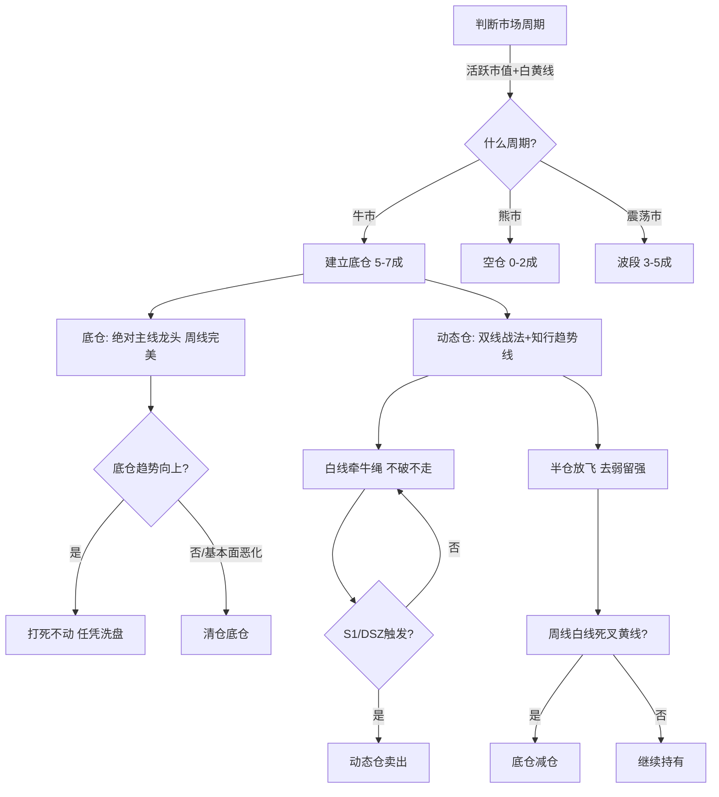

# 长线底仓与牛市ETF管理

> [!info] 阅读口径
> 本篇上半部按交易流程综合整理；下半部完整保留归属本篇的原库条目正文，并保留原有数值、例外与冲突。原库表述属于特定方法论；其中收益、胜率、历史案例及市场判断未经本次独立核验。综合编排不是Z哥原话。跨条目冲突统一见 [[19-规则冲突与知识缺口]]。

## 长期持有看什么，动态仓看什么

底仓的理由是长期价值、主线逻辑和大周期上涨，动态仓的理由是价格结构与波段信号。长期持有不等于买入后不再验证；原库长线手册将基本面恶化、大趋势持续反转及周期切换列为边界。

## 长线的实际工作顺序

判断周期与周线白黄趋势；确认长期逻辑和主线；等待周B1或周趋势下的日线入场；按计划分批；动态仓独立执行止损、放飞和强弱管理；每周看结构，每月/季度复查逻辑与配置。

手册举例牛市初期5—7成、中期7—9成、末期3—5成，熊市0—2成、震荡3—5成；底仓/动态仓又有6:4或7:3。它们是该手册场景表，不应与主题5%上限、ETF单份建仓等混成一个账户通用模型。

## 牛市持股与逃顶

原库牛市策略强调分散、底仓与动态仓协作，避免单吊、过度换股和提前卖飞；同时要求加速放飞与阶段顶部防守。勇气是对有效信号敢执行，决心也包含破位敢退出，技巧是把情绪转换为可检查条件。

“2024捡钱、2025估值修复、2026交易、2027业绩”等年度叙事，以及4800—5200、4500等指数剧本，均是原库当时的判断，不是截至整理日核验过的市场结论，也不应作为当前账户操作前提。

## 牛市ETF的四步与边界

原库前提是强趋势、多头增量资金、使用者不擅长或没时间管理个股。选主线或主题ETF；在B1买足一份计划仓位；波段持有，破位次日不收回退出；加速减仓并按条件做高低切换。

“一次买够计划2.5万”与“全账户一次满仓”不同。反对倒金字塔是反对越涨越追加使成本恶化；它不意味着无论风险都买相同金额。

该条目把一些行业指数也称“宽基”，并有ETF不会骗线、熊市应重仓个股等强表述。这里仅保留其方法论语境，不据此确认产品分类或风险差异。具体ETF代码、跟踪指数、交易规则不在本次原库理论整理范围。

## 指数贡献与价值投资是不同观察路径

指数贡献策略看贡献榜前10的大权重，结合主线、趋势、回撤与爆发减仓。贡献榜说明对指数的贡献，不能单独证明下一步收益或资金身份；其“BBI黄线”与常规BBI白线有术语冲突。

价投条目分估值极低、基本面改变、通胀共识资产、周期低点四种类型，强调逻辑破坏时退出。三种波段路径则区分左侧低估、超跌反弹、多头控盘，主流程偏向第三种。不能用“左侧输时间不输钱”作为任何低估股不亏损的保证。

## 卖出与重新建立底仓

底仓逻辑破坏、大周期趋势反转和牛市尾段风险都要重新评估。短期情绪与实际逻辑变化要区分，但原库没有完整的财务分析阈值和行业尽调清单，不能补成Z哥已规定的数字。卖出后出现新周线买点仍须按新交易审视，不以“曾长期看好”免检。

## 原库理论详解

以下按原库概念页保留正文；仅调整标题层级、内部链接和来源展示，不把整理者的结论升级为已验证事实。

### 原库条目：长线交易操作手册

原概念页：/Users/nanan/Documents/ChatGPT/Z哥知识库/references/长线交易操作手册.md  
原页更新时间：2026-04-19。来源路径是追溯线索，本Skill未附这些路径对应的原文。

<details>
<summary>原页标注的来源线索</summary>

- wiki/zettaranc/sources/摘要-zhihang-精水流深-batch-01.md
- wiki/zettaranc/sources/摘要-zhihang-空谷幽兰-batch-03.md

</details>

#### 研究问题
中长线投资者（持仓周期1-3个月甚至完整牛熊周期）如何运用Zettaranc交易体系进行月度/季度级别的资产配置与波段管理？

#### 核心结论

> [!abstract] 五句话概括
> 1. **"底仓守信仰，动态仓守纪律"**，两者性质不同、管理规则截然不同
> 2. 穿越牛熊的关键是**防守而非进攻**：先求不亏钱，再求赚大钱
> 3. **周线格局定方向，日线找买卖点**：长周期有序，短周期服从长周期
> 4. 牛市拿住、熊市空仓、震荡市波段：**周期判断比个股选择重要10倍**
> 5. 长线不是死扛：底仓也有止损线（基本面恶化或趋势彻底反转）

#### 长线交易流程图



#### 不同周期的仓位策略

##### 一、周期判断：先定牛熊，再谈操作

**第一步：判断当前市场周期**
- **[[17-心理防守与概率认知#原库条目：周期与人性|周期与人性]]**：A股遵循明显的周期性规律，牛熊交替不可违逆
- **[[02-择时过滤与市场环境#原库条目：活跃市值|活跃市值]]**：判断多空区间的核心指标，确定当前处于牛市、熊市还是震荡市
- **[[04-趋势结构与量价工具#原库条目：白线黄线系统|白线黄线系统]]**：周线级别的白黄线位置决定大方向
  - 白线在黄线上方且距离拉大 → 牛市确立，重仓持有
  - 白线在黄线下方且距离拉大 → 熊市确立，空仓或极低仓位
  - 白黄纠缠 → 震荡市，波段操作，不赌方向

> [!warning] 开仓纪律
> 只有确认市场周期后才决定仓位。熊市绝不重仓，牛市绝不空仓。

**不同周期的核心策略**：
| 市场周期 | 仓位建议 | 核心操作 |
|---------|---------|---------|
| 牛市初期 | 5-7成 | 建立底仓，动态仓滚动 |
| 牛市中期 | 7-9成 | 底仓不动，动态仓做T |
| 牛市末期 | 3-5成 | 逐步减仓，准备逃顶 |
| 熊市 | 0-2成 | 空仓为主，偶尔反弹 |
| 震荡市 | 3-5成 | 波段操作，高抛低吸 |

##### 二、资产配置：底仓+动态仓的4231阵型

**第二步：建立底仓**
- **底仓定位**：看好行业/公司的长期价值，准备拿完整个牛市周期
- **选股标准**：
  - 只选**[[03-选股后验证与候选池管理#原库条目：绝对主线|绝对主线]]**中的核心龙头（如队长、宁子等）
  - 基本面扎实，有长期成长逻辑
  - 周线N型结构完美，大趋势向上
- **底仓纪律**：
  - 除非基本面根本性变化，否则不管短期涨跌都不动
  - 赚的是整个牛市的贝塔收益
  - 底仓不与股票谈恋爱，但与趋势谈恋爱

> [!danger] 底仓纪律
> 除非基本面根本性变化，否则不管短期涨跌都不动。底仓不是死扛的借口，底仓也有止损线。

**第三步：管理动态仓**
- **动态仓定位**：用来做波段、做短线，赚市场波动的钱
- **操作规则**：
  - 严格遵守交易纪律，走坏了立刻拍掉
  - 用**[[04-趋势结构与量价工具#原库条目：双线战法|双线战法]]**和**[[04-趋势结构与量价工具#原库条目：知行趋势线|知行趋势线]]**判断波段高低点
  - 黄线是最终止损线，跌破且收不回必须离场
- **仓位比例**：底仓:动态仓建议为 6:4 或 7:3

##### 三、买入：少妇战法的长线化应用

**第四步：择时与选股**
- **择时**：不见兔子不撒鹰，大盘不进入多头区间不开仓
- **选股**：
  - **[[03-选股后验证与候选池管理#原库条目：三最原则|三最原则]]**：只选最美（周线完美图形）、只买最强（主线龙头）、只拿最硬（基本面最扎实）
  - **[[16-筹码资金与板块轮动解释#原库条目：顺周期轮动|顺周期轮动]]**：按金融→资源→制造→消费的板块轮动规律配置底仓

**第五步：等B1（长线标准）**
- 长线B1要求比短线更严格：
  - **周线B1优先**：日线B1容易受短期波动干扰，周线B1信号更稳
  - **J值标准**：长线底仓可在J值 < 13 时分批建仓，不必等到-10以下（少妇战法严格标准更适合动态仓）
  - **回踩关键支撑位**：年线、半年线、前期平台等重要支撑
- **建仓节奏**：
  - 首次建仓3成（试仓）
  - 确认趋势后加仓至目标仓位
  - 绝不一次性满仓

##### 四、持仓：跨越周期的持仓心法

**第六步：底仓持仓纪律**
- **牛市中**：底仓打死不动，任凭洗盘折腾
  - 像钉子一样钉在庄家的粮仓里，成为"硕鼠"
  - 主力灭不掉你，只能带着你一起飞
- **震荡市中**：底仓不动，动态仓高抛低吸
- **熊市中**：底仓也要减仓，甚至清仓（底仓不是死扛的借口）

**第七步：动态仓波段操作**
- **白线当牵牛绳**：动态仓不跌破白线不走
- **半仓放飞**：遇到不确定信号，卖一半动态仓锁定利润
- **去弱留强**：动态仓只留最强的，弱的果断止损换强的

> [!quote] 心态管理
> - 装睡的拔河：交易像拔河，绝大部分时间是垃圾时间，等待力量衰竭的临界点
> - 建立周线格局：日线看不懂的切换到周线，周线看不懂的放弃
> - 均线只看趋势：不要把均线当支撑位去精准预测点位，那是极其危险的

##### 五、卖出：逃顶与止损

**第八步：长线卖出触发条件**
1. **基本面恶化**：行业逻辑被破坏、公司业绩暴雷 → 底仓也必须清仓
2. **大趋势反转**：周线白线死叉黄线，且持续向下 → 底仓减仓
3. **牛市末期逃顶**：
   - **[[15-长线底仓与牛市ETF管理#原库条目：牛市策略|牛市策略]]**中的逃顶信号
   - 市场情绪极度狂热、身边从不炒股的人开始推荐股票
   - 逐步减仓，不要试图卖在最高点
4. **动态仓常规卖出**：
   - 连续两日收盘跌破BBI线清仓
   - S1信号或DSZ战法触发

> [!warning] 卖出铁律
> - 底仓卖出后不再回头（除非重新出现周线B1）
> - 不要试图做"倒T"（卖出后更低买回），长线交易者没有这种能力
> - 止盈后即使继续涨也不后悔，只赚认知范围内的钱

##### 六、月度/季度复盘

**长线复盘框架**：
- [ ] 当前市场周期判断是否正确？
- [ ] 底仓的基本面是否发生变化？
- [ ] 底仓的周线趋势是否仍然向上？
- [ ] 动态仓的波段操作是否遵循纪律？
- [ ] 仓位配置是否符合当前周期？
- [ ] 是否被短期波动影响了长期判断？

**关键反思问题**：
- 这次交易的周期判断是对是错？
- 底仓和动态仓的界限是否清晰？
- 有没有把底仓当动态仓乱动，或把动态仓当底仓死扛？

#### 长线vs短线的核心差异

| 维度 | 短线（1-5天） | 长线（1-3个月+） |
|-----|-------------|----------------|
| 核心工具 | 砖形图、DSZ、量比 | 白线黄线、周线格局 |
| B1标准 | J值 < 13，日线为主 | 周线B1优先，分批建仓 |
| 止损策略 | 单根K线止损（2-3%） | 基本面恶化或趋势反转才止损 |
| 仓位管理 | 动态仓为主，快进快出 | 底仓+动态仓，底仓守信仰 |
| 核心原则 | 择时大于选股、去弱留强 | 防守哲学、框架式交易 |
| 盯盘频率 | 每日盯盘，盘中操作 | 每周复盘，月度调仓 |
| 盈亏比目标 | 10:1 | 3:1 或更高 |
| 资金量建议 | 100万以下 | 100万以上或有稳定现金流 |
| 适用市场环境 | 震荡市、结构性牛市 | 牛市主升浪、完整牛熊周期 |
| 单次仓位 | 单票不超过10% | 底仓单票可达20-30% |
| 持仓数量 | 5-10只（开超市） | 3-5只核心底仓+动态仓 |
| 信息来源 | 分时图、量比、盘口 | 周线图、基本面、行业研报 |
| 情绪管理 | 克服手痒、拒绝噪音 | 装睡的拔河、建立周线格局 |
| 卖出标准 | S1/DSZ/跌破BBI | 基本面恶化/周线趋势反转 |
| 交易频率 | 一周最多两枪 | 一月最多调仓一次 |

#### 七、不同市场环境下的长线策略

##### 牛市初期
- **核心任务**：建立底仓，锁定优质筹码
- **建仓节奏**：分批建仓，不追高，等周线B1回调时加仓
- **底仓选择**：[[03-选股后验证与候选池管理#原库条目：绝对主线|绝对主线]] 龙头，周线N型完美，基本面有长期成长逻辑
- **心态**：牛市初期最怕踏空，但也不要因为焦虑而降低选股标准

##### 牛市中期
- **核心任务**：拿住底仓，动态仓滚动
- **操作**：底仓打死不动，动态仓用 [[04-趋势结构与量价工具#原库条目：双线战法|双线战法]] 做波段高抛低吸
- **警惕**：市场情绪开始狂热时，逐步减仓底仓

##### 牛市末期
- **核心任务**：逐步逃顶
- **信号**：[[13-放飞止盈与破位退出#原库条目：主力出货五种经典方式|主力出货五种经典方式]]、周线级别量价背离、市场情绪极度狂热
- **策略**：不追求卖在最高点，分批减仓，保留现金等下一个周期

##### 震荡市
- **核心任务**：降低底仓比例，以动态仓波段操作为主
- **仓位**：底仓 3-4 成，动态仓 1-2 成
- **节奏**：震荡市赚小钱是常态，不要赌方向

##### 熊市
- **核心任务**：空仓，等待下一个周期
- **纪律**：熊市的每一次反弹都是陷阱，不要参与
- **心态**：熊市最大的敌人是不甘心空仓

#### 八、从新手到体系掌握者的进阶路径

##### 第一阶段：认知建立（1-2个月）
- 学习目标：理解 [[04-趋势结构与量价工具#原库条目：白线黄线系统|白线黄线系统]]、[[04-趋势结构与量价工具#原库条目：N型结构|N型结构]]、[[06-B1入场与建仓波鉴别#原库条目：B1建仓波|B1建仓波]] 三大基础工具
- 行动：每天看盘但不操作，只练习识别信号
- 检验标准：能独立判断当前大盘处于多头/空头/震荡区间

##### 第二阶段：少妇战法实操（2-3个月）
- 学习目标：掌握 [[10-盘中执行与止损计划#原库条目：少妇战法|少妇战法]] 六步SOP，从择时到卖出的完整流程
- 行动：用小仓位（不超过总资金20%）实战，每周最多两枪
- 检验标准：连续一个月严格执行止损，没有手痒开仓

##### 第三阶段：体系扩展（3-6个月）
- 学习目标：掌握 [[05-MACD与砖形图共振#原库条目：砖形图|砖形图]]、[[13-放飞止盈与破位退出#原库条目：DSZ战法|DSZ战法]]、[[10-盘中执行与止损计划#原库条目：量比战法|量比战法]]、[[05-MACD与砖形图共振#原库条目：四块砖交易体系|四块砖交易体系]] 等短线工具
- 行动：根据资金量选择合适的仓位管理策略，建立自己的候选池和复盘流程
- 检验标准：月度复盘连续3个月正收益（即使很小）

##### 第四阶段：长线过渡（6个月+）
- 学习目标：理解 [[11-仓位分工与组合轮动#原库条目：底仓与动态仓|底仓与动态仓]]、[[17-心理防守与概率认知#原库条目：防守哲学|防守哲学]]、[[01-交易闭环与策略边界#原库条目：框架式交易|框架式交易]] 等长线思维
- 行动：开始建立底仓，学习周线格局判断，逐步增加长线仓位比例
- 检验标准：能清晰区分底仓和动态仓，不会把底仓当动态仓乱动

#### 九、复盘方法与交易日志

##### 周复盘（每周日）
- [ ] 本周持仓盈亏情况（底仓/动态仓分开统计）
- [ ] 每笔交易的入场理由是否充分？是否符合择时条件？
- [ ] 止损是否及时执行？有没有"再看一天"的情况？
- [ ] 选股是否遵循 [[03-选股后验证与候选池管理#原库条目：三最原则|三最原则]]？有没有买"看起来便宜"的票？
- [ ] 动态仓的波段操作是否遵守白线牵牛绳纪律？

##### 月复盘（每月末）
- [ ] 本月总盈亏、胜率、盈亏比统计
- [ ] 当前市场周期判断是否正确？需要调整吗？
- [ ] 底仓的基本面是否发生变化？
- [ ] 仓位配置是否符合当前周期？
- [ ] 有没有把动态仓当底仓死扛的情况？
- [ ] 有没有把底仓当动态仓乱动的情况？

##### 交易日志模板
```
日期：YYYY-MM-DD | 市场周期：牛/熊/震荡 | 白黄线位置：白上/白下/纠缠
活跃市值：多头/空头/震荡

今日操作：
- 买入：[标的] [理由：B1/少妇战法/...] [仓位%] [止损价]
- 卖出：[标的] [原因：止损/S1/DSZ/半仓放飞/...] [盈亏%]

持仓状态：
- 底仓：[标的] [成本] [当前盈亏%] [趋势判断]
- 动态仓：[标的] [成本] [当前盈亏%] [止损价]

心态记录：
- 今日是否情绪化交易？□是 □否
- 是否有手痒想开仓但忍住了？□是 □否
- 是否有"再看一天"没止损的情况？□是 □否

明日计划：
- 需要关注的信号：
- 候选池标的：
```

#### 关联连接
- [[10-盘中执行与止损计划#原库条目：少妇战法|少妇战法]] — 长线化应用的六步SOP基础框架
- [[17-心理防守与概率认知#原库条目：防守哲学|防守哲学]] — 穿越牛熊的核心是防守
- [[11-仓位分工与组合轮动#原库条目：底仓与动态仓|底仓与动态仓]] — 两种仓位的管理规则
- [[15-长线底仓与牛市ETF管理#原库条目：牛市策略|牛市策略]] — 牛市中的特殊操作与逃顶
- [[17-心理防守与概率认知#原库条目：周期与人性|周期与人性]] — 牛熊周期的判断依据
- [[17-心理防守与概率认知#原库条目：交易心理|交易心理]] — 装睡的拔河与周线格局
- [[17-心理防守与概率认知#原库条目：不可能三角|不可能三角]] — 长线优先胜率和盈亏比，降低频率
- [[04-趋势结构与量价工具#原库条目：N型结构|N型结构]] — 周线N型是长线持股的底层依据
- [[01-交易闭环与策略边界#原库条目：框架式交易|框架式交易]] — 长线交易的纪律约束

### 原库条目：牛市策略

原概念页：/Users/nanan/Documents/ChatGPT/Z哥知识库/references/牛市策略.md  
原页更新时间：2026-06-03。来源路径是追溯线索，本Skill未附这些路径对应的原文。

<details>
<summary>原页标注的来源线索</summary>

- raw/01-zettaranc/知行小菜鸟/[202602271900]72驯服狂暴如何在牛市中做一名顶级的斗牛士.md
- raw/01-zettaranc/知行课代表/[202508271555]25824大直播核心总结牛市未来如何逃顶.md
- raw/01-zettaranc/知行课代表/[202509171430]25916大直播核心总结如何做一位斗牛士.md
- raw/01-zettaranc/知行课代表/[202510271652]251027大直播核心总结牛市里的三大散户魔咒.md
- raw/01-zettaranc/知行小菜鸟/[202603120752]81牛市ETF躺平策略.md
- raw/01-zettaranc/复盘专用z/[202508272202]如何在未来牛市逃顶1今天的b1池25年8月24日Z哥公开直播.md
- raw/01-zettaranc/复盘专用z/[202508282100]如何在未来牛市逃顶2b1池补票池25年8月24日Z哥充电直播反复看.md
- raw/01-zettaranc/复盘专用z/[202509160818]牛市偷懒法之ETF躺平策略25年911Z哥充电直播.md
- raw/01-zettaranc/复盘专用z/[202509201543]心法如何做一名斗牛士25年914Z哥充电直播.md
- raw/01-zettaranc/复盘专用z/[202510040833]牛市中如何开超市25年921Z哥充电直播.md
- raw/01-zettaranc/大富翁小菜鸟/[202602161541]投资复盘从公园大爷到职业选手的关键跃迁.md
- raw/01-zettaranc/大富翁小菜鸟/[202601280734]2026慢牛密码破译龙队负责慢你我负责牛关于未来两年的全息推演.md

</details>

#### 定义

> [!abstract] 一句话定义
> 牛市策略是 Z 哥针对牛市(或偏牛走势)环境的特殊操作框架——核心解决散户两大困境:**指数涨了钱没了 + 被牛甩下**。强调**斗牛士三属性(勇气/决心/技巧) + 配货思维 + 底仓信仰**,做"硕鼠"而非"老鼠"。

#### 关键信息

##### 斗牛士三属性
- **勇气（Courage）**：克服空仓怕涨、满仓怕跌的恐慌，怕就会输一辈子
- **决心（Determination）**：骑上牛背就要承受所有震荡，只要心够决
- **技巧（Skill）**：不是蛮干，是基于认知根基的精准操作

##### 慢牛密码："龙队负责慢，增量资金负责牛"

> [!tip] 广东靓汤隐喻
> 龙队（国家队）就像广州同事按住汤盖 —— 最大任务是**按住盖子不让行情过早高潮**。涨快了点刹，跌猛了托底。波动率控制在5-7%以内，日内波动2.5%以内。

**"吃五个，煮五个"**：龙队不会一口气煮一锅饺子，而是分批释放。跌了托底，涨了按住。

**真正的"牛"是增量资金负责的**：险资、存款搬家、活跃市值。龙队只搭台子，唱戏的是增量资金。

##### 钱的属性：三年周期

| 年份 | 钱的属性 | 核心策略 |
|------|---------|---------|
| **2024** | 捡钱（遍地黄金） | 无脑买都能赚 |
| **2025** | 估值修复（便宜→正常） | 填坑，核心资产回归 |
| **2026** | 投机/交易（过渡年） | 做波段，B1/B2/B3，手脚要快 |
| **2027** | 业绩钱（EPS释放） | 抢存款搬家的钱，越涨越便宜 |

> [!caution] 2026年核心判断
> 估值已修复到中间位置，业绩(EPS)还没彻底释放。今年是**私募和游资的大年**，主动管理型基金的大年。拿大白马指望躺赢的人会很痛苦。

##### 2026三种剧本

| 剧本 | 条件 | 目标 |
|------|------|------|
| **乐观** | 十年期国债降到1.5%+美国持续降息+消费起来 | 4800-5200 |
| **中庸**（概率最大） | 美国降息但消费不及预期 | 4500 |
| **悲观** | 美国不降息+消费一潭死水 | 原地踏步/4200以下 |

##### 2026四条铁律

1. **主线低成本筹码**：锁仓不动，留给2027年抢钱
2. **做交易**：会玩单针探底/B1B2B3的人今年最舒服
3. **别追高**：今年不是捡钱年，追高容易被套
4. **配置思维**：别满仓一个板块，底仓+动态仓

##### 散户三大魔咒（牛市特供）
1. **重仓单吊**：只想要一个代码然后一把梭，而非通过止损获得高盈亏比入场
2. **频繁切换**：存量博弈中被机构反复收割，高切低、低切高永远慢半拍
3. **提前下车**：主升启动前被洗盘甩出，错过最大利润段

##### 核心操作原则
- **配货思维**：同时开多个仓位，用"爱马仕配货"逻辑——四个打止损，剩下一个就是水鬼
- **底仓信仰**：像钉子一样钉在庄家粮仓里，成为"硕鼠"，让主力灭不掉、带着一起飞
- **ETF躺平**：对选股能力不自信时，牛市ETF是确定性最高的选择
- **逃顶预判**：牛市未来逃顶的关键信号（见具体直播总结）

##### 生态位认知
- 散户在机构眼中是"偷粮的老鼠"，目标不是战胜机构，而是成为"硕鼠"
- 偷走最精良的底仓，不管怎么洗盘都钉在里面

#### 关联连接
- [[10-盘中执行与止损计划#原库条目：少妇战法|少妇战法]] — 牛市中少妇战法的"配货"应用
- [[17-心理防守与概率认知#原库条目：交易心理|交易心理]] — 勇气与决心的精神属性构建
- [[11-仓位分工与组合轮动#原库条目：底仓与动态仓|底仓与动态仓]] — 底仓守信仰的具体实践
- [[01-交易闭环与策略边界#原库条目：框架式交易|框架式交易]] — 认知根基不牢导致拿不住
- ETF策略（原库未附独立条目） — 牛市中ETF躺平的替代方案
- [[17-心理防守与概率认知#原库条目：防守哲学|防守哲学]] — 牛市中更要警惕的三大魔咒

### 原库条目：牛市ETF躺平策略

原概念页：/Users/nanan/Documents/ChatGPT/Z哥知识库/references/牛市ETF躺平策略.md  
原页更新时间：2026-04-26。来源路径是追溯线索，本Skill未附这些路径对应的原文。

#### 定义

> [!abstract] 一句话定义
> 牛市ETF躺平策略是Z哥针对**牛市强趋势阶段**的核心持仓策略——在正确的时间用ETF替代个股，躺着赚指数贝塔收益。

#### 牛熊策略分界

| 阶段 | 策略 | 核心逻辑 |
|------|------|---------|
| **熊市/震荡市** | 重仓轮动个股 | 熊市80-90%个股下跌，ETF=绞肉机；少数走独立行情的个股才能赚钱 |
| **牛市强趋势** | ETF开超市躺平 | 牛市增量资金涌入，所有板块都轮动，个股单吊容易踏空 |

> [!caution] 熊市碰ETF等于跳入全市场最大风险陷阱
> 2021-2024年迪迪不动本金未亏，同期新能源车ETF跌64%；熊市买ETF亏了连说理的地方都没有。

#### 策略三大前提

1. **牛市强趋势已开启**：大盘单边上涨，指数沿白线稳稳往上，不轻易破位
2. **增量资金源源不断**：165万亿居民存款搬家+外资流入，水涨船高
3. **非专业交易者**：没时间盯盘、不会选股、标的太多操作不过来的人

#### 实操四步

##### 第一步：选对标的

- **主线ETF**：科创50、恒生科技、创A500等宽基——牛市核心仓位，不踏空大盘
- **主题ETF**：创新药、半导体等细分——小仓位抓轮动，弹性大波动也大

##### 第二步：B1买点一次性建仓

> [!danger] 严禁倒金字塔加仓
> 计划2.5万仓位就在B1一次性买够，不要5%→10%→10%越涨越加。低位建仓成本低，主升浪不给你舒服加仓机会。

##### 第三步：波段持有，破位止损

- ETF破位极少是骗线（个股可能有庄家做假，ETF跟踪整个板块，除某队没人能操控）
- 破位第二天没收回，立刻止损，不要扛

##### 第四步：爆发减仓+高低切换

- **爆发减仓**：连续两三大阳线进入加速期就减仓，涨得越猛越要卖
- **高低切换**：大资金90%目的是防守（守住利润），10%才是埋伏下一波
  - 从高位板块出来→切到没涨的低位板块→等轮动

#### 牛市三大致命坑

| 坑 | 后果 | 避免方法 |
|---|------|---------|
| 加速不卖 | 利润全部回吐还亏本金 | 涨了就卖，落袋为安 |
| 破位不止损 | 一套好几年（新能源ETF亏64%） | 破位立刻走，不幻想 |
| 倒金字塔加仓 | 一把亏光所有利润 | 底部一次性买够，不追涨加仓 |

#### 关联连接

- [[15-长线底仓与牛市ETF管理#原库条目：牛市策略|牛市策略]] — 牛市环境下的整体策略框架
- [[11-仓位分工与组合轮动#原库条目：开超市策略|开超市策略]] — 牛市分散持仓的具体方法
- [[06-B1入场与建仓波鉴别#原库条目：B1建仓波|B1建仓波]] — ETF的一次性建仓买点
- [[17-心理防守与概率认知#原库条目：防守哲学|防守哲学]] — 破位止损的风控底线
- [[12-持股评分与洗盘应对#原库条目：少妇战法1.3每日持股检查手册|少妇战法1.3 每日持股检查手册]] — 牛市持仓的每日检查
- [[20-知识来源与理论适用边界#原库条目：Zettaranc|Zettaranc]] — 体系作者

### 原库条目：指数贡献策略

原概念页：/Users/nanan/Documents/ChatGPT/Z哥知识库/references/指数贡献策略.md  
原页更新时间：2026-04-26。来源路径是追溯线索，本Skill未附这些路径对应的原文。

<details>
<summary>原页标注的来源线索</summary>

- raw/01-zettaranc/大富翁小菜鸟/[202511190659]温故知新指数贡献策略.md
- raw/01-zettaranc/TANGOO/[202508280207]指数贡献策略.md

</details>

#### 定义

> [!abstract]
> Z 哥独创的"押大票贡献指数权重"策略 — 通过通达信指数贡献榜识别能拉动指数的大权重股,跟着"中场核心"赚指数级行情的钱。本质是借龙队抬指数的力量蹭权重收益。

#### 关键信息

##### 工具

- **通达信指数贡献榜**:查每日哪些个股贡献了指数涨跌(贡献点数 + 贡献率)
- 关注贡献榜 top 10,识别"中场核心"

##### 操作四步法

1. **看榜识别中场核心**:每日复盘指数贡献榜,锁定贡献 top 10 的大权重股
2. **配纯血 + 混血组合**:
   - 纯血 = 唯一中场核心(最大权重 + 当日最大贡献)
   - 混血 = 同板块的跟随票(避免单票黑天鹅)
3. **用 BBI 看节奏**:借助 [[04-趋势结构与量价工具#原库条目：白线黄线系统|白线黄线系统]] 的 BBI 黄线 — 黄线上方持有,跌破黄线减仓
4. **爆发减仓**:当中场核心出现加速放量时,执行 [[13-放飞止盈与破位退出#原库条目：半仓放飞策略|半仓放飞策略]] 锁定收益

##### 与战略回撤的关系

- **战略回撤期**(龙队压银行制造短期回撤,目的是消化获利盘)是上车窗口
- 战略回撤不是趋势反转,而是节奏调整 — 此时大权重错杀,正好低吸中场核心

##### 与绝对主线的配合

- 中场核心 = [[03-选股后验证与候选池管理#原库条目：绝对主线|绝对主线]] 在指数层面的表达
- 指数主线决定 β,中场核心决定 α 中的指数贡献部分
- 双重确认:个股是绝对主线 + 个股进入指数贡献榜 top 10 = 重仓信号

#### 关联连接

- [[04-趋势结构与量价工具#原库条目：白线黄线系统|白线黄线系统]] — BBI 节奏判断
- [[03-选股后验证与候选池管理#原库条目：绝对主线|绝对主线]] — 中场核心的板块层表达
- [[13-放飞止盈与破位退出#原库条目：半仓放飞策略|半仓放飞策略]] — 爆发后的减仓纪律
- [[16-筹码资金与板块轮动解释#原库条目：国家队|国家队]] — 指数贡献的幕后推手
- [[15-长线底仓与牛市ETF管理#原库条目：牛市策略|牛市策略]] — 借指数贡献策略实现 β 收益
- [[02-择时过滤与市场环境#原库条目：活跃市值|活跃市值]] — 整体多空环境
- [[20-知识来源与理论适用边界#原库条目：Zettaranc|Zettaranc]] — 知识体系作者

### 原库条目：价投真相与实操法则

原概念页：/Users/nanan/Documents/ChatGPT/Z哥知识库/references/价投真相与实操法则.md  
原页更新时间：2026-04-26。来源路径是追溯线索，本Skill未附这些路径对应的原文。

#### 定义

> [!abstract] 一句话定义
> Z 哥 260406 大直播对**价值投资真相的拆解 + 2026年实操生存法则**。核心：**A股真做价投的不超1%，值得价投的标的不超50家；2026年只做右侧+止损第一**。

#### 价投的四种形态

真正的价值投资只有以下四种形态，除此之外全是伪价投：

1. **估值足够低**：市场完全扭曲了企业真实价值，跌出绝对安全边际（如米尔跌到 9 块）
2. **基本面彻底改变**：企业核心逻辑发生根本变化（国旅→中免、普通车企→华为核心载体）
3. **全球通胀共识的硬通货**：可口可乐、茅台等绑定货币通胀的共识标的
4. **宏观经济周期的相对低点**：企业逻辑没问题，因周期波动跌到低估位置

##### 价投卖出法则

**取决于核心逻辑被破坏的那一刻**，而非股价涨跌。

- **诺基亚案例**：逻辑结束不是 iPhone 1 发布会那天，而是苹果宣布彩屏后将推智能手机、市场形成共识时，股价已跌了 70-80%
- **可口可乐**：核心逻辑从未被破坏 → 巴菲特一直持有
- **中国中免**：基本面切换到免税赛道时进场 = 价投；现在进去 = 不是价投

##### 为什么价投在中国很难

- 真正的价投标的常年被低估，没有赚钱效应
- 50 亿市值小票能翻倍，招商银行万亿市值最多涨 20%
- 只有当市场禁止炒作、严查内幕、加征资本利得税、完善退市后，价投才能普及

#### 2026年实操法则：右侧交易 + 止损第一

##### 核心交易原则

- **只能做右侧，绝不抄底**：等底部形态走出来、趋势明确了再进场
- **入场必须设好止损**：再好的票涨多了都会调，不止损一波回调全错过
- **做滑头，不做死多头也不做死空头**：谁能让你赚钱就跟谁

##### 顶底识别法则

**底部 K 线只有两种情况**：

1. **快速下杀后的放巨量**：恐慌盘出来 → 击穿对手盘 → 资金进场抄底放量 → 阶段性底部
2. **熊市末期的极度缩量**：连续下跌末期，小十字星/小阴阳线 + 250 日最小成交量 → 没人卖了就是大底

**头肩顶/头的形成**：

- 头肩顶：拉→跌→再拉新高→再跌→再反弹→破位 → 漫漫下跌
- 头肩底：砸→拉→再砸新低→散户绝望割肉→大资金接完直接拉 → 主升浪

> [!tip] 关键洞察
> 每次下跌都是大资金提前至少两周开始撤，最后一哆嗦砸崩，再加速两根阴线。看不懂这个流程，每次都在加速下跌时抄底，只会死得很惨。

##### 年度交易节奏

- A股每年 **2-3 波完整波段**，年化收益 **17%-24%**
- **二季度规律**：开年涨了二季度就差，开年跌了二季度就好
- **二季度两个方向**：
  1. 有业绩确定性的标的（年报/一季报窗口期）
  2. 有故事有逻辑的新质生产力赛道（但**不要追高**）

##### 空头区间应对

> [!danger] 空头区间铁律
> 多头区间没赚到足够的钱，空头区间绝对不可能赚钱。

**空头区间该做的事**：
1. 休息沉淀：降仓位、管住手
2. 整理错误：记录追高/不止损/猜底等错误
3. 研究赛道：梳理基本面找好买点，等多头区间直接进场

**空头区间最重要的事是学习加复盘，绝对不是忙着交易。**

#### 与体系的关系

- 与 [[17-心理防守与概率认知#原库条目：防守哲学|防守哲学]] 的关系：右侧交易 + 止损第一 = 防守哲学的执行层落地
- 与 [[02-择时过滤与市场环境#原库条目：择时大于选股|择时大于选股]] 的关系：空头区间多看少动 = 择时的极端表现
- 与 [[17-心理防守与概率认知#原库条目：交易心理|交易心理]] 的关系：做滑头不做死多头 = 交易心理的务实态度
- 与 [[16-筹码资金与板块轮动解释#原库条目：筹码三段论|筹码不死循环]] 的关系：17 万倍循环中真正的长期获利者是市值持续成长的上市公司

#### 关联连接

- [[17-心理防守与概率认知#原库条目：防守哲学|防守哲学]] — 右侧交易 + 止损 = 防守的执行层
- [[02-择时过滤与市场环境#原库条目：择时大于选股|择时大于选股]] — 空头区间多看少动
- [[17-心理防守与概率认知#原库条目：交易心理|交易心理]] — 做滑头的务实态度
- [[16-筹码资金与板块轮动解释#原库条目：筹码三段论|筹码三段论]] — 筹码循环的底层规律
- [[02-择时过滤与市场环境#原库条目：空仓策略|空仓策略]] — 空头区间 0 也是交易
- [[20-知识来源与理论适用边界#原库条目：Zettaranc|Zettaranc]] — 体系作者

### 原库条目：三种波段路径

原概念页：/Users/nanan/Documents/ChatGPT/Z哥知识库/references/三种波段路径.md  
原页更新时间：2026-04-26。来源路径是追溯线索，本Skill未附这些路径对应的原文。

#### 定义

> [!abstract] 一句话定义
> 三种波段路径是Z哥将A股波段交易分为**左侧低估**、**超跌反弹**、**多头控盘**三种模式——难度、确定性、适配人群天差地别，选对路才有资格谈赚钱。

#### 三种波段对比

| 维度 | 左侧低估 | 超跌反弹 | 多头控盘 |
|------|---------|---------|---------|
| **定义** | 全周期均线空头排列+估值跌到极致 | 长期下跌后横盘震荡，上涨都是反弹 | 长周期均线多头排列，N型结构成型 |
| **确定性** | 高（输时间不输钱） | 最低（刀口舔血） | 最高（强者恒强） |
| **操作难度** | 人性门槛极高 | 技术门槛极高 | 操作难度最低 |
| **持有周期** | 2-3年 | 日线级快进快出 | 数月至数年 |
| **适配人群** | 有认知+耐心+资金 | 专业短线高手 | 所有人（2026-2027主战场） |
| **Z哥态度** | 新手不碰 | 自己从来不碰 | 全力以赴唯一主战场 |

#### 左侧低估

- 核心案例：2024年6-8月布局的标的，持有2-3年，浮盈50-60%
- 核心门槛：**人性门槛**——大盘回调时怀疑、别人涨停时眼红、扛不住横盘磨底
- 反面案例：万科从36跌到5元、PB仅0.34，但周线空头发散，抄底=赌博

#### 超跌反弹

- Z哥原话："**我自己从来不碰，也不建议大家碰**"
- 最大坑：把反弹当反转，买进去拿着不动，反弹结束创新低直接套死
- 非要做：只能日线级快进快出+严格止损

#### 多头控盘（2026-2027主战场）

- 核心定义：周线日线均线多头排列，N型上涨结构成型，资金形成合力
- 核心优势：随便找B1买点都能给几根阳线，赚钱是大概率事件
- 核心心法：**因为上涨所以上涨，因为强所以强**
- 比喻：美人胚子等长成型再接触，不用从出生就陪跑

#### 与七步战法的关系

七步战法是多头控盘模式的完整执行流程：
1. 只做周线白线之上N型结构
2. 只选有大资金布局的标的
3. 周线均线判断精准入场位置
4. 日线B1信号确认最终入场点
5. 周线级别均线止损位
6. 日线级别放飞与卖出
7. 趋势没改变反复操作

#### 关联连接

- [[04-趋势结构与量价工具#原库条目：N型结构|N型结构]] — 多头控盘的结构基础
- [[02-择时过滤与市场环境#原库条目：择时大于选股|择时大于选股]] — 先判断牛熊再做波段
- [[15-长线底仓与牛市ETF管理#原库条目：牛市策略|牛市策略]] — 牛市环境下的多头控盘策略
- [[17-心理防守与概率认知#原库条目：防守哲学|防守哲学]] — 止损是活下去的底线
- [[17-心理防守与概率认知#原库条目：交易心理|交易心理]] — 耐心是波段盈利的核心
- [[20-知识来源与理论适用边界#原库条目：Zettaranc|Zettaranc]] — 体系作者
