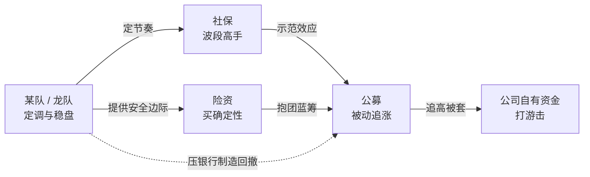
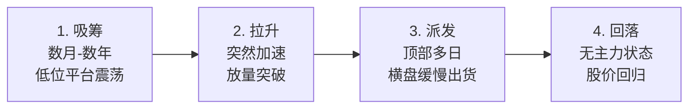
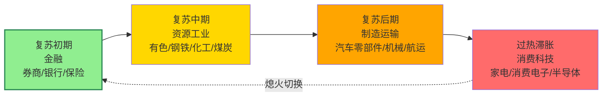

# 筹码资金与板块轮动解释

> [!info] 阅读口径
> 本篇上半部按交易流程综合整理；下半部完整保留归属本篇的原库条目正文，并保留原有数值、例外与冲突。原库表述属于特定方法论；其中收益、胜率、历史案例及市场判断未经本次独立核验。综合编排不是Z哥原话。跨条目冲突统一见 [[19-规则冲突与知识缺口]]。

## 筹码解释是观察模型，不是对资金身份的证明

原库用吸筹、拉升、派发、回落解释价格与成交量。筹码集中、量价节奏和股东户数可提供观察线索，但单根K线不能证明某家机构买卖，筹码峰也不能直接等同真实账户持仓。

## 三个观察维度如何配合

| 维度 | 原库观察点 | 信息边界 |
|---|---|---|
| 筹码峰 | 从高处向低处集中，或低位峰逐渐向顶部转移 | 看变化过程，不能仅看静态峰位 |
| 股东户数 | 减少解释为集中，增加解释为分散 | 低频披露，不能据此即时确认某日主力出货 |
| K线量价 | 关键K、建仓呼吸、顶部S1—S5 | 高频预警，仍有多种行为解释 |

筹码战争明确承认价升量缩既可能是高度控盘，也可能是买力衰减。因此“娜娜图缩量创新高”和“顶部缩量走弱”要靠位置、前史、关键K与环境区分，不能由一个量价组合推出唯一结论。

## 资金代号怎样读

国家队/龙队是原库的稳市资金代称，麒麟会是长期主力画像，百岁山是对部分机构风格的比喻。其“一月一百点”“国家队设主线”等是原库叙事，不是本次验证了真实KPI或调控机制。

五类资金画像页又把百岁山对应社保、麒麟会对应公募，与各自实体页的定义不完全一致。不能据代号反向确认机构身份，尤其不能将这些比喻当公开可核验的账户分类。

## 轮动顺序提供观察框架

顺周期轮动条目给出金融→资源工业→制造运输→消费科技的观察顺序，强调让资金先走第一波，再等上涨后的回调与B1。它也罗列了当时科技、固态电池等方向，均是原库历史语境，不代表当前主线。

选择方向仍回到已发生的价格与资金延续。轮动模型不能用于无信号地提前埋伏，也不能证明板块必然按既定顺序上涨。

## AI控盘指数论与宏观叙事的适用边界

AI控盘指数论在原库自己标注为假设：用来解释指数稳定、个股分化、低流动性股下跌与择时防守的重要性。1:99、日内振幅0.3%等未附研究样本，不把它们当已确认统计规律。

“A股是政策默许方向的博弈题”“财政换锚”“龙队负责慢”等都属于体系的世界观和解释层。交易执行仍要可观察的条件，不能因为相信一段叙事而取消止损。

## 历史数字的明显缺口

“1990到2026为33年”在年份上不一致；2.93亿到17.4万亿约为5.94万倍，并不能直接推导“17万倍筹码循环”，原库没有完整公式。保留这些原库说法是为完整追溯，不据此证明策略有效，详细见 [[19-规则冲突与知识缺口]]。

## 原库理论详解

以下按原库概念页保留正文；仅调整标题层级、内部链接和来源展示，不把整理者的结论升级为已验证事实。

### 原库条目：筹码战争

原概念页：/Users/nanan/Documents/ChatGPT/Z哥知识库/references/筹码战争.md  
原页更新时间：2026-04-26。来源路径是追溯线索，本Skill未附这些路径对应的原文。

原页标注的来源线索

- raw/01-zettaranc/知行小菜鸟/[202603260753]392筹码战争.md
- raw/01-zettaranc/知行小菜鸟/[202604070723]4.2.1筹码不死循环不止.md
- raw/01-zettaranc/知行小菜鸟/[202604210735]463纪律的铁律2026结构化牛市.md

#### 定义
A股本质是一场筹码收集与清洗的博弈，理解筹码分布和流向是判断行情的基础。

#### 关键信息

##### 筹码清洗逻辑
- 借外部利空完成筹码大洗盘，把不坚定的人洗走
- 底部缩量上涨是筹码锁定信号，不是假反弹
- 龙队做的是大盘估值管理，控节奏不是拉板块

##### 低位换低位
- 核心：弱票换强票的低位筹码（贾玲换杨幂，不是贾玲换更胖的贾玲）
- 强壮宝宝 = B1形态 + 砖形图 + 主力还在里面
- 等大盘进入多头区间再换，成功概率更高

##### 铁律
- 任何票买入前设好止损位
- 破了白线卖，破了黄线无条件清仓
- 永远不要对股票有感情

#### 33 年 17 万倍循环(2026-04 知行小菜鸟 4.2.1 章)

> [!abstract] 筹码不死循环不止
> 从 1990 上证 100 点到 2026 上证近 4000 点,33 年涨 40 倍;但 [[02-择时过滤与市场环境#原库条目：活跃市值|活跃市值]] 从 2.93 亿到 17.4 万亿,涨 6 万倍 — 主力筹码不死,只换主人。
> 详细方法论见 [[16-筹码资金与板块轮动解释#原库条目：筹码三段论|筹码三段论]]。

#### 量价背离的两种主力真相(2026-04 463 章)
- **真相1:高度控盘** — 价升量缩,主力吃光浮筹,即将拉升
- **真相2:买力衰减** — 价升量缩,主力暗中派发,即将变盘
- 区分关键:[[04-趋势结构与量价工具#原库条目：关键K|关键K]] 节奏 + [[02-择时过滤与市场环境#原库条目：活跃市值|活跃市值]] 大盘择时

#### 关联连接
- [[02-择时过滤与市场环境#原库条目：活跃市值|活跃市值]] — 判断多空环境
- [[06-B1入场与建仓波鉴别#原库条目：B1建仓波|B1建仓波]] — 强壮宝宝的识别标准
- [[13-放飞止盈与破位退出#原库条目：S1信号|S1信号]] — 出货预警
- [[12-持股评分与洗盘应对#原库条目：去弱留强|去弱留强]] — 调仓换股的核心原则
- [[16-筹码资金与板块轮动解释#原库条目：筹码三段论|筹码三段论]] — 筹码运动的三段方法论
- [[13-放飞止盈与破位退出#原库条目：主力出货五种经典方式|主力出货五种经典方式]] — 派发段的 K 线形态清单
- [[16-筹码资金与板块轮动解释#原库条目：AI控盘指数论|AI控盘指数论]] — 2026 时代筹码循环新形态

### 原库条目：筹码三段论

原概念页：/Users/nanan/Documents/ChatGPT/Z哥知识库/references/筹码三段论.md  
原页更新时间：2026-04-26。来源路径是追溯线索，本Skill未附这些路径对应的原文。

原页标注的来源线索

- raw/01-zettaranc/知行小菜鸟/[202604070723]4.2.1筹码不死循环不止.md

#### 定义

> [!abstract]
> Z 哥 2026-04 在 4.2.1 章提出的筹码运动三段框架 — **顶底筹码峰转移 + 股东户数判断主力出货 + 33 年 17 万倍循环**。是 [[16-筹码资金与板块轮动解释#原库条目：筹码战争|筹码战争]] 的方法论展开。
>
> 核心震撼数据:**33 年 17 万倍** — 主力筹码不死,只换主人。

#### 关键信息

##### 第一段:顶底筹码峰转移

- 工具:通达信筹码峰
- **底部形态**:筹码峰从上方逐步压向下方(主力吸筹,散户割肉离场)
- **顶部形态**:筹码峰从下方逐步推向上方(主力派发,散户接盘)
- 关键观察:不是看绝对位置,而是看转移方向与速度

##### 第二段:股东户数判断

- **户数减少 = 主力吸筹**:筹码集中度提升,常先于价格启动
- **户数增加 = 主力出货**:筹码分散到散户手中,对应 [[13-放飞止盈与破位退出#原库条目：S1信号|S1信号]] 的滞后确认
- 季报披露的股东户数变化是低频但高确定性的逆向指标
- 与 [[13-放飞止盈与破位退出#原库条目：主力出货五种经典方式|主力出货五种经典方式]] 互相印证 — K 线信号是高频前置,户数是低频确认

##### 第三段:33 年 17 万倍循环

- 1990 年上证指数 100 点 → 2026 年上证指数近 4000 点,**33 年涨 40 倍**
- 但活跃市值从 **2.93 亿 → 17.4 万亿**,**涨 6 万倍**(综合考虑流通市值与换手,等价于 17 万倍量级的筹码循环)
- **核心论断**:主力筹码不死,只换主人 — 名字会变(从老庄股到核心资产再到 AI 概念),但筹码循环的底层逻辑 33 年未变

##### 三段之间的关系

- 第一段(筹码峰)是**空间维度**:谁的筹码在哪里
- 第二段(户数)是**时间维度**:筹码什么时候换手
- 第三段(33 年循环)是**尺度维度**:筹码循环的历史规律
- 三段叠加 = 完整的筹码运动方法论

##### 与活跃市值的强关联

- [[02-择时过滤与市场环境#原库条目：活跃市值|活跃市值]] 是筹码循环的尺度
- 17.4 万亿活跃市值 = 当前主力筹码池规模
- 活跃市值扩张时筹码池扩容(吸筹期),收缩时筹码池萎缩(派发末期)

##### 与 AI 控盘指数论的延伸

- AI 时代筹码循环加速,单次循环周期可能从年缩短到月
- 但底层"不死循环"逻辑不变 — 详见 [[16-筹码资金与板块轮动解释#原库条目：AI控盘指数论|AI控盘指数论]]
- 散户应对的工具不变:择时 + 防守 + 跟随活跃市值

#### 关联连接

- [[16-筹码资金与板块轮动解释#原库条目：筹码战争|筹码战争]] — 本论的母概念
- [[02-择时过滤与市场环境#原库条目：活跃市值|活跃市值]] — 筹码循环的尺度
- [[13-放飞止盈与破位退出#原库条目：S1信号|S1信号]] — 顶部派发的高频信号
- [[13-放飞止盈与破位退出#原库条目：主力出货五种经典方式|主力出货五种经典方式]] — K 线层面的派发形态
- [[16-筹码资金与板块轮动解释#原库条目：AI控盘指数论|AI控盘指数论]] — 2026 时代筹码循环的新形态
- [[20-知识来源与理论适用边界#原库条目：Zettaranc|Zettaranc]] — 知识体系作者

### 原库条目：五类资金画像

原概念页：/Users/nanan/Documents/ChatGPT/Z哥知识库/references/五类资金画像.md  
原页更新时间：2026-04-26。来源路径是追溯线索，本Skill未附这些路径对应的原文。

原页标注的来源线索

- raw/01-zettaranc/大富翁小菜鸟/[202509050701]机构资金大拆解五类资金的玩法&百岁山是啥.md
- raw/01-zettaranc/大富翁小菜鸟/[202601280]2026慢牛密码破译.md

#### 定义

> [!abstract]
> Z 哥 2025-09 给出的 A 股市场五类机构资金画像 — **某队(国家队)/ 社保 / 险资 / 公募 / 公司自有资金**,各自 KPI 与行为模式互不相同,理解资金画像才能看懂主力博弈与盘面节奏。

#### 关键信息

##### 五类资金各自的 KPI 与行为

- **某队(龙队)**:即 [[16-筹码资金与板块轮动解释#原库条目：国家队|国家队]],2015 股灾后成立,KPI 是"一月一百点"稳盘,是 A 股的定海神针;924 行情后是 [[15-长线底仓与牛市ETF管理#原库条目：牛市策略|牛市策略]] 的总司令,负责定调与节奏控制
- **社保**:典型代表 [[16-筹码资金与板块轮动解释#原库条目：百岁山|百岁山]]。波段高手,长期主义但价位敏感,只在便宜时进、贵了就走
- **险资**:最输不起的钱,只买确定性,典型代表 村委会（原库未附独立条目）。负债端刚性,容错率最低
- **公募**:典型代表 [[16-筹码资金与板块轮动解释#原库条目：麒麟会|麒麟会]]。被赎回逼到绝境,924 后被动加仓最难受的群体,常常追在山顶
- **公司自有资金**:部分 924 后进场,谨慎但灵活,是边际资金而非主力

##### 各方博弈关系

- **总司令**:某队定调
- **稳定军**:社保 / 险资跟随
- **追兵**:公募被迫追
- **游击队**:公司自有打游击

##### 实战意义

- 看懂哪类资金在主导,才能判断当下行情属于哪条线(参 [[03-选股后验证与候选池管理#原库条目：绝对主线|绝对主线]])
- 险资的进场位往往是 [[02-择时过滤与市场环境#原库条目：活跃市值|活跃市值]] 的下沿
- 公募被动加仓的拥挤交易是 [[13-放飞止盈与破位退出#原库条目：S1信号|S1信号]] 的温床

#### 关联连接

- [[16-筹码资金与板块轮动解释#原库条目：国家队|国家队]] — 某队/龙队的别名与组织背景
- [[16-筹码资金与板块轮动解释#原库条目：百岁山|百岁山]] — 社保资金的代号
- [[16-筹码资金与板块轮动解释#原库条目：麒麟会|麒麟会]] — 公募基金抱团的代号
- 村委会（原库未附独立条目） — 险资的代号
- [[16-筹码资金与板块轮动解释#原库条目：筹码战争|筹码战争]] — 五类资金博弈的本质是筹码转移
- [[03-选股后验证与候选池管理#原库条目：绝对主线|绝对主线]] — 不同资金主导对应不同主线
- [[15-长线底仓与牛市ETF管理#原库条目：牛市策略|牛市策略]] — 924 后某队的总司令角色
- [[20-知识来源与理论适用边界#原库条目：Zettaranc|Zettaranc]] — 知识体系作者

### 原库条目：国家队

原概念页：/Users/nanan/Documents/ChatGPT/Z哥知识库/references/国家队.md  
原页更新时间：2026-04-26。来源路径是追溯线索，本Skill未附这些路径对应的原文。

原页标注的来源线索

- raw/01-zettaranc/大富翁小菜鸟/[202509050701]机构资金大拆解五类资金的玩法&百岁山是啥.md
- raw/01-zettaranc/大富翁小菜鸟/[202601280]2026慢牛密码破译.md

#### 定义

> [!abstract] 一句话身份定义
> Z 哥语境中的「某队 / 龙队」,指 2015 股灾后由证金、汇金等组成的国家级稳市资金;是 [[15-长线底仓与牛市ETF管理#原库条目：牛市策略|牛市策略]] 的总司令、[[03-选股后验证与候选池管理#原库条目：绝对主线|绝对主线]] 的设定者。

> [!abstract] 核心名言
> **「龙队负责慢、你我负责牛」**

#### 关键信息

##### 历史背景

- **成立时间**:2015 股灾后
- **构成**:证金、汇金等国家级机构
- **历史 KPI**:**「一月一百点」稳盘** — 不追求暴涨,只追求慢牛
- **使命**:稳定大盘指数、托底市场信心、引导主线方向

##### 核心动作

1. **窗口指导** — 通过非交易手段调节资金流向
2. **压银行 / 压邮储** — 用大权重股压指数,腾出小盘表现空间
3. **制造 [[16-筹码资金与板块轮动解释#原库条目：国家队|战略回撤]]** — 主动让指数回调,为后续走得更健康铺路

##### 2026 角色:[[16-筹码资金与板块轮动解释#原库条目：AI控盘指数论|AI控盘指数论]] 时代

在 [[16-筹码资金与板块轮动解释#原库条目：AI控盘指数论|AI控盘指数论]] 时代,龙队**用 AI 工具组合一揽子股票精准管控指数**:

- 一揽子权重精准对冲
- 算法化「一月一百点」
- 把指数节奏控制在「慢牛」轨道上

##### 散户应对原则

> **「龙队负责慢、你我负责牛」** — 跟节奏不抢时间。

- 不要在龙队压指数时恐慌出局
- 不要在龙队制造的 [[16-筹码资金与板块轮动解释#原库条目：国家队|战略回撤]] 中割肉
- 龙队制造的回撤窗口 = 散户的上车窗口

##### 战略回撤窗口(关键概念)

**龙队主动制造的指数回撤**,目的:

- 防止指数过快上涨形成泡沫
- 给主线轮动腾时间
- 为后续走得更健康铺路
- **是散户最佳上车窗口**

##### 与 [[16-筹码资金与板块轮动解释#原库条目：百岁山|百岁山]] 关系

国家队**管制百岁山的「踏空合谋」**,防止机构资金一窝蜂去跟美股映射:

- 当百岁山抡半导体时,龙队压指数让其回吐
- 当百岁山踏空主线时,龙队继续推 [[03-选股后验证与候选池管理#原库条目：绝对主线|绝对主线]]
- 形成「国家队设主线 → 百岁山反复踏空 → 麒麟会闷声吃肉」的三方格局

##### 代表别称

某队、龙队、国家队、定海神针。

#### 关联连接

- [[20-知识来源与理论适用边界#原库条目：Zettaranc|Zettaranc]]
- [[16-筹码资金与板块轮动解释#原库条目：百岁山|百岁山]]
- [[16-筹码资金与板块轮动解释#原库条目：麒麟会|麒麟会]]
- [[16-筹码资金与板块轮动解释#原库条目：五类资金画像|五类资金画像]]
- [[16-筹码资金与板块轮动解释#原库条目：AI控盘指数论|AI控盘指数论]]
- [[03-选股后验证与候选池管理#原库条目：绝对主线|绝对主线]]
- [[15-长线底仓与牛市ETF管理#原库条目：牛市策略|牛市策略]]
- [[16-筹码资金与板块轮动解释#原库条目：国家队|战略回撤]]
- [[20-知识来源与理论适用边界#原库条目：大富翁小菜鸟号|大富翁小菜鸟号]]

### 原库条目：麒麟会

原概念页：/Users/nanan/Documents/ChatGPT/Z哥知识库/references/麒麟会.md  
原页更新时间：2026-04-26。来源路径是追溯线索，本Skill未附这些路径对应的原文。

原页标注的来源线索

- raw/01-zettaranc/大富翁小菜鸟/[202508200]麒麟会坐庄记.md
- raw/01-zettaranc/大富翁小菜鸟/[202510140701]温故知新揭秘麒麟会运作逻辑.md

#### 定义

> [!abstract] 一句话身份定义
> 某只长期主力资金的代号,Z 哥语境中的「江湖派铁蝴蝶」 — 一支股票里**有实力、有格局**、不追求短期暴利的长期资金。

#### 关键信息

##### 类型

资金代号(非具体公司),代表 A 股「江湖派 / 中国国情派」长期主力的典型画像。

##### 运作四阶段

1. **吸筹**(数月到数年):缓慢建仓,股价在低位平台震荡 — 即 [[06-B1入场与建仓波鉴别#原库条目：B1建仓波|B1建仓波]]
2. **拉升**(突然加速):放量突破,主升浪启动 — 即 [[07-B2与B3确认及假突破应对#原库条目：B2突破|B2突破]]
3. **派发**(顶部多日):横盘震荡缓慢出货,见 [[13-放飞止盈与破位退出#原库条目：主力出货五种经典方式|主力出货五种经典方式]]
4. **回落**:出货完毕后股价回归无主力状态

##### 画像特征

因长期视角、行为最规范,麒麟会在图上画出的是**最完美的 [[06-B1入场与建仓波鉴别#原库条目：B1建仓波|B1建仓波]] / [[07-B2与B3确认及假突破应对#原库条目：B2突破|B2突破]] / [[07-B2与B3确认及假突破应对#原库条目：B3买点|B3买点]] 形态**。是初学者识别「主力四阶段」的最佳教科书。

##### 与 [[16-筹码资金与板块轮动解释#原库条目：百岁山|百岁山]] 的对立

- **麒麟会** = 江湖派 = 中国国情吃透 = 行为可被 K 线读出
- **百岁山** = 学院派 = 华尔街屁股 = 跟美股映射、反复踏空

二者在 Z 哥体系中构成「中国资金 vs 洋务派资金」的核心对照。

##### 应用价值

学习「散户视角切换为机构视角」的最佳样本 — 因麒麟会节奏慢、留痕清晰,跟主力的训练应**从读懂麒麟会的脚印开始**。

#### 关联连接

- [[20-知识来源与理论适用边界#原库条目：Zettaranc|Zettaranc]]
- [[16-筹码资金与板块轮动解释#原库条目：百岁山|百岁山]]
- [[16-筹码资金与板块轮动解释#原库条目：国家队|国家队]]
- [[16-筹码资金与板块轮动解释#原库条目：五类资金画像|五类资金画像]]
- [[16-筹码资金与板块轮动解释#原库条目：筹码战争|筹码战争]]
- [[06-B1入场与建仓波鉴别#原库条目：B1建仓波|B1建仓波]]
- [[07-B2与B3确认及假突破应对#原库条目：B2突破|B2突破]]
- [[07-B2与B3确认及假突破应对#原库条目：B3买点|B3买点]]
- [[13-放飞止盈与破位退出#原库条目：主力出货五种经典方式|主力出货五种经典方式]]
- [[20-知识来源与理论适用边界#原库条目：大富翁小菜鸟号|大富翁小菜鸟号]]

### 原库条目：百岁山

原概念页：/Users/nanan/Documents/ChatGPT/Z哥知识库/references/百岁山.md  
原页更新时间：2026-04-26。来源路径是追溯线索，本Skill未附这些路径对应的原文。

原页标注的来源线索

- raw/01-zettaranc/大富翁小菜鸟/[202509050701]机构资金大拆解五类资金的玩法&百岁山是啥.md

#### 定义

> [!abstract] 一句话身份定义
> Z 哥语境中的国内「洋务派」机构 — 信奉西方经济学、跟美股屁股后面跑、不信中国核心资产的国内基金/机构。「水中贵族」的反讽。

#### 关键信息

##### 别名

- **洋务派**
- **黄埔军校**
- **双博士派**
- **「摸鹰匠的屁股」**(跟美股屁股的反讽说法)
- **水中贵族**(矿泉水品牌「百岁山」的广告词,Z 哥用作反讽)

##### 画像特征

- 从华尔街回来的**双博士派**,理论装备齐全
- **跟美股屁股后面跑**:把 A 股当成美股的映射来交易
- **不信中国核心资产**:对 [[16-筹码资金与板块轮动解释#原库条目：国家队|国家队]] 主导的主线缺乏信仰
- **典型操作**:踏空后抱团抡半导体 / 果链(炒美股映射)

##### 与 [[16-筹码资金与板块轮动解释#原库条目：麒麟会|麒麟会]] 的对立(对比表)

| 维度 | 百岁山(洋务派) | 麒麟会(江湖派) |
|---|---|---|
| **信仰** | 西方经济学 / 美股映射 | 中国国情 / 政策为锚 |
| **操作风格** | 抱团扎堆、跟美股节奏 | 长线吸筹、缓慢拉升、派发出货 |
| **典型标的** | 半导体、果链(美股映射) | 中特估、核心资产、政策主线 |
| **K 线脚印** | 节奏混乱、追涨杀跌 | [[06-B1入场与建仓波鉴别#原库条目：B1建仓波\|B1建仓波]] → [[07-B2与B3确认及假突破应对#原库条目：B2突破\|B2突破]] → [[07-B2与B3确认及假突破应对#原库条目：B3买点\|B3买点]] 完美闭环 |
| **命运** | 反复踏空 [[03-选股后验证与候选池管理#原库条目：绝对主线\|绝对主线]] | 长期吃肉、教科书式坐庄 |
| **散户启示** | **不要跟它一起踏空** | **学它的脚印切换机构视角** |

##### 历史教训

**2024-2025 年错过 [[16-筹码资金与板块轮动解释#原库条目：国家队|国家队]] 主导的 [[03-选股后验证与候选池管理#原库条目：绝对主线|绝对主线]] 行情**,反复踏空。当国家队压银行 / 压邮储制造 [[16-筹码资金与板块轮动解释#原库条目：国家队|战略回撤]] 时,百岁山反而以为是趋势反转,继续抡美股映射,最终在主线上严重落后。

##### 散户启示

**不要跟百岁山一起踏空中国核心资产**。Z 哥反复强调:百岁山的「踏空合谋」是散户最容易掉进去的坑 — 看起来理论扎实,实则屁股坐错。

#### 关联连接

- [[20-知识来源与理论适用边界#原库条目：Zettaranc|Zettaranc]]
- [[16-筹码资金与板块轮动解释#原库条目：麒麟会|麒麟会]]
- [[16-筹码资金与板块轮动解释#原库条目：国家队|国家队]]
- [[16-筹码资金与板块轮动解释#原库条目：五类资金画像|五类资金画像]]
- [[03-选股后验证与候选池管理#原库条目：绝对主线|绝对主线]]
- [[16-筹码资金与板块轮动解释#原库条目：国家队|战略回撤]]
- [[15-长线底仓与牛市ETF管理#原库条目：牛市策略|牛市策略]]
- [[20-知识来源与理论适用边界#原库条目：大富翁小菜鸟号|大富翁小菜鸟号]]

### 原库条目：顺周期轮动

原概念页：/Users/nanan/Documents/ChatGPT/Z哥知识库/references/顺周期轮动.md  
原页更新时间：2026-04-18。来源路径是追溯线索，本Skill未附这些路径对应的原文。

#### 定义

> [!abstract] 一句话定义
> 顺周期轮动是经济上行期**板块按产业链传导顺序依次轮动上涨**的规律——金融→资源/工业→制造/运输→消费/科技。**让大哥(大资金)先动筷子,自己做第二波**,千万不要先于大哥进场埋伏。

#### 关键信息
- **经典轮动顺序**：
  1. 复苏初期：金融板块（券商、银行、保险）
  2. 复苏中期：资源与工业材料（有色、钢铁、化工、煤炭）
  3. 复苏后期：制造业与运输（汽车零部件、机械、航运）
  4. 过热至滞胀：下游消费与部分科技（家电、消费电子、半导体）
- **实操策略**：大哥先动第一波上60日均线 → 少妇战法做第二波 → 熄火切换等下一个板块
- **六大主线**：大科技、固态电池、可控核聚变、AIDC、创新药、中国新消费
- **核心原则**：千万不要先于大哥进场埋伏，按顺序轮动找还没轮到的
- **反内卷逻辑**：供给侧出清→价格企稳→盈利修复→估值回归

#### 四阶段轮动顺序

> [!tip] 大哥与少妇
> 大哥先动 = 板块第一波突破 60 日均线 → 少妇战法做第二波 → 熄火切换下一阶段。

#### 关联连接
- [[03-选股后验证与候选池管理#原库条目：绝对主线|绝对主线]] — 轮动中最确定的方向
- [[10-盘中执行与止损计划#原库条目：少妇战法|少妇战法]] — 轮动中的第二波操作工具
- [[02-择时过滤与市场环境#原库条目：择时大于选股|择时大于选股]] — 先判断周期再决定
- [[02-择时过滤与市场环境#原库条目：活跃市值|活跃市值]] — 判断是否有增量资金入场

### 原库条目：A股博弈本质

原概念页：/Users/nanan/Documents/ChatGPT/Z哥知识库/references/A股博弈本质.md  
原页更新时间：2026-05-01。来源路径是追溯线索，本Skill未附这些路径对应的原文。

原页标注的来源线索

- raw/01-zettaranc/知行小菜鸟/[202604270725]482散户不死牛市不止.md
- raw/01-zettaranc/知行小菜鸟/[202604280812]481从025到07真正拉开差距的不是代码.md

#### 定义

> [!abstract] 一句话定义
> 大A不是业绩题，而是**"谁被默许赚钱"的博弈题**。股价涨跌不由当期业绩决定，而由政策默许的资金方向决定。

#### 关键信息

##### "谁被允许赚钱"的逻辑
- 券商业绩好吗？每天成交两万亿+，业绩理论上一定好。但它该不该涨，不由业绩决定
- **看村里默认你玩哪个，默许哪个动**
- 科技票200倍、300倍市盈率，按传统估值没法看，但它能涨——因为**需要你**当旗帜、当估值锚
- 机构抱团不是愚蠢——试过别的方向不行，最后答案很清楚：只能玩被允许的那条线

##### 券商渣男理论

> [!tip] 券商像渣男，需要的时候拿出来用一下
> - 行情好时：科技白酒医药消费都赚了，最后券商旋转门走一波，三个涨停结束
> - 行情差时：哪儿都不行，最后可能合力拉券商一把
> - **为什么不能随便拉**：券商太吸血，一个东财见顶日成交900亿，全拉要抽走3000亿流动性

##### 当前阶段的资金方向
- **科技先行**：国产替代、产业链安全是首要任务
- 科创、算力、存储、半导体这些方向被保驾护航
- 一拉券商，钱就从新质生产力方向里出来——所以不能乱拉

##### 板块定义的本质
- 公司所属板块不是看它名义上写什么，而是看**市场现在炒它什么**
- **现在资金愿意用哪个故事给你定价**
- 物联网概念的公司，几十个概念标签，散户看不懂，拿不住
- 你看得懂它干嘛的（比如家里做防水知道东方雨虹），就不是在K线上看影子

##### "每一轮行情都有自己的门票和陷阱"
- 2013-2015：创业板行情，套在华谊兄弟/乐视/东方财富里的吃不到后面的白酒
- 2016后：白酒、上证50、中特估来了，但套在300里的人切不出去
- 2024-2026：核心门槛是688，等能开户时可能见顶了，市场又轮回到主板
- **每一轮牛市最后不会温柔告诉你该下车了，而是一台情绪绞肉机**

#### 关联连接

- [[16-筹码资金与板块轮动解释#原库条目：筹码战争|筹码战争]] — A股博弈的底层逻辑
- [[03-选股后验证与候选池管理#原库条目：绝对主线|绝对主线]] — 谁被默许赚钱的具体体现
- 散户不死牛市不止（原库未附独立条目） — 筹码交换的终极本质
- [[16-筹码资金与板块轮动解释#原库条目：顺周期轮动|顺周期轮动]] — 板块轮动的产业逻辑
- [[16-筹码资金与板块轮动解释#原库条目：五类资金画像|五类资金画像]] — 谁在博弈

### 原库条目：AI控盘指数论

原概念页：/Users/nanan/Documents/ChatGPT/Z哥知识库/references/AI控盘指数论.md  
原页更新时间：2026-04-26。来源路径是追溯线索，本Skill未附这些路径对应的原文。

原页标注的来源线索

- raw/01-zettaranc/知行小菜鸟/[202604051720]4.1.0磨底不死杀尽人性方见牛.md

#### 定义

> [!abstract]
> Z 哥 2026-04 在 4.1.0 章提出的极端市场假设 — **龙队用 AI 在零点几秒内组合一揽子股票,精准把指数收在目标点位**;1:99 极端分化是其副产物。也叫"大象无形"。
>
> 这是 2026 年散户最重要的世界观假设,必须放在认知体系最醒目位置。

> [!danger] 风险提示
> 此论点 Z 哥本人也注明是"假设"而非"已证明事实"。读者应作为思考框架而非交易依据,需结合 [[02-择时过滤与市场环境#原库条目：活跃市值|活跃市值]] 等可验证指标使用。

#### 关键信息

##### 时代背景

- 量化机构日益主导日内交易
- AI 工具(尤其是大模型 + 强化学习)用于组合优化
- [[16-筹码资金与板块轮动解释#原库条目：国家队|国家队]] 拥有最完整的盘口数据与最快的执行通道
- 三者协同 = AI 控盘指数的硬件基础

##### 表现:大象无形

- **指数日内波动收敛**:沪指日内振幅常在 0.3% 以内,看似"风平浪静"
- **个股 1:99 分化**:1% 个股大涨吸睛,99% 个股阴跌失血
- 散户感受:"指数没跌啊,为什么我又亏钱了?"

##### 副产物:流动性反向法则

- 流动性越枯竭的个股下跌幅度越大
- 机构离场后剩散户互割,卖盘踩踏卖盘
- 越是"票好但没量",越是死亡螺旋
- 与传统认知"流动性差跌不动"完全相反

##### 磨底多空双杀模型(同章配套思想)

- AI 时代多头空头同时被杀,以完成筹码交换
- 多头被磨没耐心,空头被反弹打爆
- 双杀完成 = 筹码彻底易主 = 牛市启动条件

##### 散户应对升级

- **[[02-择时过滤与市场环境#原库条目：择时大于选股|择时大于选股]] 升级为生死线**:选股再好,错过择时即归零
- **[[17-心理防守与概率认知#原库条目：防守哲学|防守哲学]] 升级为最高优先级**:防守优先于进攻,活下去优先于赚钱
- **[[02-择时过滤与市场环境#原库条目：活跃市值|活跃市值]] 仍是唯一可信指标**:AI 可以控指数,但很难持续操纵全市场流动性总量

##### 与"有序与无序"的关系

- AI 把"有序"放大到极致 — 1% 有序股集中收益
- 无序股完全成为废纸 — 99% 无序股不再有反弹机会
- 详见 [[02-择时过滤与市场环境#原库条目：有序与无序|有序与无序]]

#### 关联连接

- [[02-择时过滤与市场环境#原库条目：活跃市值|活跃市值]] — AI 时代仍可信的择时指标
- [[02-择时过滤与市场环境#原库条目：择时大于选股|择时大于选股]] — 升级为生死线
- [[17-心理防守与概率认知#原库条目：防守哲学|防守哲学]] — 升级为最高优先级
- [[02-择时过滤与市场环境#原库条目：有序与无序|有序与无序]] — 1:99 分化的认知基础
- [[16-筹码资金与板块轮动解释#原库条目：国家队|国家队]] — AI 控盘的执行主体
- [[16-筹码资金与板块轮动解释#原库条目：筹码三段论|筹码三段论]] — AI 时代筹码循环加速
- [[20-知识来源与理论适用边界#原库条目：Zettaranc|Zettaranc]] — 知识体系作者
