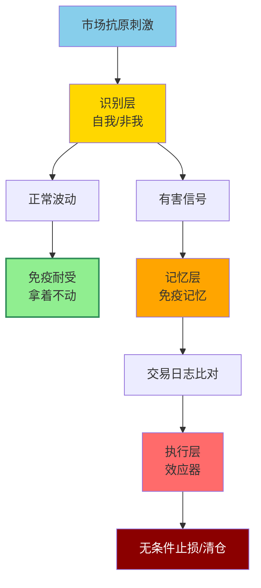
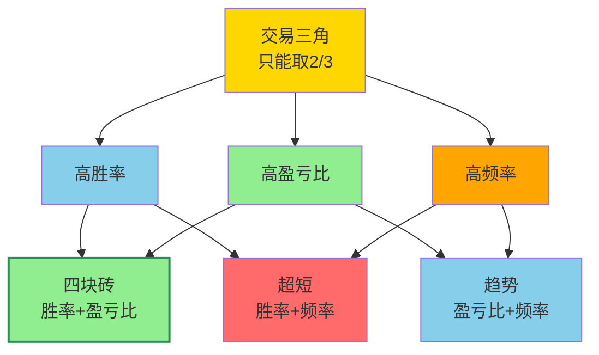
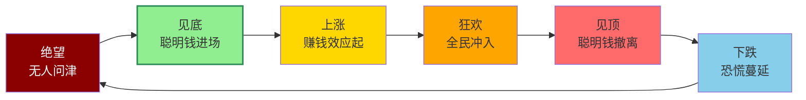

# 心理防守与概率认知

> [!info] 阅读口径
> 本篇上半部按交易流程综合整理；下半部完整保留归属本篇的原库条目正文，并保留原有数值、例外与冲突。原库表述属于特定方法论；其中收益、胜率、历史案例及市场判断未经本次独立核验。综合编排不是Z哥原话。跨条目冲突统一见 [[19-规则冲突与知识缺口]]。

## 防守把一次判断错误限制为可处理的事件

原库的核心不是永远看对，而是通过价格止损、仓位分工和退出纪律，避免一次错误侵蚀此前积累。盈利翻倍后再回撤50%，净值回到起点，说明大额盈利不能替代回撤控制。

## 四不原则各自针对一种失控

不追：没有成本、策略和心理优势时，不由涨停与分时冲高驱动下单。不动：对符合长期逻辑的底仓容忍正常波动，对看不懂的行情保持观望。不慌：先看是否触发规则，不被消息与短期急杀拖走。不乱摸：只研究能解释风险边界的模式，不因其他票上涨越出能力范围。

“不追”与B2突破参与存在方法选择差异；“不动”与超短不涨即走存在周期差异。先选路径，不能同时要求一笔交易获得所有优点。

## 交易免疫系统怎样落实

识别层区分正常回撤与趋势破坏；记忆层用日志记录相同形态和执行偏差；执行层在有害信号触发时做出事先约定的动作。过度交易是把正常波动误当危险，死扛则是把危险误当噪音。

可以把每次想操作的原因写成一句话：是信号变化，还是害怕利润回吐、怕踏空、想回本。如果只是情绪而规则没有变化，回到计划；如果规则已触发，不能因为情绪想等就拖延。

## 盈亏比和胜率应一起理解

原库强调“小亏多次、大赚少次”及严格止损的重要性。其“胜率不重要”应理解为反对只盯命中次数，而不能推成胜率对结果没有影响。

基于上述规则作概率整理：在相同统计口径下，单笔平均结果取决于胜率×平均盈利、败率×平均亏损以及成本。原库没有提供可靠的总体胜率样本，也没有提供完整交易成本模型，本篇不新增策略盈利预测。

不可能三角提示胜率、赔率、频率难兼得，但它不是已经证明的数学定理。其流程图对各策略的配对与正文还有不一致，不能机械要求所有趋势策略一定高频。

## 纪律与结果分开复盘

合规止损后上涨，不自动证明止损错误；违规追涨后赚钱，也不证明违规可复制。记录当时可见的条件与选择，再看长期重复结果，避免只用事后涨跌给每一笔行为打分。

勇气对应符合条件时执行，决心对应该退出时执行，技巧对应识别周期、结构和证据。原库对仓位不超过三个月工资、长期先保本等有心理训练建议，属于原库面向特定读者的忠告，不转成所有人的固定资金标准。

## 周期与人性的实际用途

绝望、见底、上涨、狂欢、见顶、下跌的循环帮助提醒情绪可能过度，但不能只凭“大家很恐惧”就宣布底部。情绪是背景，趋势确认、价格失效位和仓位纪律才是可执行层。

## 原库理论详解

以下按原库概念页保留正文；仅调整标题层级、内部链接和来源展示，不把整理者的结论升级为已验证事实。

### 原库条目：防守哲学

原概念页：/Users/nanan/Documents/ChatGPT/Z哥知识库/references/防守哲学.md  
原页更新时间：2026-05-01。来源路径是追溯线索，本Skill未附这些路径对应的原文。

#### 定义
穿越牛熊的核心不是进攻（赚多少），而是防守（亏多少时能守住）。

#### 关键信息
- 防守是交易的终极哲学
- 三层防火墙体系：止损线、仓位控制、对冲配置
- 空头区间活下去比什么都重要

#### AI 控盘时代升级版（2026-04 知行小菜鸟 450 章）

> [!abstract] 防守哲学二元论
> 进攻已达标 / 防守是生死线 —— 在 [[16-筹码资金与板块轮动解释#原库条目：AI控盘指数论|AI控盘指数论]] 时代，1:99 极端分化使纯进攻策略必败，防守即「穿越牛熊的核心」。

##### 三层防火墙（主题交易语境）
- **第一层：仓位上限** —— 主题仓 ≤ 总资金 5%
- **第二层：时间止损** —— 关键K 不出来 3 日内不进场
- **第三层：绝对价位止损** —— 破前低无条件出

##### 防守优先级位置
在 [[01-交易闭环与策略边界#原库条目：知行交易模块|知行交易模块]] 三层架构中，「应对模块（黄色）」的防守纪律 > 「买入模块（蓝色）」的进攻纪律 > 「择时模块（红色）」的判断 —— 防守为最高优先级。

##### 与 [[17-心理防守与概率认知#原库条目：四不原则|四不原则]] 的关系
四不原则是「日常防守」，450 章升级版是「系统化防守」；前者面向单笔交易，后者面向组合层面。两者一纵一横，构成完整的防守网。

#### 翻倍又腰斩的病理分析

> [!danger] 翻倍又腰斩 = 攻击力强 + 防守体系薄
> 赚 100% 回撤 50% = 利润归零。不是利润腰斩，是直接回来了。盈亏同源——你敢重仓猛攻，就必然有空档。踢四-二-四就不要幻想还能像四-三-三那样攻守平衡。

##### 核心金句
- **"进攻靠命，防守靠体系"** — 进攻期运气给风，防守期只有体系能保命
- **"真正拉开差距的，不是进攻期谁多赚了几天，而是防守期谁少亏"** — 回撤小才是复利起点
- **"你赚不到的钱，很多时候不是遗憾，是保护"** — 为了赚那一口可能把之前全吐出来

#### "散户不死，牛市不止"

> [!caution] 顶部不是点，是情绪绞肉机
> 牛市最后不会温柔地告诉你"该下车了"。它让你兴奋→恐惧→再兴奋→再恐惧，几次之后你熄火。市场永远要把最大量的不懂的、跟风的资金，在最高位置完成筹码交换。

##### 牛市逃顶铁律
- 把活跃市值、止损体系、仓位结构整明白，顶大概率能逃
- 无非是最后交多少门票钱，给市场多少小费
- 市场最狠的地方不是它骗你，是你在最危险时会主动替它找理由

#### "有些苦必须吃"

#### 关联连接
- [[01-交易闭环与策略边界#原库条目：交易闭环|交易闭环]] — 防守的具体执行
- [[11-仓位分工与组合轮动#原库条目：底仓与动态仓|底仓与动态仓]] — 对冲配置
- [[16-筹码资金与板块轮动解释#原库条目：AI控盘指数论|AI控盘指数论]]
- [[01-交易闭环与策略边界#原库条目：知行交易模块|知行交易模块]]
- [[02-择时过滤与市场环境#原库条目：主题交易的三层防火墙|主题交易三层防火墙]]
- [[17-心理防守与概率认知#原库条目：四不原则|四不原则]]
- [[12-持股评分与洗盘应对#原库条目：击穿对手盘|击穿对手盘]]

### 原库条目：交易心理

原概念页：/Users/nanan/Documents/ChatGPT/Z哥知识库/references/交易心理.md  
原页更新时间：2026-05-01。来源路径是追溯线索，本Skill未附这些路径对应的原文。

#### 定义

> [!abstract] 一句话定义
> 交易心理是 Z 哥反复强调的核心——**90% 亏损来自忍不住的手痒和听不完的噪音**。技术简单执行难,模拟盘和实盘差距巨大,**把规则刻进骨子里才是真本事**。

#### 关键信息

##### 核心问题
- 亏了就心态崩，赚了就飘
- 套了就死扛，卖了就怕踏空
- 90%亏损来自于忍不住的手痒和听不完的噪音

##### 超短线心理纪律
- **9:33与9:37两条生死线**：超短线止损卡死这两个时间点，不恋战不犹豫
- **30秒诱多识别**：30秒之内拉6个点的，全是诱多，一律不追。真正上攻的票会拉5-10分钟给上车机会
- **止损锁主动权**：今天止损亏5个点，换来的是明天涨跌都有主动权；死扛则完全被动
- **超短线不能变波段**：套了就安慰自己"拿一拿做波段"是致命心理陷阱

##### 忠告
1. 仓位不超过三个月工资
2. 五年内先想着不亏钱
3. 不要跟股票谈恋爱
4. 市场淘汰赛，最后拼的是意志品质

##### 知行合一
- 技术简单，执行难
- 模拟盘和实盘差距巨大
- 把规则刻进骨子里才是真本事

##### 三最原则的心理层面
- "只选最美"：警惕"小鹿过载"——想太多做得太少
- "只买最强"：预测是徒劳的，开闸才是真相
- "只拿最硬"：物来则应，过去不留
- 股票不是爱情，是"如果不爱请别伤害"的前任

#### 关联连接
- [[01-交易闭环与策略边界#原库条目：框架式交易|框架式交易]] — 纪律是知行合一的基础
- [[11-仓位分工与组合轮动#原库条目：底仓与动态仓|底仓与动态仓]] — 心态管理的前提
- [[03-选股后验证与候选池管理#原库条目：三最原则|三最原则]] — 交易心理的具体执行框架

### 原库条目：交易免疫系统

原概念页：/Users/nanan/Documents/ChatGPT/Z哥知识库/references/交易免疫系统.md  
原页更新时间：2026-04-26。来源路径是追溯线索，本Skill未附这些路径对应的原文。

原页标注的来源线索

- raw/01-zettaranc/大富翁小菜鸟/[202510081220]从免疫耐受机制谈股市生存交易免疫系统心法.md

#### 定义

> [!abstract] 一句话定义
> 交易免疫系统是从生物学**免疫耐受机制**借喻的交易心法——市场充满"抗原"(诱惑、恐慌、噪音),交易者需建立**识别 + 记忆 + 执行**三层免疫架构,**容忍正常波动 + 攻击有害信号**。

#### 核心类比

| 生物免疫 | 交易对应 |
|---------|---------|
| **自身抗原** | 正常的市场波动、合理的回撤 |
| **外来抗原** | 主力诱多/诱空、突发利空、消息面噪音 |
| **免疫耐受** | 对正常波动的容忍，不因小波动而恐慌卖出 |
| **免疫攻击** | 对有害信号的果断反应（止损、清仓） |
| **免疫缺陷** | 没有交易纪律，被所有波动牵着走 |
| **自身免疫病** | 过度交易，把正常波动当成危险信号 |

#### 免疫系统三大组件

##### 1. 识别层（自我/非我识别）
- 能区分**正常的市场波动**（自身抗原）和**有害的交易信号**（外来抗原）
- 正常波动 → 免疫耐受（拿着不动）
- 有害信号 → 免疫攻击（果断止损）

##### 2. 记忆层（免疫记忆）
- 记住曾经让自己亏钱的图形和心态
- 同样的错误不犯第二次
- 交易日志就是"免疫记忆"的载体

##### 3. 执行层（效应器）
- 识别到有害信号后**无条件执行**
- 不犹豫、不侥幸、不期待
- 就像免疫系统消灭病毒一样干脆

#### 免疫系统三层架构

#### 免疫耐受的边界

> [!caution] 免疫耐受 ≠ 死扛
> 免疫耐受是对**正常波动**的容忍，不是对**趋势破坏**的视而不见。
> 
> 区别标准：是否触及止损线/是否破BBI/是否评分跌破2分

#### 关联连接

- [[17-心理防守与概率认知#原库条目：交易心理|交易心理]] — 交易免疫系统是交易心理的具体实施工具
- [[17-心理防守与概率认知#原库条目：防守哲学|防守哲学]] — 免疫系统的核心功能是防守
- [[12-持股评分与洗盘应对#原库条目：五分制持仓评分系统|五分制持仓评分系统]] — 评分系统是免疫识别的具体量化标准
- [[01-交易闭环与策略边界#原库条目：框架式交易|框架式交易]] — 个人交易框架是免疫系统的规则化表达

### 原库条目：四不原则

原概念页：/Users/nanan/Documents/ChatGPT/Z哥知识库/references/四不原则.md  
原页更新时间：2026-06-03。来源路径是追溯线索，本Skill未附这些路径对应的原文。

原页标注的来源线索

- raw/01-zettaranc/知行小菜鸟/[202511050720]四不原则前世今生详解.md
- raw/01-zettaranc/大富翁小菜鸟/[202509291730]温故知新Z哥2024年大富翁知识点总结梳理.md

#### 定义

> [!abstract] 一句话核心定义
> 「四不原则」是 Z 哥经历 2012 年清盘 + 2015 年股灾后浓缩的散户风控心法 —— **不追、不动、不慌、不乱摸**。是萌新心法的第一根定海神针。

#### 四不原则详解

##### 不追：永远别做"追高的韭菜"

涨停板/突破日不追高，必须等回调到 [[06-B1入场与建仓波鉴别#原库条目：B1建仓波|B1建仓波]] 信号出现再介入。追高 = 把位置交给对手盘。

> [!danger] 924行情的教训
> 2024年9月24日那波从2600干到3600的猛涨，不少人追B2/B3/B4仓位赚了钱，但这种"错误的正向激励"最害人——这次追高赚了，下次就敢追更高的，等行情一回头，之前赚的全吐回去还得倒亏。

- **大A从来没有"踏空"这回事儿**，死得最快的永远是天天追高的人
- 没成本优势、没心理优势、没策略优势的追高者，亏损幅度远大于低位建仓者

##### 不动：分两种情况

> [!tip] 实操要点
> "不动"不是躺平，是"有把握就拿，没把握就等"。

**第一种不动**：手里握的是**中国核心资产**（如阿信、台子、小米），安全垫足够厚 → 除非估值严重泡沫或长期逻辑走破，否则不动。

**第二种不动**：没看懂行情时 → 空仓或低仓位趴着，别瞎动。"365天，看懂哪天做哪天"。

- 只要不动，就没有额外风险，保住了有生力量
- 等后面机会来了，一把赚10%-20%都轻松

##### 不慌：别被"噪音"吓住

遇大阴线先看止损位再做决策，呼应「忍一根」心法（详见 [[12-持股评分与洗盘应对#原库条目：击穿对手盘|击穿对手盘]]）。慌乱止损的代价远高于浮亏本身。

> [!tip] 噪音过滤法则
> 随便就能听到的消息（朋友圈转发、自媒体瞎吹）99%都是噪音。不是自己研究财报/调研得出的结论，都别当真。
>
> 案例：证券时报在A股开盘前发"酒精致癌"新闻 → 实际是欧美旧闻重炒 → 白酒是中国核心资产，全世界没竞争对手，短期波动不算啥。

- 政策基本面才是真正的底：国家提出"适度宽松的货币政策"= 质的变化
- 就算发生黑天鹅（战争等），中国是世界第二大经济体，怎么下去还得怎么上来

##### 不乱摸："骚票"别碰

不熟悉的板块/题材绝不碰，只在自己的 [[01-交易闭环与策略边界#原库条目：框架式交易|框架式交易]] 范围内做。能力圈外的钱不属于自己。

> [!danger] "骚票"的定义
> 短期涨得猛、看着诱人，但背后全是坑的票。真要是好票，不会天天跟你玩心跳。
>
> 实在忍不住想摸 → **必须带"保险"（设好止损位）+ 快进快出**。没这手艺就别碰。

##### 历史背景
- **2012 年清盘**：Z 哥首次大规模认错，认识到无防守的全攻策略必败。
- **2015 年股灾**：从「全攻」转向「攻防并重」，四不原则正式成型。

> [!danger] 警示
> 四不原则是日常防守的最低纪律线。任何一条被打破，往往是亏损链条的起点。

#### A股四阶段模型

理解市场所处阶段是"不追"和"不动"的前提：

| 阶段 | 主力行为 | 散户行为 | 特征 |
|------|---------|---------|------|
| **第一阶段：券商点火** | 券商自营/资管先动手拉行情 | 观望 | 行情启动信号 |
| **第二阶段：公募接棒** | 公募基金进场推ETF/主动基金 | 跟风买基金 | 赚钱效应扩散 |
| **第三阶段：老钱进场** | 机构存款/大款私人资金买私募 | 老基金解套 | 全面开花 |
| **第四阶段：散户接盘** | 前面机构开始出货 | 存款搬家满仓冲 | 行情见顶 |

> [!caution] 核心判断
> 散户亏钱最大原因不是"买错票"，是**"怕踏空"**。大A从来没有踏空——就算涨了一根大阳线，后面也会有回调和二启动、三启动的机会。

#### "只输一根K线"止损法

> [!abstract] 核心规则
> 不管在哪个位置买，只要跌破止损位就立马卖，**只亏这一根K线的钱，绝不多亏**。

##### 三套环境用法

| 环境 | 操作 | 逻辑 |
|------|------|------|
| **震荡市** | 触发止损就卖，不追第二波 | 保存精力等大机会 |
| **牛市** | 输一根后行情还会涨，但赚两三根就走 | 别贪，赚点就走总比回调吐回去强 |
| **熊市** | 输一根后不再买，保住本金 | 等新起涨点还有本金可买 |

- 止损位：买入K线最低点向下3-5个价位
- **别高估自己的扛跌能力**，99%的人都会高估 → 机械化操作，别带情绪

#### 核心资产配置思维

> [!tip] 三种角色定位
> - **罗德里（核心资产）**：阿信/台子/小米等 → "村委会"，进可攻退可守，长期持有
> - **新前锋（短期机会）**：建仓成本高无安全垫 → "不进球就换下场"
> - **斥候（试错仓位）**：轻仓试探 → 赚了加仓，亏了不影响净值

##### 存款搬家两个"明牌"时刻

1. **全市场看懂的"放量长阳"**：如2005年998→6124中国石化放量突破圆弧底
2. **安全的底部区域**：大盘跌到估值合理+政策支撑的区域

没有这两个时刻 → 别慌，等明牌再搬。

##### 三大优势缺一不可

- **策略优势**：低位买日线第一/周线第一
- **成本优势**：买得低比别人先解套
- **心理优势**：成本低心态稳，不因短期波动慌

#### 关联连接
- [[17-心理防守与概率认知#原库条目：防守哲学|防守哲学]] — 四不原则是日常防守，防守哲学是系统化防守
- [[12-持股评分与洗盘应对#原库条目：击穿对手盘|击穿对手盘]] — "不慌"的心法支撑
- [[17-心理防守与概率认知#原库条目：交易心理|交易心理]] — 克服贪婪恐惧的心理修行
- [[02-择时过滤与市场环境#原库条目：择时大于选股|择时大于选股]] — "不动"的理论基础
- [[06-B1入场与建仓波鉴别#原库条目：B1建仓波|B1建仓波]] — "不追"的替代操作
- [[13-放飞止盈与破位退出#原库条目：半仓放飞策略|半仓放飞策略]] — "不动"的具体执行
- [[01-交易闭环与策略边界#原库条目：框架式交易|框架式交易]] — "不乱摸"的能力圈边界
- [[09-坑口结构与目标价边界#原库条目：黄金坑三大分类|黄金坑三大分类]] — 核心资产配置的坑类型判断
- [[02-择时过滤与市场环境#原库条目：空仓策略|空仓策略]] — "不动"第二种情况的具体操作
- [[20-知识来源与理论适用边界#原库条目：Zettaranc|Zettaranc]]

### 原库条目：不可能三角

原概念页：/Users/nanan/Documents/ChatGPT/Z哥知识库/references/不可能三角.md  
原页更新时间：2026-04-18。来源路径是追溯线索，本Skill未附这些路径对应的原文。

#### 定义

> [!abstract] 一句话定义
> 不可能三角是 Z 哥概率论:交易中**不可能同时满足 高胜率 + 高盈亏比 + 高频率**,只能取其中两个。**什么都想要的人最后什么都得不到**。

#### 关键信息
- 四块砖取的是高盈亏比
- 超短取的是高频率
- 不可能三角的囚徒：什么都想要的结果是什么都得不到

#### 三角取舍

> [!warning] 选定即放弃
> 选了四块砖就要接受频率低,选了超短就要接受赔率小。**三选二是铁律,不是建议**。

#### 关联连接
- [[17-心理防守与概率认知#原库条目：盈亏比与胜率|盈亏比与胜率]] — 不可能三角的具体体现
- [[05-MACD与砖形图共振#原库条目：四块砖交易体系|四块砖交易体系]] — 取舍后的选择

### 原库条目：盈亏比与胜率

原概念页：/Users/nanan/Documents/ChatGPT/Z哥知识库/references/盈亏比与胜率.md  
原页更新时间：2026-04-18。来源路径是追溯线索，本Skill未附这些路径对应的原文。

#### 定义

> [!abstract] 一句话定义
> 盈亏比与胜率是 Z 哥概率思维的核心:**胜率不重要,盈亏比才是核心**——错 7 次每次亏 5%,对 3 次每次赚 30%,最终仍然盈利。**300 次止损不可怕,可怕的是 1 次不止损**。

#### 关键信息

##### 核心论点
- 胜率不重要，盈亏比才是核心
- 300次止损不可怕，可怕的是1次不止损
- 坚决买入，严格止损

##### 实践意义
- 完美图形出现就干，错了止损就完了
- 怕你就会输一辈子
- 市场永远有意外，接受不确定性

#### 关联连接
- [[13-放飞止盈与破位退出#原库条目：DSZ战法|DSZ战法]] — 止损规则体现盈亏比
- [[13-放飞止盈与破位退出#原库条目：半仓放飞策略|半仓放飞策略]] — 盈利后的管理方法

### 原库条目：斗牛士三属性

原概念页：/Users/nanan/Documents/ChatGPT/Z哥知识库/references/斗牛士三属性.md  
原页更新时间：2026-04-26。来源路径是追溯线索，本Skill未附这些路径对应的原文。

#### 定义

> [!abstract] 一句话核心定义
> 「斗牛士三属性」是 Z 哥 7.2 章节提出的牛市心理三要素 —— **勇气（Courage）/ 决心（Determination）/ 技巧（Skill）**。把牛市操盘抽象为西班牙斗牛士面对公牛时所需的三种素质。

#### 关键信息

##### 勇气（Courage）
在 [[06-B1入场与建仓波鉴别#原库条目：B1建仓波|B1建仓波]] 信号出现时敢于开仓，克服「踏空恐惧症」。牛市中最贵的不是高位，而是空仓。

##### 决心（Determination）
> [!tip] 实操要点
> 一旦出现破位信号敢于止损，执行 [[10-盘中执行与止损计划#原库条目：嘀嘀战法|嘀嘀战法]] 不犹豫。决心 = 把交易系统的输出当成军令而非建议。

##### 技巧（Skill）
用 [[04-趋势结构与量价工具#原库条目：白线黄线系统|白线黄线系统]] / [[04-趋势结构与量价工具#原库条目：关键K|关键K]] / [[04-趋势结构与量价工具#原库条目：N型结构|N型结构]] 等工具把决策机械化，避免情绪干扰。

##### 三者的化学反应
- 有勇无谋 = **赌徒**（敢开仓但点位错乱）
- 有谋无勇 = **空仓踏空**（看得见行情但不敢下手）
- 有勇有谋无技 = **方向对但点位错**（赚不到该赚的钱）

> [!danger] 警示
> 三属性缺一不可。牛市最大的悲剧不是亏钱，而是看对方向却没赚到 —— 通常都是某一属性短板所致。

##### 与牛市三阶段对应
- **挖掘牛**阶段 → 最需要 **勇气**（无人问津处建仓）
- **确认牛**阶段 → 最需要 **技巧**（精准加仓控制节奏）
- **不得不发牛**阶段 → 最需要 **决心**（顶部果断减仓）

##### 核心战法：放飞换取"永久居留权"
- **减仓不是为了止盈，而是为了"壮胆"**：爆发后卖一半，即使明天跌停依然赚钱
- **白线是斗牛士的抓手**：牛市主升浪中"不下白线不卖"，盘中跌破收盘收回就拿着
- **买点位置决定持股能力**：B1提供最厚利润垫，B2进入加速通道，B3没有任何容错空间
- **建立"曼城阵容"**：选10个左右各行业顶尖公司分散配置，无论哪个板块轮动都在牛背上

> [!tip] "一手"练心法
> 如果发现自己心理素质不行，只买一手（1500元）。任务不是赚钱，而是练习"能不能一直拿到牛市见顶"。连一手的波动都拿不住，吃不了这碗饭。

#### 关联连接
- [[15-长线底仓与牛市ETF管理#原库条目：牛市策略|牛市策略]]
- [[10-盘中执行与止损计划#原库条目：嘀嘀战法|嘀嘀战法]]
- [[17-心理防守与概率认知#原库条目：四不原则|四不原则]]
- [[17-心理防守与概率认知#原库条目：防守哲学|防守哲学]]
- [[17-心理防守与概率认知#原库条目：交易心理|交易心理]]
- [[06-B1入场与建仓波鉴别#原库条目：B1建仓波|B1建仓波]]
- [[04-趋势结构与量价工具#原库条目：白线黄线系统|白线黄线系统]]
- [[04-趋势结构与量价工具#原库条目：关键K|关键K]]
- [[04-趋势结构与量价工具#原库条目：N型结构|N型结构]]
- [[20-知识来源与理论适用边界#原库条目：Zettaranc|Zettaranc]]

### 原库条目：周期与人性

原概念页：/Users/nanan/Documents/ChatGPT/Z哥知识库/references/周期与人性.md  
原页更新时间：2026-04-18。来源路径是追溯线索，本Skill未附这些路径对应的原文。

#### 定义

> [!abstract] 一句话定义
> 周期与人性是 Z 哥核心交易哲学：A 股运行遵循**周期性规律**,周期背后是**人性的循环**——绝望→见底→上涨→狂欢→见顶→下跌→绝望。**相信周期 = 相信人性不变**。

#### 关键信息
- 磨底不死，杀尽人性方见牛
- 市场在绝望中见底，在狂欢中见顶
- 相信周期，就是相信人性不变

#### 周期与人性循环

> [!tip] 核心心法
> 在绝望处建仓,在狂欢处清仓——**与大多数人逆向**才能赚钱。

#### 关联连接
- [[05-MACD与砖形图共振#原库条目：四块砖交易体系|四块砖交易体系]] — 4天循环的微观周期
- [[02-择时过滤与市场环境#原库条目：活跃市值|活跃市值]] — 多空周期的判断工具
