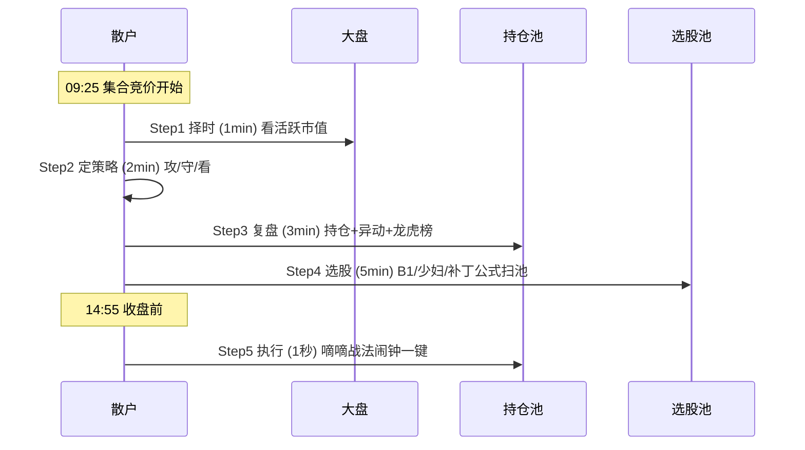
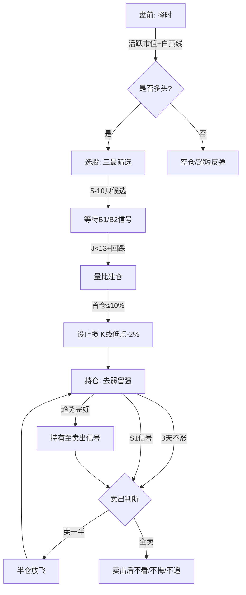

# 每日复盘与交易记录

> [!info] 阅读口径
> 本篇上半部按交易流程综合整理；下半部完整保留归属本篇的原库条目正文，并保留原有数值、例外与冲突。原库表述属于特定方法论；其中收益、胜率、历史案例及市场判断未经本次独立核验。综合编排不是Z哥原话。跨条目冲突统一见 [[19-规则冲突与知识缺口]]。

## 每天先处理旧风险，再找新机会

原库五步工作流是择时、定策略、复盘、选股、执行；“1＋2＋3＋5分钟＋1秒”是压缩过度决策的纪律比喻，不代表必须或能够在固定时间内完成全部研究，也不能把所有风险都等到最后一秒。

## 盘前、盘中、收盘各记录什么

| 阶段 | 固定问题 | 输出 |
|---|---|---|
| 盘前 | 今天的环境允许什么策略，哪些旧仓接近失效 | 攻/守/看，持仓风险与候选条件 |
| 开盘观察 | 池内谁获得价格和资金确认，是否过度高开 | 记录量比时点、开盘幅度，避免池外追逐 |
| 盘中 | 是否触发已定价格或时间条件 | 执行动作与实际成交记录 |
| 尾盘/收盘 | 各策略是否到检查窗口，结构是否保留 | 评分、砖数、BBI、止损滚动和次日分支 |
| 周末 | 什么模式反复成功或失败 | 分类统计与误差复查 |
| 月度/季度 | 大周期、底仓逻辑、组合是否变化 | 长线复核与规则版本审视 |

## 一笔交易的可复制记录

~~~text
日期 / 标的 / 行情数据截至时间：
策略名称与版本：
持仓性质：超短 / 波段动态仓 / 长期底仓
信号周期：周线 / 日线 / 其他

市场环境：
- 活跃市值读数、计算或观察区间、数据源：
- 大盘与个股趋势：
- 哪些条件支持，哪些条件不支持：

入场依据：
- 原有上涨N型与关键K：
- 异动、回调、量能：
- B1/J值，或B2涨幅/J值/成交量等：
- 使用哪个阈值版本：

事前计划：
- 计划仓位及底仓/动态仓分工：
- 价格失效位与依据：
- 时间失效点：
- 何种情况减仓、清仓：
- 放飞后的余仓规则：
- 不能做的动作：

持仓检查：
- 今天收盘与昨收、BBI、巨量阴线、N型、勾，各0或1分：
- 评分总分（五项独立相加）：
- 砖形图状态与砖数：
- 是否S1/破线/触发原止损：
- 现在属于“涨 / 磨 / 跌”的哪种状态：

实际执行：
- 触发时间、决定、成交时间与价格：
- 未成交或偏离计划的情况：
- 采用的规则，没有采用哪条冲突规则及原因：

复盘：
- 结果：盈利 / 亏损 / 无操作
- 执行：合规 / 偏离 / 规则本身不清
- 当时证据是否支持动作：
- 下次需要核验的一个问题：
~~~

该模板是按原库要求综合编排，不是原文表格。它保留数据源与版本字段，用来防止不同周期、不同规则与事后解释混在一起。

## 如何检查一笔交易是否完成闭环

开仓前能说清失效位；持仓中能识别信号是否改变；离场能对应具体规则；事后能区分计划与实际执行。少了任何一环，就还不能只用“赚钱了”证明体系执行完整。

## 周月复盘不只统计盈亏

按策略和周期分别统计交易次数、合规率、平均盈利与平均亏损、实际退出偏差。资金和仓位口径一致时再比较，不把底仓长期收益与超短单笔收益混算。

原库长线手册列出学习阶段和“连续三个月正收益”等检查示例，这不构成方法已经有效的充分证明。本次没有运行实盘或回测，记录模板用于帮助以后核验。

## 原库理论详解

以下按原库概念页保留正文；仅调整标题层级、内部链接和来源展示，不把整理者的结论升级为已验证事实。

### 原库条目：Z家军每日五步工作流

原概念页：/Users/nanan/Documents/ChatGPT/Z哥知识库/references/Z家军每日五步工作流.md  
原页更新时间：2026-04-26。来源路径是追溯线索，本Skill未附这些路径对应的原文。

#### 定义

> [!abstract] 一句话定义
> Z家军每日五步工作流是 Z 哥粉丝群"Z 家军"的日内执行闭环 — **择时 1 分钟 + 定策略 2 分钟 + 复盘 3 分钟 + 选股 5 分钟 + 执行 1 秒**,共约 11 分钟,是 [[01-交易闭环与策略边界#原库条目：知行交易模块|知行交易模块]] 的日常落地版。

#### 关键信息

##### 五步详解

- **Step 1 择时(1 分钟)**:看 [[02-择时过滤与市场环境#原库条目：活跃市值|活跃市值]] 大盘 4% / -2.3% 阀值,判断当日多空环境。
- **Step 2 定策略(2 分钟)**:依据择时结果选当日策略 — 攻 / 守 / 看(空仓观望)。
- **Step 3 复盘(3 分钟)**:看昨日持仓盈亏、今日早盘异动、龙虎榜资金动向。
- **Step 4 选股(5 分钟)**:用 [[06-B1入场与建仓波鉴别#原库条目：B1建仓波|B1建仓波]] / [[10-盘中执行与止损计划#原库条目：少妇战法|少妇战法]] / B1补丁（原库未附独立条目） 通达信公式扫池。
- **Step 5 执行(1 秒)**:[[10-盘中执行与止损计划#原库条目：嘀嘀战法|嘀嘀战法]] 14:55 闹钟一键执行(止损 / 减仓 / 加仓)。

##### 与上层框架的关系

- 与 [[01-交易闭环与策略边界#原库条目：知行交易模块|知行交易模块]] 的关系:五步工作流是知行交易模块的日常落地版,用执行流程封装知识体系。
- 与 [[05-MACD与砖形图共振#原库条目：四块砖交易体系|四块砖交易体系]] 的关系:五步是动作,四块砖是认知框架 — 执行层 vs 体系层。
- 与 [[02-择时过滤与市场环境#原库条目：择时大于选股|择时大于选股]] 的关系:Step 1 优先于 Step 4,正是"择时大于选股"的流程化体现。

##### 时间分配的哲学

> [!tip] 为什么是 11 分钟?
> Z 哥强调"散户最大的敌人是过度交易",五步压缩到 11 分钟是为了**强制决策纪律化**:看盘越久,情绪干扰越大,严格按流程走比"看一天"更高胜率。

##### 五步顺序时序图

#### 关联连接

- [[02-择时过滤与市场环境#原库条目：活跃市值|活跃市值]] — Step 1 择时的核心阀值工具
- [[06-B1入场与建仓波鉴别#原库条目：B1建仓波|B1建仓波]] — Step 4 选股的核心战法
- [[10-盘中执行与止损计划#原库条目：少妇战法|少妇战法]] — Step 4 选股备选战法
- [[10-盘中执行与止损计划#原库条目：嘀嘀战法|嘀嘀战法]] — Step 5 执行的闹钟工具
- [[01-交易闭环与策略边界#原库条目：知行交易模块|知行交易模块]] — 五步是该模块的日常落地版
- [[05-MACD与砖形图共振#原库条目：四块砖交易体系|四块砖交易体系]] — 五步是动作,四块砖是认知框架
- [[02-择时过滤与市场环境#原库条目：择时大于选股|择时大于选股]] — Step 1 优先于 Step 4 的底层逻辑
- [[20-知识来源与理论适用边界#原库条目：Zettaranc|Zettaranc]] — 工作流的提出者

### 原库条目：短线交易操作手册

原概念页：/Users/nanan/Documents/ChatGPT/Z哥知识库/references/短线交易操作手册.md  
原页更新时间：2026-04-19。来源路径是追溯线索，本Skill未附这些路径对应的原文。

原页标注的来源线索

- wiki/zettaranc/sources/摘要-zhihang-精水流深-batch-01.md
- wiki/zettaranc/sources/摘要-zhihang-知行课代表-batch-02.md

#### 研究问题
从开盘到收盘，一个短线交易者（持仓周期1-5天）应该如何按照Zettaranc交易体系完成一次完整的交易闭环？

#### 核心结论

> [!abstract] 五句话概括
> 1. **择时→选股→等信号→买入→持仓→卖出**，六步闭环，步步有标准
> 2. 择时永远大于选股，先看大盘再决定开仓与否
> 3. 只做上涨趋势的N型结构，横盘和下跌趋势绝不参与
> 4. 盈亏比优先于胜率，止损控损2-3%，B1/B2捕空间20%+
> 5. 盘中绝大多数时间是垃圾时间，真正的窗口只在开盘30分钟和关键信号出现时

#### 交易流程图

#### 详细论证

##### 一、盘前准备：判断今日能否开仓

**第一步：看大盘环境（择时）**
- 打开**[[02-择时过滤与市场环境#原库条目：活跃市值|活跃市值]]**指标，判断当前处于多头区间、空头区间还是震荡区间
- 查看大盘**[[04-趋势结构与量价工具#原库条目：白线黄线系统|白线黄线系统]]**：
  - 白线在黄线上方 → 多头趋势，可以积极操作
  - 白线在黄线下方 → 空头趋势，空仓或只做超短反弹
  - 白黄纠缠 → 震荡市，降低仓位、提高选股标准

> [!warning] 开仓纪律
> 只有多头区间或震荡偏多才考虑开仓。空头区间**严格执行空仓纪律**。

**第二步：确定今日主线**
- 参考**[[16-筹码资金与板块轮动解释#原库条目：顺周期轮动|顺周期轮动]]**规律，判断当前市场处于哪个轮动阶段
- 查看前日涨停板块和资金流向，确定**[[03-选股后验证与候选池管理#原库条目：绝对主线|绝对主线]]**
- 只做主线和主题投资，杂毛不碰

##### 二、选股：建立候选池（只选最美）

**第三步：三最筛选**
- **只选最美**：用审视艺术品的眼光挑剔图形，筛选出N型上涨结构完美、筹码锁定良好的标的
- 排除所有以下形态：
  - 长期下跌趋势中的横盘（大爷图陷阱）
  - 跳空建仓形态
  - 高位放量上影线
  - 建仓波位置过高（底部已涨75%+）

> [!tip] 候选池规模
> 5-10只即可，宁缺毋滥。

##### 三、盘中等待：信号不出现绝不开枪

**第四步：等B1或B2信号**
- **B1建仓波信号**：KDJ的J值 < 13，股价回踩关键支撑位
  - 日线B1适合主题票（一波流）
  - 周线B1更适合主线票（中长线）
  - 用**[[06-B1入场与建仓波鉴别#原库条目：两个30%原则|两个30%原则]]**筛选真假B1：涨幅30%左右、累计换手率不超过30%
- **B2突破信号**：B1后的放量突破确认阳线
- **B3买点**：B2后的中继确认，确定性最高但盈亏比最低

> [!danger] 等待纪律
> - 开盘前30分钟是资金博弈最激烈的时段，**观察但不急于操作**
> - 没有B1/B2信号**绝不开仓**
> - 一周**最多两枪**，不要频繁交易

##### 四、买入：精细化建仓

**第五步：确认买入时机**
- B1出现后，第二天开盘使用**[[10-盘中执行与止损计划#原库条目：量比战法|量比战法]]**精细化建仓
- 量比异常放大（资金确认流入）时跟进
- 建仓分批次，首次试仓不超过总资金的10%

**买入即设止损**：
- 止损价 = 买入K线最低价向下1%-3%
- 或前N型结构低点
- 核心：单笔亏损控制在3%以内

##### 五、持仓：去弱留强+半仓放飞

**第六步：持仓管理**
- **3天内必须恢复上涨**：低位不涨必有妖，最多再看1-2天
- **[[12-持股评分与洗盘应对#原库条目：去弱留强|去弱留强]]**：同时持有多个仓位时，只留最强的，弱的果断止损
- **[[13-放飞止盈与破位退出#原库条目：半仓放飞策略|半仓放飞策略]]**：遇到S1信号或不确定图形时，卖一半锁定利润，剩下的一半用白线当牵牛绳

> [!quote] 心态管理
> - 股票不是爱情，不涨就换
> - 好股票不套人，套人的不是好股票
> - 跌了心态不崩（已设止损），涨了不踏空（还有半仓）

##### 六、卖出：果断止盈止损

**卖出触发条件（优先级从高到低）**：
1. **跌穿止损**：直接全卖，别犹豫，这是生命线
2. **[[13-放飞止盈与破位退出#原库条目：S1信号|S1信号]]**：高位放量阶段性顶部预警，卖一半或全卖
3. **[[13-放飞止盈与破位退出#原库条目：DSZ战法|DSZ战法]]**三铁律：
   - 绿砖出现且跌破白线 → 卖
   - 连续两根绿砖 → 卖
   - 放量滞涨 → 卖
4. **连续两日收盘跌破BBI线**（少妇战法离场信号）
5. **[[05-MACD与砖形图共振#原库条目：四块砖交易体系|四块砖交易体系]]**反转信号：红砖/绿砖判断变盘点

> [!danger] 卖出铁律
> - 卖出后**不看、不悔、不追**
> - 止盈卖出后即使继续涨也不后悔（只赚认知范围内的钱）
> - 止损卖出后即使立刻反弹也不追（说明认知外）

##### 七、收盘复盘：记录与迭代

**每日复盘清单**：
- [ ] 今日开仓是否符合择时条件？
- [ ] 选股是否遵循三最原则？
- [ ] B1/B2信号是否标准？
- [ ] 止损是否及时执行？
- [ ] 半仓放飞是否操作正确？
- [ ] 是否有手痒开仓、情绪交易？

#### 八、市场环境应对

##### 震荡市（白黄纠缠）
- **仓位**：降至 3-5 成，提高选股标准
- **策略**：只做最确定的 B1 信号，放弃 B2 追涨
- **节奏**：涨不动就卖，不恋战，快进快出
- **心态**：震荡市赚小钱就是赢，不要幻想单笔暴富

##### 牛市（白线大幅高于黄线）
- **仓位**：可提至 7-8 成，底仓+动态仓并行
- **策略**：用 [[10-盘中执行与止损计划#原库条目：少妇战法|少妇战法]] 六步 SOP，重点做主线票
- **节奏**：牛市持股不动是常态，频繁换手反而错过主升浪
- **陷阱**：牛市末期要警惕情绪狂热时的派发信号（[[13-放飞止盈与破位退出#原库条目：主力出货五种经典方式|主力出货五种经典方式]]）

##### 熊市（白线在黄线下方）
- **仓位**：0-2 成，极轻仓位练手
- **策略**：空仓为主，偶尔做超跌反弹（要求图形极度完美）
- **纪律**：熊市亏损主要来自不甘心空仓

#### 九、资金体适配

| 资金量 | 仓位建议 | 战法选择 | 注意要点 |
|-------|---------|---------|---------|
| 10万以下 | 全仓单票 | 少妇战法、量比战法 | 灵活性是优势，进出自由 |
| 10-50万 | 2-3票分散 | B1建仓+半仓放飞 | 控制单票风险，分散但不杂 |
| 50-100万 | 3-5票 | 开超市模式，去弱留强 | 流动性开始受限，注意冲击成本 |
| 100万以上 | 底仓+动态仓 | 参考长线操作手册 | 建议逐步向长线策略过渡 |

> [!warning] 资金体转换
> 资金量增长后，短线策略的灵活性会下降。100万以上应开始学习并逐步过渡到长线策略。

#### 十、典型陷阱识别

##### 假B1（诱多陷阱）
- 特征：J值确实 < 13，但缩量严重、无主力建仓迹象
- 识别：用 [[06-B1入场与建仓波鉴别#原库条目：两个30%原则|两个30%原则]] 校验——涨幅不在30%左右或换手超30%的，大概率是假B1
- 应对：B1出现后用 [[10-盘中执行与止损计划#原库条目：量比战法|量比战法]] 确认资金意图，量比 < 10 的当天不抱期望

##### 假突破（B2失败）
- 特征：放量突破但次日立即回吐，形成"金叉空"结构
- 识别：突破后缩量滞涨，量价背离
- 应对：止损设在B2阳线中值，跌破即走

##### 大爷图陷阱（长期下跌趋势中的横盘）
- 特征：长期下跌后出现横盘，看似"见底"
- 识别：高点在降低、低点也在降低，横盘只是下跌中继
- 应对：永远只做上涨趋势的N型结构，横盘和下跌趋势绝不参与

##### 诱多/诱空信号
- **金叉空**：金叉次日马上死叉，诱多陷阱
- **死叉多**：死叉次日反包向上，诱空陷阱
- 来源：[[04-趋势结构与量价工具#原库条目：白线黄线系统|白线黄线系统]] 4.7.2 升级版重新定义金叉/死叉为诱导信号

#### 关联连接
- [[10-盘中执行与止损计划#原库条目：少妇战法|少妇战法]] — 短线交易的六步SOP核心框架
- [[06-B1入场与建仓波鉴别#原库条目：B1建仓波|B1建仓波]] — 核心买入信号
- [[13-放飞止盈与破位退出#原库条目：DSZ战法|DSZ战法]] — 卖出三铁律
- [[17-心理防守与概率认知#原库条目：交易心理|交易心理]] — 克服手痒和恐慌
- [[17-心理防守与概率认知#原库条目：不可能三角|不可能三角]] — 高胜率、高盈亏比、高频率不可兼得，短线优先盈亏比
- [[04-趋势结构与量价工具#原库条目：N型结构|N型结构]] — 所有走势的底层判断依据
- [[17-心理防守与概率认知#原库条目：盈亏比与胜率|盈亏比与胜率]] — 短线优先盈亏比的数学基础
