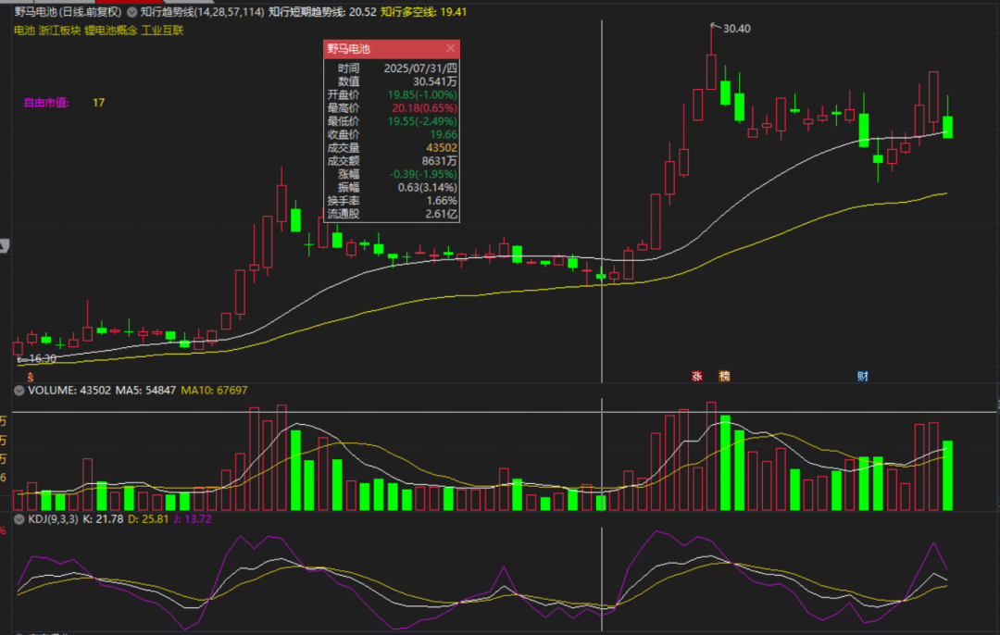

# 规则冲突与知识缺口

> [!info] 阅读口径
> 本篇为跨条目的综合整理，不是Z哥原话；对应原库全文保存在各主题章节的“原库理论详解”中。原库属于特定交易方法论，收益、胜率、案例与市场判断未经本次独立核验。不得用情景表填补原库缺失的规则。

## 为什么必须保留冲突

本Skill是多个时期和整理者的结构化知识库，不是同一版本、所有边界都已形式化的交易规范。具体条目优先有助于理解场景，却不能自动消除正文中的真正矛盾。

本篇分三类：可以按不同场景区分的口径；缺少证据而不能确认如何统一的冲突；知识库没有提供的执行细节。下表中的“整理处理”是本次综合，不冒充Z哥统一裁定。

## 数值、周期与场景的口径差异

| 问题 | 原库口径 | 整理处理 |
|---|---|---|
| B1的J值 | 通用<13；少妇严格<-10 | 分策略标注，J达标也不代表全部条件达标 |
| B1单日形态 | 最强模型-2%到+1.8%、振幅<4%；完美图约±2% | 视为不同筛选模型，不合成新阈值 |
| 建仓涨幅30% | 正文30%左右；图示≤30%；40%偏高、50%以上放弃；另有75%+高位禁区 | 前两者并非完全同义，保留，不把30%当精确统计分界 |
| 累计换手 | ≤30%理想、>40%废B1；30%—40%未完整定义 | 不自行填补中间区间；与持仓期高换手分阶段 |
| B1止损 | K线低点、下3—5价位、低点下1%—3%、N型低点；有3%以内和3%—5% | 买前明确版本与结构位置，百分比不等同成交损失上限 |
| B2成交量 | 比前日增加20%以上；另一页只要求大于前日 | 不能声称唯一标准 |
| B2止损 | 专页此前N型低点；短线手册假突破用B2中值；另有次日阴线低点 | 不在亏损后向更低的版本切换 |
| B3止损 | B3低点或B2中值；“保守/激进”的空间需看实际价格 | 记录具体失效价，不只记名词 |
| 放飞比例 | 中阳分批、两阳减半、第四红砖减半、1/10或1/3 | 按策略、阶段区分，不能全都同时执行或任意选择 |
| 主题和组合仓位 | 主题≤5%；前锋≤20%；其他手册多种底仓比例 | 各自模型，不拼成单一账户标准 |
| 计划一次建仓 | ETF一份仓位B1买足；其他页分批建仓 | 单份计划仓位不等于全账户满仓 |
| 周日线 | 主线偏周B1，主题用日B1；主题防火墙还要周线上涨 | 周趋势过滤不等于必须等周B1 |

## 无法仅凭场景完全消解的冲突

| 冲突 | 冲突双方 | 本次综合的边界 |
|---|---|---|
| B3到底买还是卖 | 买点页：中继确认可参与；三波：冲刺只减不加 | 用单根确认与波段末端分别描述；这是解释路径，原库未完整定义分界 |
| 是否必有B1B2B3 | 买点页：缺一不可；三波：可跳过B2 | 不声明已统一，不补画不存在的B2 |
| SB1止损方向 | SB1只下移；嘀嘀只上移；七层建议放弃SB1 | 完整保留；不把放宽持仓止损列为默认流程 |
| “没涨就走”时限 | 当天/次日；9:33或9:37；B1三天可再1—2天；B2两天减半 | 超短、普通B1、B2和波段分别预设，不随行情延长 |
| DSZ三铁律 | 专页第四砖、尾盘翻绿、9:37；综合手册绿砖破白线、两绿、滞涨 | 专页和综合手册并列，不把手册转述当同一原文 |
| 红翻绿是否必卖 | 砖形/DSZ立即卖；黄金定式允许一绿很快翻红 | 需选择系统版本，不能把宽规则临时挪来 |
| 4+4是否允许 | DSZ不做4+4；砖形页承认延续 | 作为不同执行选择，不视为预测保证 |
| 黄线破位可等多久 | 跌破立即走；允许忍一根，第二根收不回走 | 先有策略边界；周线空头和已破硬止损不因忍耐豁免 |
| S1定义与动作 | 高位巨量不分阴阳、先减半或全退；共振页放量阴线直接走 | 保留信号范围与动作强度差异，风险不能被其他买点覆盖 |
| 假阴真阳 | 持股补丁收盘抬高可持；逃顶页废除概念、量价优先 | 记录高低位置与成交量，不能仅以颜色或昨收差定安全 |
| MACD顶背离 | 体系页解释衰竭减仓；三用法后段又解释建仓结束锁筹 | 不把顶背离当单独且唯一交易按钮 |
| MACD优先级 | MACD一票否决；持股补丁又说趋势后忘掉MACD只看收盘 | 可按筛选与持仓阶段理解，但原库未给完整切换协议 |
| 四分之三阴量 | 1/2—3/4假突破；另处接近或≥3/4；<1/2洗盘 | 中间和边界不齐，不虚构分类；不接受“90%+”为核验结论 |
| 缩量下跌意义 | 长阴短柱主力未跑；另说下跌不看量、缩量可能没人买 | 缩量只能是线索，不能豁免破位 |
| 暴力K能否当天追 | 总纪律不追当天；小暴力允许追 | 底部与延续分别理解，原库未完全统一，保留差异 |
| 倍量比较基准 | 前日2倍；暴力K写前期均量2倍 | 不互换分母，计划注明采用基准 |
| 白黄上下关系 | 主体为白上黄；DSZ页写黄线在白线上；有序页有黄上白下 | 存在方向冲突，不据孤立句子反转整个规则 |
| 白线究竟是什么 | BBI/短趋势；指数大盘股；MACD的DIF；资金副图散户线 | 必须注明图表和公式，不混成一个变量 |
| “BBI黄线” | 指数贡献页如此写，双线页BBI为白线 | 属术语不一致，不自行换颜色或代入指标 |
| 熊市怎么做 | 主流程空仓；部分页0—2成、0—50%；开超市及ETF页又说集中重仓个股 | 无统一答案；空头旁支不包装成防守主流程 |
| 小资金能否单吊 | 短线手册10万以下全仓单票；转折点页永不满仓单票 | 不替用户选择，作为实质风险冲突保留 |
| 资金身份 | 百岁山实体为洋务派，五类资金页对应社保；麒麟会长期主力又对应公募 | 当作比喻叙事，不据此辨认真实机构 |
| 不可能三角的策略配对 | 正文强调四块砖赔率、超短频率；图示又给趋势高频等 | 概念可理解为取舍，配对未形成统一规范 |

<!-- web-images-2026-10-20-图文阈值冲突-start -->
## 对应形态的历史图例

> [!note] 网络图例的阅读范围
> 以下图片来自[笔记在线：《Z哥_需要反复背诵的十张完美图形》](https://www.noteol.com/xuexi/ZG_wanmeituxing.html)，页面署名“管理员”，属于二级学习整理；截图的原始制作者未独立核实。图片按原文件本地保存，下载日期为2026-10-20。图中带有后续走势，只用于辨认结构；不据事后上涨确认信号必胜，也不以图文中的宽松口径覆盖本笔记规则。

### 图例被称作买点，不等于通过严格阈值：野马电池

图中KDJ栏显示J=13.72；来源把它放在变量型案例中，而本地通用B1写J<13。此图保留作口径差异证据，不把13.72改成达标，也不据此修改正文阈值。

[查看原图](https://s21.ax1x.com/2025/10/15/pVqYXt0.png)。

<!-- web-images-2026-10-20-图文阈值冲突-end -->

## 明确不应转成执行条件的表述

MACD共振页出现“股价回调到DIF/DEA线”。DIF、DEA是动量副图数值，不能与股价坐标直接对应；原页没有给转换公式。原文照录保留，但不能据此计算买卖价。

“1990到2026共33年”存在年份差异；2.93亿至17.4万亿约5.94万倍，如何变成17万倍没有可复现推导。类似“一月一百点”、1:99、AI控盘、2026—2027剧本属于历史叙述或假设，不是当前已核实事实。

“天量次日必然无人接盘”“缩量无法造假”“ETF破位很少骗线”“永不套牢”“只输一根K线”均是原库强表述，不是本次验证的市场定律、可成交损失上限或结果保证。

## 当前知识库没有覆盖的内容

| 缺口 | 对理解或执行的影响 |
|---|---|
| 活跃市值完整公式、稳定数据源、窗口与边界值 | 不能只用两个百分比自制同名指标并声称等价 |
| 黄线/知行趋势线完整公式，资金副图完整代码 | 不能任取均线、散户指标替代 |
| 砖形图构造算法、4和6各自含义 | 不能把一块砖直接当一天，无法复现参数回测 |
| 所有战法统一的入场成交与同日可卖约束 | 理论触发与可成交之间有缺口 |
| 跳空、停牌、价格限制、无流动性时的完整协议 | 预设止损不保证按指定价格退出 |
| 费用、滑点、资金容量、相关性及账户回撤预算 | 原库收益和仓位表不能直接验证账户风险 |
| 多信号冲突的完整优先级和状态切换条件 | 只能保留已明确部分，不能补成唯一算法 |
| 财务恶化、估值过热和长期逻辑破坏的统一量化阈值 | 长线还需额外研究，不能用“核心资产”名号替代 |
| 样本定义、样本外测试、成本后的绩效与原始数据 | 不能确认40%、70%+、90%+等胜率和年化目标 |
| 仅被引用的B1补丁、黑话词典等独立全文 | 本次不创建假页面，也不补写成Z哥原话 |

## 怎样使用一套有冲突的知识体系

基于“防守优先、先定义后执行”的原则推断：一笔计划一次选择一个主策略、一个信号周期、一个阈值版本和一套退出规则；其他条目提供检查线索，不自动修改原计划。无法确定的关键冲突保留为待核验，不用更宽松的说法填补。
