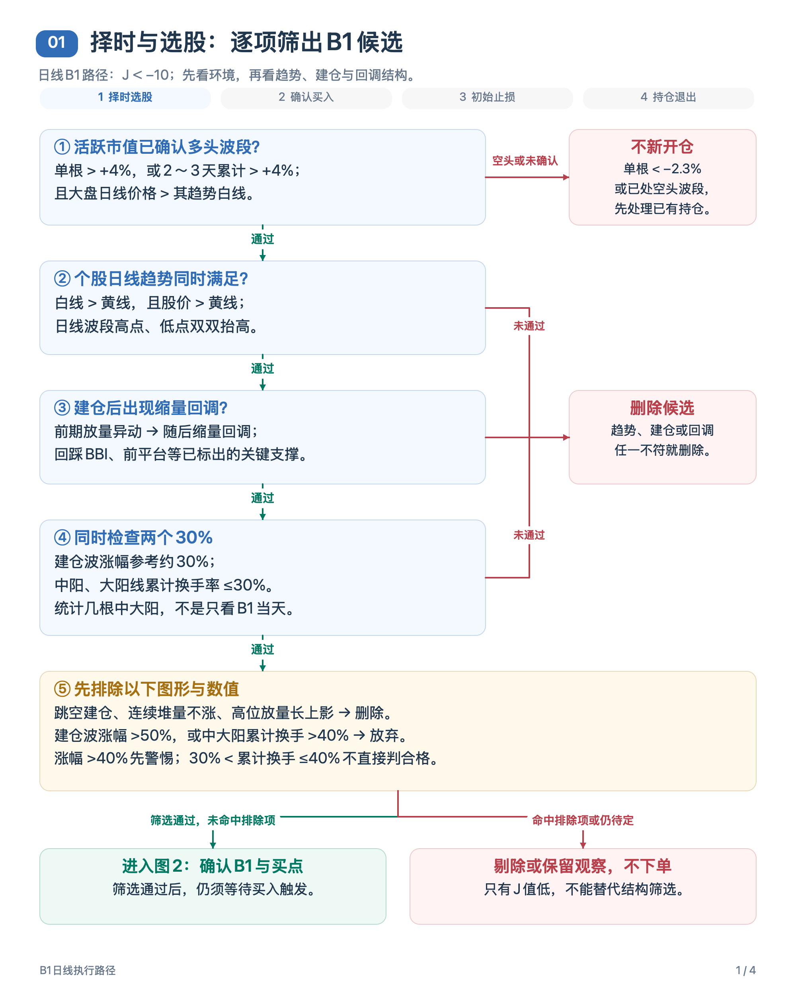
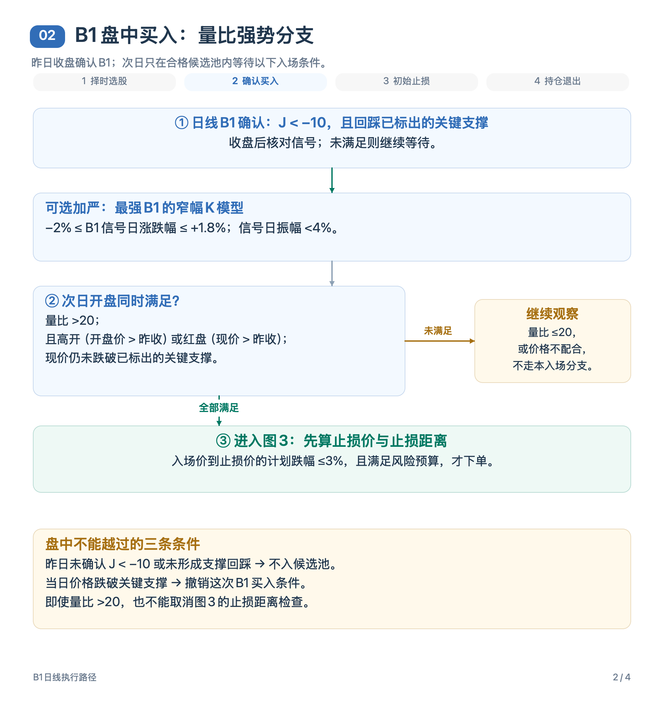
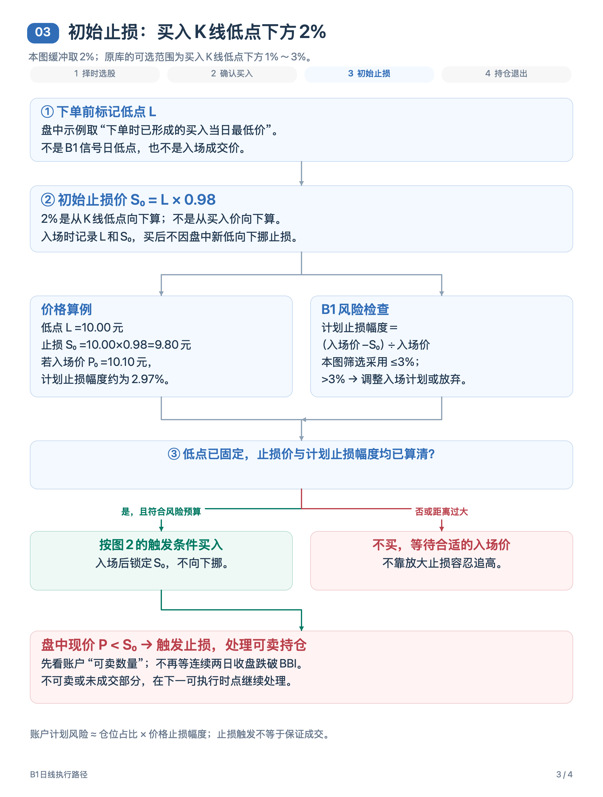
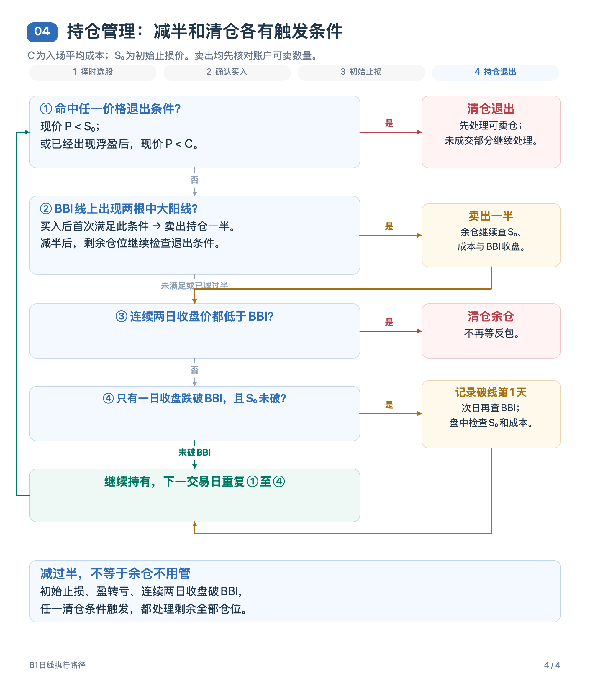
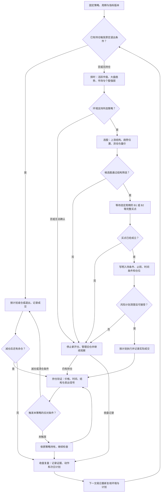
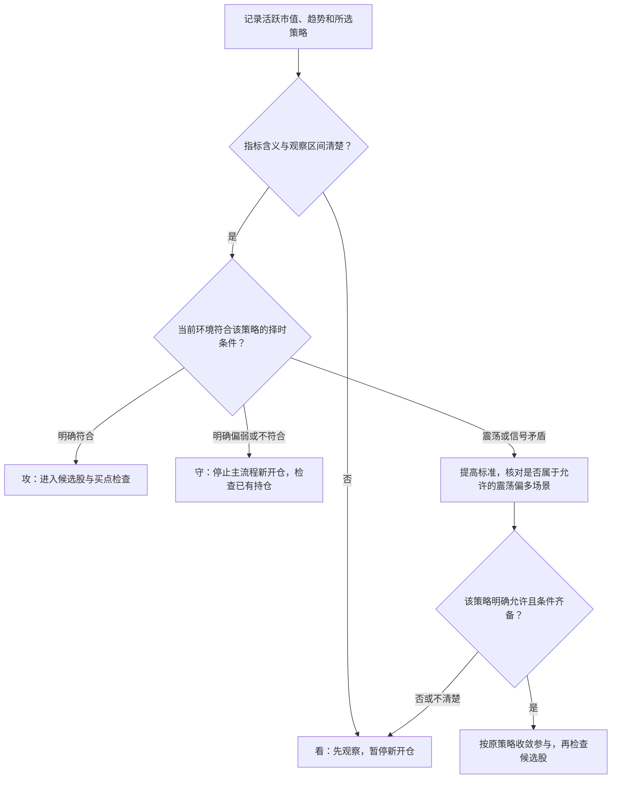
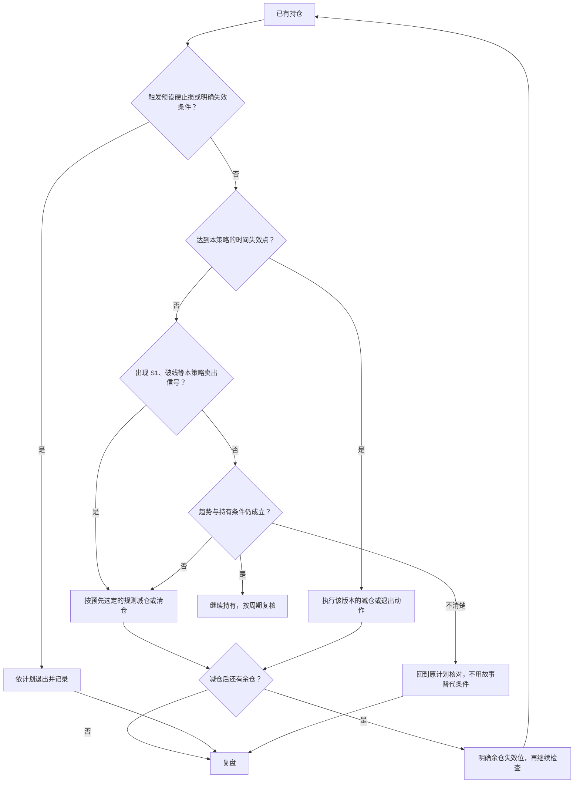

# 择时选股与持仓退出操作手册

使用顺序是：**先确定策略与周期，处理已有持仓风险，再检查择时、候选股、买点和风险计划；入场后持续验证，退出后复盘。**任何一步不满足，都可以停止新增交易。

本手册以常规顺势 B1、B2 交易为主流程，同时列出超短线、主升浪持股和长期底仓的使用边界。流程图与检查表属于对知识库规则的综合编排；文中的数值注明其对应战法，未明确的定义和相互冲突的规则保留为待核验项。通过筛选不等于确认主力行为，也不代表收益或胜率已被验证。

## 条件流程图速查

### B1 日线执行示例

这组图沿着“择时与个股筛选→日线B1确认→次日量比强势分支→初始止损→持仓减半与退出”给出具体触发条件。信号采用少妇B1的 `J < −10`；通用B1的 `J < 13` 不混入同一判断框。

| 环节 | 图中采用的具体条件 |
|---|---|
| 择时 | 已确认活跃市值多头波段，单根或两三天累计超过4%的相应口径；本图同时要求大盘日线价格在趋势白线上 |
| 候选股 | 日线上涨N型；白线在黄线上且价格在黄线上；前期异动放量后缩量回踩关键支撑 |
| B1信号 | 收盘核对 `J < −10` 与支撑回踩；最强B1模型的涨跌幅−2%至+1.8%、振幅小于4%作为可选加严 |
| 量价初筛 | 建仓波涨幅参考约30%；中大阳累计换手不超过30%；明确排除项与待定区间见图1 |
| 盘中买入 | 本组只选“量比>20，且高开或红盘，支撑仍有效”的强势分支；风险检查通过才下单 |
| 初始止损 | 本次示例固定 `S₀ = L × 0.98`，L为下单时已形成的买入当日低点；入场后不向下挪 |
| 价格风险 | 计划止损幅度＝（入场价−S₀）÷入场价；本图筛选采用不超过3%，并另核对账户风险预算 |
| 减仓 | 买入后首次在BBI线上出现两根中大阳，减半一次 |
| 清仓 | 价格跌破S₀、已浮盈后跌回入场成本以下，或连续两日收盘低于BBI；均先核对可卖数量 |

### 图解参数与补充约定

原库《少妇战法》的止损范围是买入K线低点下方1%至3%。这里按本次讨论中的例子，固定取2%演示；低点10元对应止损9.80元，并非从入场成交价减2%。《B1建仓波》另有3%以内的价格风险口径，本组将其作为入场距离筛选。

为了让图中的触发可以核对，本次补充约定了：多头信号与大盘白线上方同时检查；盘中低点L在入场时冻结，不因随后新低而下移；双阳减半只在首次满足时执行一次。这些是图解的具体化选择，原库没有给出完整、统一的盘中低点冻结和减仓重置协议，不将其表述为Z哥统一原话。低点L不是前一日B1信号K线的低点，次日买入时两者可能不同。

量比的10至20分时确认分支、嘀嘀前低滚动止损、DSZ时间规则和五分制持仓，属于另外的执行安排，本组不自动叠入。通用B1的三天时间检查仍保留在正文，未自动叠入本组BBI持仓流程；其中“未大跌”和“中大阳”没有统一百分比，保留原有形态条件，不另造数字。

价格触发与实际成交分开记录：先核对账户可卖数量；不可卖或未成交部分在下一可执行时点继续处理，不能把图中的止损价理解为保证退出价。

原库依据：[[02-择时过滤与市场环境]]、[[06-B1入场与建仓波鉴别]]、[[10-盘中执行与止损计划]]、[[13-放飞止盈与破位退出]]。原先的四张概览图片保留在附件目录，正文改用本组B1执行图。

## 一 开始前先固定交易身份

同一笔交易先写清以下六项，再使用后面的流程。

| 必须固定的项目 | 要写清什么 | 最容易混用的地方 |
|---|---|---|
| 策略身份 | 超短转折、顺势波段，还是长期底仓；具体战法及版本 | 超短没按预期涨，就临时改叫长期投资 |
| 分析对象 | 市场指数、板块、个股分别看什么 | 用指数强势替代个股强势 |
| 信号周期 | 周线定方向、日线找买点，或选定的其他周期 | 用日线 B1 掩盖周线下跌 |
| 指标身份 | 软件、指标名称、参数及版本 | 把指数分时白黄线、BBI、知行趋势线当成同一指标 |
| 触发方式 | 盘中触价执行，还是收盘确认；检查窗口是什么 | 盘中止损触发后临时改为等收盘 |
| 应对计划 | 买入失效价、时间失效点、减仓条件、清仓条件及余仓管理 | 看到亏损后才找更宽松的规则 |

**本手册的保守编排选择**：空头或关键条件不清楚时，停止主流程的新开仓；已有持仓按其原计划管理。原库另有空头轻仓 B1、反弹等旁支，不默认纳入这一主流程。这是为了保持规则一致，不代表原库已经统一了空头交易权限。

## 二 完整交易流程图

流程中的“继续”只表示进入下一项检查。择时绿灯、一个低 J 值、一根放量阳线，都不能单独替代完整交易条件。应对条件可以在任何持仓阶段触发，不能为了等完整流程走完而推迟退出。

依据：[[01-交易闭环与策略边界]]、[[18-每日复盘与交易记录]]。

## 三 择时需要看什么

### 先核对图表和数据

| 查看项目 | 具体检查方法 | 要形成的结论 |
|---|---|---|
| 活跃市值 | 记录数据来源、指标版本、当前柱体、观察日期和波段范围；同时查看单根变化与近几根变化 | 资金环境是否支持所选策略，还是不清楚 |
| 大盘趋势 | 在已确认的趋势指标上看价格与白线、黄线的位置，以及趋势是否反复纠缠 | 大方向偏强、偏弱或不明 |
| 板块与个股强弱 | 看候选标的是否仍保留上涨结构，是否与市场环境协调 | 大盘允许时，个股是否也合格 |
| 已有持仓风险 | 查是否接近原定止损、时间失效点、S1 或趋势破坏位置 | 先处理什么风险，今天是否还有新增交易条件 |

白黄线必须注明对象和指标：**指数分时的大盘股与中小盘股曲线，不等于个股的 BBI 与知行趋势线。**原库部分页面存在混写，不能只凭颜色套用买卖规则。黄线的完整公式在当前材料中没有统一给出，也不能任取一根均线替代。

### 活跃市值两个阈值怎样使用

| 原库口径 | 允许得出的判断 | 不能直接推出的结论 |
|---|---|---|
| 多头阈值约为 `+4%`；《交易松紧手》写单根红柱超过 4%，或两三天累计涨幅超过 4% | 在相应口径下支持“手松”的环境判断，继续检查个股和买点 | 所有股票都能买；必须满仓；每天都必须涨 4% |
| 空头阈值约为 `−2.3%`；同页写单根跌幅超过 2.3%，或连续下跌进入该区间 | 支持收紧和防守；本手册主流程暂停新开仓 | 未达到 −2.3% 就不需要处理个股止损 |
| 两个阈值之间，或活跃市值与趋势信号不一致 | 结合此前波段、趋势及所选战法继续确认；无法确认就观察 | 整个中间区间都必然是震荡，或自动允许某个固定仓位 |

当前材料未给出完整的累计起点、累计算法、多空状态持续时间和解除条件；恰好等于阈值的边界口径也有差异。因此，不能只凭这两个数字自制一个等价的择时指标。它们也不能用上证指数涨跌幅、成交额增幅或资金净流入比例直接代替。

### 择时之后怎样选“攻 守 看”

“攻”表示可以继续筛选，“守”表示优先管理风险，“看”表示等待证据。震荡市提高标准、降低参与力度，不能据此虚构一套统一的仓位比例。

主题交易有更明确的专用过滤：**多头择时成立，同时周线价格在白线上方、走出上涨 N 型、均线多头排列，再等日 B1 与辅助结构。**该条目另列预期盈亏比不低于 `3:1`；这是主题交易语境，不自动推广成全部战法的统一门槛。

依据：[[02-择时过滤与市场环境]]、[[03-选股后验证与候选池管理]]、[[19-规则冲突与知识缺口]]。

## 四 选股阶段如何建立候选池

先按图形和结构建池，再在池内比较盘中强弱。原库“三最原则”分别对应：买前只选最美、盘中只买最强、持仓只拿最硬。

| 检查项 | 应观察什么 | 不通过时怎样处理 |
|---|---|---|
| 大周期方向 | 对应周期的波段高点和低点是否双双抬高 | 下跌结构不作为本顺势主流程的抄底对象 |
| 趋势位置 | 在已核对的个股趋势指标中，检查白线在黄线上、股价在黄线上；金叉仅提供确认线索，仍需买点 | 弱势或指标含义不明，留在观察状态 |
| 建仓痕迹 | 前面是否有异动放量、关键位置和有意义的价格反应 | 只有低 J 值、没有结构证据，不能确认 B1 |
| 回调质量 | 异动之后是否回调缩量、关键支撑和结构低点是否保留 | 不能把所有缩量下跌都解释为洗盘 |
| 所处位置 | 是否已从低位上涨过多，是否出现高位巨量、长上影或滞涨 | 先排除高位风险，再讨论买点 |
| 失效位置 | 能否标出前 N 型低点、关键 K 低点或所用战法的止损位 | 说不清哪里算错，就不进入下单阶段 |

这里的“上涨结构”指所选方向周期的结构；局部回调和整理不等于所有周期都在下跌。也不能因为局部出现一根阳线，就把更大周期的下跌改称上涨。

每只候选股至少标出：**信号周期、前高、结构低点、关键 K、趋势线、预期买点和失效位置。**未出现买点可以一直观察，无须每天都凑出一笔交易。

依据：[[03-选股后验证与候选池管理]]、[[04-趋势结构与量价工具]]、[[06-B1入场与建仓波鉴别]]。

## 五 买点阶段分别检查 B1 和 B2

### B1 需要同时核对位置 结构 指标和量价

| 项目 | 知识库规则或检查内容 | 使用时的注意点 |
|---|---|---|
| 阶段位置 | 在所选周期寻找回调后的阶段性低点与关键支撑 | B1 不等于绝对底，也不等于每次 J 值低都可以买 |
| J 值 | 通用 B1 页采用 `J < 13` | 必须写明周期；少妇战法严格版本要求 `J < −10`，两者不要临时切换 |
| 建仓波涨幅 | 一般参考 `30%左右`；超过 40%偏大，超过 50%按该规则放弃 | “约30%”没有精确上下界，不能改成必须恰好30%，也不能把略超30%直接判假 |
| 累计换手率 | 建仓波中几根中阳线、大阳线累计不超过 30%；超过 40%视为废 B1 | 看几根相加，不是只看 B1 当天，也不是把区间内所有 K 线一律相加；30%至40%无统一判定 |
| 量价配合 | 检查前期异动、随后缩量回调、支撑和趋势是否保留 | 两个30%只是筛选，不能证明筹码都被主力收集 |
| 失效位置 | 对照所用版本的买入 K 线低点、关键支撑或前 N 型低点 | 用结构先找失效依据，再核对损失是否可接受 |

例如一段上涨从 10 元到 13 元，涨幅是 30%；其中三根中大阳线的换手分别为 8%、10%、9%，累计为 27%。这个算例只解释数字，不代表该图已经符合完整 B1。

原库没有完整统一建仓波起止点、价格取值方式及“中阳/大阳”的机械划分。实操记录应把所用区间和 K 线标在图上，避免为了达标临时更换统计范围。

### B2 看 B1 之后的确认

| 检查项 | 原库列出的条件 |
|---|---|
| 前置结构 | 必须接在 B1 后面，并检查 J 值拐头；一根孤立长阳不能直接叫 B2 |
| 阳线力度 | 涨幅 `≥4%` |
| 成交量 | 比前一日放量；《B2突破》写比前一天多20%以上，《B2战法》写今日量大于昨日量即可，二者未完全统一 |
| 指标位置 | `J < 55` |
| K 线质量 | 无长上影更好；原页将其列入筛选，但表述是优选条件，没有给统一上影长度阈值 |
| 失效位 | B2 专页主要采用之前 N 型结构低点；不是默认采用 B2 阳线最低点 |

两个 B2 页共同给出的时间规则是：买入当天算第一个交易日，两天都没涨先减半，第三天仍不涨清仓；跌穿 N 型低点则直接退出。该规则里的“大幅拉升”没有统一量化幅度，不能另加一个百分比。

### B3 和其他战法怎样接入

B3 是 B2 后的中继确认；原库给出 B3 最低点或 B2 阳线中值等不同止损选择，且存在中继参与和后期减仓的语境差异。它不等于“没赶上 B1、B2 就自动补买”，进入前仍需重新核对位置、成本和退出条件。

单针、砖形图、补票等属于另有前提和退出协议的模式。完整流程仍可复用，但要把“买点检查”和“持仓规则”替换为对应战法，不能把所有战法的宽松条件合并使用。

依据：[[06-B1入场与建仓波鉴别]]、[[07-B2与B3确认及假突破应对]]、[[08-特殊买点与止损后重新入场]]。

## 六 下单前写清风险和执行条件

至少写下六项：**入场触发、价格失效位、时间失效点、计划仓位、减仓条件、余仓退出条件。**如果关键规则还说不清，保留候选，继续观察。

### 止损必须跟所用战法对应

| 适用情境 | 原库出现的失效依据 | 不能怎样套用 |
|---|---|---|
| 常规 B1 | 买入 K 线低点向下3至5个价位，或前 N 型低点；另有幅度控制在3%以内的表述 | “3至5个价位”不是“3%至5%” |
| 少妇战法版本 | 买入 K 线最低价向下1%至3%；连续两日收盘跌破 BBI 的离场规则 | 不能等连续两日破 BBI 才处理已经触发的预设硬止损 |
| B2 | 前 N 型结构低点，专页说明距离可能约5% | 不能强套成与 B1 相同的固定止损幅度 |
| B3 | B3 低点或 B2 阳线中值等版本 | 下单前选清所用规则，不在亏损后换成更远的一条 |

原库不同位置、不同止损方案未形成统一公式。先找出本次判断失效的依据；如果所需距离不适合计划，就调整计划或放弃，而不是移动结构低点让它“合格”。

**整理补充的风险算术**：价格止损幅度约为“计划入场价与止损价之差 ÷ 计划入场价”；在不计费用、滑点和跳空等因素时，账户计划风险约为“仓位占比 × 价格止损幅度”。因此，股价止损3%与整个账户亏损3%并不是同一个概念。预设止损价也不保证实际能按该价格成交。

若所选策略要求检查预期盈亏比，应先给出预期退出区间的依据，再用“预期收益空间 ÷ 计划止损空间”估算。预期空间只是计划假设，不能为了达到3:1而临时虚设一个更远目标。

### 量比只用于已通过筛选的候选池

原库强调先有合格图形，再看盘中量比与价格表现。若采用《量比战法》，要记录观察时点、量比和高低开情况：

| 开盘观察 | 原库描述的使用思路 |
|---|---|
| 量比小于10 | 等待回调或继续观察，不因期待强行追入 |
| 量比10至20 | 稳一手，观察均线附近或分时确认 |
| 量比超过20且高开或红盘 | 作为池内相对强势的辅助线索 |

原页还列有“量比超过10、低开幅度小于2%”等分支，与上述区间存在重叠，未形成互斥的完整决策表；恰好等于10或20的端点也未统一。不能把量比大单独当买点，或从全市场量比榜直接追入。盘中读数和完整日线成交量也不要直接混用。

依据：[[10-盘中执行与止损计划]]、[[11-仓位分工与组合轮动]]、[[19-规则冲突与知识缺口]]。

## 七 入场后怎样持仓 减仓和退出

### 先查风险触发 再解释涨跌

上图是便于使用的风险检查顺序。原库《七层应对》把“没涨就走、盈转亏必走”列为高优先级；这不意味着已经触发硬止损时还要等待时间条件，也不意味着必须等所有风险信号依次出现。

| 持仓情况 | 应检查什么 | 对应处理边界 |
|---|---|---|
| 买后不涨 | 本次是超短转折、B1、B2，还是已进入主升浪的趋势持股 | 按对应时间规则处理，不把所有策略统一成次日或第三天卖 |
| 出现浮盈后回落 | 是否触发计划中的成本保护与退出条件 | 《交易闭环》《七层应对》强调盈转亏必须走；量比页另有回到成本砍掉或减半的口径 |
| 正常回调 | 结构、关键支撑、BBI及原止损是否保留，是否属于允许容忍的阶段 | 缩量只能提供线索，不能覆盖已发生的失效 |
| 高位放巨量或滞涨 | 是否符合 S1，放量出现于什么位置，是否伴随趋势破坏 | S1是风险预警；减半、等白线或直接清仓在不同页并存，事前确定版本 |
| 跌破白线或黄线 | 核对对象、周期、盘中还是收盘确认，以及既定退出方式 | 不能把“忍一根”当成所有破位均可延迟执行 |
| 市场转弱 | 对照原策略复查个股与仓位风险 | 新增交易暂停；旧仓按其失效条件处理，不能只等市场恢复 |

### 不同策略的持有时钟

| 模式 | 原库具体口径 | 使用范围 |
|---|---|---|
| DSZ超短 | 买后不涨次日9:37前清仓；数完四块红砖至少减半；收盘前三分钟红翻绿走 | 仅在已选择该超短模式并能辨认砖形图时使用 |
| 通用B1 | 三天内恢复上涨；三天不涨但未大跌，最多再观察1至2天，不行就减仓 | 与“没涨立即走”存在强度差异，不能临场择宽 |
| B2 | 买入当天计第一天；两天都没涨先减半，第三天不涨清仓 | 同时保留结构低点的价格失效条件 |
| 主升浪持股 | 允许正常波动，使用趋势与对应持股版本检查 | 不能用该补丁救济不合格的超短买点 |
| 长期底仓 | 回到长期逻辑、大周期趋势和底仓退出边界 | 不能因短线亏损临时改名底仓 |

DSZ专页的三铁律，与《短线交易操作手册》中被称作“DSZ三铁律”的列表不同；这里保留专页口径，未将两者合并。

### 五分制只作为对应主升浪持股版本的工具

按《少妇战法1.3每日持股检查手册》，五项独立各计0或1分，最后相加：

| 项目 | 得1分的原页条件 |
|---|---|
| 收盘价 | 今天收盘高于昨天 |
| BBI | 股价在BBI上方 |
| 巨量阴线 | 缩量调整或阳量，没有巨量阴线 |
| 趋势 | 上涨N型，高点突破、低点抬高 |
| 勾 | 原页描述为金叉或张口向上；需以实际使用的指标定义核对 |

原页动作是4至5分持有，3分可以减半且反对直接全卖，2分及以下退出。**该评分不替代预设止损。**其“勾是否死叉”未给出完整机械判据，“巨量”也未统一量化，不能自行补成可回测公式。五项要全部检查，不能第一项不满足就停止计分。

### 放飞后余仓也要有规则

《半仓放飞策略》给出“先卖一半，余仓用白线管理”的版本；《七层应对》对S1采取更强的退出动作。《交易闭环》还列出加速放飞、滞涨减仓、破白线、破黄线与死叉等机会。这些是可能触发的应对条件，不要求一笔交易逐个走完。

若预定动作是减仓，应同时写明余仓以哪条线、哪个结构位、什么确认方式退出；减过仓不代表剩余风险消失。

依据：[[10-盘中执行与止损计划]]、[[12-持股评分与洗盘应对]]、[[13-放飞止盈与破位退出]]、[[14-选股后各阶段的情景应对]]、[[15-长线底仓与牛市ETF管理]]。

## 八 每天怎样按手册使用

| 时段 | 固定动作 | 完成后应留下什么 |
|---|---|---|
| 盘前 | 更新市场环境，复核旧仓风险，确定今天攻、守或看 | 环境证据、需处理的旧仓、允许使用的策略 |
| 开盘观察 | 只在合格候选池内比较价格、量比与强弱 | 符合预设条件的候选；未触发的继续观察 |
| 盘中 | 检查价格与时间触发；执行预设动作 | 触发时间、动作、实际成交或未成交原因 |
| 尾盘与收盘 | 在所用战法的窗口核对趋势、评分、砖形和余仓 | 今日持仓状态、次日失效条件 |
| 收盘复盘 | 对照原计划检查是否合规，区分规则问题与执行偏差 | 完整记录及需要继续核验的问题 |

原库五步工作流中的“约11分钟”和“执行1秒”用于强调简化决策，不应理解为所有研究都能在固定时间做完，也不应把盘中已触发的风险统一拖到14:55处理。没有合格机会时，完成观察、记录与复盘就是当天流程的完成。

复盘时分别记录“结果”和“执行”：合规交易也可能亏损，违规交易也可能暂时盈利。一次结果不足以确认或否定一套方法。

## 九 一笔交易的记录模板

以下字段是整理后的执行记录格式，可复制到每日记录中。

### 基本信息

- 日期、标的、行情截至时间：
- 策略名称及版本：
- 持仓性质：超短／波段动态仓／长期底仓
- 方向周期与买点周期：
- 软件、指标名称、参数与确认方式：

### 择时与候选证据

- 活跃市值读数、数据源、观察区间及所用口径：
- 大盘趋势、个股趋势及两者是否协调：
- 候选股上涨结构、关键K与失效位置：
- B1或B2的具体条件与截图：
- 两个30%的统计区间和结果（如适用）：
- 仍不清楚或存在冲突的条件：

### 下单前计划

- 允许入场的触发条件：
- 计划仓位及风险计算：
- 预期空间的依据与盈亏比（该策略要求时）：
- 价格失效位与依据：
- 时间失效点及对应动作：
- 盈利后保护、放飞与余仓退出条件：
- 哪些变化要求暂停新开仓：

### 持仓与复盘

- 今天属于上涨／整理／转弱哪一类，证据是什么：
- 是否触发止损、时间条件、S1或破线：
- 五分制各项及总分（仅在适用时填写）：
- 计划动作与实际动作、成交时间和价格：
- 若偏离计划，偏离在哪里：
- 明天继续持有与退出分别需要什么条件：

## 十 使用时需要保留的规则差异

| 问题 | 当前材料的差异或缺口 | 对使用的影响 |
|---|---|---|
| 活跃市值怎样计算和切换状态 | 单根、累计与波段口径并存，状态解除与端点规则未完整定义 | 先核对实际指标，不能用两个数字拼成唯一算法 |
| 空头能否交易 | 只卖不买、极轻仓练手、只做B1及0至50%等口径并存 | 本手册主流程暂停新开仓，旁支需另定策略 |
| 白黄线是什么 | 指数大小盘曲线、个股BBI和趋势线存在混写，部分页还有方向相反的表述 | 每次注明对象、周期和指标，不能只看颜色 |
| B1的J阈值 | 通用小于13；少妇战法严格版小于−10 | 下单前选择所用版本 |
| 两个30%怎样精确统计 | 波段划分、阳线界定及部分边界未完整统一 | 标图并保留未明确区间，不能用结果反推统计范围 |
| B2放量与止损 | 放量“超过前日”与“多20%以上”并存；专页N型低点与综合手册阳线中值存在差异 | 记录采用的来源版本及失效依据 |
| 不涨多久走 | 立即处理、次日9:37、B1三天、B2两天及趋势持有并存 | 按模式使用，不临时改持有时钟 |
| S1怎样退出 | 减半、等白线与直接清仓并存 | 事前明确动作及余仓规则 |
| 黄线破位是否等一根 | 跌破即走、收不回走、第二根仍在下方清仓并存 | 不把“忍一根”当作硬止损豁免 |
| 评分与防守哪个优先 | 持股补丁强调容忍波动，防守页强调主动退出 | 保留已设失效条件，不能用高分覆盖止损 |
| 仓位用多少 | 不同策略和资金语境的比例互不统一，缺少统一账户风险预算 | 不从原页任选一个比例当通用答案 |

这些差异意味着本手册可用于按步骤检查和学习，但材料尚不足以还原一个无歧义、可全自动运行的交易系统。需继续核验的项目包括指标公式、状态切换、信号边界、成交约束与成本后的统计效果。

## 十一 来源与追溯

本页核对了本地结构化概念页，并沿用既有笔记的分类。以下链接对应本手册各模块的原库正文与既有整理；本页未覆盖或改写这些原始条目。

| 本手册模块 | 既有笔记与包含的主要概念 |
|---|---|
| 总流程与策略身份 | [[01-交易闭环与策略边界]]：知行交易模块、交易闭环、框架式交易 |
| 择时与策略选择 | [[02-择时过滤与市场环境]]：活跃市值、交易松紧手、择时大于选股、主题交易三层防火墙 |
| 候选筛选与基础工具 | [[03-选股后验证与候选池管理]]、[[04-趋势结构与量价工具]]：三最、N型、关键K、知行趋势线、量价关系 |
| B1与两个30% | [[06-B1入场与建仓波鉴别]]：B1建仓波、两个30%原则 |
| B2与B3 | [[07-B2与B3确认及假突破应对]]：B2突破、B2战法、B3买点 |
| 买入与价格时间条件 | [[10-盘中执行与止损计划]]：量比、嘀嘀等执行规则 |
| 仓位与持股 | [[11-仓位分工与组合轮动]]、[[12-持股评分与洗盘应对]]：底仓与动态仓、五分制、少妇1.3 |
| 减仓与退出 | [[13-放飞止盈与破位退出]]：七层应对、S1、半仓放飞、DSZ |
| 每日记录与差异 | [[18-每日复盘与交易记录]]、[[19-规则冲突与知识缺口]] |

直接核对的概念页位于 `/Users/nanan/.codex/skills/zettaranc-knowledge/references/`。这些页面属于结构化整理，页内列出的原始文章路径是追溯线索；未据此声称已经逐篇核验原文或验证交易效果。
